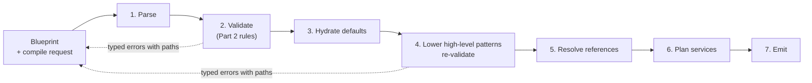

# 2. Compiler pipeline

A conforming compiler takes every valid blueprint inside its profile (plus a compile
request) to a running system, and refuses everything else with typed errors. This chapter
states the logical stages of that work and the properties its output must have. A compiler
**MAY** merge, reorder or parallelise the stages internally, and an agent compiler **MAY**
carry them out with a model, with tools the model calls, or with both; what every compiler
**MUST** preserve is what each stage guarantees about the result.

The rules of sections 2.1 to 2.9 and 2.11 apply to every compiler. The rules of section
2.10 apply only to a compiler that makes the deterministic claim
([chapter 1.7](01-conformance-model.md#172-deterministic)).



## 2.1 Inputs

- The **blueprint**: one JSON document whose root is a `Project`
  ([spec](../spec/Project.md)).
- The **compile request**: the technical selections that are not part of the blueprint.
  It **MUST** be able to select the target language of each service. It **MAY** override
  the database engine of a service; the blueprint's `serviceOptions.dbType` (default
  `postgresql`) is the value when the request does not.
- The **language version**: the version of `openappl.json` the blueprint is written
  against. A compiler **MUST** reject a blueprint whose language version it does not
  support, before any other stage.

> **To verify:** how a blueprint states its language version on the wire (a root field, a
> request field, or only the schema the validator loads). The reference today validates
> against the schema version it ships.

## 2.2 Stage 1: Parse

The compiler reads the blueprint as JSON. Every object in the tree is an instance of
exactly one pattern, determined by its position: the root is a `Project`, the value of a
property is an instance of the property's declared type. There are no type tags in the
document.

- A compiler **MUST** reject a document that is not JSON or whose root is not an object.
- A compiler **MUST** treat property order inside an object as insignificant, and the
  order of array elements as significant.

## 2.3 Stage 2: Validate

The compiler checks the blueprint against Part 2: the [schema](../spec/openappl-json.md)
and the [constraints](../spec/constraints.md).

A compiler **MUST** detect, before emitting anything:

| Check | Example |
|---|---|
| Unknown property | `"loginRequierd": true` in `authOptions` |
| Wrong type or value format | a string where a `Boolean` is declared; a `codeName` with a space |
| Value outside an enum | `"crudType": "upsert"` |
| Missing required value | a data object without `basicSettings.name` |
| Broken reference | `"dataObjectName": "actionItems"` when no such object exists in the service |
| Constraint violation | the rules listed per pattern under **Constraints** in Part 2 |
| Retired vocabulary | a value removed from the language (for example a retired `dbType`) |

- Each error **MUST** carry the blueprint path of the offending node (for example
  `services[0].businessLogic[2].basics.apiOptions.dataObjectName`) and a stable code.
  A compiler **SHOULD** use the codes listed in Part 2 so that tools can share them.
- A compiler **MUST** report all errors it can find, not only the first one, unless an
  error makes the rest of the subtree meaningless.
- A compiler **MUST NOT** emit output for a blueprint that has validation errors.
  Warnings do not block.
- Validation **MUST** run on the blueprint as authored. It **MUST NOT** depend on data
  read from a running system, a database or a network service.
- A compiler **MUST NOT** silently correct an invalid blueprint and compile the
  correction. This holds for agent compilers too: a model that guesses what an invalid
  blueprint meant, instead of reporting the error, does not conform.

Rationale: validation is the interface between authoring and compilation. Every defect
that passes it is either a gap in the design or a compiler fault, never malformed input.

Expression slots (see [chapter 8](08-mscript.md)) are parsed, never evaluated, during
validation.

## 2.4 Stage 3: Hydrate defaults

Every property in `openappl.json` may declare a default. After validation, the compiler
fills every absent optional property with its declared default.

- A compiler **MUST** use exactly the defaults of the language version, and **MUST NOT**
  invent other defaults for properties that have one.
- A property absent from the blueprint and its explicit default value **MUST** produce
  identical output.
- A section whose activation flag is off (for example `isActive: false` or a disabled
  feature switch) **MUST** behave as if the section were absent, whatever its other
  properties say.

Rule example. These two data objects compile to the same system, because
`useSoftDelete` and `publishDbEvents` both default to `true`:

```json
{ "objectSettings": { "basicSettings": { "name": "invoice" } } }
```

```json
{ "objectSettings": { "basicSettings": {
    "name": "invoice", "useSoftDelete": true, "publishDbEvents": true } } }
```

Observable result: a delete API on `invoice` marks the record inactive instead of removing
it, and every write raises the object's change events.

## 2.5 Stage 4: Lower high-level patterns

Some patterns are **high-level**: they stand for a structure that could be written with
core patterns (data objects, properties, business APIs, workflows, subscriptions).
Examples are the checkout, subscription and marketplace settings of a data object, and
the shopping cart of a service.

- A compiler **MAY** implement a high-level pattern by **lowering** it to core patterns
  and compiling the result, or by emitting it directly.
- Either way, the observable result **MUST** equal the result the reference produces for
  that pattern (chapters 4 to 9 state it).
- When a compiler lowers, it **MUST** validate the lowered blueprint again. A lowering
  can add vocabulary but **MUST NOT** produce a structure that the core validation would
  reject.
- A lowering **MUST** handle every valid use of the pattern it lowers: no valid blueprint
  is left unlowered or half lowered. A compiler that makes the deterministic claim **MUST**
  also lower deterministically (section 2.10).
- [Chapter 12.1](12-derived-surface.md#121-lowering) lists what each high-level pattern
  lowers to in the reference, in the order the reference applies the lowerings.

Rationale: lowering keeps the set of things a compiler must emit small, and the second
validation keeps a plug-in lowering from weakening the contract.

> **To verify:** which high-level patterns the reference lowers to core patterns and which
> it emits directly. This does not change conformance, but a list would help compiler
> authors pick a strategy. Generated table goes here (S9).

## 2.6 Stage 5: Resolve references

References in a blueprint are by name: a data object name, a property name, a business
API name, an action name, a role name, a provider name. The compiler binds each name to
its target.

- Name resolution **MUST** follow the scopes of Part 2: a data object name resolves first
  among the data objects of its own service; an action name resolves inside its business
  API; a provider name resolves among the providers of the project.
- A data object name that is not an object of the current service, and is not qualified,
  names **the object of that name wherever it lives in the project** (a remote object).
  The read it causes **MUST** follow the remote-read rules of
  [chapter 4](04-data-layer.md): it reads the search projection of that object, not the
  owning service over HTTP.
- A name that resolves nowhere in the project is a validation error (2.3).

> **To verify:** the case rule for name comparison. The reference compares several kinds
> of names case-insensitively (for example data object names in membership lookups) and
> others exactly; a per-kind table is needed before this becomes normative.

## 2.7 Stage 6: Plan services

The compiler decides the set of runtime units and what each one contains.

- Every `Service` in `services` **MUST** become one logical service with its own data
  objects, business APIs, event producers and consumers, and its own route prefix.
- The project-level sections (`authentication`, `bffService`, `notificationService`,
  `agentHub` and the provider settings) **MUST** produce the system services described in
  [chapter 9](09-system-services.md), under the conditions given there.
- For each logical service, the compiler fixes the target language and database engine
  from the compile request and the blueprint.
- A compiler **MUST** check the profile here at the latest ([chapter 1](01-conformance-model.md#15-profiles-and-compile-time-refusal)):
  every active feature of every service is either supported for the chosen target or the
  compilation is refused.

How logical services map to processes, containers or functions is free
([chapter 3](03-architecture-and-topology.md)).

## 2.8 Stage 7: Emit

The compiler writes the generated system: source code, storage schema or migrations,
configuration templates, build and deployment files, API documentation, and tests.

- The emitted system **MUST** be complete: it **MUST** build and start without any
  hand-written addition, for every blueprint the compiler accepts. The only hand-written
  code is what the blueprint itself carries in its extension points (expressions, library
  functions, edge controllers, declared packages).
- The compiler **MUST** emit, for every service, a machine-readable description of its
  HTTP interface. The reference emits OpenAPI; a compiler **SHOULD** do the same.
- The compiler **SHOULD** emit tests that exercise the generated behaviour. These are not
  part of conformance.

## 2.9 Interface stability

These rules follow from C2 and apply to every compiler, deterministic or not. They are
about the result, not about how the compiler reaches it.

- Every output of a compiler **MUST** meet C2. Two compilations of the same blueprint and
  compile request **MUST** therefore present the same routes, envelopes, topic names, wire
  names and error codes, even when their source code differs.
- Generated identifiers that are visible on the wire (for example the ids of seeded system
  records such as the root tenant or the first super admin) **MUST** be fixed values, not
  values drawn at compile time.

Rationale: a client is written once against the interface the blueprint defines. It must
keep working when the system is compiled again, by the same compiler or by another one.

## 2.10 The deterministic claim

A compiler **MAY** claim to be deterministic ([chapter 1.7.2](01-conformance-model.md#172-deterministic)).
Not making the claim never makes a compiler non-conformant. A compiler that makes it
**MUST** meet D1 and D2.

### D1 Repeatability

- The compiler **MUST** produce byte-identical output for the same blueprint, the same
  compile request and the same compiler version.
- Output **MUST NOT** depend on the time of day, random numbers, the order of map
  iteration, the host operating system, or the file-system order.
- When the compiler uses an AI model, the compiler version **MUST** fix everything that can
  change the output: the model and its version, its parameters, its prompts, and any seed.

### D2 Diff locality

A change to one place in the blueprint changes one neighbourhood of the output.

- A change at blueprint path `p` **MUST** change only the output files that are derived
  from `p` and the files that list it (route tables, documentation indexes, the service's
  interface description).
- Renaming or adding a data object **MUST NOT** change the generated code of an unrelated
  data object.

Rationale: a deterministic compiler makes regeneration safe. The blueprint is the source of
truth, and the code can be recreated from it at any time. Locality is what makes a code
diff reviewable after a blueprint diff.

> **To verify:** that the reference meets D2 on every reference patch of the locality check
> ([chapter 11.6](11-conformance-testing.md#116-determinism-and-locality-checks)).

## 2.11 Errors at compile time versus at run time

| Situation | When the compiler acts |
|---|---|
| Invalid blueprint | Refuse at validation (2.3). |
| Valid blueprint outside the compiler's profile | Refuse at planning (2.7). |
| Valid blueprint, missing runtime credential (for example no payment key) | Compile normally. The generated service applies the fallback of [chapter 10](10-configuration-and-secrets.md) at run time. |
| Valid blueprint, an expression that may fail at run time | Compile normally. The failure is reported at run time with the blueprint path of the expression ([chapter 8](08-mscript.md)). |

A missing credential **MUST NOT** block compilation. Credentials belong to the deployment,
not to the design.
