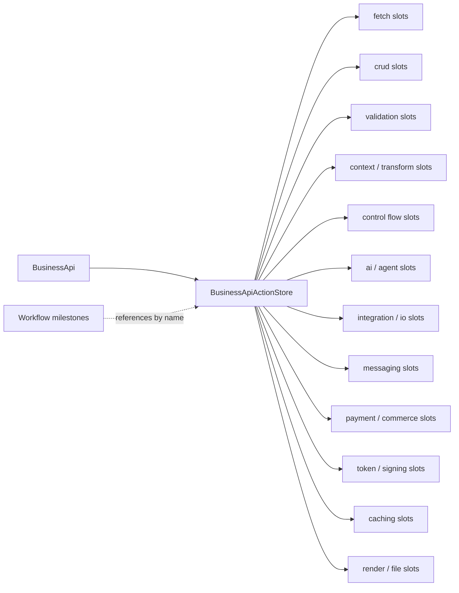

# Actions overview

An **action** is a single unit of executable logic on a `BusinessApi`. Actions are defined in a typed registry (the `BusinessApiActionStore`) under the API's `actions` chapter and are referenced by name from workflow milestones under `workflow`.

The store is typed: every action class has its own slot (e.g. `fetchObjectActions`, `validationActions`, `paymentActions`). The workflow simply lists names. An action that exists in the store but is never named by the workflow is inert.

## Anatomy of an action

Every action extends [`BusinessApiAction`](../../spec/BusinessApiAction.md), which contributes the shared fields below. The per-action pages document the type-specific fields on top of these.

- `name` (required), unique camelCase identifier.
- `description`, free text describing intent.
- `condition`, MScript boolean. When provided, the action only runs if the expression is truthy.
- `contextPropertyName`, where to write the result on `this`. Downstream actions read it as `this.<contextPropertyName>`. Leave null when the result is not consumed.
- `writeToResponse` (required), when true, the result is also added to the API response under `contextPropertyName`.
- `onActionError`, `throwError` (default, abort the API) or `completeApi` (catch, expose as `this.<actionName>Error`, continue).
- `emitProgressInSSEContext`, when true and the API is running in SSE mode, emit a progress event before and after the action.

See [actions-and-workflow overview](../workflow/overview.md) for a deeper walk-through.

## Workflow milestones

Each `crudType` selects one sub-flow (`workflow.create`, `workflow.update`, `workflow.delete`, `workflow.get`, `workflow.list`). Sub-flows are ordered milestone arrays of action names. The canonical create-flow milestones, for example, are:

- `afterStartBusinessApi`
- `afterReadParameters`
- `afterTransposeParameters`
- `afterCheckParameters`
- `afterCheckBasicAuth`
- `afterBuildDataClause`
- `afterMainCreateOperation`
- `afterBuildOutput`
- `afterSendResponse`
- `afterApiEvent`

Other crudTypes have analogous milestones (`afterMainGetOperation`, `afterMainListOperation`, `afterMainUpdateOperation`, `afterMainDeleteOperation`). See the per-CrudType workflow pages: [`CreateBusinessWorkflow`](../../spec/CreateBusinessWorkflow.md), [`GetBusinessWorkflow`](../../spec/GetBusinessWorkflow.md), [`ListBusinessWorkflow`](../../spec/ListBusinessWorkflow.md), [`UpdateBusinessWorkflow`](../../spec/UpdateBusinessWorkflow.md), [`DeleteBusinessWorkflow`](../../spec/DeleteBusinessWorkflow.md).

## A note on branching

OpenAPPL has **no** `IfAction`, `IfElseAction`, or `SwitchAction`. Branching is done with the `condition` MScript field on each individual action. Two control-flow primitives exist: [`LoopAction`](./loop-action.md) (iterate a sub-flow per item) and [`ParallelAction`](./parallel-action.md) (fan-out independent sub-flows). For richer composition see [parallel and loops](../workflow/parallel-and-loops.md).

## Action catalogue

### Data fetch & query

Read operations against data objects (own service or, where indicated, the elastic mirror).

| Action | Slot | Summary |
|---|---|---|
| [`FetchObjectAction`](./fetch-object-action.md) | `fetchObjectActions` | Fetch a related or foreign object by matching key or query. |
| [`FetchParentAction`](./fetch-parent-action.md) | `fetchParentActions` | Retrieve the parent object of the current context. |
| [`FetchStatsAction`](./fetch-stats-action.md) | `fetchStatsActions` | Aggregate computations (count, sum, min, max) across a data object. |
| [`SearchObjectAction`](./search-object-action.md) | `searchObjectActions` | Keyword search a data object via elastic; returns an id array. |
| [`FetchFromElasticAction`](./fetch-from-elastic-action.md) | `fetchFromElasticActions` | Raw elastic query returning `{ items, aggregations }`. |
| [`CollateListsAction`](./collate-lists-action.md) | `collateListsActions` | Join a source array onto a target array by key matching. |

### CRUD writes

Mutations against data objects. `CreateObjectAction` is plain JS object construction in context (no DB hit), see also Context & transform.

| Action | Slot | Summary |
|---|---|---|
| [`CreateCrudAction`](./create-crud-action.md) | `createCrudActions` | Create a related record in another data object. |
| [`CreateBulkCrudAction`](./create-bulk-crud-action.md) | `createBulkCrudActions` | Bulk create child records from an MScript array expression. |
| [`UpsertBulkCrudAction`](./upsert-bulk-crud-action.md) | `upsertBulkCrudActions` | Bulk insert-or-update rows matched on a key, with per-column enrichment policies (the import write step). |
| [`UpdateCrudAction`](./update-crud-action.md) | `updateCrudActions` | Update related objects by conditional query. |
| [`DeleteCrudAction`](./delete-crud-action.md) | `deleteCrudActions` | Delete related child or linked objects. |
| [`CreateObjectAction`](./create-object-action.md) | `createObjectActions` | Construct a plain JS object in context (no DB). |

### Validation & access control

Pre-conditions and authorisation checks. `VerifyWebhookAction` also appears under Payments & commerce.

| Action | Slot | Summary |
|---|---|---|
| [`ValidationAction`](./validation-action.md) | `validationActions` | MScript boolean check; optionally aborts the workflow. |
| [`PermissionCheckAction`](./permission-check-action.md) | `permissionCheckActions` | Verify a global (non-object-scoped) permission. |
| [`ObjectPermissionCheckAction`](./object-permission-check-action.md) | `objectPermissionActions` | Verify a permission against a specific object loaded in context. |
| [`MembershipCheckAction`](./membership-check-action.md) | `membershipCheckActions` | Verify the caller is a member of a related object (org, team). |
| [`ReadJwtTokenAction`](./read-jwt-token-action.md) | `readJwtTokenActions` | Decode and validate a JWT into context. |
| [`VerifyWebhookAction`](./verify-webhook-action.md) | `verifyWebhookActions` | Verify a provider webhook signature (e.g. Stripe). |

### Context & transform

Pure data-shaping actions. They mutate context or response without touching a database, provider, or remote service.

| Action | Slot | Summary |
|---|---|---|
| [`AddToContextAction`](./add-to-context-action.md) | `addToContextActions` | Write a computed or fixed value to `this`. |
| [`AddToResponseAction`](./add-to-response-action.md) | `addToResponseActions` | Add a computed or context value to the API response. |
| [`RemoveFromResponseAction`](./remove-from-response-action.md) | `removeFromResponseActions` | Strip properties from the response before send, and, with `applyToListRows`, from every ROW of a list response, conditionally. |
| [`FunctionCallAction`](./function-call-action.md) | `functionCallActions` | Invoke a reusable MScript library function. |
| [`ArrowFunctionAction`](./arrow-function-action.md) | `arrowFunctionActions` | Declare an arrow function callable elsewhere by context name. |
| [`ListMapAction`](./list-map-action.md) | `listMapActions` | Map an array into a new array (JS `.map`); with `replacesResult` the mapped rows become the list response. |
| [`CreateObjectAction`](./create-object-action.md) | `createObjectActions` | Construct a plain JS object in context (also under CRUD writes). |

### Control flow

The two composition primitives. Branching is done with `condition` on individual actions.

| Action | Slot | Summary |
|---|---|---|
| [`LoopAction`](./loop-action.md) | `loopActions` | Repeat a sub-flow for each item of an MScript array. |
| [`ParallelAction`](./parallel-action.md) | `parallelActions` | Fan-out child actions that have no inter-dependency. |

### AI & agents

LLM calls, calibrated decisions and agent invocations. `IteratorAction` is the generic streaming primitive for cases `AiCallAction` does not cover. When a later action only branches on the answer, prefer `DecisionAction`; see [The decision layer](../capabilities/decision-layer.md).

| Action | Slot | Summary |
|---|---|---|
| [`DecisionAction`](./decision-action.md) | `decisionActions` | Ask a decision provider typed questions (yes/no, one-of, scale) about one state; get calibrated answers on `this.decisions`, with an `escalateTo` path to an LLM for the unsure cases. |
| [`AiCallAction`](./ai-call-action.md) | `aiCallActions` | Call an LLM with structured prompts; receive text or JSON. |
| [`AgentCallAction`](./agent-call-action.md) | `agentCallActions` | Invoke an AI agent declared in the service's `aiAgents`. |
| [`IteratorAction`](./iterator-action.md) | `iteratorActions` | Generic streaming action whose method returns an async iterable. |

### Integration & I/O

Network calls outside the service. `IntegrationAction` is the **general** integration path (DB-driven catalogue). The other actions on this page are **native** integrations with dedicated provider settings.

| Action | Slot | Summary |
|---|---|---|
| [`ApiCallAction`](./api-call-action.md) | `apiCallActions` | Generic external or internal HTTP request. |
| [`InterserviceCallAction`](./interservice-call-action.md) | `interserviceCallActions` | Call another Business API in a different microservice. |
| [`IntegrationAction`](./integration-action.md) | `integrationActions` | Call a general integration provider declared in the project's integration catalogue. |
| [`RedirectAction`](./redirect-action.md) | `redirectActions` | Redirect the API response to another URL or internal path. |

### Native messaging & notifications

Provider-bound messaging. Each uses an entry in `projectSettings.notificationProvidersSettings` (or `realtimeSettings` for SSE/event-bus).

| Action | Slot | Summary |
|---|---|---|
| [`SendMailAction`](./send-mail-action.md) | `sendMailActions` | Send an email via a configured provider, or on behalf of a project MailAccount, with reply threading. |
| [`CheckMailboxAction`](./check-mailbox-action.md) | `checkMailboxActions` | Pull filtered message summaries (metadata only) from a MailAccount's mailbox. |
| [`ReadMailAction`](./read-mail-action.md) | `readMailActions` | Fetch one full message, bodies + attachment content, by RFC 5322 messageId. |
| [`SendSmsAction`](./send-sms-action.md) | `sendSmsActions` | Send an SMS to a phone number. |
| [`SendPushNotificationAction`](./send-push-notification-action.md) | `sendPushNotificationActions` | Send a push notification to a mobile or web client. |
| [`SendWhatsAppAction`](./send-whatsapp-action.md) | `sendWhatsAppActions` | Send a WhatsApp Business message (Meta Cloud or Twilio). |
| [`EmitSseEventAction`](./emit-sse-event-action.md) | `emitSseEventActions` | Emit a custom SSE event mid-workflow (no-op in REST). |
| [`PublishEventAction`](./publish-event-action.md) | `publishEventActions` | Publish a custom domain event to the message bus. |

### Payments & commerce

Native payment-provider actions plus shopping-cart and coupon helpers. `VerifyWebhookAction` (under Validation) verifies a provider notification your design consumes outside the payment lifecycle; payment-lifecycle webhooks need no API (the generated `POST /v1/payments/webhook/<providerName>` route handles them).

| Action | Slot | Summary |
|---|---|---|
| [`PaymentAction`](./payment-action.md) | `paymentActions` | Start, complete, or refresh a payment via a native provider. |
| [`RefundAction`](./refund-action.md) | `refundActions` | Refund (full or partial) an existing payment. |
| [`SubscriptionAction`](./subscription-action.md) | `subscriptionActions` | Create / cancel / refresh a subscription on a native provider. |
| [`PayoutAction`](./payout-action.md) | `payoutActions` | Issue a marketplace payout to a connected account. |
| [`CartValidationAction`](./cart-validation-action.md) | `cartValidationActions` | Validate a shopping cart before checkout. |
| [`CartCheckoutAction`](./cart-checkout-action.md) | `cartCheckoutActions` | Process cart checkout: inventory, promotions, order creation. |
| [`CouponValidationAction`](./coupon-validation-action.md) | `couponValidationActions` | Validate a coupon code, compute discount. |
| [`VerifyWebhookAction`](./verify-webhook-action.md) | `verifyWebhookActions` | Verify a provider webhook signature (also under Validation). |

### Tokens & signing

JWT minting and project-key signing.

| Action | Slot | Summary |
|---|---|---|
| [`CreateJWTTokenAction`](./create-jwt-token-action.md) | `createJWTTokenActions` | Mint a JWT with a payload and store it in context or response. |
| [`SignDataWithProjectKeyAction`](./sign-data-with-project-key-action.md) | `signDataWithProjectKeyActions` | Sign data with the project's Ed25519 key; return `{ sig, kid, jwks_url }`. |

### Caching

Direct Redis access from the workflow. For caching tied to data-object reads, use the data-object cache config instead.

| Action | Slot | Summary |
|---|---|---|
| [`ReadFromRedisAction`](./read-from-redis-action.md) | `readFromRedisActions` | Read a Redis key into context. |
| [`WriteToRedisAction`](./write-to-redis-action.md) | `writeToRedisActions` | Write a value to Redis under a computed key. |

### Rendering & files

Template rendering and file generation. `RenderPdfAction` is the only PDF path; `DataToFileAction` covers CSV / JSON / TXT.

| Action | Slot | Summary |
|---|---|---|
| [`RenderDataAction`](./render-data-action.md) | `renderDataActions` | Substitute flat `${key}` placeholders in a literal template string (no EJS, no library lookup). |
| [`RenderPdfAction`](./render-pdf-action.md) | `renderPdfActions` | Render a PDF from a `PdfTemplate` or pre-rendered HTML. |
| [`DataToFileAction`](./data-to-file-action.md) | `dataToFileActions` | Serialise a string or structured rows to CSV / TSV / XLSX / JSON / NDJSON / TXT; an empty `inputData` on a list api exports the list. |
| [`FileToDataAction`](./file-to-data-action.md) | `fileToDataActions` | Parse a csv / tsv / xlsx / json / ndjson file into typed rows of a DataObject (the import parse step). |

### Actions described with their capability

Each action guide describes its behavior and failure conditions. The capability guides show how to use the actions together.

| Action | Pattern page | Capability |
|---|---|---|
| [`ChatHandlerAction`](./chat-handler-action.md) | [spec](../../spec/ChatHandlerAction.md) | [chat-handlers](../capabilities/chat-handlers.md) |
| [`ContentTransitionAction`](./content-transition-action.md) | [spec](../../spec/ContentTransitionAction.md) | [content editorial](../capabilities/content-editorial.md) |
| [`EnterpriseAction`](./enterprise-action.md) | [spec](../../spec/EnterpriseAction.md) | [enterprise provider](../../spec/providers/enterpriseIntegration.md) |
| [`FetchFromElasticLogAction`](./fetch-from-elastic-log-action.md) | [spec](../../spec/FetchFromElasticLogAction.md) | [ElasticLog](../composition/elastic-log.md) |
| [`WriteToElasticLogAction`](./write-to-elastic-log-action.md) | [spec](../../spec/WriteToElasticLogAction.md) | [ElasticLog](../composition/elastic-log.md) |
| [`FiscalizeAction`](./fiscalize-action.md) | [spec](../../spec/FiscalizeAction.md) | [invoice and fiscalization chain](../capabilities/invoice-fiscalization-chain.md) |
| [`InvoiceAction`](./invoice-action.md) | [spec](../../spec/InvoiceAction.md) | [invoice and fiscalization chain](../capabilities/invoice-fiscalization-chain.md) |
| [`GraphQueryAction`](./graph-query-action.md) | [spec](../../spec/GraphQueryAction.md) | [graph layer](../capabilities/graph-layer.md) |
| [`GrpcCallAction`](./grpc-call-action.md) | [spec](../../spec/GrpcCallAction.md) | [gRPC interservice](../capabilities/grpc-interservice.md) |
| [`HubScheduledAction`](./hub-scheduled-action.md) | [spec](../../spec/HubScheduledAction.md) | [realtime hub](../capabilities/realtime.md) |
| [`InterProjectCallAction`](./inter-project-call-action.md) | [spec](../../spec/InterProjectCallAction.md) | [ApiManager](../business-apis/api-manager.md) |
| [`VideoRoomControlAction`](./video-room-control-action.md) | [spec](../../spec/VideoRoomControlAction.md) | [video provider](../../spec/providers/videoProvider.md) |
| [`VideoRoomTokenAction`](./video-room-token-action.md) | [spec](../../spec/VideoRoomTokenAction.md) | [video provider](../../spec/providers/videoProvider.md) |

## Native vs general integrations

Most provider-bound actions on this page are **native** integrations bound to a typed `*ProvidersSettings` entry and exposed as a dedicated action type (`PaymentAction`, `SendMailAction`, `AiCallAction`, …). [`IntegrationAction`](./integration-action.md) is the **general** escape hatch, a free-form provider declared in the project's integration catalogue, called by name with no dedicated action type.

## Action store on the BusinessApi

## See also

- [Actions & workflow overview](../workflow/overview.md)
- [Workflow context](../workflow/workflow-context.md)
- [Parallel and loops](../workflow/parallel-and-loops.md)
- [MScript overview](../mscript/overview.md)
- Ontology: [`BusinessApiActionStore`](../../spec/BusinessApiActionStore.md), [`BusinessApiAction`](../../spec/BusinessApiAction.md), [`BusinessWorkflow`](../../spec/BusinessWorkflow.md)
