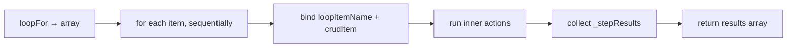

# LoopAction

`LoopAction` iterates over an MScript expression and runs a sequence of inner actions once per item. Before each iteration the runtime assigns the current item to `this.<loopItemName>` (and to the universal alias `this.crudItem`), so inner action MScript reads it via that binding. Loops can be nested. A loop that runs inner actions walks its items one at a time, whatever `isParallel` says; for concurrent work use a [`ParallelAction`](./parallel-action.md).

## When to use it

- Apply per-row work to a list, sending one email per invoice, fanning out a permission check across a set of resources.
- Build a derived result by collecting a `contextPropertyName` value off each iteration.
- Nest loops to walk a hierarchy (e.g., organisations → projects → members).

## Configuration

| Property | Type | Req | Description |
|---|---|---|---|
| `loopFor` | `MScript` | ✓ | Expression that evaluates to an array. The loop iterates over its elements. |
| `loopItemName` | `String` | ✓ | Property name bound to the current item on `this`. Inner MScript reads it as `this.<loopItemName>`. The service falls back to `"item"` if the value is missing at runtime, but the validator requires the field; treat it as mandatory. Use an explicit name for nested loops so references stay unambiguous. |
| `isParallel` | `Boolean` |   | Default `false`. A loop that runs inner actions iterates one item at a time either way: each step publishes its item and step context on the shared `this`, so concurrent steps would read each other's item. Only a loop with no inner actions maps its items concurrently, and such a loop runs nothing per item. |
| `actions` | `String`[] |   | Names of actions defined elsewhere in the same `actionStore` to run on each iteration. The store is partitioned by action class (typed arrays such as `validationActions`, `fetchObjectActions`, `loopActions`), so the referenced child must live in the array that matches its own class. The runtime looks up by name across all slots; see [Actions & workflow, overview](../workflow/overview.md) for the store shape. Optional at the schema level; an omitted or empty list still evaluates `loopFor` and iterates it, but runs nothing per item: the item is NOT published on `this` (that binding happens before each inner action, and there is none), and the action's result is one empty object `{}` per element. |

Plus every property inherited from [`BusinessApiAction`](../../spec/BusinessApiAction.md) (`name`, `condition`, `contextPropertyName`, `writeToResponse`, `onActionError`, …).

## Behaviour



On each iteration the runtime:

1. Publishes the loop-step context **before every inner action**, not once per iteration: the current item as `this.<loopItemName>`, the aliases `this.crudItem` and `this.loopItem`, `this.stepIndex`, the zero-based index of the current iteration, and `this.stepResults`, this loop level's accumulator keyed `<innerActionName>_<stepIndex>`. An alias is skipped when `loopItemName` already spells it: the item wins the name. Re-publishing before each inner action is what keeps a NESTED loop from handing its own index to the next sibling of the outer step.
2. Runs each inner action by name, in declaration order. If an inner action has a `contextPropertyName`, its return value is published in two places: on the manager as `this.<contextPropertyName>`, the access path `contextPropertyName` documents, and, when the loop item is an object, written back onto the loop item itself (so later inner actions in the same iteration see it on `customerItem.<contextPropertyName>`). The `this` slot names the last step in which that inner action RAN: normally the CURRENT step, exactly like `this.<loopItemName>` and `this.stepIndex`, so once the loop has finished it holds the LAST step's value, but an inner action carrying a `condition` writes nothing on a step it skips, so on such a step the slot still holds the PREVIOUS iteration's value. One carve-out: an `addToContextAction` whose `contextPropertyName` spells one of its own `contextName`s keeps the computed context value; the action's bare `true` return does not overwrite it.
3. Collects each inner action's return into a per-iteration step-results map, keyed by the inner action's `name`, and also accumulates it into this loop level's `this.stepResults` under `<innerActionName>_<stepIndex>` so a later step can read what earlier ones produced. The per-iteration map is what the loop returns (see below); `this.stepResults` is the across-steps accumulator.

What an inner action's MScript can read on `this`:

- `this.<loopItemName>`, the current item (and `this.crudItem` as an alias, except when `loopItemName === "crudItem"`).
- Outputs of earlier inner actions in the same iteration that declare a `contextPropertyName`. Each is reachable both as `this.<contextPropertyName>` (the current step's value) and, for an object item, as `this.<loopItemName>.<contextPropertyName>`, the per-item copy. Prefer the per-item copy when you need a specific iteration's value rather than the most recent one.
- `this.stepIndex`, the zero-based index of the current iteration. Referencing it in a `dataValue` is the canonical way to persist an order derived from the input list.
- `this.stepResults`, this loop level's accumulator, keyed `<innerActionName>_<stepIndex>`.
- The full parent context: session, request parameters, prior top-level action outputs.

Under a NESTED loop, `stepIndex` and `stepResults` always name the **innermost** enclosing loop: each level owns a fresh counter and accumulator, so an inner level can never advance or overwrite its parent's, and while it runs the outer level's values are shadowed and unreachable by name. Loop **items** are the exception, every enclosing level's `loopItemName` stays reachable, so a grid-shaped write addresses its rows and columns through the item names rather than through two `stepIndex`es. That includes the `condition` of an action inside the inner loop: it may read the outer item by bare name (`rowItem.key !== 'skip'`), because the inner loop passes every enclosing item into its per-step function. See [MScript step context, Inside a LoopAction](../mscript/step-context.md#inside-a-loopaction) for the canonical statement.

The loop returns an array of per-iteration step-results objects (one entry per declared inner action that ran). When `loopFor` evaluates to an empty list (or to anything that is not an array), no step runs, the loop returns `[]`, and `this.<loopItemName>` is set to `null`, so an action after the loop never sees a stale item from an earlier run of the same loop. A `condition` that dereferences the item must still guard it (`this.booking && this.booking.status === 'done'`). Bind the loop's own `contextPropertyName` to keep that array around for later actions.

A loop that runs no step logs one `info` line, `LoopCollectionEmpty`. `info` is the generated service's default log level, so the service log shows it. Fields: `requestId`, `action`, `itemName` (the `loopItemName`), `collectionExpression` (the authored `loopFor` expression), `collectionState` and `collectionType` (the JavaScript `typeof` of the evaluated collection). `collectionState` is one of `undefined`, `null`, `not-an-array` and `empty`. A misspelled reference reads `undefined`, while a list that was really empty reads `empty`. The line never prints the collection's content. An optional fetch inside the loop that finds nothing logs its own line on every iteration.

> **Note:** setting `isParallel: true` does not make a loop with inner actions concurrent, so one item's steps never overlap another's. Concurrency inside a workflow comes from a [`ParallelAction`](./parallel-action.md); see [race conditions in workflows](../workflow/race-conditions.md) for what its branches may share.

## Example

```json
{
  "name": "notifyCustomers",
  "loopFor": { "js": "this.affectedCustomers" },
  "loopItemName": "customerItem",
  "isParallel": false,
  "actions": ["fetchCustomerEmail", "buildBody", "sendCustomerEmail"]
}
```

Inside `sendCustomerEmail`'s `to` expression the author writes:

```js
this.customerItem.email
```

…or, equivalently, `this.crudItem.email`.

## Errors

- `loopFor` must evaluate to an array; otherwise the loop is a no-op (returns `[]`) and logs `LoopCollectionEmpty` with `collectionState` `undefined`, `null` or `not-an-array`.
- Errors from inner actions follow the same `onActionError` rules as standalone actions.
- An inner action that throws stops the loop at that item (later items do not run) and rejects the loop, unless that inner action declares `onActionError: completeApi`, in which case the step resolves `null`, the error lands on `this.<innerActionName>Error` and the loop goes on.

## See also

- [`BusinessApiAction`](../../spec/BusinessApiAction.md): parent class.
- [`ParallelAction`](./parallel-action.md): sibling for fixed-fan-out concurrency.
- [Parallel and loops](../workflow/parallel-and-loops.md): when to pick one shape over the other.
- [Race conditions in workflows](../workflow/race-conditions.md).
- [MScript step context](../mscript/step-context.md).
