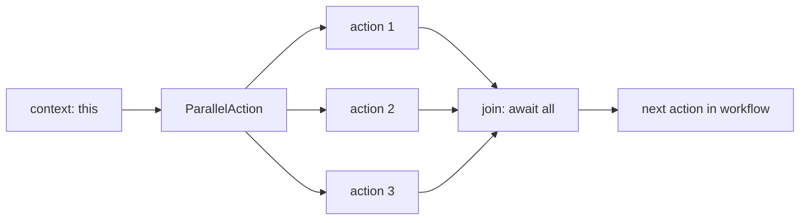

# ParallelAction

`ParallelAction` runs a fixed list of named actions concurrently using the same shared context. It is the right tool when several independent units of work need to fan out in parallel, most commonly read-only fetches, side-effect-free validations, or downstream notifications that don't depend on each other.

## When to use it

- Concurrent fetches that don't depend on each other (`fetchProfile` + `fetchSettings` + `fetchRecentActivity`).
- Validations that can fail in parallel before any side-effect action runs.
- Fire-and-pass-through actions whose ordering doesn't matter.

Use `ParallelAction` when the fan-out is over a known, static set of named actions. A [`LoopAction`](./loop-action.md) walks a dynamic list one item at a time (also with `isParallel: true`); it is not a concurrent fan-out.

## Configuration

| Property | Type | Req | Description |
|---|---|---|---|
| `actions` | `String`[] | ✓ | Names of actions to run concurrently. Each name resolves through the API's typed action store, the entries live in whatever slot matches their action class (`fetchObjectActions`, `apiCallActions`, `loopActions`, …), not in a single flat array. Each child runs with the shared context. Nested `ParallelAction` / `LoopAction` entries are supported. See [Actions & workflow, overview](../workflow/overview.md) for the store shape. |

Plus the [`BusinessApiAction`](../../spec/BusinessApiAction.md) base properties.

## Behaviour



Each named action is awaited as a group. If any throws, the group rejects under standard all-must-succeed join semantics (`Promise.all` in JavaScript), every other branch is allowed to finish, but the workflow surfaces the first rejection (subject to each branch's `onActionError`).

> **Warning:** all branches share the same `this`. Avoid having two branches write to the same context property, mutate the same object, or perform read-modify-write updates on the same database row. Final state in those cases is non-deterministic. Prefer branch-local writes (each branch writes to its own `contextPropertyName`) or database concurrency controls. See [race conditions](../workflow/race-conditions.md).

Nesting is allowed: a `ParallelAction` can list another `ParallelAction` or a `LoopAction` among its children. Don't go more than two levels deep without a strong reason, it gets hard to reason about.

## Example

```json
{
  "name": "loadDashboard",
  "actions": ["fetchProfile", "fetchSubscription", "fetchRecentOrders"]
}
```

Each named child must exist elsewhere in the API's action store, under whatever typed slot matches its class (a `FetchObjectAction` lives in `fetchObjectActions`, an `ApiCallAction` in `apiCallActions`, etc.). They run concurrently; the workflow resumes once all three have completed.

## See also

- [`BusinessApiAction`](../../spec/BusinessApiAction.md): parent class.
- [`LoopAction`](./loop-action.md): per-item work over an array, one item at a time.
- [Parallel and loops](../workflow/parallel-and-loops.md): picking between the two.
- [Race conditions](../workflow/race-conditions.md).
