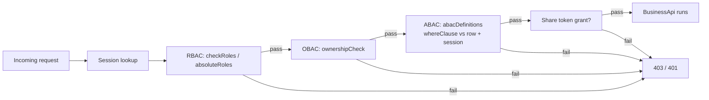
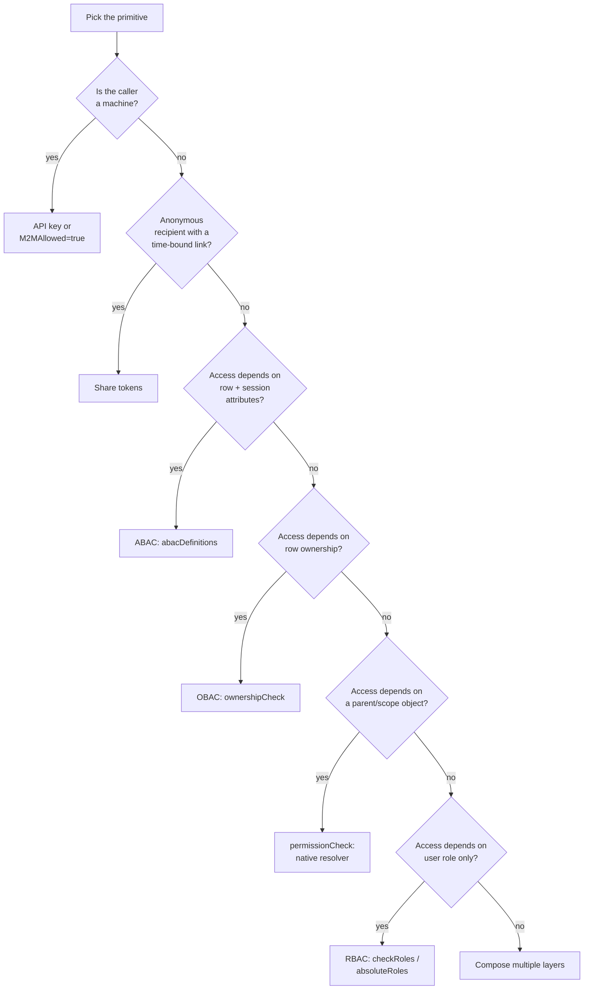

# Permissions strategy

OpenAPPL provides four enforcement primitives. They compose: most
projects use all four at different layers.

| Primitive | When it fits |
|---|---|
| **Roles (RBAC)** | Access shape is "users with role X can do Y." Coarse, declarative, tenant-friendly. |
| **Object permissions (OBAC)** | Access depends on the row about to be touched (owner, parent owner, member). |
| **Attribute predicates (ABAC)** | Access depends on a free-form expression over the row and the session. |
| **Share tokens** | Access is granted to a specific outsider, time-bound, possibly anonymous. |

The vocabulary lives under
[`authentication.accessControl`](../../spec/AccessControl.md);
per-API enforcement happens on each BusinessApi's
[`basics.authOptions`](../../spec/ApiAuthOptions.md).

> **Going further.** For fine-grained, per-permission, instance-aware
> resolution that also compiles into list filters (multi-scope membership
> roles, object-roles, ±overrides, and ABAC conditions in one layered
> resolver), opt an API into the
> [native permission system](../capabilities/native-permissions.md)'s
> `permissionCheck` gate. To delegate the decision to an external policy
> engine instead, see the
> [foreign permission check](../capabilities/foreign-permission-check.md).



Each layer narrows access. The default is deny — every check must
pass for the API to run.

The JSON snippets on this page are fragments of a blueprint, shown
under the key where they sit (`authentication`, `basics`, …).

## Layer 1 — roles

Activate RBAC at the project level:

```json
"authentication": {
  "accessControl": {
    "roleSettings": {
      "rbacIsActive": true,
      "configuration": {
        "roleItems": [
          { "name": "admin", "value": "admin" },
          { "name": "editor", "value": "editor" }
        ]
      }
    },
    "permissionTypes": {
      "roleBasedPermissionsIsActive": true
    }
  }
}
```

Gate an API on roles:

```json
"basics": {
  "authOptions": {
    "loginRequired": true,
    "checkRoles": ["admin", "editor"],
    "absoluteRoles": ["superAdmin"]
  }
}
```

`checkRoles` is required-or-of: the caller must hold at least one
listed role. `absoluteRoles` bypasses every other check (still subject
to business validations). Use roles for feature scoping and
tenant-level tiers — never for per-record decisions.

## Layer 2 — object permissions (OBAC)

OBAC restricts access to specific rows by ownership or parent-ownership.

```json
"accessControl": {
  "objectBasedSettings": {
    "objectBasedPermissionsIsActive": true,
    "dataObjects": ["Order", "Invoice"]
  },
  "permissionTypes": { "objectBasedPermissionsIsActive": true }
}
```

Per API:

```json
"authOptions": {
  "loginRequired": true,
  "ownershipCheck": true,
  "permissionCheck": { "permission": "order.write" }
}
```

`ownershipCheck: true` enforces the main data object's owner property
match the session. `permissionCheck` names ONE permission the
caller must hold: for list APIs the resolver's bounded id-list is folded
into the query, for single-record APIs it is decided after the row is
fetched. For a second permission, or any conditional or cross-object
predicate, drop into
[`ObjectPermissionCheckAction`](../../spec/ObjectPermissionCheckAction.md).

`ownershipCheck` covers the **main** data object only. Ownership *through a
parent* ("the caller owns the organization this order belongs to") is expressed
by [`authOptions.parentOwnershipChecks`](../../spec/ApiParentOwnershipCheck.md):
each entry names the parent object, the request field carrying its id, and the
owner column on the parent, and the generated service fetches the parent row and
returns 403 unless the caller owns it. This is the create-under-parent /
modify-child-if-you-own-the-parent case that `ownershipCheck` (no target row yet
on a create) cannot make, and that `permissionCheck` (RBAC/membership, not
ownership) cannot express. For a role/membership decision against a scope object
instead, use [`authOptions.permissionCheck`](../../spec/ApiPermissionCheck.md),
whose resolver takes the scope object id directly.

The parent-ownership gate applies to every api shape. A compiler for a target
language that cannot emit it must refuse a declared `parentOwnershipChecks` list
(the validator reports `PARENT_OWNERSHIP_UNSUPPORTED_LANGUAGE`): gate the api
another way (`checkRoles`, `ownershipCheck`, a permission check or a 403
validation) or build the service in a language whose compiler emits the gate.
See [the compiler specification](../../compiler/index.md).

## Layer 3 — attribute predicates (ABAC)

ABAC binds an MScript predicate to a data object; matching records
grant the listed permissions (or a dynamic role) to the session for
the duration of the request.

```json
"accessControl": {
  "attributeBasedSettings": {
    "attributeBasedPermissionsIsActive": true,
    "abacDefinitions": [
      {
        "name": "myOwnInvoices",
        "dataObject": "Invoice",
        "whereClause": { "js": "createdBy === this.session.userId" },
        "permissions": ["invoice.read", "invoice.write"]
      },
      {
        "name": "financeManagerOverdue",
        "dataObject": "Invoice",
        "whereClause": { "js": "this.session.role === 'financeManager' && status === 'overdue'" },
        "permissions": ["invoice.read"]
      }
    ]
  }
}
```

ABAC is switched on by `attributeBasedSettings.attributeBasedPermissionsIsActive`.
The `whereClause` is an MScript expression evaluated against each
candidate record. Use `this.session.*` for the caller and bare
property names for the row. ABAC takes precedence over the equivalent
role-based permission when both match.

For conditional checks inside a workflow, use
[`PermissionCheckAction`](../../spec/PermissionCheckAction.md).

## Layer 4 — share tokens

Granting access to a specific outsider — guest reviewer, expiring link,
delegated approver — is the share-token pattern. See
[Membership & share tokens](../composition/membership.md).

Share tokens beat permanent role assignments whenever:

- The recipient is anonymous (no account).
- The grant should expire automatically.
- The grant is per-record, not per-feature.

## Layer 5 — API keys (machine clients)

For server-to-server / AI-agent / CI pipeline callers, configure
[`APIKeyAuth`](../../spec/APIKeyAuth.md) under
`authentication.authenticationEssentials.apiKeyAuthentication`. Secret
keys carry a fixed user identity; APIs that should accept
both a user session and an API key need no extra flag. For pure M2M
endpoints (a webhook receiver, an inter-service callback), set
`authOptions.M2MAllowed: true`.

## Anti-patterns

### Role explosion

A new role for every feature combination
(`editor-with-export`, `editor-no-billing`, `viewer-with-comments`)
makes onboarding brittle and every new feature touches every role.
Replace with a permission vocabulary under
`accessControl.permissionBasics` and either RBAC permissions on a
small role set or ABAC predicates over user attributes.

### Checking auth inside an action body

Putting access logic into a workflow step runs after the request has
already entered the pipeline. Use `authOptions` so the gate fires
before any DB work, and reach for the dedicated check actions
(`PermissionCheckAction`, `ObjectPermissionCheckAction`,
`MembershipCheckAction`) only when the decision genuinely depends on
data fetched earlier in the workflow.

### Trusting request fields for identity

A body field like `userId: "…"` is what the caller _wants_; what they
_are_ is `this.session.userId`. Use the session — never the request —
for identity in WHERE clauses, ABAC predicates, or workflow gates.

### Open by default

Every BusinessApi is gated by default; opening one requires
`authOptions.loginRequired: false` (and usually no role checks).
Repeatedly opening APIs to make integration easier is a smell. Reach
for API keys or share tokens before you reach for unauthenticated APIs.

### A calibrated decision as the gate

A [decision provider](../capabilities/decision-layer.md) can say a tool call
looks destructive or a transaction looks unusual, but its answer has no
rationale an auditor can read. Never let it grant or deny access: route
the case to a human (the agent `decisionGate` with `requireApproval`, a
`decisionSource` column a reviewer queries) and keep the deny in the
layers above. Validation enforces this as `DECISION_ON_AUTHZ_SURFACE`.

## Decision tree



Real projects compose: RBAC for tenant tiers, OBAC for record
ownership, ABAC for cross-cutting predicates, share tokens for
invitations, API keys for M2M. The tree picks the *primary*
mechanism; secondary mechanisms layer on top.

## See also

- [Authentication service](../system-services/authentication/overview.md)
- [Native permission system](../capabilities/native-permissions.md) — the
  layered `permissionCheck` resolver (check + list-objects).
- [Foreign permission check](../capabilities/foreign-permission-check.md) —
  delegate authorization to an external policy engine.
- [Membership & share tokens](../composition/membership.md)
- [Session-aware logic](../composition/session-aware-logic.md)
- [Anti-patterns](anti-patterns.md)
- Patterns: [`AccessControl`](../../spec/AccessControl.md),
  [`ApiAuthOptions`](../../spec/ApiAuthOptions.md),
  [`PermissionTypes`](../../spec/PermissionTypes.md),
  [`OBACPermission`](../../spec/OBACPermission.md),
  [`AbacPermission`](../../spec/AbacPermission.md),
  [`ABACDefinititon`](../../spec/ABACDefinititon.md),
  [`PermissionCheckAction`](../../spec/PermissionCheckAction.md),
  [`ObjectPermissionCheckAction`](../../spec/ObjectPermissionCheckAction.md).
