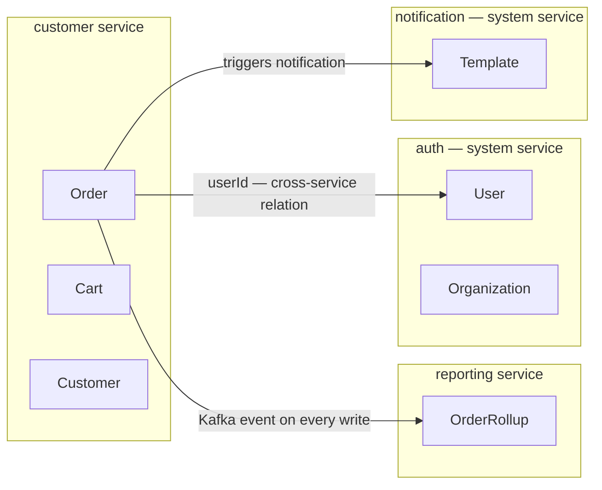

# Service boundaries

How to decide what belongs in one service vs many.

## The core question

A `Service` in a blueprint compiles to one microservice — its own
database, its own Kafka producer, its own deployment. The lines you
draw between services determine:

- **Operational cost** — every service is one more thing to deploy and
  monitor.
- **Cross-service coupling** — relations across services become
  inter-service calls or static-joins, not SQL joins.
- **Team boundaries** — a service is a unit of ownership.

## Guidance

### Start small, split later

For a new project, fewer services is almost always right. Three healthy
patterns at small scale:

- **Single-service monolith with the system services.**
  One `services[]` entry covering all your business logic. The
  system services (`auth`, `bff`, `mcpbff`, `notification`) ship alongside
  as configured singletons — not generic `Service` instances — and keep
  their concerns out of your code. See
  [System services overview](../system-services/overview.md) for the
  full set; `agentHub` is opt-in.
- **Two-service split**: customer-facing service + admin/back-office
  service. Same data model, different access patterns.
- **Three-service split**: customer-facing + admin + reporting. The
  reporting service is read-only against the others' Kafka events.

### Signals to split

Move from one service to two when *all* of the following are true:

- The two halves have **independent data lifecycles** — one updates 100x
  more often than the other.
- They have **different access patterns** — one is a high-traffic
  customer API; the other is internal reporting.
- They could **deploy independently** without coordination meetings.

### Anti-signals (don't split)

- "Microservices is the modern way." Operational complexity costs
  real engineering time.
- "These data objects might evolve differently." Speculative coupling
  fear. Wait for actual evidence.
- "We want strong isolation." A service boundary is *coarse*
  isolation; a permissions model is *fine* isolation. Often you want
  the latter, not the former.

## Where the line falls

The split usually follows a DataObject whose lifecycle is large
enough to warrant its own deployment and operational story. Helpers
(notification, audit, search) are cross-cutting and stay in the
system services rather than fragmenting into one microservice each.

Three signals that earned the split here: `Order` has independent
write traffic (orders per minute) vs `OrderRollup` (one row per day),
`User` belongs to identity (a system-service concern, not the customer
domain), and notifications are cross-cutting (every service emits to
them, none own them). Everything else stays inside the `customer`
service.

## Cross-service relations

A relation from `Order.userId → User` works whether `User` is in the
same service or `auth`. The runtime cost is:

| Same service | Cross service |
|---|---|
| One SQL JOIN | One inter-service call (or [static join](../composition/static-joins.md)) |
| Strong FK constraint | Eventual consistency via Kafka |
| Transactional updates across both | Saga pattern across services |

Cross-service is rarely a deal-breaker, but it adds complexity. If two
"services" have many relations both ways, they might be one service.

## System services vs your services

The system services (`auth`, `bff`, `mcpbff`, `notification`) sit
alongside `services[]` rather than in it. They're not generic `Service`
instances; the language owns their pattern shape, and the compiler owns
their code and data model:

- They evolve independently of your domain.
- Their codebases are compiler-managed; you configure them, not
  rewrite them.
- Removing them rarely makes sense — they're already cheap to run.

Don't put a `User` data object in your domain service "to keep it
local" — auth owns identity; reach across.

## See also

- [Anti-patterns](anti-patterns.md) — the same warnings in catalogue form.
- Composition: [Static joins](../composition/static-joins.md), [Select-join](../composition/select-join.md)
- [Multi-tenancy](../data-modeling/multi-tenancy.md)
