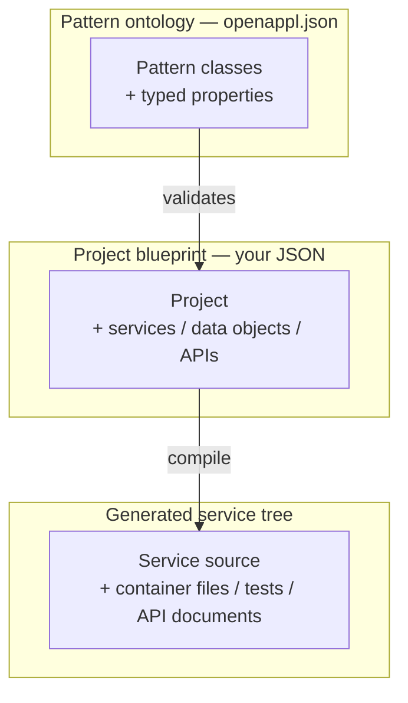

# Core concepts

In OpenAPPL, an author (a person or an AI agent) writes the design of an application
down as one JSON **project blueprint**, validated against the **pattern ontology**. A
**compiler** turns the validated blueprint into runnable services.

This page introduces the half-dozen ideas the rest of the guides assume you know, and
then states two things authors look up constantly: the [type system](#type-system) and
the [naming rules](#naming-rules). For the structure of the blueprint tree, read
[Project structure](project-structure.md); for the vocabulary, the
[Dictionary](dictionary.md).

## The project blueprint

An OpenAPPL project is one JSON document. That document — the **project blueprint** — is
the source of truth: every service, data object, business API, AI agent, integration, and
workflow is a typed entry inside it. The file format is plain JSON so it diffs cleanly and
reviews like code. An author writes it from the approved design, any tool that speaks to
the hosting platform can read and write it, and it can be edited by hand.

The root pattern class is [`Project`](../../spec/Project.md). Every blueprint starts there.

## The pattern ontology

The **pattern ontology** is the schema that defines what's allowed in a blueprint. It is
published as `openappl.json` and surfaced as per-class reference pages in the
[specification](../../spec/index.md). Every pattern class lists its properties, their
types, required-ness, defaults, and prose docs.

The schema is versioned; each release of the language is a new version of `openappl.json`.
Authors don't edit the ontology — the language maintainers do. Authors write **instances**
of the ontology inside a blueprint.

> Don't conflate the two. The **ontology** is the *schema*. A **blueprint** is one
> *instance* of that schema. Patching the blueprint is not "patching the ontology".

## Services

An OpenAPPL project is a collection of microservices. Each [`Service`](../../spec/Service.md)
is the unit of deployment and carries its own data objects, business APIs, edge
controllers, libraries, realtime hubs, event subscriptions, AI agents, and file buckets.

Three system services are part of every project and are configured directly off the
project root, not inside `services[]`. A fourth, `agentHub`, is optional:

| Role | Class | Where in the blueprint | Status |
|------|-------|------------------------|--------|
| Authentication / sessions | `ProjectAuthentication` | `authentication` | injected by the compiler |
| Backend-for-frontend (BFF) | `BFFService` | `bffService` | injected; generated once it declares data views |
| Notifications (email / SMS / push) | `NotificationService` | `notificationService` | injected by the compiler |
| AI agent hub | `AgentHubConfig` | `agentHub` | optional, opt-in |

User-defined services live under `services[]`. A service can also host file storage as
[`RemoteBucket`](../../spec/RemoteBucket.md) (cloud bytes),
[`NativeBucket`](../../spec/NativeBucket.md) (an object store managed by the hosting
platform) or [`DbBucket`](../../spec/DbBucket.md) (in-database bytes) — all sit alongside
data objects on the same service.

## Data objects and properties

A [`DataObject`](../../spec/DataObject.md) is the unit of persistence inside a service. It
carries the schema (its [`DataProperty`](../../spec/DataProperty.md) entries) and the
behaviour around it: object-level authorization, Redis entity cache, composite indexes,
soft delete, membership rules, payment activations, and
[content moderation](../capabilities/object-moderation.md).

Standard fields (`id`, `createdAt`, `updatedAt`, and `isActive` when soft delete is
enabled) are added automatically — don't declare them (see [Naming rules](#naming-rules)).

For details see [Data objects](../data-modeling/data-objects.md) and
[Property types](../data-modeling/property-types.md).

## Business APIs and workflow

A [`BusinessApi`](../../spec/BusinessApi.md) is the request-handling unit. Every API —
CRUD-shaped or not — is declared explicitly under a service's `businessLogic[]`; nothing
is auto-generated. You shape each API by populating two JSON keys under it: `actions` (a
[`BusinessApiActionStore`](../../spec/BusinessApiActionStore.md) — the typed registry of
actions this API uses) and `workflow` (a [`BusinessWorkflow`](../../spec/BusinessWorkflow.md)
— per crudType, the action names to run at each lifecycle milestone, e.g.
`workflow.create.afterBuildDataClause`, `afterMainCreateOperation` or `afterSendResponse`).

Each crudType comes with its standard pipeline (read parameters, check, build the data
clause, run the database operation, build the output, raise the event), so a CRUD-shaped
API needs few actions. Custom logic assembles actions like `FetchObjectAction`,
`ValidationAction`, `CreateObjectAction`, `ApiCallAction`, `InterserviceCallAction`,
`AiCallAction`, `DecisionAction`, `PaymentAction`, and dozens of others. See
[Business APIs](../business-apis/overview.md).

## MScript

[**MScript**](../mscript/overview.md) is a strict subset of JavaScript expressions used
inside the blueprint anywhere a small piece of logic is needed: validation rules, computed
defaults, custom-data formulas, authorization checks, conditional triggers. Every MScript
slot in the JSON holds a per-language source map tagged with the language the expression is
written in — `{ "js": "this.user.age > 18" }` for the portable default. The compiler turns
that source into handler code at generation time; it does not execute it as a script at
runtime — the compiled output is normal source code wrapped in a diagnostic envelope.

MScript is where small pieces of logic live in the blueprint. Logic that patterns and
expressions cannot express goes into the service library (`library` functions, edge
functions and templates); everything else is structured data.

## Type system

A blueprint is a closed, typed tree. Every key is a declared property of a pattern class,
and every property has a type. The validator refuses what the types do not allow, so most
mistakes are found before any code exists.

### Value types of a pattern property

Each row of a pattern's property table (the *Type* column in the
[specification](../../spec/index.md)) is one of:

| Type | What a value looks like |
|---|---|
| `String` | A short piece of text. |
| `Text` | Long-form text (descriptions, templates, documents). |
| `Boolean` | `true` or `false`. |
| `Integer` | A whole number. Ranges, where they exist, are listed in the *Details* column (`min 0, max 6`) and refused with `VALUE_OUT_OF_RANGE`. |
| `Double` | A fractional number. |
| `Any` | A literal whose type depends on a sibling property (for example a property's `defaultValue`, which must match the property's `type`). |
| A named enum (`DataTypes`, `ErrorStatus`, …) | One of a closed list of strings, shown in the *Allowed values* column. A value outside the list is refused with `INVALID_ENUM_VALUE`. |
| A pattern class (`DataProperty`, `BusinessApi`, …) | A JSON object whose keys are the properties of that class. |
| `T[]` | An array of `T`. A property that holds a list is always written as an array, even for one item. |
| `MScript` | An expression slot: `{ "js": "<expression>" }`, one source per target language. See [MScript](../mscript/overview.md). A bare string is the deprecated form and is refused. |
| A reference type (`DataObjectName`, `LocalDataObjectName`, `PropRefer`) | A string that names another part of the blueprint: a data object (`orderItem`, or `content:orderItem` qualified by its service), a data object of the same service, or a property of a data object. A malformed value is refused (`INVALID_DATA_OBJECT_NAME_FORMAT`, `INVALID_LOCAL_DATA_OBJECT_NAME_FORMAT`, `INVALID_PROP_REFER_FORMAT`). |

Rules that apply to every pattern:

- A property the pattern does not declare is refused (`UNKNOWN_PROPERTY`).
- A value of the wrong type is refused (`INVALID_FIELD_TYPE`).
- A required property that is missing is refused (`REQUIRED_FIELD_MISSING`).
- A property that moved is written at its new path.

### Property types of a data object

A data property chooses its own storage type through `basicSettings.type`, from the fixed
`DataTypes` enum. It has sixteen values, the same for every database engine:

| Type | Meaning |
|---|---|
| `ID` | UUID-shaped identifier: primary keys, foreign-key columns, opaque references. |
| `String` | Short text with a length limit (`maxLength`, `String` only). |
| `Text` | Long-form text. |
| `Integer` | 4-byte signed integer. |
| `Short` | 2-byte integer. |
| `Double` | 8-byte floating point. Not for money. |
| `Float` | 4-byte floating point. |
| `Decimal` | Fixed-scale number (`decimalScale` 0 to 6, default 2), rounded half-to-even at every write. Use for money. |
| `Boolean` | `true` / `false`. |
| `Date` | Date-time. |
| `Enum` | A fixed set of string values; requires `enumOptions` with at least two entries. |
| `Object` | A JSON document kept as one value; its keys are not typed or validated. |
| `GeoPoint` | A GeoJSON point `[longitude, latitude]`. |
| `GeoRoute` | A GeoJSON line string. |
| `GeoArea` | A GeoJSON polygon (closed ring). |
| `Blob` | Binary content; used for in-database file storage, rarely declared by hand. |

A property can hold a list with `isArray: true` (not for `Blob`). The full catalogue, the
modifiers, defaults, computed properties and the rules for changing a stored property's
type are in [Property types](../data-modeling/property-types.md); the property pattern is
[`PropertyBasicSettings`](../../spec/PropertyBasicSettings.md).

### Value formats

A `String` property may name a **format** (shown in the *Details* column as
`format codeName`). The validator checks the value against it and reports the code shown:

| Format | Meaning | Reported as |
|---|---|---|
| `codeName` | A camelCase identifier (letters and digits, starting with a letter). A multi-word UPPER_CASE constant name is kept as written. Other spellings whose words survive are rewritten to camelCase with a warning; a value that would lose characters is refused. A reserved word of a target language gets a trailing `_` (`RESERVED_WORD_RENAMED`). | `INVALID_CODE_NAME_FORMAT` |
| `lowerCamelCase` | As `codeName`, without the UPPER_CASE exception: always starts with a lower-case letter, because other names are derived from it. | `INVALID_CODE_NAME_FORMAT` |
| `wireToken` | An HTTP token (header or cookie name): ASCII letters, digits and ``! # $ % & ' * + - . ^ _ ` | ~``; no spaces or separators. Never rewritten. | `INVALID_WIRE_TOKEN_NAME` |
| `wireKey` | A URL query or JSON body key: printable ASCII only, no whitespace or control characters. Never rewritten. | `INVALID_WIRE_KEY_NAME` |
| `noSpace` | Any text without whitespace (package names, key names). Never rewritten. | `INVALID_NO_SPACE` |
| `url` | A URL without whitespace or control characters. The scheme and host are not checked, so relative values are accepted. | `INVALID_URL` |
| `urlPath` | A URL path: as `url`, and it must not carry a scheme. | `INVALID_URL_PATH` |
| `dotPath` | A dotted chain of property names, each optionally followed by a numeric index (`items[0].id`): no whitespace, no empty segment, no leading or trailing dot. | `INVALID_DOT_PATH` |

The specification lists the same formats in
[Value formats](../../spec/value-formats.md), and states, on every pattern page, which
rules the validator attributes to it.

## Naming rules

Names in a blueprint are identifiers: routes, tables, event topics, class and function
names of the generated service derive from them. One convention keeps everything in step.

| Where | Rule |
|---|---|
| Project `name`, service `name`, agent, hub and similar `name` fields | `codeName` format (see above): a camelCase identifier. Service names are short, single-word, camelCase. A leading underscore is warned (`NAMING_CONVENTION`). |
| Data object `name` | A single lowerCamelCase word: singular, a noun (`order`, `orderItem`). A PascalCase name is rewritten when the blueprint is saved (`OrderItem` becomes `orderItem`, reported as an applied auto-fix); separators or punctuation, a leading digit and UPPER_CASE spellings are errors. References to a data object are written the same way, optionally qualified as `service:object`. |
| Property `name` | camelCase, no spaces or special characters, unique within the data object. |
| API `name` (`apiOptions.name`) | camelCase imperative verb-noun (`createOrder`, `publishOrder`). A default CRUD-shaped name makes the API behave like the standard REST endpoint for its crudType. |
| Action names, context names | May not collide with the names the generated API implementation already uses (`RESERVED_ACTION_NAME`, `RESERVED_CONTEXT_NAME`, `RESERVED_CONTEXT_PROPERTY`, `RESERVED_RESPONSE_KEY`). |
| Enum options | Data, not identifiers: stored verbatim, compared verbatim in MScript, and never renamed, so reserved words (`public`, `default`, `class`) are legal values. |
| Siblings of one kind | Names are distinct within one list, compared case-insensitively (`DUPLICATE_ASSET_NAME`): data objects of a service, APIs of a service, properties of an object, services of a project, and so on. |

### Reserved names

| Name | Applies to | Why |
|---|---|---|
| `id`, `isActive`, `createdAt`, `updatedAt`, `recordVersion`, `_type` | Property names, in any letter case and in their snake_case spellings (`is_active`, `created_at`, `updated_at`, `record_version`) | The compiler adds these fields to every stored data object. Declaring one is refused with `RESERVED_PROPERTY_NAME`. |
| `session` | Property name | A create or update API binds every column it writes as `this.<name>`, where MScript reads `this.session` as the caller's session, so such an API is refused (`PARAM_NAMED_SESSION`). |
| `sys_` prefix | Data object names | Owned by the system-service injectors (payment, invoice, fiscal, ledger, compute, bucket, graph, agent hub, moderation). Refused with `RESERVED_SYSTEM_OBJECT_PREFIX`; other names the compiler owns are refused with `SYSTEM_RESERVED_NAME_COLLISION`. |
| Service slugs | Service names | See below. |
| Environment variable names the platform owns | `customVariables` entries of a project or service | Refused with `RESERVED_ENV_NAME`. |

A service is routed by its **slug**: the name normalized to camelCase, then lower-cased
(`creatorProfile` becomes `creatorprofile`). Validation refuses a slug that belongs to a
platform route or system service (`RESERVED_SERVICE_SLUG`) and two services of one project
that share a slug (`SERVICE_SLUG_COLLISION`). The reserved slugs, and the rest of the
service naming rules, are listed under
[Reserved names and slug collisions](services.md#reserved-names-and-slug-collisions).

## The compiler step

A compiler reads a validated blueprint and emits a complete implementation of each
service of the project. The output is normal source code in the target language, with its
tests and API descriptions; it is not a runtime that interprets the blueprint. Which
language and which database each service uses is chosen in the compile request, not in the
blueprint. See [the compiler specification](../../compiler/index.md).

## See also

- [Project structure](project-structure.md) — the structural map of the blueprint.
- [Services](services.md) — the per-service settings deep dive.
- [Dictionary](dictionary.md) — every term used across these guides.
- [Data objects](../data-modeling/data-objects.md) — the persistence layer.
- [Business APIs](../business-apis/overview.md) — the request-handling layer.
- [MScript](../mscript/overview.md) — the expression language.
- [Pattern specification](../../spec/index.md) — the full pattern catalogue.
