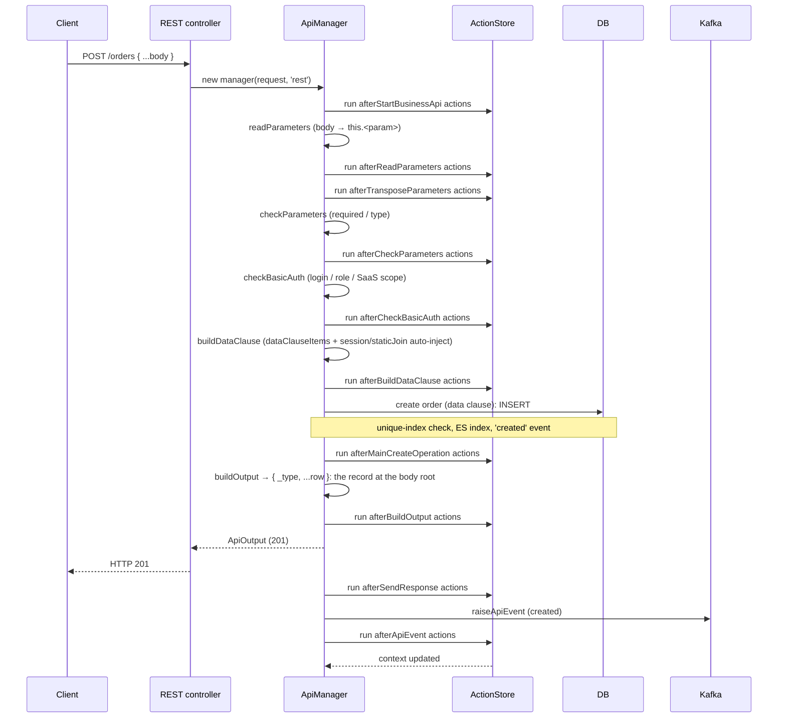

# Create API

A `create`-crudType `BusinessApi` inserts a new row of its
`dataObjectName` and returns it. You declare it explicitly: there is no
auto-generated create endpoint; the route exists because you author the
`businessLogic[]` entry. The compiler supplies the standard create
pipeline (read → validate → build data clause → insert → event), so a
minimal create API is just an `apiOptions` block plus a transport flag.

```json
{
  "basics":      { "apiOptions": { "name": "createOrder", "crudType": "create", "dataObjectName": "Order" } },
  "controllers": { "restSettings": { "hasRestController": true } }
}
```

That mounts `POST /orders`. The request body is validated against the
data object's required properties; the response is the created row with
a `201` status.

## How a create request travels



The body `buildOutput` produces is the **record itself at the root**, with a required `_type` and no wrapper. See [Response shape](response-shape.md) for the full contract, including the problem+json error body.

Create **skips** the where-clause / fetch-instance / check-instance
steps (steps 6–8 of the [request lifecycle](overview.md#request-lifecycle)):
there is no existing record to locate.

## Workflow milestones

Populate these under `workflow.create.<milestone>` (ordered action-name
arrays). They map onto the [ApiManager](api-manager.md) hook points:

- `afterStartBusinessApi`
- `afterReadParameters`
- `afterTransposeParameters`
- `afterCheckParameters`
- `afterCheckBasicAuth`
- `afterBuildDataClause`
- `afterMainCreateOperation`
- `afterBuildOutput`
- `afterSendResponse`
- `afterApiEvent`

See [`CreateBusinessWorkflow`](../../spec/CreateBusinessWorkflow.md).

## `dataClauseItems`: the write payload

Create builds its INSERT from `query.dataClauseItems`. Each entry is a
[`DataMapItem`](../../spec/DataMapItem.md) mapping a property `name` to
a `value` MScript (or literal). Caller-supplied values reference a
request parameter (`"this.<param>"`); constants quote themselves
(`"'draft'"`); computed values call a library function.

```json
"query": {
  "dataClauseItems": [
    { "name": "title",   "value": { "js": "this.title" } },
    { "name": "total",   "value": { "js": "this.lineItems.reduce((s, i) => s + i.price, 0)" } },
    { "name": "status",  "value": { "js": "'draft'" } }
  ]
}
```

> **Auto-injected properties.** Any property bound by `sessionSettings`
> or `staticJoin` on the data object (owner id, tenant id, parent
> references) is injected at write time and must **not** appear in
> `dataClauseItems`: declaring it there is redundant and risks letting
> a caller override a session-bound value.

> **The primary key is not a `dataClauseItems` entry.** The create
> mints the row's `id` itself and never reads an entry named
> `id`, so such an entry is refused at design time with
> `DATA_CLAUSE_ITEM_NOT_EMITTED`. To create a row under a caller- or
> event-supplied id (a mirror keyed by an upstream id), declare a
> request parameter named `id` instead: the create keeps a `this.id`
> that is already set and mints one only when it is empty. The same
> entry on an update api is refused too: an update never rewrites the
> key. The other framework columns get the same refusal for the same
> reason: `createdAt` / `updatedAt` (stamped by the database layer; model
> an upstream time as a property of its own, e.g. `sourceCreatedAt`) and,
> on a create, `isActive` / `_archivedAt` (a create always inserts an
> active row).

A create API has no `whereClause`, `getOptions`, `listOptions`, or
`deleteOptions`: those blocks are dropped if present (see the
[applicability table](overview.md#crudtype-drives-field-applicability)).
Of `selectClause` only `selectProperties` is read: it narrows the `201`
answer to the declared properties + `id`, while the insert and every
action keep the full row (see
[Response shape](response-shape.md#write-answers-and-selectproperties)).

## On a moderated object

When the object carries
[`objectModeration`](../capabilities/object-moderation.md), the create meets
the moderation seam right after `afterBuildDataClause`, with nothing to
declare on the api. An accepted write continues as above and its `201`
also carries `moderation: { id, status }`. In the default `staged` mode a
held write (`reject`, `review`, low confidence, provider failure) answers
`202` `{ moderation: { id, status, message } }` and inserts nothing: no
`afterMainCreateOperation`, no output stages, no `created` event, until a
reviewer accepts it and the write is replayed through this api. In
`onPlace` mode the row is always inserted, carrying the verdict in its
`moderationStatus` column. Cron and `API.*` internal calls, and callers
holding an `exemptRoles` role, write straight through. See
[Object content moderation: what the caller sees](../capabilities/object-moderation.md#what-the-caller-sees).

## `dataViewName` does not apply

`apiOptions.dataViewName` has **no effect** on create: the insert
always runs against the DB. DataView reads are `get` / `list` only
(see [BusinessApi overview](overview.md#reading-from-a-dataview)).

## What the insert does

The main create operation, on every supported database engine:

1. Runs the **unique-index pre-check** against the data object's unique
   indexes, applying each index's `onDuplicate` policy (stop the
   operation, or overwrite the existing row).
2. **Inserts** the row.
3. **Indexes** the row to Elasticsearch (the read replica), settled or
   timed out before the event is raised.
4. Emits the `created` **DB-level event**.
5. Returns the created row.

The generated database helpers that do this are described in
[the compiler specification](../../compiler/index.md).

## Worked example: `createOrder` with a validation guard

```json
{
  "basics": {
    "apiOptions": { "name": "createOrder", "crudType": "create", "dataObjectName": "Order" },
    "authOptions": { "loginRequired": true }
  },
  "controllers": { "restSettings": { "hasRestController": true, "routePath": "/orders" } },
  "parameters": {
    "requestParameters": [
      { "name": "items", "type": "Object", "isArray": true, "httpLocation": "body", "required": true }
    ]
  },
  "query": {
    "dataClauseItems": [
      { "name": "items",  "value": { "js": "this.items" } },
      { "name": "total",  "value": { "js": "this.items.reduce((s, i) => s + i.price * i.qty, 0)" } },
      { "name": "status", "value": { "js": "'draft'" } }
    ]
  },
  "actions": {
    "fetchObjectActions": [
      { "name": "loadBuyer", "targetObject": "User", "matchValue": { "js": "this.session.userId" }, "localKey": "id", "isRequired": true, "contextPropertyName": "buyer" }
    ],
    "validationActions": [
      {
        "name":             "checkCreditLimit",
        "description":      "Order total must not exceed the buyer's credit limit.",
        "validationScript": { "js": "this.total <= this.buyer.creditLimit" },
        "shouldBeTrue":     true,
        "errorMessage":     "Order total exceeds your credit limit.",
        "errorStatus":      "422"
      }
    ]
  },
  "workflow": {
    "create": {
      "afterCheckParameters": ["loadBuyer", "checkCreditLimit"]
    }
  }
}
```

`loadBuyer` fetches the buyer onto `this.buyer`; `checkCreditLimit`
rejects with 422 before the INSERT. The owner / tenant ids are injected
from the session by the data object's `sessionSettings`, so they are
absent from `dataClauseItems`.

## See also

- [Response shape](response-shape.md): the response body contract
- [BusinessApi overview](overview.md) · [Update API](update-api.md)
  (the other write crudType) · [Get API](get-api.md)
- [Bulk actions](bulk-actions.md): inserting many rows at once
- Specification: [`CreateBusinessWorkflow`](../../spec/CreateBusinessWorkflow.md),
  [`DataMapItem`](../../spec/DataMapItem.md),
  [`BusinessApiQuery`](../../spec/BusinessApiQuery.md).
