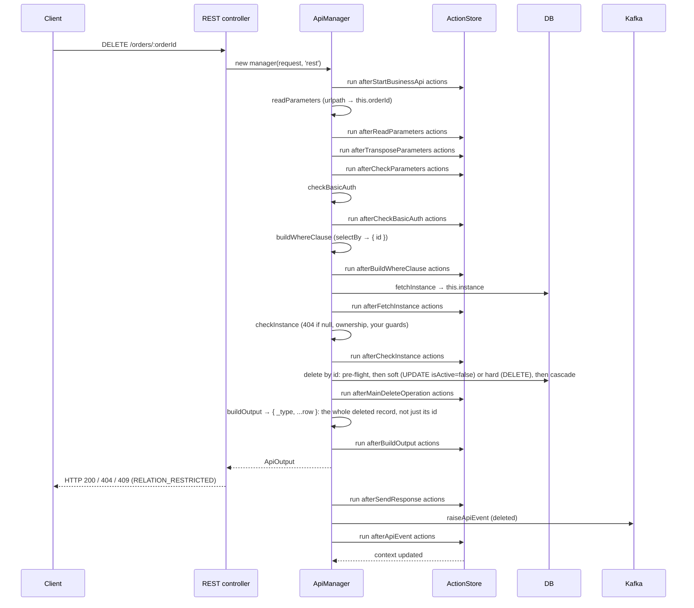

# Delete API

A `delete`-crudType `BusinessApi` locates one record and removes it:
either a soft delete (mark inactive) or a hard delete (physical
removal). Declared explicitly under `businessLogic[]` like every API.
The compiler supplies the pipeline (read → build where → **fetch
instance** → check → delete → event); the fetch-before-delete step lets
your guards inspect the record before it goes.

```json
{
  "basics":      { "apiOptions": { "name": "deleteOrder", "crudType": "delete", "dataObjectName": "Order" } },
  "controllers": { "restSettings": { "hasRestController": true } }
}
```

That mounts `DELETE /orders/:orderId`.

The answer is the deleted row. A `query.selectClause.selectProperties`
list narrows it to the declared properties + `id` (the delete and its
guards still see the full row, see
[Response shape](response-shape.md#write-answers-and-selectproperties)).

## How a delete request travels



The body `buildOutput` produces is the **record itself at the root**, with a required `_type` and no wrapper. See [Response shape](response-shape.md) for the full contract, including the problem+json error body.

Delete **skips** the data-clause step (no field changes). It shares the
single-record safety guarantee with update: the fetched instance's
`id` is what gets deleted, regardless of WHERE breadth.

## Workflow milestones

Populate these under `workflow.delete.<milestone>`:

- `afterStartBusinessApi`
- `afterReadParameters`
- `afterTransposeParameters`
- `afterCheckParameters`
- `afterCheckBasicAuth`
- `afterBuildWhereClause`
- `afterFetchInstance`
- `afterCheckInstance`
- `afterMainDeleteOperation`
- `afterBuildOutput`
- `afterSendResponse`
- `afterApiEvent`

See [`DeleteBusinessWorkflow`](../../spec/DeleteBusinessWorkflow.md).

## `whereClause`: locate the record

Delete locates the row via `query.whereClause.selectBy` (default
`["id"]`), identical to [get](get-api.md#whereclause-the-locator) and
[update](update-api.md#whereclause-locate-the-record). Scope with
`additionalClauses` so a caller can't delete outside their tenant /
ownership.

## `deleteOptions`: soft vs hard

[`DeleteOptions.useSoftDelete`](../../spec/DeleteOptions.md) is the
per-API flag. Whether a delete is soft or hard is ultimately driven by
the **data object's** soft-delete configuration (the compiler reads
the object's `useSoftDelete`):

- **Soft delete**: the row is marked inactive (`isActive: false`) and
  stamped with `_archivedAt`; it stops appearing in reads (which filter
  `isActive: true`) but stays in the table. The default for primary data
  objects.
- **Hard delete**: the row is physically removed. Used for objects with
  no soft-delete configuration.

```json
"query": {
  "deleteOptions": { "useSoftDelete": true }
}
```

Either way the `deleted` DB-level event fires so downstream subscribers
(cache invalidators, projectors) can react.

On an object with [`objectModeration`](../capabilities/object-moderation.md)
in `mode: onPlace` the fetch-instance step runs the moderation read gate, so
a non-privileged caller who is not the author meets `404` on a row that is
not yet `accepted`. Deletes are never moderated themselves. See
[the onPlace read gate](../capabilities/object-moderation.md#the-onplace-read-gate).

## `dataViewName` does not apply

`apiOptions.dataViewName` has **no effect** on delete: the fetch and
the delete run against the DB. DataView reads are `get` / `list` only
(see [BusinessApi overview](overview.md#reading-from-a-dataview)).

## What the delete does

The pipeline fetches the row by id for the fetch-instance step, then
deletes it by id. On every supported database engine the delete runs in
three phases:

1. **Pre-flight** (only when the delete's cascade subtree holds a
   `restrict` edge): walk everything this delete removes, on every branch,
   and ask whether anything that will outlive it still points in. If so the
   service answers `409 RELATION_RESTRICTED` before the first write.
2. **The write**: a soft delete marks the row (`isActive: false`,
   `_archivedAt` stamped); a hard delete physically removes it. Which one
   runs follows the data object's soft-delete setting, never both.
3. **Cascade**, per declared relation: children with `doDelete` are
   deleted, children with `setNull` have their reference cleared.

Both soft and hard deletes de-index the row from Elasticsearch and emit the
`deleted` DB-level event. The de-index is awaited (for a bounded time,
never failing the delete) before the event, so a `deleted` consumer that
re-reads the source projection does not find the row. The removal is
issued with a version strictly above the row's `updatedAt`, so a stalled
update of the row that lands afterwards is refused by Elasticsearch for the
index's `gc_deletes` window (60 s by default) instead of resurrecting the
document. The pre-flight and cascade phases apply only to objects that
actually declare the matching relations; an object nothing points at gets
neither and issues no extra query. The result is the deleted record itself
(with `isActive: false` and `_archivedAt` for a soft delete).

See [On-delete cascades](../data-modeling/relations.md#on-delete-cascades)
for what each `onDeleteAction` value does and what the 409 means, and
[Lifecycle & state](../data-modeling/lifecycle-and-state.md) for the
soft-delete model. For how the generated service implements the
phases, see [the compiler specification](../../compiler/index.md).

## Worked example: `deleteOrder` with a state guard

```json
{
  "basics": {
    "apiOptions": { "name": "deleteOrder", "crudType": "delete", "dataObjectName": "Order" },
    "authOptions": { "loginRequired": true, "ownershipCheck": true }
  },
  "controllers": { "restSettings": { "hasRestController": true, "routePath": "/orders/:orderId" } },
  "query": {
    "whereClause":  { "selectBy": ["id"] },
    "deleteOptions": { "useSoftDelete": true }
  },
  "actions": {
    "validationActions": [
      {
        "name":             "notShipped",
        "description":      "A shipped order can't be deleted.",
        "validationScript": { "js": "this.instance.status !== 'shipped'" },
        "shouldBeTrue":     true,
        "checkType":        "liveCheck",
        "errorMessage":     "Shipped orders cannot be deleted.",
        "errorStatus":      "409"
      }
    ]
  },
  "workflow": {
    "delete": { "afterCheckInstance": ["notShipped"] }
  }
}
```

`notShipped` reads the fetched `this.instance` and rejects with 409
before the soft delete runs.

## See also

- [Response shape](response-shape.md): the response body contract
- [BusinessApi overview](overview.md) · [Update API](update-api.md)
  (shares fetch-then-write) · [Get API](get-api.md)
- [Lifecycle & state](../data-modeling/lifecycle-and-state.md); restoring a
  soft-deleted row (restore / unarchive / undelete) is an `update` API, not a
  `delete` API; see [Restore endpoint](../data-modeling/lifecycle-and-state.md#restore-endpoint)
- Specification: [`DeleteBusinessWorkflow`](../../spec/DeleteBusinessWorkflow.md),
  [`DeleteOptions`](../../spec/DeleteOptions.md),
  [`WhereClauseSettings`](../../spec/WhereClauseSettings.md).
