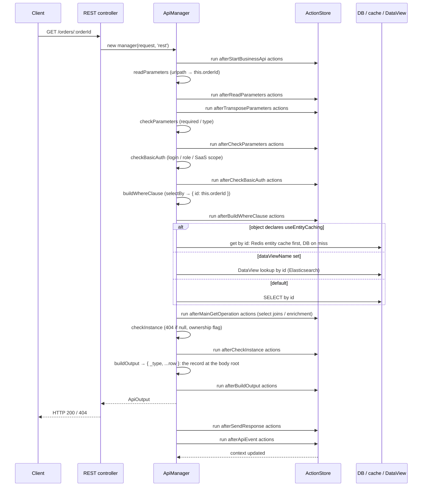

# Get API

A `get`-crudType `BusinessApi` fetches a single record of its
`dataObjectName` by a locator and returns it. Like every API it is
declared explicitly under `businessLogic[]`: there is no
auto-generated get endpoint. The compiler supplies the read pipeline
(read → build where → fetch → output); a minimal get API is one
`apiOptions` block plus a transport flag.

```json
{
  "basics":      { "apiOptions": { "name": "getOrder", "crudType": "get", "dataObjectName": "Order" } },
  "controllers": { "restSettings": { "hasRestController": true } }
}
```

That mounts `GET /orders/:orderId`. The locator defaults to `id`; a
missing record returns `404`.

## How a get request travels



The body `buildOutput` produces is the **record itself at the root**, with a required `_type` and no wrapper. See [Response shape](response-shape.md) for the full contract, including the problem+json error body.

Get **skips** the data-clause step (no write). It runs the where-clause
and fetch steps but never `fetchInstance` separately: the main get
operation *is* the fetch.

## Workflow milestones

Populate these under `workflow.get.<milestone>`:

- `afterStartBusinessApi`
- `afterReadParameters`
- `afterTransposeParameters`
- `afterCheckParameters`
- `afterCheckBasicAuth`
- `afterBuildWhereClause`
- `afterMainGetOperation`
- `afterCheckInstance`
- `afterBuildOutput`
- `afterSendResponse`
- `afterApiEvent`

See [`GetBusinessWorkflow`](../../spec/GetBusinessWorkflow.md). By
default `raiseApiEvent` is `false` (for every api): a get publishes its
record to Kafka only when it sets the field to `true` explicitly.

## `whereClause`: the locator

Get resolves a single record via `query.whereClause.selectBy`. The
default is `["id"]`, which makes the URL parameter `:orderId`. Selecting
by another unique property changes the parameter:

```json
"query": {
  "whereClause": { "selectBy": ["slug"] }
}
```

⇒ `GET /orders/:slug`. `additionalClauses` append conditional scope
fragments (tenant / role visibility / soft-delete exclusion) the same
way they do for lists. The full where-clause vocabulary
(`selectBy`, `fullWhereClause`, `additionalClauses`) is documented on
the [List API](list-api.md#whereclause-locator-and-base-filter) page;
get uses the same syntax to locate one row instead of scoping many.

## `getOptions`

`query.getOptions` carries the get-specific read knobs. See
[`GetOptions`](../../spec/GetOptions.md).

The Redis entity cache is **not** a get-api knob: it is declared on the
DATA OBJECT (`objectSettings.redisEntityCacheSettings.useEntityCaching`)
and then every get-by-id, from every caller, is cache-first; no
per-api option turns it on or off. See
[Redis entity caching](../composition/redis-entity-caching.md).

## `selectClause`: projection and joins

`get` shares the read-side `selectClause` with `list`:
`selectProperties` chooses which columns to return, and `selectJoins`
embeds related objects. The syntax is identical; see
[List API](list-api.md#selectclause-projection-and-joins) and
[`SelectClauseSettings`](../../spec/SelectClauseSettings.md).

The projection is applied at the query on both read shapes, and the
rules for nested/aliased refs, unknown properties, and the cases where
the read is widened are documented once, under
[How `selectProperties` is applied](list-api.md#how-selectproperties-is-applied).
Note the ownership case in particular: a `get` guarded by
`ownershipCheck` reads the owner column too, because the owner compare
reads it off the fetched row, but the response is still narrowed to the
declared columns + `id`. Where a target language's service cannot narrow
the response in this case, design time reports
`SELECT_PROJECTION_SUPPRESSED`.

## Reading from a DataView

Setting `apiOptions.dataViewName` makes get read from a BFF DataView's
Elasticsearch index instead of the DB: no DB hit at all. This is one of
the **two** crudTypes (get and list) that honor `dataViewName`; see
[BusinessApi overview](overview.md#reading-from-a-dataview).

**Which gates the view-backed get keeps.** The api's compiled where clause
(its `additionalClauses`, its `fullWhereClause`, its authored `selectBy`
selectors and, in a multi-tenant project, the tenant term) travels with
the address as the read's `filter`, so a document the clause excludes
answers **404**, exactly as a row the clause excludes is a miss on the
database path. A condition naming a column the view does not project
matches nothing, so it fails closed rather than open. What does **not**
travel is `selectProperties`: the Elasticsearch read takes no column list,
and declaring one beside `dataViewName` is reported at design time
(`DATAVIEW_SELECT_PROPERTIES_INERT`); narrow the view's
`viewBasics.properties` instead. Row-level gates that compare a fetched
row, `ownershipCheck` among them, are unchanged: they run on the document
this read returns.

**On an `onPlace`-moderated object.** A get of an object with
[`objectModeration`](../capabilities/object-moderation.md) in `mode: onPlace`
carries the moderation read gate, on the database path and on a
`dataViewName` read alike: a non-privileged caller who is not the row's
author meets `404` on a row that is not `accepted`. Reviewers, the platform
operator and trusted system transports read every row. See
[the onPlace read gate](../capabilities/object-moderation.md#the-onplace-read-gate).

## A get on a virtual (response-only) object

When `dataObjectName` names a [virtual data object](../data-modeling/data-objects.md#virtual-response-only-data-objects) (`objectSettings.basicSettings.virtual: true`), the get computes its record instead of reading one. It takes **no id route parameter**, so a `$default` route is the bare resource path (e.g. `/accessdecisions`), the same path the object's default-routed list api takes. A virtual get next to a default list must therefore **author its own `restSettings.routePath`** (e.g. `/checkaccess`); leaving both on `$default` is a design-time `ROUTE_COLLISION` error. The service reads no stored row: the main operation sets the result to an empty record (mirrored onto `this.<objectName>`) and marks the outcome `matched`, so the after-main stages still run. The response is what the api's actions add on top of that empty record:

```json
{
  "basics": { "apiOptions": { "name": "checkAccess", "crudType": "get", "dataObjectName": "accessDecision" } },
  "controllers": { "restSettings": { "routePath": "/checkaccess", "hasRestController": true } },
  "actions": { "addToResponseActions": [ { "name": "writeDecision", "context": [
    { "contextName": "allowed", "contextValue": { "js": "this.permissionOk" } },
    { "contextName": "reason",  "contextValue": { "js": "this.denyReason ?? null" } } ] } ] },
  "workflow": { "get": { "afterMainGetOperation": ["writeDecision"] } }
}
```

Ownership checks, parent-ownership checks and `dataViewName` read stored rows and are validation errors on such an api (`VIRTUAL_OBJECT_API_STORAGE_OPTION`).

## Database behaviour

The main get operation fetches the row by id (or by the compiled where
clause). On both supported database engines it excludes soft-deleted rows
(`isActive: true` is part of the match) unless the caller of the data
layer asks for archived rows. With `dataViewName` set, the database is
bypassed in favor of the Elasticsearch DataView lookup. For how the
generated service implements the lookup, see
[the compiler specification](../../compiler/index.md).

## Worked example: `getOrder` with an ownership scope

```json
{
  "basics": {
    "apiOptions": { "name": "getOrder", "crudType": "get", "dataObjectName": "Order" },
    "authOptions": { "loginRequired": true }
  },
  "controllers": { "restSettings": { "hasRestController": true, "routePath": "/orders/:orderId" } },
  "query": {
    "whereClause": {
      "selectBy": ["id"],
      "additionalClauses": [
        { "name": "ownOrdersOnly", "condition": { "js": "this.session.role !== 'admin'" }, "whereClause": { "js": "{ sellerId: this.session.userId }" } }
      ]
    },
    "selectClause": {
      "selectProperties": ["id", "status", "total", "createdAt"],
      "selectJoins": [
        { "joinName": "buyer", "joinedDataObject": "User", "selector": "buyerId->id", "properties": ["id", "fullName"] }
      ]
    }
  }
}
```

A non-admin caller can only fetch their own orders (the additional
clause scopes the WHERE); the response embeds the buyer.

## See also

- [Response shape](response-shape.md): the response body contract
- [BusinessApi overview](overview.md) · [List API](list-api.md) (where
  the shared read clauses are documented in full) · [Create API](create-api.md)
- [BFF](../system-services/bff.md) (DataView reads)
- Specification: [`GetBusinessWorkflow`](../../spec/GetBusinessWorkflow.md),
  [`GetOptions`](../../spec/GetOptions.md),
  [`WhereClauseSettings`](../../spec/WhereClauseSettings.md),
  [`SelectClauseSettings`](../../spec/SelectClauseSettings.md).
