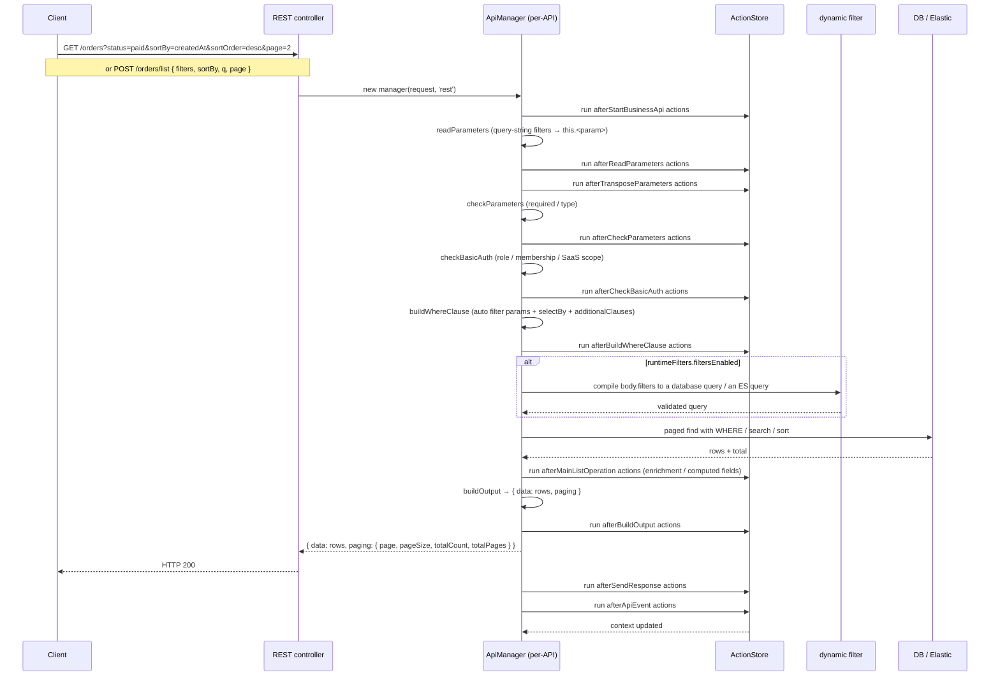

# List API

A `list`-crudType `BusinessApi` returns a filtered, sorted, paginated
set of records. Declared explicitly under `businessLogic[]` like every
API. The compiler turns the filter into a database query (for
DataObject-backed lists) or an Elasticsearch query (for DataView-backed
lists) and applies the same auth gates as any other read. This page is
the syntax reference for list (`whereClause`, `selectClause`,
`listOptions`, and `paginationOptions`) and the home of the where-clause
vocabulary that [get](get-api.md), [update](update-api.md), and
[delete](delete-api.md) also use to locate records.

```json
{
  "basics":      { "apiOptions": { "name": "listOrders", "crudType": "list", "dataObjectName": "Order" } },
  "controllers": { "restSettings": { "hasRestController": true } }
}
```

That mounts `GET /orders`.

## Workflow milestones

Populate these under `workflow.list.<milestone>`:
`afterStartBusinessApi`, `afterReadParameters`,
`afterTransposeParameters`, `afterCheckParameters`,
`afterCheckBasicAuth`, `afterBuildWhereClause`, `afterMainListOperation`,
`afterBuildOutput`, `afterSendResponse`, `afterApiEvent`. See
[`ListBusinessWorkflow`](../../spec/ListBusinessWorkflow.md).

## How a list request travels



The list envelope (`{ data, paging }`) and the keyset variant are documented in full on [Response shape](response-shape.md), alongside the problem+json error body.

The four blocks that shape a list (`whereClause`, `selectClause`,
`listOptions`, `paginationOptions`) live under `query` on the
business API. Their behaviour stacks: WHERE locator + per-property
filter params + runtime filter body + joint / membership / permission
/ search filters → final query.

## `whereClause`: locator and base filter

`whereClause` is the static, design-time filter. It is the locator for
`get` / `update` / `delete` (single-record) and the base WHERE for
`list` (scoping).

```json
"whereClause": {
  "selectBy":         ["slug"],
  "fullWhereClause":  null,
  "additionalClauses": [
    { "name": "publishedOnly", "condition": { "js": "this.session.role !== 'admin'" }, "whereClause": { "js": "{ isPublished: true }" } }
  ]
}
```

- `selectBy`: list of property names that must match exactly. For
  single-record APIs it picks the URL parameter
  (`selectBy: ["slug"]` ⇒ `/<resource>/:slug`). For lists it scopes
  results to the given values.
  Each list scope term naming a declared property must bind from a declared request or redis parameter, a same-named `:segment`, or the property's `sessionSettings.sessionParam`; otherwise validation reports `LIST_SELECTBY_UNBINDABLE`. Stored DataView reads are exempt.
- `fullWhereClause`: an MScript expression that returns a full WHERE
  object; overrides the default locator.
- `additionalClauses`: conditional MScript fragments appended to the
  WHERE when their `condition` evaluates truthy. Use these for
  tenant-scope, role-based visibility, or soft-delete exclusion.
- `fuzzyDomainFilters` (list only): narrow by a judgement no column
  holds, decided per distinct value by a decision provider. See
  [Fuzzy domain filters](#fuzzy-domain-filters) below.

See [`WhereClauseSettings`](../../spec/WhereClauseSettings.md).

## Per-property filter parameters

When `listOptions.queryFiltersActive` is `true` (default), the compiler
auto-adds query-string parameters for every property on the data
object that carries an `isFilterParameter: true` flag in its
`basicSettings`. Setting it to `false` suppresses both the parameters
and their WHERE items. Each param becomes part of the request shape: the
caller passes `?status=paid&priority=$gte-2` and the values land on
the runtime context, then merge into the WHERE.

Properties set as `selectBy` or already declared in
`requestParameters` are excluded from the auto-filter set: no
duplicate params.

### Every surface, one binding

A declared filter belongs to the **API**, not to its REST route. The
generated service binds all of them in one place, and every transport
reader supplies its own request scopes:

| Surface | Where the filter value is read from |
|---|---|
| REST | the query string first, then the JSON body |
| MCP | the tool-call arguments |
| gRPC | the request message fields |
| internal call | the `API.<name>({ … })` params object |
| kafka | the decoded event payload |
| cron | the scheduled run's input |

If a surface exposes the API, it honours the API's filters. A `list` API's
MCP tool also advertises them: its `inputSchema` publishes every declared
filter as an optional query argument, alongside its declared request
parameters and its route segments.

### Value shape and the null rule

A declared filter is read verbatim from the first scope that carries it,
so the **caller** chooses the shape and both are supported:
`?status=paid` is a scalar equality term, and a JSON body
`{"status": ["paid", "open"]}` is the MQuery bare-array `$in`
shorthand. Nothing coerces between them, on any property: a scalar
property accepts a list and filters by membership.

Absence, and the two different nulls:

| What the caller sends | Meaning |
|---|---|
| the parameter, not at all | **no constraint**: the filter is skipped |
| `{"status": null}` | **no constraint**: same as not sending it |
| `?status=` (empty value) | **no constraint**: same as not sending it |
| `{"status": ["paid", null]}` | **400** `FILTER_VALUE_NULL_ELEMENT` |
| `{"status": {"$gte": 2}}`, `{"status": {}}` | **400** `FILTER_OPERATOR_NOT_ALLOWED` |
| `?status[]=paid`, `?status[$gte]=2` | **no constraint**: not bracket-parsed: these are parameters named `status[]` / `status[$gte]`, not `status` |

Those two shapes are the whole contract: a declared filter carries a
VALUE, never an OPERATOR. `isFilterParameter` says the filter's
operator "follows the property's `type` automatically": it is the
server's choice, so an object value is refused rather than read as an
operator map. Read as one, it would hand the caller an operator surface
the API never advertised, bypassing `allowedOperators` and, on an
authored `selectBy` term, letting the caller restate the very scope the
route addressed. Operators have a supported home: the runtime-filter
body below, which validates the operator name and honours the
allow-list. To send a list in the query string, repeat the key
(`?status=paid&status=open`).

The first three are the same rule: a declared filter constrains only
when it has a value, so an unsent one still means "no constraint".

The empty-value row covers what a cleared form field and a
key-always-appended URL builder send: `?status=` is absence on every
surface. An empty value in one scope does not shadow a real value in the
next, so `?status=` plus a JSON body `status` reads the body.

`0`, `false` and `"0"` are **values**, not absence, and constrain
normally. An empty string *inside* a value list
(`{"status": ["paid", ""]}`) is left exactly as sent, for the same
reason a null element is refused rather than stripped: the caller wrote
it, and silently answering a narrower filter hides the mistake.

An **element** of a value list is not covered by that rule and is
refused instead. A `null` inside `$in` selects a
different row set on every backend (Postgres cannot match it,
MongoDB matches `null` *and* missing, Elasticsearch rejects it inside
`terms`), so it is answered as a 400 that names the parameter and the
element index, never lowered into a dialect-specific runtime error.
The element is not stripped either: the caller wrote it on purpose,
`[null]` would strip to an empty `$in` (a membership test that
matches nothing on all three dialects) and
silently answering a narrower filter than the request asked for hides
the mistake. Remove the element, or omit the filter to impose no
constraint. The same input inside a `filters` body (below) answers the
same way, as `NULL_IN_VALUES`, including the LIST form of `contains` /
`notContains`, whose operand arrives under `value` rather than `values`.

An authored **`selectBy`** term answers the same way. A
selectBy term names a declared `requestParameter`, so its value is
caller-chosen in exactly the same sense (`/orders/:organizationId`
addressed with `{"organizationId": ["o-1", null]}` is a value list with
a null member), and both where-builders bind it through the same
guard.

Filter values the SERVICE builds rather than receives (the id lists
behind joint filters, search filters and membership filters) take the
opposite branch and drop their nulls, because nothing the caller sent
produced them and there is no request for the caller to correct.

### Range forms on Date and numeric filters

A scalar filter parameter whose property type is `Date`, `Integer`,
`Short`, `Float`, `Double` or `Decimal` also reads a small, closed set of
value-prefixed range forms. The caller still sends a VALUE; the server
parses it into the operator map, so the Elasticsearch list path (an ES
`range` query) and the database path answer the same row set:

| Value | Meaning |
|---|---|
| `$lt-<v>`, `$lte-<v>`, `$gt-<v>`, `$gte-<v>` | the comparison against `<v>` |
| `$btw-<min>_<max>` | `min <= value <= max`, both bounds inclusive |
| `$btw-<min>-<max>` | the same, numbers only (`$btw--5-5` works) |
| `$today`, `$week`, `$month` | Date only: the current UTC day, ISO week (Monday 00:00Z to the next Monday) or calendar month, start inclusive and end exclusive |
| `$ltoday`, `$lweek`, `$lmonth` | Date only: everything before the end of that window |

The `$btw` bounds are separated by `_` on every type because an ISO date
contains `-`: `?startAt=$btw-2026-10-18T00:00:00Z_2026-10-31T00:00:00Z`.
The windows resolve against the server clock in UTC, whatever the
caller's timezone; to filter by a local day, send `$btw-` with the two
instants of that day. A `<date>` is ISO 8601 (`2026-10-18` or a
date-time), and a date-time without a zone is read as UTC, the same
reading Elasticsearch gives `strict_date_optional_time`. In a query
string, encode a `+` offset as `%2B`.

A malformed value answers **400** `FILTER_VALUE_INVALID`, naming the
parameter and the accepted forms, on both paths: an unknown operator, a
malformed operand, `$btw` with a `-` between two dates or with its lower
bound above the upper one, a plain value that is not an ISO date (or not
a number, or not an integer on an `Integer` / `Short` column), and an
operator form sent as a member of a value list.

Two readings to keep in mind:

- **A date-only bound on a date-time column means midnight UTC.**
  `$lte-2026-10-31` is "up to 2026-10-31T00:00:00Z", so the rest of that day
  is excluded. For "to the end of the 31st" send `$lt-2026-11-01`, or a
  `$btw-` whose upper bound is a date-time.
- **Only a scalar Date or numeric filter parses the forms.** On an `isArray`
  property a `$`-prefixed value is still a literal member of the membership
  test (a driver or Elasticsearch error), and on every other type (String,
  Enum, ID, Boolean) the value is an exact equality term. A plain value that
  is well formed is bound as an equality term.

A few other forms do less on a REST list than they appear to:

| Form | What it does | Instead |
|---|---|---|
| `?status=null` | binds the literal string `"null"` (no IS NULL) | runtime `filters` with `isNull` / `missing` |
| `?tags=<v>&tags_op=contains` | `tags_op` is ignored; an array filter is always "any of" (overlap) | runtime `filters` with `contains` and a list value (all of) |
| a String or Enum value | exact, case-sensitive equality | runtime `filters` with `contains`, `starts` or `match` |
| `$bbox-`, `$circle-`, `$polygon-` on a GeoPoint | not parsed (an equality term on the geo column) | the object's `/geo` routes (`geoSettings`) |

Runtime filters are the body described in the next section; turn them on
with `listOptions.runtimeFilters.filtersEnabled`.

## Runtime filters: operator-based body

`listOptions.runtimeFilters` opts a list API into a richer filter
surface. Four independent flags:

| Flag | Effect |
|---|---|
| `filtersEnabled` | Accept a `filters` POST body with operator-based per-field criteria. |
| `searchEnabled` | Accept a `?q=` full-text search across `searchedFields`. |
| `sortEnabled` | Accept runtime `?sortBy=&sortOrder=` query parameters; static `listSortBy` becomes the default. |
| `savedFiltersEnabled` | Auto-generate `/filters` aux endpoints + a per-service `listSavedFilter` table. |

When `filtersEnabled: true`, the API accepts:

```http
POST /orders/list
Content-Type: application/json

{
  "filters": {
    "status":    { "operator": "in",    "values": ["paid", "shipped"] },
    "total":     { "operator": "gte",   "value":  100 },
    "createdAt": { "operator": "range", "values": ["2026-01-01", "2026-06-01"] },
    "title":     { "operator": "contains", "value": "annual" }
  },
  "sortBy":    "createdAt",
  "sortOrder": "desc",
  "page":      1
}
```

The service validates the body and then compiles it either to MQuery (for
DataObject sources, which the service translates to SQL / Mongo) or to an
Elasticsearch `bool` query (for DataView sources). See
[`ListRuntimeFilterSettings`](../../spec/ListRuntimeFilterSettings.md).

### Operator vocabulary

The canonical operator set has twenty-two operators:

| Operator | Value shape | Meaning |
|---|---|---|
| `eq` | `value` | Equality. |
| `noteq` | `value` | Inequality. |
| `in` | `values: []` | One of. |
| `notin` | `values: []` | None of. |
| `gt`, `gte`, `lt`, `lte` | `value` | Comparison. |
| `range` | `values: [lo, hi]` | Inclusive on both ends. |
| `exists`, `notNull` | — | Field present / non-null. |
| `missing`, `isNull` | — | Field absent / null. |
| `match` | `value` | Full-text match (ES) / `$match` (SQL). |
| `matchPhrase` | `value` | Phrase match, `$matchPhrase`. Adjacent-and-in-order on ES; **degrades to `$match`** on Postgres / Mongo. |
| `matchPhrasePrefix` | `value` | Phrase prefix (ES) / `$starts` (SQL). |
| `contains` | `value` | With a SCALAR value, substring: wildcard `*v*` (ES) / `$contains` (SQL). With a LIST value, array **superset containment** on both legs: the stored array holds every listed element, and an EMPTY list is the explicit *match-nothing* filter. A `null` ELEMENT is `NULL_IN_VALUES`. |
| `notContains` | `value` | Inverse. With a list value the negation is around the WHOLE conjunction ("at least one is missing"), not per element. |
| `starts` | `value` | Prefix. |
| `ends` | `value` | Suffix wildcard (ES) / `$ends` (SQL). |
| `wildcard` | `value` | Wildcard expression: `*` / `?` / `\` escapes. Raw `wildcard` (ES); translated into `$like`'s `%` / `_` grammar on the SQL / Mongo path. One asymmetry survives the translation: a `%` or `_` **already in the caller's pattern** is an ordinary character to ES and a wildcard to `$like`, because SQL spells a literal one with an `ESCAPE` clause and MQuery has no operand for it. `{"wildcard":"100%"}` therefore matches the literal `100%` on a DataView and anything starting with `100` on a DataObject. |
| `regexp` | `value` | Regular expression on the ES path. On the DataObject path the answer depends on the target language: where supported it is a `$regex` match, and some targets lower `regexp` to `$like` (a literal substring test, not a regex) instead, so the same filter body can answer two different questions depending on the generated language. On some targets the whole runtime-filter feature is unavailable. See [runtime list filters](../composition/runtime-list-filters.md). **Off unless the API lists it in `allowedOperators`**, and even then the pattern goes through a construct blacklist (not a proof of linearity, and not a timeout; see below). Anchoring and regex dialect differ per store; see the [ruling table](../mscript/query-reference.md#cross-dialect-operator-semantics). |

`allowedFields` and `allowedOperators` on
`ListRuntimeFilterSettings` restrict the surface per-API, on the
target languages where this feature is available at all. A `null`
`allowedFields` is not "any field": the compiler computes the default
(every `isFilterParameter` property; on a stored DataView the projection
plus every aggregate and stat name) minus every `hashed` / `isSecret` /
storage-internal column, and an empty default refuses every field. A
`null` `allowedOperators` allows every operator in the table **except
`regexp`**, which is default-deny: on the ES path and on a DataObject
path that reaches a regex engine it lowers to a caller-supplied program
for a backtracking engine (Postgres `~`, MongoDB PCRE2), where `(a+)+$`
costs ~10 s of a database worker on a thirty-character value. On a target
whose DataObject path lowers `regexp` to `$like` instead, the risk is
wrong rows, not a slow query. See
[runtime list filters](../composition/runtime-list-filters.md).
On an API that does opt in, the pattern is
scanned for two ambiguity families and refused with
`UNSAFE_REGEX_PATTERN`: a quantified GROUP whose body can itself
backtrack (`(a+)+`) unless that body carries a DELIMITER an iteration
cannot absorb and is unambiguous besides (so `^(-[a-z]+)*$` and
`^(\S+ ){4}\S+$` are fine and `^(\w+\w+,)+$` is not; see
[the delimited-list idiom](../composition/runtime-list-filters.md#the-delimited-list-idiom),
which also names the everyday shape this costs: a delimited list whose
cell is a choice, such as `^(true|false)(,(true|false))*$`), and
variable-length quantifiers that can
TRADE characters with each other (`a*a*a*a*b`, `a{0,9}` eight times,
`.*e.*e.*e.*e.*`, `a*a*a*b*b*b*c*c*c*Z`). The WHOLE
pattern is priced as one product and alternation branches ADD to it, so
one pair may trade and no more: `a*a*b`, `.*foo.*` and
`^(true|false|yes|no)$` stay allowed, while a third trading term
(`a*a*a*b`), a second pair anywhere else (`a*a*b*b*Z`,
`.*foo.*bar.*`) or a second branch that itself trades
(`a*a*Z|a*a*Z`) is refused. Quantifiers separated by a MANDATORY atom
they cannot match do not trade at all, which is why `\d+[a-z]+`,
`^\d+\.\d+\.\d+\.\d+$` and `^\w+\s+\w+\s+\w+\s+\w+$` all cost one
and keep working. Anything over 256 characters is refused too.

That scan is a **blacklist, not a guarantee**: it refuses two known
families and does not prove that what it accepts is linear; across a
500,000-pattern fuzz the worst ACCEPTED pattern still measured 58 ms
against a 256-character value. So each of the three stores also carries
a match timeout: a database statement timeout (Postgres and MongoDB
alike) surfaces as `503 DB_STATEMENT_TIMEOUT`, and the Elasticsearch
search timeout surfaces as `503 SEARCH_TIMEOUT`. All default to 30 s;
`0` disables. Default-deny is still the control that actually keeps the
operator off an API. See
[runtime list filters](../composition/runtime-list-filters.md).

On the **DataObject** path the criterion is translated to MQuery and
then lowered to the database dialect, and two operators are spelled
differently on the two sides: `notin` translates to `$notIn` and
`notContains` to `$notContains`, which the converter normalises onto
its canonical `$nin` / `$ncontains` arms. The two vocabularies are tied
together by a test, so a documented operator cannot ship without a
lowering on all three dialects.

A translated operator still carries **the backing store's** semantics,
and a few of them differ. `matchPhrase` is phrase-exact on
Elasticsearch and degrades to `$match` on the SQL / Mongo side;
`match` and `contains` mean different things on each of the three
stores. The per-store ruling for every such operator is the table in
[MScript query reference: Cross-dialect operator semantics](../mscript/query-reference.md#cross-dialect-operator-semantics).

An **empty `values[]`** is an explicit *match-nothing* filter on every
store, not "no filter"; see the same page. A client that means "no
filter on this field" must omit the criterion.

## Joint filters: filter by related-object criteria

`listOptions.jointFilters` filters the main list by a condition on a
related data object: the equivalent of an inner-join WHERE. The block
wraps an array of [`ListJointFilter`](../../spec/ListJointFilter.md)
entries with a top-level `operator` (`AND` default, or `OR`)
controlling how multiple filters combine.

```json
"jointFilters": {
  "operator": "AND",
  "filters": [
    {
      "name":             "withOverdueInvoices",
      "condition":        { "js": "this.session.role === 'finance'" },
      "joinedDataObject": "Invoice",
      "selector":         "id->orderId",
      "whereClause":      { "js": "{ status: 'overdue' }" }
    }
  ]
}
```

The service resolves the join through the relation declared on the
property (or through the joined object's relation if the main object
doesn't declare one). See [`ListJointFilterSettings`](../../spec/ListJointFilterSettings.md)
for the wrapper and [`ListJointFilter`](../../spec/ListJointFilter.md)
for each entry.
A joint filter can also carry `fuzzyDomainFilters` that narrow the
joined rows by a judgement about one of the joined object's properties
(see [Fuzzy domain filters](#fuzzy-domain-filters)).

## Membership and permission filters

- `listOptions.membershipFilters`: append WHERE fragments that limit
  the result to objects the current user is a member of. Multiple
  filters OR. See [`ListMembershipFilter`](../../spec/ListMembershipFilter.md).
- `listOptions.permissionFilters`: append permission-scoped WHERE
  fragments (object-level permissions). Multiple filters AND. See
  [`ListPermissionFilter`](../../spec/ListPermissionFilter.md).

A list of an object moderated with `objectModeration` in `mode: onPlace`
also carries the moderation read gate, with nothing to declare: a
non-privileged caller sees accepted rows plus their own. The gate also
rides the joint and membership filters of other objects' lists that narrow
by the moderated object. See
[Object content moderation: the onPlace read gate](../capabilities/object-moderation.md#the-onplace-read-gate);
a `staged` object never holds an unapproved row to hide.

## Fuzzy domain filters

`whereClause.fuzzyDomainFilters` narrows a list by a judgement no column
holds, such as "people whose profession normally requires a university
degree". A [decision provider](../capabilities/decision-layer.md) classifies
the **distinct values** of one column, never the rows, caches each
decision, and the list adds `profession IN (<qualifying values>)` to its
WHERE. A cold cache asks at most one decision per distinct value and a
warm cache asks none, so the row count never enters the cost.

```json
"whereClause": {
  "fuzzyDomainFilters": [
    {
      "name":                "graduateProfessions",
      "condition":           { "js": "this.graduateProfessionsOnly === true" },
      "targetProperty":      "profession",
      "criterion":           "names a profession that normally requires a completed university degree to practise",
      "providerName":        "mainJev",
      "confidenceThreshold": 0.8
    }
  ]
}
```

- **List APIs only**, on target languages that support it, and not on a
  DataView-backed read.
- The target is a scalar `String`, `Text`, `Enum`, `Integer` or `Short`
  property, never `id`, the tenant column or a session/owner column, and
  the `condition` may not read roles, permissions or memberships: a
  decision never decides visibility (`DECISION_ON_AUTHZ_SURFACE`).
- At most `maxDomainSize` distinct values (default 1,000, ceiling 5,000).
- The filter **fails closed**: a provider outage answers
  `FUZZY_DOMAIN_PROVIDER_FAILED` (503), or an empty list with
  `onProviderError: "matchNothing"`, never the unfiltered rows.
- A narrowed response carries a `fuzzyDomainFilters` attribution member
  naming the filter, provider, model and threshold; an exact list has
  none.

The same block on a [joint filter](#joint-filters-filter-by-related-object-criteria)
narrows the joined object instead. How the cache, the near-threshold
exclusion and the failure modes work is in
[The decision layer: fuzzy domain filters](../capabilities/decision-layer.md#fuzzy-domain-filters-query-time);
every field is on [`FuzzyDomainFilter`](../../spec/FuzzyDomainFilter.md).

## Full-text search

`listOptions.searchFilter` runs a keyword search against the data
object's Elasticsearch index, collects the matching id array, and
appends it to the WHERE. Configured fields go through
`ListSearchFilter.searchProperties`. See
[`ListSearchFilter`](../../spec/ListSearchFilter.md). The same
mechanism backs the runtime `?q=` parameter when
`runtimeFilters.searchEnabled` is set.

Design-time validation of `searchFilter.searchProperties` uses the bound
stored DataView's projected main-object columns and projected
`<aggregate>.<column>` paths. Projected framework fields are accepted;
unprojected fields, unknown paths, and bare aggregate or stat names are
refused with `PROPERTY_NOT_FOUND`. Dynamic views use the main object's
columns. The source property's Elasticsearch mapping controls full-text
warnings for an aggregate column; framework fields do not receive designer
full-text flag warnings.

For a list bound to a **stored** DataView (`apiOptions.dataViewName`)
the `?q=` path runs on the view index: an OR of one `$contains` per
`searchedFields` entry, lowered against the view's mapping: a
`fulltextSearch` String matches an analyzed word of its `.ftext`
sub-field or a case-insensitive substring, a plain String a
case-insensitive substring.

`searchedFields` is resolved against the api's **read source**, not
unconditionally against `dataObjectName`. On a stored DataView
that is the view document: every main-object column the view projects,
by its own name, and every column an aggregate projects, as
`<aggregate>.<column>`. A bare aggregate or stat name is an object, not
a text column, and is refused; so is a column the view does not project,
a non String / Text / Enum column, and a `hashed` / `isSecret` column
(never stored in a view index). A **dynamic** (read-time) view reads the
main object's own table, so only that object's columns are searchable
there. The rule the validator keeps: a searched field it accepts is one
the generated read can query, and one it refuses is not.

When the view catalog is not in scope (no `bffService` module resolves),
the validator keeps the `searchEnabled` / `searchedFields` coherence
checks but abstains from every existence and type judgment; it never
falls back to the main object's columns.

A `$match` / `$nmatch` or scalar `$contains` in a view-bound list's
`whereClause` / `additionalClauses` over a plain `keyword` String path (no
`.ftext` sub-field) raises the WARNING `DATAVIEW_TEXT_MATCH_NO_FTEXT`:
`$match` / `$nmatch` are a case-insensitive **whole-value** term match, so
`dune` does not find `Dune Messiah`, and `$contains` is a substring wildcard on
the raw value with no analyzed token semantics. Set
`indexSettings.fulltextSearch: true` on the source property for word search.
Only a literal MQuery object is inspected; a dynamic script, an unresolved
path, an array column or a non-string operand is never flagged.

```json
{
  "basics": {
    "apiOptions": { "name": "listStockItems", "crudType": "list", "dataObjectName": "stockItem", "dataViewName": "stockOverview" }
  },
  "query": {
    "listOptions": {
      "runtimeFilters": { "searchEnabled": true, "searchedFields": ["item.title", "item.barcode", "location"] }
    }
  }
}
```

Here `stockOverview` is a stored view of `stockItem` that projects
`location` and aggregates the stock item's `item` with its `title` and
`barcode`.

## `selectClause`: projection and joins

`selectClause.selectProperties` chooses which properties of the main
object to return. `selectClause.selectJoins` declares related objects
to embed in the response: each entry names a join path, the projected
properties on the join (`properties`), and a `joinName` under which
the embedded record appears.

```json
"selectClause": {
  "selectProperties": ["id", "title", "total", "createdAt"],
  "selectJoins": [
    {
      "joinName":         "buyer",
      "joinedDataObject": "User",
      "selector":         "buyerId->id",
      "properties":       ["id", "fullName"]
    }
  ]
}
```

For deeper join patterns (recursive, multi-hop, computed columns), see
the select-join pattern.

Two validation rules guard what a join may copy onto the response:

- a join's `properties` may not name a column the joined object declares
  `hashed` or `isSecret` (ERROR `SELECT_JOIN_SECRET_COLUMN`, every join
  shape, aliased refs included). A one-property join writes the value as a
  plain value under `joinName`, where the response secret scrub cannot see
  it. `apiOptions.exposeSecrets` does not open it: that opens columns of
  the api's own object only;
- a `joinName` equal to a column of the api's own object is a WARNING
  (`SELECT_JOIN_NAME_SHADOWS_COLUMN`): the join runs after the main
  operation and replaces that column on every returned record.

### How `selectProperties` is applied

The declared columns are applied **at the query** (`attributes` on a
SQL engine, a driver `projection` on mongo), so an undeclared column is
never read and there is no wider row in memory for a later step to leak.
Those are the two engines it reaches: a read served from **Elasticsearch**
through `apiOptions.dataViewName` has no projection arm at all, and says so
at design time rather than accepting the declaration (see the table below).
The returned rows are then picked down to the same list, which is what
makes the response *exactly* the declared set: mongo hands back `_id`
alongside a positive projection unless it is explicitly excluded, and the
row normalizer derives sibling keys (`<enum>_idx`, `_owner`, …) that a
declared projection does not include. An empty or absent
`selectProperties` reads every column.

The projection shapes the **record**, not the envelope. Anything an
`AddToResponseAction` writes onto the response root (the `_type`
discriminator that a projecting api such as the declared user profile
stamps in `afterBuildOutput`, for example) is added after the record is
read, so a projected response is the declared columns *plus* whatever the
envelope carries. The projection neither adds nor removes those.

Naming a property the data object does not have is a design-time
**ERROR** (`PROPERTY_NOT_FOUND`). The framework columns every row carries
(`id`, `isActive`, `createdAt`, `updatedAt`, `_archivedAt`) and, on a
tenant-scoped object, the injected `<tenantName>Id` column may be projected
even though they are not in `properties[]`; see
[Multi-tenancy](../system-services/authentication/multi-tenancy.md) for where
that column may be named. Nested refs (`author.name`) are not
main-object columns (they resolve through a `selectJoin`) and are
ignored by the projection. The `name:alias` form projects its **source**
column; the rename is not applied on read paths.

A declared select list is always the **response boundary**: the
service may read more columns than the list declares, but it never returns
them. Where the service must read a column off the fetched row that the
list omits, a compiler that supports the rule **widens the read** by
exactly that column (or reads the full row where the column is only known
at runtime), runs the gate, the join and the api's own actions on the
widened row, and then narrows the response back to the declared columns +
`id` + the selectJoin payload keys:

| case | what the read is widened by |
|---|---|
| `get` with `ownershipCheck` | the owner column the instance owner compare reads. A **`list`** enforces ownership by narrowing the WHERE clause instead, so nothing is widened. |
| `get` with `ownershipCheck` and a `permissionCheck` | the full row: the object-level ABAC pass reads whatever attribute the permission's condition names. |
| a `list` gated by `permissionCheck` | the full row, for the same reason (the per-row re-check). |
| a **materialized** `selectJoin` | the local foreign key the join fetch reads off the main row. |
| a `get` of `sys_agentExecution` / `sys_agentConversation` | the `tenantId` column the session-tenant row gate compares. |
| on the ownership, permission-filter and selectJoin shapes, the api's own actions | every column an action reads off the row (`this.<object>.<column>`, a FetchParentAction's foreign key); the full row when a read is dynamic. |
| a read bound to a **DataView** (`apiOptions.dataViewName`) | not applicable: the row comes from Elasticsearch, and the read helpers take a query and an address, never a column list. Reported at design time as `DATAVIEW_SELECT_PROPERTIES_INERT` (a warning), because the declaration never applied. |

What the boundary does **not** cover:

- **Authored copies of the row.** Only the response is narrowed. A
  `publishEventAction` or a `functionCall` that serializes
  `this.<objectName>` (or `this.instance`) hands on the widened in-memory
  row (declared columns + `id` + whatever the read was widened by), which
  can be wider than the declared list. Publish the fields you mean
  explicitly rather than the whole row.
- **A `ListMapAction` that copies or renames a column.** A `mapScript`
  with `replacesResult` keeps the keys it writes, so
  `{ note: item.staffNote }` ships `staffNote`'s value under `note` even
  though `staffNote` is outside the declared list; so does a map whose
  `sourceList` is a separate full-row fetch of the same object. The map is
  authored output and is not re-checked against the list: map only the
  columns the list declares. A static `item.<column>` read outside the
  declared list is reported at design time as `LIST_MAP_READS_UNDECLARED_COLUMN`
  (a warning); a dynamic read (`item[x]`) is not statically known and is
  never reported.
- **Keys added onto the record outside `AddToResponseAction`.** On a
  widened shape the record is a whitelist, so a non-column key an action
  writes directly onto `this.result` (instead of through
  `AddToResponseAction`, which writes to the envelope) is dropped from the
  response. Use `AddToResponseAction` for such keys.

**Target-language support.** The column projection is not available on
every target language. A target that cannot apply it on a shape (the
ownership `get`, the permission-filtered `list`, the materialized
`selectJoin`) reads and returns the full row, and a target with no column
projection at all returns the full row everywhere. Such an api on a service
of that language is reported at design time as `SELECT_PROJECTION_SUPPRESSED`
(a warning) that names the columns that will reach the caller. A create /
update / delete that declares a list on a target that cannot narrow a write
answers the full row it wrote and warns the same way.

### Narrowing a view-backed read

`selectProperties` is not the boundary for view-backed data, and it cannot
be: it is validated against the **main object's** columns, while the
document a `dataViewName` read returns is the **view's**: the projected
columns plus the fields the view computes (its stats, its aggregates, its
joined data), none of which can legally appear in `selectProperties`.
Lowering the list onto the Elasticsearch read would therefore delete every
computed field from the response with no way to name one back.

The boundary that does exist is the view's own `viewBasics.properties`,
applied when the document is **written**: a column outside it never reaches
the index, so no reader of that view can see it. Narrow the view, or
declare a second, narrower view for the audience that needs less; that
narrowing is shared by every consumer of the view, which is exactly what
makes it a boundary. If the api needs a per-audience projection instead,
read the DataObject rather than the view.

`hashed` columns are a separate, always-on concern: the outbound
credential scrub removes them from every response regardless of what
`selectProperties` declares, so a projection can never widen it.

#### When the reader is anonymous

Validation correlates the two sides on a view whose consumer declares
`authOptions.loginRequired: false`, because there the inert projection is a
disclosure rather than a surprise:

| code | tier | fires when |
|---|---|---|
| `DATAVIEW_PUBLIC_PROJECTION_LEAK` | error | the view projects columns an **unauthenticated** consumer's `selectProperties` withholds. The withhold does not apply; those columns are served to anonymous callers. Narrow the view, declare a second view for that audience, or set `loginRequired: true`. |
| `DATAVIEW_PUBLIC_UNPROJECTED` | warning | the view declares **no** `viewBasics.properties` at all and an unauthenticated read is bound to it. An empty list is not "the id": it projects the whole source document, so every column the source object gains later joins the public surface silently. |

Both are reported on the **view**, next to `viewBasics.properties`, because
that is where the fix is and because one view has to answer for every one of
its readers at once.

## Sorting

`listOptions.listSortBy[]` is the static sort order. Each
[`SortByItem`](../../spec/SortByItem.md) carries `property`, `order`
(`asc` / `desc`), and `name`. Multi-level sorts are honoured in array
order.

```json
"listSortBy": [
  { "name": "byStatus",     "property": "status",    "order": "asc" },
  { "name": "byCreatedDesc","property": "createdAt", "order": "desc" }
]
```

With `runtimeFilters.sortEnabled: true`, the caller can override at
runtime via `?sortBy=<property>&sortOrder=<asc|desc>` or via the
request body (`{ "sortBy": "...", "sortOrder": "..." }`).
The property must be on the api's sort allow-list: the declared
`runtimeFilters.allowedSortFields`, or when that is empty the default
computed by the compiler (sortable, non-secret columns plus `id` / `createdAt` /
`updatedAt`; see [runtime list filters](../composition/runtime-list-filters.md#allow-lists)).
Any other value is refused with `400 INVALID_SORT_FIELD`.

### Sorting a view-backed list

A list bound to a DataView orders the **view document**, and the view
document carries only the columns `viewBasics.properties` projects (plus
`id`, which the aggregator always seeds). The framework columns
(`createdAt`, `updatedAt`, the soft-delete pair) are *mapped* on every view
index only when projected. A narrowed view omitting an implicit sort column
has no value to sort on, so Elasticsearch returns the rows in index order.

For a **stored** view, validation resolves explicit `listSortBy` properties
against the view document: projected main-object columns (including selected
framework columns), projected `<aggregate>.<column>` paths, declared
aggregate or stat names, and numeric stat result leaves such as
`waiting.oldestPlacedAt` (`<stat>.<aggName>` from `stats[].aggList[]`).
Stat result leaves are sort targets only; they are excluded from fulltext
search targets. Unknown leaves such as `waiting.nope` remain refused.
A field absent from that namespace is refused with
`PROPERTY_NOT_FOUND`, even when it exists on the underlying data object.
The root `id` remains valid because the view always seeds it; an aggregate's
`id` must be projected. Dynamic views and joined-object sorts keep their
respective data-object namespaces.

The separate `DATAVIEW_SORT_PROPERTY_NOT_PROJECTED` warning correlates the
consumer with the view projection. It also judges the **implicit** order:
a list with no `listSortBy` falls back to `createdAt`, so narrowing a view
past it breaks the default ordering. Add the column to the view, or order
by one the view projects.

## `topPick`: cap the ranked set before paging

`listOptions.topPick` is an integer cap that limits the full sorted
result set before pagination is applied. Use it for "top N" patterns
where the response should expose only the highest-ranked rows under
the current sort, then page through that capped slice.

```json
"listOptions": {
  "listSortBy": [ { "name": "byScore", "property": "relevanceScore", "order": "desc" } ],
  "topPick":    1000
}
```

The example exposes the top 1000 most relevant rows under
`relevanceScore desc`. Pagination then divides that 1000-row slice
into pages: the page `LIMIT` never reaches past the cap, a page that
starts beyond it comes back empty, and `paging.totalCount` /
`paging.totalPages` describe the capped slice rather than the whole
table. Leave `topPick` at `null` (or `0`) to skip the cap.

> Support for `topPick` varies by target language; a target that does not
> read it serves the uncapped list. `topPick` is IGNORED when the api also
> declares `paginationOptions.cursorMode`; see
> [keyset paging](#cursormode-keyset-cursor-paging).

## Pagination

[`PaginationOptions`](../../spec/PaginationOptions.md) offers two
paging schemes, offset paging (the default) and keyset ("cursor")
paging, plus one explicit opt-out, `unpaged`, for a list that must
answer its whole set.

> `paginationEnabled` is **ignored**. Every list is
> paged unless it declares `unpaged: true`. Authoring tools commonly write
> `paginationEnabled: false` on every api, so a stored `false` cannot be
> told apart from the scaffold default and is never read as "return the
> full set". Leave stored values alone; do not author the key.

### Offset paging (the default)

```json
"paginationOptions": {
  "defaultPageRowCount": 20
}
```

`defaultPageRowCount` is the page size used when the caller sends no
`pageSize`; it must be a positive integer, and `null` / `0` means the
framework default of 25. The resolved window is still clamped to 1000
rows by the service. Targets that do not read the setting emit their own
default.

The caller sends `?page=N&pageSize=K`, 1-based (the service also
accepts `pageNumber` / `pageRowCount` as aliases). The response is the
list envelope:

```json
{
  "data":     [ "..." ],
  "paging":   { "page": 2, "pageSize": 50, "totalCount": 873, "totalPages": 18 }
}
```

The service resolves the window from the request itself (the query
string first, then the body, then the path segments; on gRPC/cron the
input data, on MCP the tool parameters, on kafka the decoded payload) and
clamps the per-request page size to a max of 1000. A value that is not a
finite number (`?page=abc`, or a repeated `?page=2&page=3`) falls back to
the default rather than reaching the store, and a fractional page is
truncated. To answer the whole result set instead, see
[`unpaged`](#unpaged-the-whole-set-in-one-response).

### `cursorMode`: keyset (cursor) paging

```json
"paginationOptions": {
  "defaultPageRowCount": 50,
  "cursorMode": true
}
```

Offset paging is exact only if nothing writes to the table while the
caller is paging. It is not: a row inserted ahead of the reader shifts
every later row one place down, so the next `OFFSET` re-reads a row the
previous page already returned; a delete behind the reader shifts them
up and skips one. Neither is reported as an error. Cursor paging
replaces the offset with a *position*: the page resumes strictly after
the last row it delivered, so nothing shifts under it.

`cursorMode: true` makes the api a keyset walk. Three things change,
which is why it is a per-api DECLARATION and not a request flag:

| | offset (default) | `cursorMode: true` |
|---|---|---|
| order | `listOptions.listSortBy`, else `createdAt DESC` | fixed `createdAt ASC, id ASC`; `listSortBy` is **ignored** |
| request | `?page=N&pageSize=K` | `?cursor=<opaque>&pageSize=K` (omit `cursor` for the first page) |
| `paging` | `{ page, pageSize, totalCount, totalPages }` | `{ pageSize, nextCursor }` |
| queries per page | the page **plus a `COUNT(*)`** over the filtered table | the page only |

`totalCount` and `totalPages` are **absent** from a cursor response,
not zero, absent. Skipping that whole-table COUNT is the point of the
mode, and a keyset walk has no page number to build `totalPages` from.
The generated API description (OpenAPI document and the typed SDK) for a
cursor api declares exactly this shape, so a client reading
`res.paging.totalPages` does not compile.

```json
{
  "data":   [ "..." ],
  "paging": { "pageSize": 50, "nextCursor": "eyJ2IjoxLCJjIjoi…" }
}
```

Walk by feeding `paging.nextCursor` back as `?cursor=`, until it comes
back `null`: that is the end of the walk. The cursor is **opaque**:
base64url of a versioned keyset tuple, not a value to parse or build.
A cursor that did not come out of this api is rejected with
`400 INVALID_CURSOR` (RFC 9457 problem+json) rather than lowered into
the query.

`listOptions.topPick` is meaningless on a cursor list (there is no
ranked window and no page number to measure a cap against), so it is
ignored, and declaring both raises a design-time warning. Declaring
`listSortBy` alongside `cursorMode` warns for the same reason.

Support for `cursorMode` varies by target language and database: where
supported, the wire cursor and the accept/refuse answer for every cursor
string are the same on PostgreSQL and MongoDB. A target that does not
support it ignores `cursorMode` and serves offset pages.

> The keyset is fixed at `createdAt, id`. A sortBy-aligned keyset (walk
> in the declared order) would need the sort columns to be part of the
> cursor.

### Streaming lists always walk by keyset

An SSE / chunked list (`responseMode: 'stream'`) pages with the cursor
loop regardless of `cursorMode`, because the same insert-shifts-the-
offset hazard is what makes a chunked export silently duplicate or drop
rows. This is server-side only (it changes no request or response
contract), but it does mean a streamed list arrives in
`createdAt ASC, id ASC` rather than in its declared sort. A list whose
main operation cannot keyset (a DataView-backed list, or a hand-written
main operation) is detected by the absence of a `nextCursor` in
its result and falls back to the page-by-page walk.

### `unpaged`: the whole set in one response

```json
"paginationOptions": {
  "unpaged": true
}
```

The one switch that turns list paging off. The service runs the list with
paging disabled; `page` / `pageSize` are ignored, and the response carries
every row of the filtered set:

```json
{
  "data":   [ "..." ],
  "paging": { "page": 1, "pageSize": 1742, "totalCount": 1742, "totalPages": 1 }
}
```

An empty set answers `pageSize: 0, totalPages: 0`, as a paged list
does. One store read never returns more than 1000 rows, so the service
**walks** the set in keyset chunks of 1000, resuming from the store's own
cursor: rows an ABAC check drops from a chunk never end the walk early.
That has two consequences:

- **Order is the keyset `createdAt ASC, id ASC`.** A declared
  `listOptions.listSortBy` does not apply (the validator warns,
  `UNPAGED_IGNORES_SORT`). Sort where the rows are consumed.
- **There is a hard ceiling.** Above `UNPAGED_LIST_MAX_ROWS` rows (a
  service setting, a positive integer, default `10000`; anything
  else falls back to the default) the api refuses with `422` and
  errorCode `UNPAGED_LIST_TOO_LARGE`. It never answers a truncated
  "full" set. 422 rather than 413: the request is well-formed; it is the
  api's contract (one complete answer) that the data outgrew.
- **The ceiling applies to the one-response answer only.** An unpaged
  list served as an SSE stream (`responseMode: 'stream'`) keeps the
  chunked stream every list has (see
  [Streaming lists always walk by keyset](#streaming-lists-always-walk-by-keyset)):
  it sends the whole set chunk by chunk and is **not** capped by
  `UNPAGED_LIST_MAX_ROWS`.
- **A broken store never hangs the request or truncates the answer.**
  Only an explicit `nextCursor: null` ends the walk; a full chunk
  without a usable cursor restarts the read by page, and a store that
  hands back a cursor it already returned ends the walk with `500`
  `UNPAGED_LIST_WALK_STALLED`.

`listOptions.topPick` still caps an unpaged list (a bounded top-N
answer). Two combinations are validation **errors**: `unpaged` with
`cursorMode` (a caller-driven keyset walk is the opposite contract,
`UNPAGED_WITH_CURSOR_MODE`) and `unpaged` on a DataView-backed list
(`apiOptions.dataViewName`; an Elasticsearch page cannot walk past its
result window, `UNPAGED_DATAVIEW_UNSUPPORTED`).

Unpaged lists are for **internal, kafka, cron and library** callers:
a batch or cascade that must see every row. The validator warns when
external callers can reach one, naming the transports: with a REST
controller (on by default) the code is `UNPAGED_LIST_REST_EXPOSED`;
with only an SSE controller, a gRPC controller or
`apiOptions.mcpExposed` it is `UNPAGED_LIST_EXPOSED`. Every caller that
passes the api's gates receives the whole table, and an SSE stream is
not even capped. For an externally reachable list, keep it paged and
size the page with `defaultPageRowCount`.

Support for `unpaged` varies by target language; a target that does not
support it serves one page at the default size for an unpaged list.

## Shaping the rows the response ships

`selectClause` decides which columns the QUERY returns, the same set for
every caller. Two constructs shape the rows AFTER they are fetched, which is
what per-caller visibility and derived fields need:

| I want to… | Use | Stage |
|---|---|---|
| hide a field on every row, for some callers | [`RemoveFromResponseAction`](../../spec/RemoveFromResponseAction.md) with `applyToListRows: true` | `afterBuildOutput` |
| add a derived field to every row (or reshape rows) | [`ListMapAction`](../../spec/ListMapAction.md) with `replacesResult: true` | `afterMainListOperation` |

Redaction is conditional at two rates that are deliberately different: the
action's inherited `condition` is evaluated **once per request** (session/role:
"is this caller an admin?"), and its `rowCondition` **once per row**
(ownership: "does this caller own THIS row?"). So a moderation field can stay
visible on the caller's own rows and on every row for an admin, and be absent
for everyone else:

```json
"removeFromResponseActions": [
  {
    "name":            "stripPendingForGuests",
    "applyToListRows": true,
    "itemName":        "row",
    "condition":       { "js": "!((this.session?.roles ?? []).includes('admin'))" },
    "rowCondition":    { "js": "row.creatorUserId !== this.session?.userId" },
    "properties":      ["pendingPayload", "lastUserFacingMessage"]
  }
]
```

What does NOT work, and why:

- an `isSecret` property is hidden **unconditionally**: from the owner and the
  admin too;
- a plain `RemoveFromResponseAction` without `applyToListRows` walks the
  ENVELOPE (`{ data, paging }`), so a row-field path is a silent no-op
  (validation warns: `LIST_REDACTION_NOT_ROW_SCOPED`);
- `contextPropertyName: "result"` never replaces the response: `result` is a
  reserved manager member and the write-back is discarded (validation errors:
  `RESERVED_CONTEXT_PROPERTY`);
- a `ListMapAction` with `writeToResponse: true` only ADDS a key beside the
  still-unmapped `data` array.

Neither construct changes the paging totals: redaction removes fields, not
rows, and a map is 1:1.

## A list on a virtual (response-only) object

When `dataObjectName` names a [virtual data object](../data-modeling/data-objects.md#virtual-response-only-data-objects), the list reads no rows: the main operation sets the result to an empty list (mirrored onto the plural binding, e.g. `this.accessDecisions`). The rows the response ships come from a `ListMapAction` with `replacesResult: true` wired into `afterMainListOperation` (see [Shaping the rows the response ships](#shaping-the-rows-the-response-ships)); its `sourceList` is whatever the api computed (a functionCall result, a remote call, a context value). Without such an action the declared `data` is always empty and validation warns `VIRTUAL_LIST_WITHOUT_ROWS`. The paging block counts the mapped rows. Runtime filters, sort, saved filters and the search filter act on stored rows and are validation errors on such an api (`VIRTUAL_OBJECT_API_STORAGE_OPTION`).

## Database behaviour

For a DB-backed list the main operation runs a paged find with the
compiled where clause, the sort and the limit / offset (or the keyset
position in cursor mode); for a DataView-backed list it queries the
view's Elasticsearch index instead.

On both database engines the list excludes soft-deleted rows by default
(`isActive: true` is added to the match) and returns the row page plus the
total count used to build `paging`. The offset is `(page - 1) * pageSize`
(pages are 1-based). For how the generated service implements the query
helpers, see [the compiler specification](../../compiler/index.md).

A DataView-backed list is therefore **not** narrowed by the soft-delete
default: the database helper that adds `isActive: true` is bypassed, and
neither where-clause builder grafts that key onto the Elasticsearch
clause. The reason is that the key would not select anything: a view
document carries only the fields its projection writes, and a view
projects `isActive` only if it is declared among the view's properties,
which most are not. An `isActive: true` term against a field the
projected documents do not have matches **no** document, so grafting it
turns the whole list into an empty page rather than narrowing it.

A `deleted` event on the view's **main object** routes to a REMOVAL of
the view document, not to a recompute, and **a soft delete is a delete
here too**. Soft and hard delete are indistinguishable from the view's
side, because the data layer drops the source document on both paths
before raising `deleted`.

So there is nothing to filter out. A soft-deleted row is **absent** from
the view index rather than present and flagged, so an `isActive` filter
added to HIDE one is answering a question the index has already
answered.

**And what that useless filter costs depends on one thing, silently, in
opposite directions.** Measured on a live project (two views,
295 and 112 documents): where the view PROJECTS `isActive`, every
document carries it and every one is `true` (zero archived documents
exist to be filtered), so the term matches everything and the filter is
a harmless no-op. Where the view does NOT project it, the field is
absent from every document, `isActive: true` matches **no** document,
and the filter empties the whole page.

The same sentence in two configurations: a no-op, or a list that
silently disappears. So read the condition, not the advice:

| the view projects `isActive` | an `isActive: true` filter does |
|---|---|
| yes | nothing (every document is already active) |
| no | empties the page |

Either way it is not how you hide archived rows; they are already gone.
Project `isActive` and declare it as a list filter only when the view
needs to SHOW archived rows, which is a different requirement, and
never reach for it to hide them.

See [bff](../system-services/bff.md) for the deletion path in full,
including what a `deleted` event on an aggregate or stat CHILD does
instead (the parent survives and is recomputed without that child) and
why a repair rebuilds rather than sweeps.

Everything above describes a **stored** view (`viewBasics.isStored:
true`), whose rows are read from its Elasticsearch index. A **dynamic**
view (the default) has no index, and binding one is legal with
**read-time** semantics: the list reads its object from the database
through the ordinary list path (declared filters, `fullWhereClause`,
`additionalClauses`, tenant and ownership terms, pagination and sort all
exactly as for an unbound list) and the view's aggregates and stats are
joined onto each returned row at request time. The response rows carry the
view's projected properties plus those joins, the same shape a stored twin
would answer. Every row pays the view's joins (one Elasticsearch search per
aggregate/stat), so validation warns on a read-time list with joins that
declares `paginationOptions.unpaged: true` (`DATAVIEW_READ_TIME_UNBOUNDED`;
every list is paged unless it declares `unpaged`, and `unpaged` beside
`dataViewName` is also the `UNPAGED_DATAVIEW_UNSUPPORTED` error) and states
the binding's semantics as
an info finding (`DATAVIEW_READ_TIME`).

## Worked example: `listOrders`

```json
{
  "basics": {
    "apiOptions": { "name": "listOrders", "crudType": "list", "dataObjectName": "Order" },
    "authOptions": { "loginRequired": true }
  },
  "controllers": {
    "restSettings": { "hasRestController": true, "routePath": "/orders" }
  },
  "query": {
    "selectClause": {
      "selectProperties": ["id", "status", "total", "createdAt"],
      "selectJoins": [
        { "joinName": "buyer", "joinedDataObject": "User", "selector": "buyerId->id", "properties": ["id", "fullName"] }
      ]
    },
    "whereClause": {
      "additionalClauses": [
        { "name": "ownOrdersOnly", "condition": { "js": "this.session.role !== 'admin'" }, "whereClause": { "js": "{ sellerId: this.session.userId }" } }
      ]
    },
    "listOptions": {
      "listSortBy":        [ { "name": "byCreated", "property": "createdAt", "order": "desc" } ],
      "queryFiltersActive": true,
      "queryCache":        false,
      "runtimeFilters": {
        "filtersEnabled":    true,
        "searchEnabled":     true,
        "sortEnabled":       true,
        "searchedFields":    ["title", "buyerName"],
        "allowedFields":     ["status", "total", "createdAt"],
        "allowedOperators":  ["eq", "in", "gte", "lte", "range", "contains"]
      }
    },
    "paginationOptions": { "defaultPageRowCount": 50 }
  }
}
```

A non-admin caller sees only their own orders (additional clause). The
default sort is by `createdAt desc`. Auto filter params expose every
`isFilterParameter` property on `Order` as a query-string filter
(`?status=paid`). The runtime body
`{ filters: { total: { operator: "gte", value: 100 } }, q: "annual" }`
adds the comparison and the search hit.

## See also

- [Response shape](response-shape.md): the body contract
- [`RemoveFromResponseAction`](../../spec/RemoveFromResponseAction.md) and
  [`ListMapAction`](../../spec/ListMapAction.md): per-row redaction and
  per-row reshaping of the list response
- [BusinessApi overview](overview.md), [Get API](get-api.md) (shares
  the read-side clauses)
- [Data modeling: indexes](../data-modeling/indexes.md) (the
  `isFilterParameter` and search index flags),
  [Geography](../data-modeling/geography.md)
- [The decision layer](../capabilities/decision-layer.md): fuzzy domain
  filters and the rest of the decision pattern family
- Specification: [`WhereClauseSettings`](../../spec/WhereClauseSettings.md),
  [`SelectClauseSettings`](../../spec/SelectClauseSettings.md),
  [`ListOptions`](../../spec/ListOptions.md),
  [`PaginationOptions`](../../spec/PaginationOptions.md),
  [`ListRuntimeFilterSettings`](../../spec/ListRuntimeFilterSettings.md),
  [`ListSearchFilter`](../../spec/ListSearchFilter.md),
  [`ListJointFilter`](../../spec/ListJointFilter.md),
  [`ListMembershipFilter`](../../spec/ListMembershipFilter.md),
  [`ListPermissionFilter`](../../spec/ListPermissionFilter.md),
  [`SortByItem`](../../spec/SortByItem.md).
