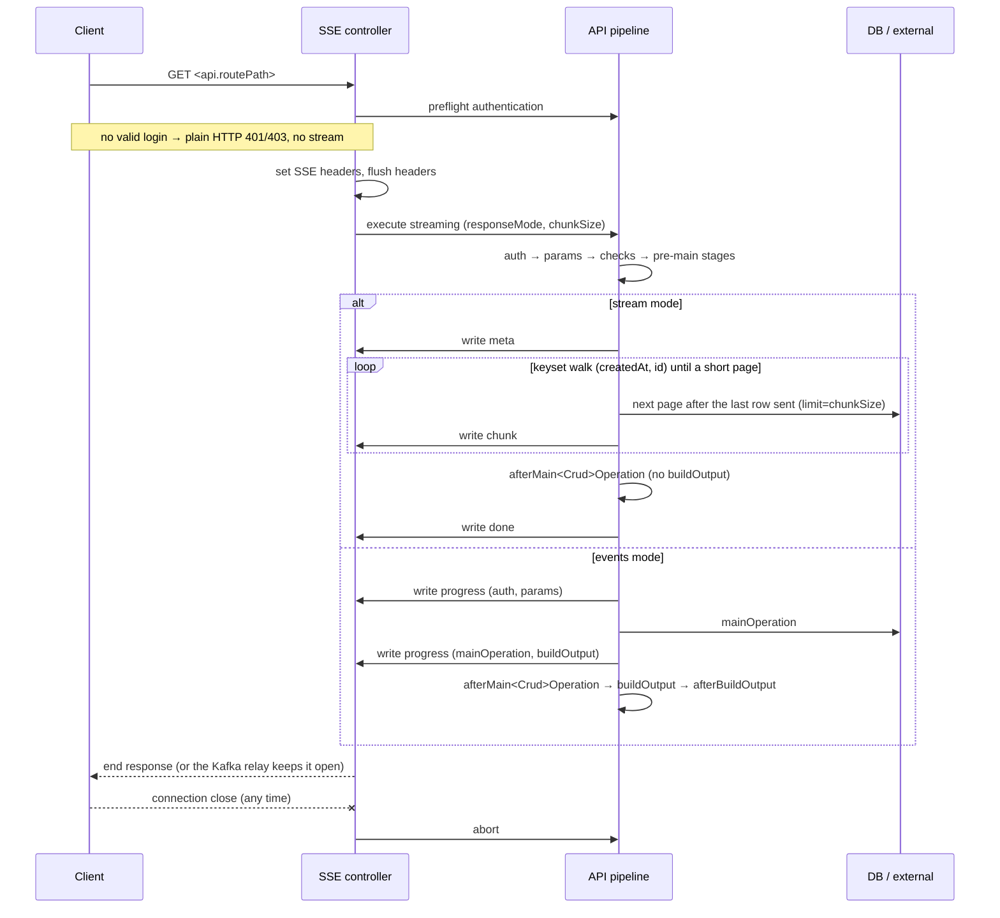

# SSE streaming

A business API can stream its response over a single open HTTP
connection using Server-Sent Events. Setting
`controllers.sseSettings.hasSseController: true` mounts a streaming
route alongside the REST endpoint that delivers the response as a
sequence of SSE frames. The streaming route uses the API's
`restSettings.routePath` directly - the compiler does **not** append
`/stream`. To expose `GET /orders/stream` as a streaming companion to
`POST /orders/list`, set `routePath: "/orders/stream"` on the SSE
controller's parent API, or declare a sibling API with that path. See
"Declaring an SSE controller" below.

## When to use SSE

| Fit | Notes |
|---|---|
| LLM token-by-token output | An `iteratorActions` entry in the workflow whose `sourceScript` returns an async iterable of tokens (a service-library async generator wrapping the provider's stream); each yielded item is written as a `chunk` frame. `AiCallAction` does not stream: it returns the whole completion. |
| Long progress reports | Use `responseMode: 'events'`; emit per-step progress. |
| Large list exports | Use `responseMode: 'stream'`; the service walks the list in keyset order and emits one `chunk` event per page. |
| Relaying a worker's progress | Use `kafkaProgressListeners`: after the pipeline the connection stays open and relays matching messages from a Kafka topic. |

Reach for the realtime hub instead when the client needs bidirectional
messages or multi-subscriber broadcast - SSE is one-way and one-client.

## Response modes

`sseSettings.responseMode` chooses the framing of the stream:

| Mode | Frames | Use when |
|---|---|---|
| `stream` (default) | `meta` once, then the data as `chunk` frames - one per page on a `list`, one carrying the record on any other crudType, plus one per item an `IteratorAction` in the workflow yields - then a terminal `done`. | You're streaming **data** - a large list export, an LLM token stream, a custom iterable. The client renders chunks as they arrive. |
| `events` | `progress` frames at each pipeline step (plus any `EmitSseEventAction` you attach). No terminal `done` - the connection closes silently after `buildOutput`. | You're streaming **status** - a long multi-step operation where the client wants per-step progress, not a data payload. |

Pick `stream` when the payload is the point and `events` when the
progress is.

**Stream mode never builds a response.** After the data chunks it runs
the `afterMain<Crud>Operation` stage and writes `done`; `buildOutput`
and `afterBuildOutput` never run, so nothing an `AddToResponseAction`
(or `writeToResponse: true`) adds ever reaches the client. To send an
extra value on a stream, emit it with an `EmitSseEventAction` at
`afterMain<Crud>Operation`. In `events` mode `buildOutput` and
`afterBuildOutput` do run, but the built response is not written to the
stream either: if the client needs the final result, attach an
`EmitSseEventAction` at `afterBuildOutput` whose `data` returns
`this.output` (see "Emitting custom events" below).

## Declaring an SSE controller

```json
"controllers": {
  "restSettings": { "hasRestController": true,  "routePath": "/orders/stream" },
  "sseSettings":  {
    "hasSseController": true,
    "responseMode":     "stream",
    "timeout":          300000,
    "chunkSize":        100
  }
}
```

The SSE controller registers a route using the API's
`restSettings.routePath` and the HTTP method its crudType implies
(`GET` for get / list, `POST` for create, or `POST` with
`restSettings.forcePOSTMethod`) - the same
path the REST controller uses, mounted on a separate SSE router. The
compiler does not derive a `/stream` suffix. If the same API exposes
both a REST and an SSE controller they share the route; if you want a
distinct path for the streaming companion (typical for large list
exports), declare a sibling business API whose `restSettings.routePath`
is explicit (`/orders/stream`, `/orders/:id/tail`, etc.).

[`ApiSseSettings`](../../spec/ApiSseSettings.md) fields:

| Field | Default | Meaning |
|---|---|---|
| `hasSseController` | `false` | Mount the SSE controller. |
| `responseMode` | `stream` | `stream` - chunk-based with `meta` / `chunk` / `done` frames; `events` - emits `progress` frames at each pipeline milestone (no terminal frame; the connection closes silently). |
| `timeout` | 300000 ms (5 min) | Max connection duration before the server writes an `SSE_TIMEOUT` error frame and closes. Enforced only on an API with `kafkaProgressListeners`; without them the stream ends when the pipeline does. |
| `chunkSize` | 100 | Rows per chunk when streaming a list (bounded by the service's page-size limit). |
| `streamSource` | null | Accepted by the schema (`sourceType`: `libFunction`, `iteratorAction`, `sseRelay` or `wsRelay`, with `libFunctionName` / `iteratorAction` / `relayUrl` / `relayAuth`), but the SSE route does not read it: a stream always carries the API's own main operation. To stream custom items, place an `IteratorAction` in the workflow (see "SSE-aware actions"). |
| `kafkaProgressListeners` | `[]` | Topic listeners that relay Kafka messages as SSE events after the pipeline completes. Their `eventName` values must be distinct (compared case-insensitively; `DUPLICATE_ASSET_NAME`). |

The SSE response sets `Content-Type: text/event-stream`,
`Cache-Control: no-cache`, `X-Accel-Buffering: no`, and
`Connection: keep-alive`, then flushes headers. Each frame is
`event: <type>\ndata: <json>\n\n`.

## What the client sees

Three event types are emitted by the service in `stream` mode:

| Event | Payload | When |
|---|---|---|
| `meta` | `{ dataName, action, userId, requestId, chunkSize }` - `dataName` is the data object name, `action` the crudType | Once, after the pre-main workflow stages. |
| `chunk` | `{ index, data, count }` - on a list `data` is the page's `_type`-stamped records; on another crudType it is the one record (`count: 1`) | Per page (list), or once. |
| `done` | `{ totalChunks, totalRows, elapsedMs }`, plus `actionFailures` when a post-write action failed | Final, before the connection closes. |

The main-operation `chunk.data` uses the same public
response projection as REST: declared secrets and internal storage columns
(`_owner`, `_iPublic`, `_tenantId`, `_archivedAt`, enum `_idx` columns) are
removed, unless internal columns were explicitly exposed. The `_type` stamp
stays present. Ledger values use major units exactly once, including when
the ledger stream channel also visits the chunk. The controller's
chunk log receives that same projected payload. (Check the compiler
specification for the targets that implement this projection.)

A list stream walks the whole set by keyset: each chunk resumes after
the last row the previous one delivered, so the rows arrive in
`createdAt ASC, id ASC` order (the API's `listSortBy` is not applied),
and a row written during the walk is sent at most once and never skips
a neighbour. A list whose main operation cannot keyset - one read from
a DataView, or a hand-written main operation - falls back to page-by-
page offsets.

An `IteratorAction` in the workflow writes each item it yields as its
own `chunk` frame whose `data` is the raw item (no `index` / `count`
envelope).

In `events` mode the service emits `progress` frames
(`{ step, message }`) at the pipeline steps `auth`, `params` (read and
validated), `mainOperation` (started and completed) and `buildOutput`,
plus one for every `EmitSseEventAction` and every
`emitProgressInSSEContext` action. The events-mode pipeline does
**not** emit a separate `result` or `done` frame - once `buildOutput`
finishes the controller ends the response and the connection closes
silently. If the client needs an explicit "result" event, attach an
`EmitSseEventAction` at the `afterBuildOutput` milestone whose `data`
MScript returns `this.output`.

A streamed create / update of an object with
[`objectModeration`](../capabilities/object-moderation.md) runs the same
moderation seam as REST. A held `staged` write writes nothing: in `stream`
mode the stream ends at once with a `done` frame of zero chunks that carries
`moderation: { id, status, message }`; in `events` mode the request ends
with the `202` `{ moderation }` answer before `mainOperation`. See
[Object content moderation - other transports](../capabilities/object-moderation.md#other-transports).

## Lifecycle



The login check runs **before** the headers are flushed, so a caller
without a valid session (on an API that requires one) gets a real HTTP
`401` / `403` JSON error and never a stream. The role gate runs in the
same place as on the REST pipeline: right after the login check and the
caller-kind check, before every designer hook. Once the headers are on
the wire (`200 text/event-stream`), a refusal the pipeline decides later
- a role re-check, a parameter `400`, a fetch `404` - ends the stream
with exactly one `error` frame, and no Kafka relay starts.

A typed payment provider refusal keeps the REST rejection pair
as `{ message: "The payment provider rejected the request", code:
"PAYMENT_PROVIDER_REQUEST_REJECTED" }`, with `providerErrorCode` and the
optional mapped card `reason` (for example `card_expired`). An iyzico `10051`
refusal carries `providerErrorCode: "10051"` without a mapped reason. A
classified `PAYMENT_DECLINED` keeps its own fixed message and code with the
same safe fields. This applies to returned business API problems and thrown
errors alike. Branch on `code`, `providerErrorCode` and `reason`; vendor
sentences and raw provider bodies are never copied into the frame.

A client disconnect aborts the pipeline. The abort sets a flag the list
walk checks before each page - in-flight operations finish, then the loop
exits cleanly. Once the pipeline has answered (the stream ended, or the
Kafka relay took the connection over), the controller runs the
post-response tail (`afterSendResponse`, the API event, `afterApiEvent`),
on success only.

## Emitting custom events from the workflow

`actions.emitSseEventActions[]` declares custom SSE frames the
workflow can publish. Each entry has an `eventName` and a `data`
MScript expression. The frame is a **`progress` event** whose
`step` is the `eventName`: `event: progress` with
`data: { step: "<eventName>", message, ...fields }`, where an object
`data` is spread into the payload (`message` is `""`) and a string
`data` becomes `message`. A client therefore listens for `progress` and
branches on `step`; an `EventSource` listener named after the
`eventName` never fires. In REST mode the action is a silent no-op.

```json
{
  "name":      "phaseComplete",
  "eventName": "phaseComplete",
  "data":      { "js": "{ phase: this.currentPhase, percentage: this.progress }" },
  "writeToResponse": false
}
```

To emit progress around any action automatically, set
`emitProgressInSSEContext: true` on that action's record. The service
writes a `progress` frame with `step: "<actionName>"` before the
action (`Starting <actionName>`) and after it (`<actionName> completed`).

See [`EmitSseEventAction`](../../spec/EmitSseEventAction.md).

## SSE-aware actions

Several action types behave differently when the API runs in an SSE
context - they stream incremental output or progress instead of
buffering a single result. In a plain REST request these same actions
collapse to their non-streaming behavior.

- **`emitProgressInSSEContext`** - the universal opt-in on
  [`BusinessApiAction`](../../spec/BusinessApiAction.md). Any action
  with this flag emits a `progress` event before and after it runs
  (a no-op outside SSE). The cheapest way to make a slow step visible.
- **`IteratorAction`** - the stream source. Placed at a workflow
  milestone, its async iterable is consumed one item at a time and each
  item is written as a `chunk` frame. This is how token-by-token LLM
  output reaches the client: a service-library async generator wraps
  the provider's token stream and the iterator yields its tokens.
  `AiCallAction` has no streaming mode; it returns the whole completion.
- **`LoopAction`** - with `emitProgressInSSEContext: true`, writes a
  `progress` frame per item (`Processing item n/total`), so a batch loop
  reports how far it got.
- **`CreateBulkCrudAction`** / **`UpsertBulkCrudAction`** - with
  `emitProgressInSSEContext: true`, write one `progress` frame with the
  row count before the write.

Outside SSE every one of these runs to completion and returns its result
normally - an `IteratorAction` then collects its items into
`this.<contextPropertyName>` (strings joined into one string). The
streaming behavior is purely additive and context-driven.
The deep semantics of each action are owned by the
[Actions & workflow](../workflow/overview.md) section; this
page documents only their SSE-specific behavior.

### Action summary

| Action | SSE behavior | Frame type |
|---|---|---|
| Any action + `emitProgressInSSEContext: true` | `Starting` / `completed` progress around the action | `progress` (`step` = action name) |
| `EmitSseEventAction` | Author-shaped custom event (no-op in REST) | `progress` (`step` = `eventName`) |
| `IteratorAction` | Emits each yielded item | `chunk` |
| `LoopAction` + `emitProgressInSSEContext` | Per-item progress | `progress` |
| `CreateBulkCrudAction` / `UpsertBulkCrudAction` + `emitProgressInSSEContext` | One progress frame with the row count | `progress` |

## Stream source: custom async iterables

To stream items of your own (model tokens, log lines, generated frames),
put an `IteratorAction` in the workflow - at `afterMain<Crud>Operation`
in `stream` mode, so its chunks follow `meta` and the main record. The
`sseSettings.streamSource` block (`sourceType` `libFunction` /
`iteratorAction` / `sseRelay` / `wsRelay`) is not read by the SSE
route and has no effect.

## Kafka progress listeners: relay remote updates

`sseSettings.kafkaProgressListeners[]` keeps the SSE connection open
after the main pipeline completes and relays filtered Kafka messages
to the client as SSE events. Use this when the work that produces
client-visible progress runs in a sibling service (a worker, a
long-running job) that publishes status updates onto a Kafka topic.

```json
"sseSettings": {
  "hasSseController": true,
  "responseMode":     "events",
  "kafkaProgressListeners": [
    {
      "topic":            "jobs.progress",
      "correlationField": { "js": "this.requestId" },
      "kafkaFilterField": "requestId",
      "eventName":        "jobProgress",
      "payloadMapping":   { "js": "({ percentage: msg.data.percent, step: msg.data.step })" },
      "completeWhen":     { "js": "msg.data.status === 'done'" }
    }
  ]
}
```

[`KafkaProgressListener`](../../spec/KafkaProgressListener.md) fields:

| Field | Meaning |
|---|---|
| `topic` | Kafka topic to subscribe to. |
| `correlationField` | MScript against the pipeline context - produces the correlation ID. |
| `kafkaFilterField` | A top-level key of the incoming Kafka message, matched (as a string) against the correlation ID. It is not a path: `data.jobId` looks for a key literally named `data.jobId`. |
| `eventName` | SSE event name to emit on each matching message. |
| `payloadMapping` | Optional MScript transform of the whole decoded message (as `msg`). If null, the whole message is forwarded. |
| `completeWhen` | Optional MScript against the whole decoded message (as `msg`) - when truthy the listener stops and the SSE connection closes. |

**The message is the wire message, not the record.** The relay parses
each Kafka value as JSON and hands it over as it is. A message a
generated service publishes (a `PublishEventAction`, an API or DB
event) is the unified event envelope, so its top level holds only
`id`, `type`, `source`, `time`, `requestId`, `actor` and `data`, and the
published record is under `msg.data`. Read record fields as
`msg.data.<field>` in `payloadMapping` / `completeWhen`, and correlate on
a top-level key. `requestId` is the one that carries across services: a
Kafka-triggered API runs under the `requestId` of the event that
triggered it, and the events it publishes carry that same `requestId`,
so `correlationField: this.requestId` with `kafkaFilterField: "requestId"`
matches the progress a worker publishes for this request. A message from
a producer of your own can carry any top-level key.

Works with both `stream` and `events` response modes. The listener
attaches after the main pipeline runs, so the workflow first executes
to completion (sending `meta` / `chunk` / `done` in stream mode, or
`progress` events in events mode); the Kafka relay then takes over the
open connection until `completeWhen` fires (or the client disconnects,
or `timeout` is reached).

Each request subscribes with its own consumer group, so two
clients on the same topic both see every message. A listener that
resolves no correlation id is skipped, and when no listener subscribes
the relay completes at once, so the connection never hangs open with
nothing to filter. The subscription is cleaned up when the client
disconnects or the timeout fires. When `completeWhen` fires, the relay
writes a final `complete` frame
(`{ "message": "Kafka progress listener completed" }`) and then closes the
connection. How the generated service resolves the listener descriptors and
runs the relay is described in
[the compiler specification](../../compiler/index.md).

## Hybrid flow: data then progress

The pipeline and the Kafka relay compose: the main workflow runs first
(emitting its `meta` / `chunk` / `done` in stream mode, or `progress` in
events mode), *then* the Kafka progress relay takes over the same open
connection. This is how one connection delivers an initial result and
then live progress from a background worker:

1. The API does its synchronous work and streams the immediate result.
2. It kicks off a background job (an `InterserviceCallAction` /
   `PublishEventAction` that a worker picks up).
3. The `kafkaProgressListeners[]` relay the worker's status events to
   the same client until `completeWhen` fires.

The worked example below shows this end to end.

## Closing the stream

The stream ends on any of:

- Workflow completion - the service emits `done` (stream mode) and the
  controller ends the response, unless `kafkaProgressListeners` keep
  the connection open for the relay.
- A failed login - answered as a plain HTTP `401` / `403` before the
  stream opens (see "Lifecycle").
- A refusal or action error after the headers - the controller writes
  one `error` event (`{ message, code }`) and ends. Every `error` event
  of a generated service has this shape: `code` is the machine
  code (`errorCode` of the thrown error, else the status default such as
  `NOT_FOUND` / `INTERNAL_ERROR`); a timeout frame says `SSE_TIMEOUT`.
- The Kafka relay finishing - a `completeWhen` fired: a `complete`
  frame, then the connection closes.
- Client disconnect - the pipeline is aborted; the next page check of the
  list walk exits and the controller closes.
- Timeout - on an API with `kafkaProgressListeners`, when `timeout` is
  reached the controller writes the `SSE_TIMEOUT` error frame and
  terminates the connection regardless of stream state.

## Client-side consumption

```js
const es = new EventSource('/orders/stream'); // whatever your API's routePath is

es.addEventListener('meta',     e => console.log('meta',  JSON.parse(e.data)));
es.addEventListener('chunk',    e => render(JSON.parse(e.data).data));
es.addEventListener('progress', e => { const p = JSON.parse(e.data); if (p.step === 'phaseComplete') showPhase(p); });
es.addEventListener('done',     e => { console.log('done', JSON.parse(e.data)); es.close(); });
es.addEventListener('error',    () => es.close());
```

Custom `EmitSseEventAction` frames arrive as `progress` events; branch
on `step`. On an API with `kafkaProgressListeners`, do not close on
`done`: the relayed events follow it, and the relay ends with its
`complete` frame.

`EventSource` does not send custom `Authorization` headers. For
authenticated SSE either run under cookie sessions (see
[Authentication](../system-services/authentication/overview.md)) or mint a
short-lived token via a regular POST, pass it as `?token=...`, and
verify it in the workflow with a
[`ReadJwtTokenAction`](../../spec/ReadJwtTokenAction.md) on an API
declared `loginRequired: false` (an API that requires a login refuses a
session-less `EventSource` with `401` before any action runs).

### cURL

`curl -N` disables buffering so frames print as they arrive - the
quickest way to watch a stream from the terminal. Unlike `EventSource`,
`curl` can send an `Authorization` header:

```bash
curl -N \
  -H 'Authorization: Bearer <token>' \
  -H 'Accept: text/event-stream' \
  https://api.example.com/orders/stream
```

```
event: meta
data: {"dataName":"order","action":"list","chunkSize":100}

event: chunk
data: {"index":0,"data":[...],"count":100}

event: done
data: {"totalChunks":3,"totalRows":273,"elapsedMs":812}
```

### Postman

Postman supports SSE natively: create a request, set the method/URL,
add the `Accept: text/event-stream` header (and `Authorization` if
needed), and Postman renders each `event:`/`data:` frame in the
response panel as it streams, keeping the connection open until the
server ends it or you cancel. For `POST` streaming endpoints, set the
body as usual - the SSE response framing is independent of the request
method.

## Worked example: streaming AI completion

```json
{
  "basics": {
    "apiOptions":  { "name": "askAgent", "crudType": "create", "dataObjectName": "AskAgentLog" },
    "authOptions": { "loginRequired": true }
  },
  "parameters": {
    "requestParameters": [
      { "name": "prompt", "type": "Text", "httpLocation": "body", "required": true }
    ]
  },
  "controllers": {
    "restSettings": { "hasRestController": true,  "routePath": "/agent/ask" },
    "sseSettings":  {
      "hasSseController": true,
      "responseMode":     "stream"
    }
  },
  "actions": {
    "iteratorActions": [
      {
        "name":         "streamCompletion",
        "sourceScript": { "js": "LIB.openaiStream({ prompt: this.prompt, model: 'gpt-4o' })" },
        "writeToResponse": false
      }
    ],
    "emitSseEventActions": [
      {
        "name":      "phaseDone",
        "eventName": "phaseDone",
        "data":      { "js": "{ phase: 'complete', requestId: this.requestId }" },
        "writeToResponse": false
      }
    ]
  },
  "workflow": {
    "create": { "afterMainCreateOperation": ["streamCompletion", "phaseDone"] }
  }
}
```

`LIB.openaiStream` is a service-library async generator that yields the
model's tokens. The REST route `POST /agent/ask` returns a regular
create response; there `streamCompletion` collects the tokens into
`this.streamCompletion` (joined into one string). The SSE controller
registers a streaming companion at the same `routePath` - the SSE
router mounts `POST /agent/ask` on its own chain - whose stream reads:
`meta`, one `chunk` with the created `AskAgentLog` record, one `chunk`
per token, a `progress` frame with `step: "phaseDone"`, then `done`.
To expose the streaming route at a distinct URL
(`POST /agent/ask/stream`), declare a sibling business API with
`restSettings.routePath: "/agent/ask/stream"`.

## Worked example: background job with Kafka progress

A reindex API: it accepts a job, kicks off a worker in another service,
and relays the worker's progress to the client over the same SSE
connection until the worker reports `done`. This uses `events` mode (the
client wants progress, not a data payload) plus a
`kafkaProgressListeners[]` entry.

```json
{
  "basics": {
    "apiOptions":  { "name": "reindexCatalog", "crudType": "create", "dataObjectName": "ReindexJob" },
    "authOptions": { "loginRequired": true, "checkRoles": ["admin"] }
  },
  "parameters": {
    "requestParameters": [
      { "name": "catalogId", "type": "ID", "httpLocation": "body", "required": true }
    ]
  },
  "controllers": {
    "restSettings": { "hasRestController": true, "routePath": "/catalogs/reindex" },
    "sseSettings":  {
      "hasSseController": true,
      "responseMode":     "events",
      "timeout":          600000,
      "kafkaProgressListeners": [
        {
          "topic":            "catalog.reindex.progress",
          "correlationField": { "js": "this.requestId" },
          "kafkaFilterField": "requestId",
          "eventName":        "reindexProgress",
          "payloadMapping":   { "js": "({ percentage: msg.data.percent, step: msg.data.step })" },
          "completeWhen":     { "js": "msg.data.status === 'done'" }
        }
      ]
    }
  },
  "query": {
    "dataClauseItems": [
      { "name": "catalogId", "value": { "js": "this.catalogId" } },
      { "name": "status",    "value": { "js": "'queued'" } }
    ]
  },
  "actions": {
    "publishEventActions": [
      {
        "name":    "enqueueWorker",
        "topic":   "catalog.reindex.requested",
        "message": { "js": "{ jobId: this.result.id, catalogId: this.catalogId }" }
      }
    ]
  },
  "workflow": {
    "create": { "afterMainCreateOperation": ["enqueueWorker"] }
  }
}
```

Flow:

1. The create pipeline inserts a `ReindexJob` row (`this.result.id` is
   the new job id) and returns it - in `events` mode the client sees
   `progress` frames through `buildOutput`.
2. `enqueueWorker` publishes `catalog.reindex.requested`; a worker in
   another service (a Kafka-controller API on that topic) picks it up
   and does the long reindex, publishing status messages
   (`{ jobId, percent, step, status }`) onto `catalog.reindex.progress`
   with its own `PublishEventAction`. The worker runs under the
   `requestId` of the event that triggered it, so every progress event
   carries this request's `requestId` at the envelope's top level, and
   the status record under `data`.
3. The connection stays open. The Kafka relay
   subscribes to `catalog.reindex.progress`,
   keeps the messages whose `requestId` equals this request's, and
   emits each as a `reindexProgress` SSE event carrying
   `{ percentage, step }`.
4. When a message arrives with `data.status === 'done'`, `completeWhen`
   fires, the relay disconnects its consumer, and the controller closes
   the connection. (The 10-minute `timeout` is the backstop.)

Client side, the same `EventSource` / `curl -N` consumption applies -
listen for the `reindexProgress` event:

```js
const es = new EventSource('/catalogs/reindex'); // POST variant via fetch + ReadableStream
es.addEventListener('reindexProgress', e => {
  const { percentage, step } = JSON.parse(e.data);
  updateBar(percentage, step);
});
```

## See also

- [BusinessApi overview](overview.md)
- [Kafka controllers](kafka-controllers.md) - the inbound Kafka side and
  the `KafkaProgressListener` cross-reference
- Schema: [`ApiSseSettings`](../../spec/ApiSseSettings.md),
  [`EmitSseEventAction`](../../spec/EmitSseEventAction.md),
  [`IteratorAction`](../../spec/IteratorAction.md),
  [`KafkaProgressListener`](../../spec/KafkaProgressListener.md).
- Action reference: [`AiCallAction`](../../spec/AiCallAction.md),
  [`IteratorAction`](../../spec/IteratorAction.md),
  [`EmitSseEventAction`](../../spec/EmitSseEventAction.md).
