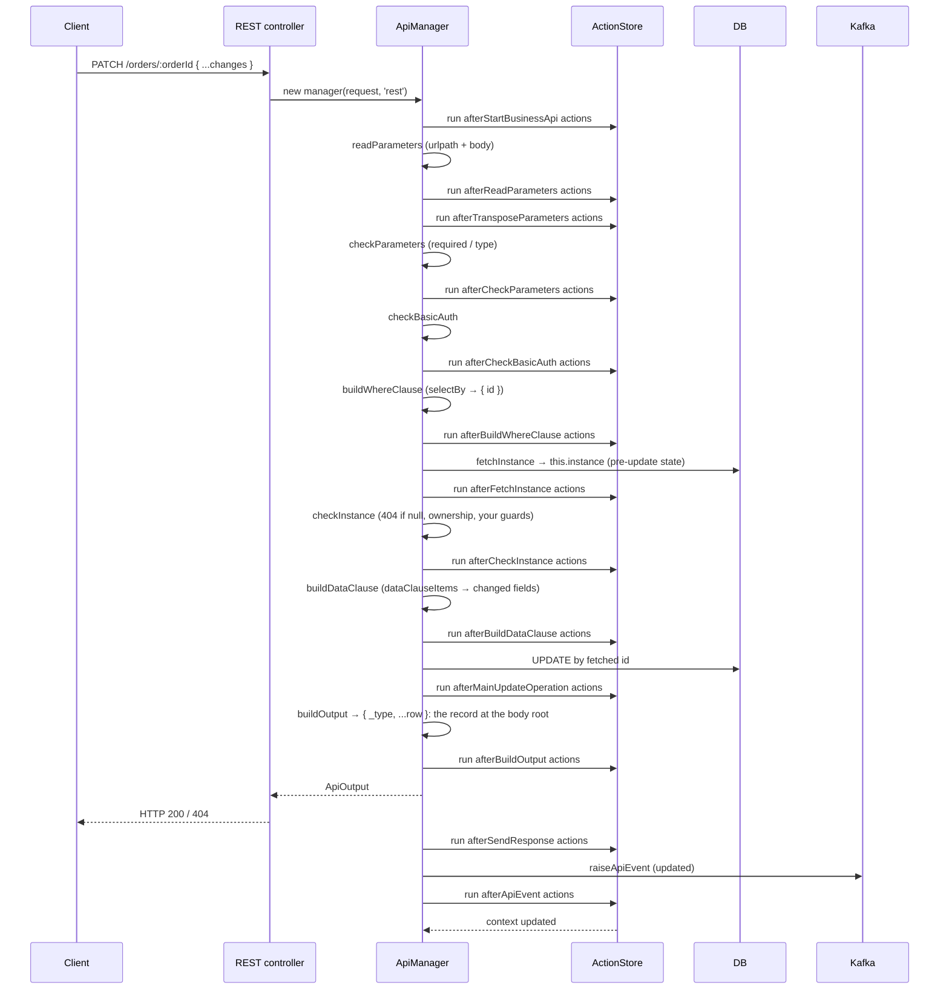

# Update API

An `update`-crudType `BusinessApi` locates one existing record, applies
a partial change, and returns the updated row (narrowed to
`selectClause.selectProperties` + `id` when the api declares that list,
see [Response shape](response-shape.md#write-answers-and-selectproperties);
declare it on a buyer-facing update behind an ownership check, so the
caller does not receive internal columns). Declared explicitly under
`businessLogic[]` like every API. The compiler supplies the pipeline
(read → build where → **fetch instance** → check → build data clause →
update → event). The fetch-before-write step is what lets your actions
see the pre-update state via `this.instance`.

```json
{
  "basics":      { "apiOptions": { "name": "updateOrder", "crudType": "update", "dataObjectName": "Order" } },
  "controllers": { "restSettings": { "hasRestController": true } }
}
```

That mounts `PATCH /orders/:orderId`. Non-default verbs that mutate a
single record (`publishOrder`, `approveRequest`) are also `update`
crudType with a custom `name` and route.

## How an update request travels



The body `buildOutput` produces is the **record itself at the root**, with a required `_type` and no wrapper. See [Response shape](response-shape.md) for the full contract, including the problem+json error body.

> **Single-record safety.** `update` (and `delete`) write to exactly the
> one record identified by the fetched instance's `id`, regardless of
> how broad the `whereClause` is. A broad WHERE on update never writes
> more than one row: the fetch resolves it to a single instance first.

## Workflow milestones

Populate these under `workflow.update.<milestone>`:

- `afterStartBusinessApi`
- `afterReadParameters`
- `afterTransposeParameters`
- `afterCheckParameters`
- `afterCheckBasicAuth`
- `afterBuildWhereClause`
- `afterFetchInstance`
- `afterCheckInstance`
- `afterBuildDataClause`
- `afterMainUpdateOperation`
- `afterBuildOutput`
- `afterSendResponse`
- `afterApiEvent`

See [`UpdateBusinessWorkflow`](../../spec/UpdateBusinessWorkflow.md).

## `whereClause`: locate the record

Update uses `query.whereClause.selectBy` (default `["id"]`) to locate
the row, exactly like [get](get-api.md#whereclause-the-locator). Add
`additionalClauses` to enforce tenant / ownership scope at the locator
level so a caller can never address a record outside their scope. The
full clause syntax lives on [List API](list-api.md#whereclause-locator-and-base-filter).

## `dataClauseItems`: the changes

Update builds its UPDATE from `query.dataClauseItems`, the same
[`DataMapItem`](../../spec/DataMapItem.md) array used by create; only
the named properties are written. A non-default verb update typically
forces constants:

```json
"query": {
  "whereClause":     { "selectBy": ["id"] },
  "dataClauseItems": [
    { "name": "status",      "value": { "js": "'published'" } },
    { "name": "publishedAt", "value": { "js": "new Date()" } }
  ]
}
```

Session- / staticJoin-bound properties auto-inject and must not appear
here. Actions wired at `afterFetchInstance` can read `this.instance`
(the pre-update row) before the data clause is built, which is useful for
state-machine guards.

### An update must write something: its own row, or another one

`buildDataClause` fills the clause from `dataClauseItems` **only**: the
session-inject and `staticJoin` sources are create-only. An update whose
write set ends up empty is refused at run time with
`400 EMPTY_UPDATE_PAYLOAD` ("Update data clause cannot be empty"), and
the refusal happens *after* the `afterFetchInstance` actions have run, so
a state-transition action leaves the row half-transitioned.

There is exactly one exemption, and both halves of it are design facts a
request cannot change: an update that declares **no `dataClauseItems` at
all** *and* whose update **workflow runs a crud write action** (create /
bulk create / update / delete, at any depth inside a loop / parallel /
iterator container) carries its effect in those actions. The service
emits no empty-clause guard for it and skips the no-op write of
its own row, answering with the row it fetched. Declaring
`dataClauseItems` opts back in: an empty clause then means *the caller
sent none of the fields this endpoint writes*, which is exactly what the
400 is for, and a write action does not suppress it.

This bites hardest on the **action shape**: `forcePOSTMethod`, a url-only
`:<object>Id`, no request parameters, all the work in workflow actions.
It looks like it needs no write set, and then 100% of its calls 400.
Declare the state the action transitions to as a constant write:

```json
"query": {
  "whereClause":     { "selectBy": ["id"] },
  "dataClauseItems": [{ "name": "status", "value": { "js": "'cancelled'" } }]
}
```

Validation enforces this: an update with an empty `dataClauseItems` and
no request parameter naming a **stored property** of the data object is an
ERROR (`UPDATE_ACTION_WITHOUT_WRITE`), as is an update that declares payload
parameters naming stored properties but writes none of them
(`UPDATE_WRITES_NOTHING`). If the endpoint genuinely must not change the
record, model it as a `get` / `list` or a `create` instead.

A parameter that names **no column** does not rescue an empty write set.
A "reorder" endpoint taking a body param such as `artworkIds` (not a
property of the object it updates) with zero `dataClauseItems` and no
write action is exactly as dead as the parameterless action shape: nothing
carries the value anywhere. What rescues it is the write itself: wire the
`updateCrudAction` loop that stamps `displayOrder` on each member into the
api's update workflow, and the endpoint is legitimate as it stands, with no
constant write on the catalog row required.

## On a moderated object

When the object carries
[`objectModeration`](../capabilities/object-moderation.md), an update that
writes a value for one of its `moderatedProperties` meets the moderation
seam after `afterBuildDataClause`; an update that touches none of them
(a counter bumped by a sale) writes straight through. In the default
`staged` mode a held update answers `202` `{ moderation }` and the row keeps
serving its previously approved state until a reviewer accepts the change,
which replays it through this api; a newer update supersedes an older
pending one. In `onPlace` mode the update is written at once and decided
again in the same request: unless the verdict is accept, the row leaves
public view until a reviewer accepts it. On an `onPlace` object the fetch
of the instance also runs the read gate, so a caller who may not see a
hidden row meets `404`. See
[Object content moderation](../capabilities/object-moderation.md#the-decision).

## `dataViewName` does not apply

`apiOptions.dataViewName` has **no effect** on update: both the
fetch-instance read and the write run against the DB. (DataView reads
are `get` / `list` only; see
[BusinessApi overview](overview.md#reading-from-a-dataview).)

## What the update does

The pipeline first fetches the row by id for the fetch-instance step, then
writes the data clause to that row. On every supported database engine the
write is scoped to active (non-soft-deleted) rows, a missing row is a
"not found" outcome, and after the write the row is re-indexed to
Elasticsearch (settled or timed out before the event) and the `updated`
DB-level event is emitted. For how the generated service implements this,
see [the compiler specification](../../compiler/index.md).

## Worked example: `publishOrder`

The canonical non-default-verb update. The
[BusinessApi overview](overview.md#worked-example-publishorder) carries
the full version; in short: `crudType: "update"`, a custom
`routePath`, a `checkDraft` validation at `afterCheckInstance` reading
`this.instance.status`, and a `publishEventActions` entry at
`afterMainUpdateOperation`.

## See also

- [Response shape](response-shape.md): the response body contract
- [BusinessApi overview](overview.md) · [Create API](create-api.md)
  (the other write crudType) · [Delete API](delete-api.md) ·
  [Get API](get-api.md)
- Restoring a soft-deleted row (restore / unarchive / undelete): [Lifecycle &
  state: Restore endpoint](../data-modeling/lifecycle-and-state.md#restore-endpoint)
- Specification: [`UpdateBusinessWorkflow`](../../spec/UpdateBusinessWorkflow.md),
  [`DataMapItem`](../../spec/DataMapItem.md),
  [`WhereClauseSettings`](../../spec/WhereClauseSettings.md).
