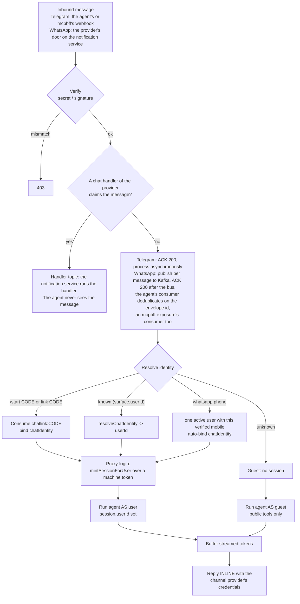
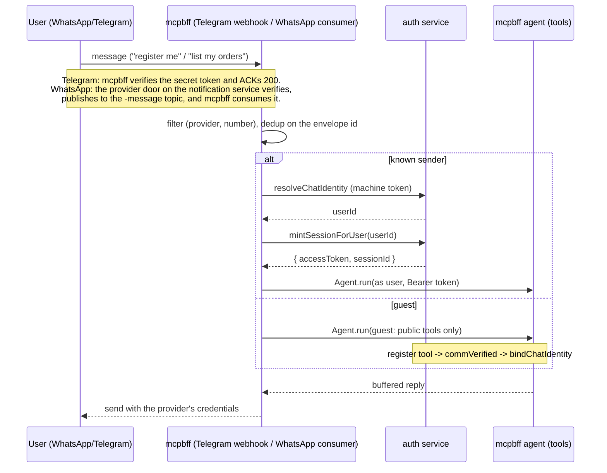

# AI agent chat surfaces (Telegram / WhatsApp)

A **chat surface** turns an aiAgent, or the whole project's API surface via the
mcpbff assistant, into a bot a user talks to **directly from a messaging app**. The
messaging account itself becomes the login: an inbound WhatsApp or Telegram message
is resolved to a project user, a real session is minted on their behalf, and the
agent runs **as that user** (its tools see `session.userId`), then replies back over
the same channel.

It sits alongside the agent's existing REST / SSE / socket interfaces: a chat
surface is just another inbound vector. One generator serves every surface; only the
**channel provider**, the **inbound transport** (a Telegram webhook on the agent's
service; for WhatsApp the provider's one door on the notification service plus a
Kafka consumer), and the **identity strategy** differ. One agent can be reached over
**Telegram and WhatsApp at once**: two entries, two providers.

## A surface binds to a channel provider

A chat surface names a **channel provider**: a
`projectSettings.notificationProvidersSettings.notificationProviders[]` entry of
kind `whatsapp` (Meta Cloud, `provider: whatsapp`) or kind `telegram`. The provider
is the **single owner of every credential of that channel**, which the generated
service reads at runtime from its configuration:

| Channel | Provider keys the surface uses |
|---------|--------------------------------|
| WhatsApp (`kind: whatsapp`, `provider: whatsapp`) | `whatsappAccessToken`, `whatsappPhoneNumberId`, `whatsappApiVersion` (default `v20.0`), `whatsappApiBase`, `whatsappAppSecret` and `whatsappVerifyToken` (the inbound door). |
| Telegram (`kind: telegram`) | `telegramBotToken` (replies), `telegramWebhookSecret` (the webhook's `X-Telegram-Bot-Api-Secret-Token`; the webhook fails closed without it), `telegramApiBase`. |

The surface type comes from the provider's kind; the surface entry carries only the
**binding** (`provider`, the identity strategy, an optional Telegram webhook-path
override) and the `typingIndicator` preference, never a credential. The same
provider that sends your event notifications serves the chat replies, so a WhatsApp
number or a Telegram bot is configured **once**, in the provider's configuration.

A provider is bound by exactly one of two consumer kinds:

- an **aiAgent surface**:
  `agentHub.aiAgents[].endpointSettings.chatSurfaces[].provider`, **or**
- the **mcpbff** full-API assistant:
  `projectSettings.mcpbffSettings.chatSurfaces[].provider`.

```json
{
  "projectSettings": {
    "notificationProvidersSettings": {
      "notificationProviders": [
        { "name": "supportTg", "kind": "telegram", "provider": "telegram",
          "configuration": [
            { "name": "telegramBotToken",      "value": "ENTER_CREDENTIAL", "secret": true },
            { "name": "telegramWebhookSecret", "value": "ENTER_CREDENTIAL", "secret": true }
          ] },
        { "name": "taskTg",  "kind": "telegram", "provider": "telegram", "configuration": [ "…" ] },
        { "name": "waMeta",  "kind": "whatsapp", "provider": "whatsapp", "configuration": [ "…" ] }
      ]
    },
    "mcpbffSettings": {
      "chatSurfaces": [ { "provider": "supportTg" } ]
    }
  },
  "agentHub": {
    "aiAgents": [
      { "agentBasics": { "name": "taskAssistant" },
        "endpointSettings": {
          "chatSurfaces": [
            { "provider": "taskTg", "identityStrategy": "link" },
            { "provider": "waMeta", "identityStrategy": "phone" }
          ] } }
    ]
  }
}
```

The `configuration: [ "…" ]` entries are fragments: they stand for the provider's
credential list.

Above: `supportTg` is the **mcpbff** full-API assistant's Telegram bot;
`taskAssistant` answers over the Telegram bot `taskTg` **and** over the WhatsApp
number `waMeta`: the same agent, two surfaces, two providers. Its Telegram replies
post with the `telegramBotToken` of `taskTg`, and its WhatsApp replies with the
`whatsappAccessToken` and `whatsappPhoneNumberId` of `waMeta`, through the
provider's Graph API version.

## Read receipts and typing while a reply is prepared

The agent surfaces and the mcpbff assistant enable `typingIndicator` by default. Set
`typingIndicator: false` on the relevant `chatSurfaces[]` entry to disable it; an
omitted or null value keeps it enabled. This setting belongs to the surface,
alongside `provider` and `identityStrategy`.

For a text message that runs the agent, a WhatsApp Meta surface posts a read receipt
for the inbound `message.id` with `typing_indicator: { type: "text" }` to the
provider's messages endpoint. It refreshes every 20 seconds while the agent runs.
Meta clears the indicator after a reply or after 25 seconds, whichever comes first.
Telegram uses `sendChatAction` with `action: "typing"` every 4 seconds; Telegram's
status lasts at most 5 seconds and clears when the bot replies. Both stop refreshing
when the turn finishes or fails.

Status calls use the same provider credentials and API base/version as replies. They
run without delaying the agent; a refusal or network error is logged and never fails
the turn. A missing inbound WhatsApp message id suppresses its status request. No
indicator is sent for media ignored by the text handler, link commands, a refused
login, or a message a chat handler claims (the agent does not run for it). Not every
compiler target implements the indicator; see
[the compiler specification](../../compiler/index.md).

Provider references: [Meta typing indicators](https://developers.facebook.com/documentation/business-messaging/whatsapp/typing-indicators)
and [Telegram sendChatAction](https://core.telegram.org/bots/api#sendchataction).

| Surface field | Meaning |
|---------------|---------|
| `provider` | the channel provider's name. Its kind is the surface type; its configuration holds every credential. Also the asset id in the list. |
| `identityStrategy` | `link` or `phone`. Defaults to `link` on **every** surface, WhatsApp included: binding a sender by the channel-asserted phone is an explicit opt-in. |
| `webhookPath` | Telegram only: optional override of the webhook route (`/agents/<agent>/telegram/webhook` for an agent, `/chat/<provider>/webhook` for the mcpbff). Ignored, with a warning, on a WhatsApp surface: it has no webhook of its own. |
| `typingIndicator` | Boolean, default `true`. See above. |

> **Binding rules (validation).** A surface that names no provider is one **error**
> (the required `provider`, `REQUIRED_FIELD_MISSING`); one that names an undeclared
> provider, or one of another kind (an smtp provider, a Twilio WhatsApp provider), is
> an **error** (`CHAT_SURFACE_PROVIDER_UNBOUND`). A provider bound by **two
> conversational consumers**, that is two agent surfaces, or an agent surface and an
> mcpbff exposure, is an **error** (`CHAT_PROVIDER_MULTI_CONSUMER`): each of them
> would answer every message of that number or bot. Keep one, or declare another
> provider for the other consumer. A bound Telegram provider without its
> `telegramWebhookSecret` warns (`TELEGRAM_PROVIDER_CHAT_UNCONFIGURED`): its webhook
> refuses every update until it is set.
>
> **Host.** A surface of a hub agent with an `assignedService` is served by that
> service only: it mounts the Telegram webhook and runs the WhatsApp consumer, and it
> is the one that receives the provider's channel keys. The agent hub mounts no
> webhook for it.
>
> **Env references.** (The two standard spellings of a secret, `$ENV:NAME` and the
> `ENTER_CREDENTIAL` placeholder, are compared in
> [Secrets in a blueprint](../blueprint/secrets.md).) A provider configuration value spelled `$ENV:NAME` names the
> environment variable that holds the credential at runtime instead of holding it.
> The reference itself is carried as a plain value, it is never pushed as a deploy
> secret, and every reader of a provider key (the notification adapters, the agent
> chat surface, the mcpbff) reads `NAME` instead. Only the exact `$ENV:NAME` spelling
> is a reference: a bare value is always the credential itself. A reference is
> followed **once**: when `NAME` itself holds a reference (a nested reference, or a
> key that references its own provider variable), and when a value is spelled like a
> reference but not exactly (`$env:X`, `$ENV: X`, an invalid name), the key reads as
> **unset**: a Telegram webhook refuses every update and a reply is not sent; such a
> value is never used as the credential. Validation reports a self reference as an
> error (`CHAT_PROVIDER_SELF_ENV_REFERENCE`) and a malformed one as a warning naming
> the canonical form (`CHAT_PROVIDER_ENV_REFERENCE_MALFORMED`).

### Deterministic handlers on the same provider

The one-consumer rule is about **conversational** consumers only. A provider can also
carry [chat handlers](chat-handlers.md) (`chatHandling` on the notification
provider): ordered, deterministic handlers with no AI involved, such as command
messages (`/status`) that call an API, message-type handlers (a location message that
lists nearby records) and the approve / reject buttons of an outbound prompt. They
run **before** the agent: a message a handler claims never reaches the agent or the
mcpbff assistant, and every message no handler claims reaches it exactly as before.
For WhatsApp the provider's door claims the message and publishes it to
`<codename>-chat-handler-inbound` instead of `<codename>-whatsapp-inbound-message`;
for Telegram the agent's webhook claims the update after it has verified the secret,
and the agent does not run for it.

Two things stay with the conversational consumer: the account-link commands
(`/start <code>`, `link <code>`) and an unknown `/command`. A provider with no agent
and no mcpbff exposure (handler-only) gets them answered by the handler runtime
instead. A Telegram provider that an mcpbff exposure binds cannot carry handlers yet.

## When to use it

- **"Manage my tasks over Telegram."** Point a task-management agent at a Telegram
  surface. A user links their account once with a deep-link code, then chats
  `"what's due today?"` / `"close the onboarding task"` and the agent calls the real
  business APIs as them.
- **"Self-onboard over WhatsApp."** Point the **mcpbff full-API assistant** at a
  WhatsApp surface. A first-time number is auto-bound by phone (the channel proves
  the number), the guest can call the public `register` tool to create an account
  with **no SMS/OTP**, and from the next message on they are an authenticated chat
  user.

## The identity model

Identity is the heart of the feature, because it differs per surface:

| Surface | What the inbound carries | Default `identityStrategy` |
|---------|--------------------------|----------------------------|
| **WhatsApp** (Meta Cloud) | the sender's **phone** (E.164) on every message | `link`, like every surface; set `"phone"` explicitly to auto-bind by phone |
| **Telegram** | a stable `from.id` (+ optional `@username`), **no phone** by default | `link`: explicit link-code only |

The default is `link` on every surface: the `ChatSurfaceSettings` pattern writes
`link` back when `identityStrategy` is omitted.

Both resolve through a single binding object in the **auth** service, `chatIdentity`
`(surface, surfaceUserId) -> userId` (composite-unique on `(surface, surfaceUserId)`,
`userId` indexed, no soft-delete). Auth owns it because a surface-to-user binding
*is* identity.

- **`link` strategy** (the default on every surface): an authenticated in-app user
  requests a link; auth mints a short-lived `chatlink:<code>` grant (5 minutes, bound
  to their `userId`) and returns a **deep link**. The user opens it; `/start <code>`
  consumes the grant and writes the `chatIdentity` row. Every later message resolves
  by `(surface, surfaceUserId)`; **the phone is never needed**.
- **`phone` strategy** (explicit opt-in, WhatsApp): on first contact the handler
  hands the channel-asserted phone to auth's `/bindchatidentity`, which resolves it
  against the read model of users by verified mobile (see
  [M2M](../system-services/authentication/m2m.md#the-search-read-model-getuserbyidentity))
  and lazily writes the `chatIdentity` row. It binds **only** when exactly one active
  user carries the number in `mobile` (bare and `+`-prefixed spellings are the same
  number) **and** that user's `mobileVerified` is `true`. No match, several matches,
  an unverified mobile or a failed lookup means the sender runs as a **guest** (no
  session, public tools only), and auth logs the reason (`noMatch`, `ambiguous`,
  `unverified`, `lookupUnavailable`) without the number. A recycled or mistyped
  number therefore never reaches another person's account. The handler does not send
  link instructions; the sender can still bind with `link <code>` / `/link <code>`.

## Inbound message flow



**Why proxy-login over M2M.** Only the **auth** service may mint a user session
(every service verifies session JWTs against auth's public key). The agent hub and
the mcpbff are database-less and hold their own keys, so they cannot sign a *user*
session. Instead, after resolving `userId`, they make a trusted machine-to-machine
call to auth's `mintSessionForUser(userId)` (a verified machine token from a
trusted-caller allowlist), which runs auth's own post-registration login path and
returns `{ accessToken, sessionId }`. On a multi-tenant project the identity answer
carries the user's tenant beside the userId (`{ userId, tenantId }`), and the mint
signs it into the machine token as the caller-tenant claim, so the session is minted
in the user's own tenant (see
[the tenant of a machine call](../system-services/authentication/m2m.md#the-tenant-of-a-machine-call)).
The handler sets the request session and a `Bearer` header so in-process tools and
HTTP/MCP tools all act as the user. See
[`mintSessionForUser`](../system-services/authentication/m2m.md#mintsessionforuser-trusted-proxy-login).

**Guest mode + tool-gating.** No `chatIdentity` and no unique verified phone match
means the agent runs **without a session**. A guest only sees and can run **public
tools**, those bound to a business API with `loginRequired: false`. Every other tool
is simply absent from the guest's tool list (fail-closed); a guest hitting a
non-public tool gets a clean "requires authentication" tool error, never a crash.
This is what makes the public `register` tool safely callable by a stranger while
sensitive tools stay hidden.

**Self-register over the comm line (`commVerified`).** When a guest registers from a
chat surface, the channel itself proves the phone, so auth's register flow accepts a
**trusted-M2M `commVerified` param** that sets `mobileVerified = true` server-side
with **no OTP** (gated by the same trusted-caller allowlist as `mintSessionForUser`;
a non-trusted caller's `commVerified` is silently ignored). Register auto-logs-in,
the handler binds `chatIdentity`, and the stranger is now an authenticated chat user.

## Surface 1: a single aiAgent over Telegram

Declare a telegram notification provider, then **name it** from a `chatSurfaces[]`
entry on the agent's [`endpointSettings`](../../spec/AgentEndpointSettings.md). The
surface carries only the binding; the provider supplies the surface type and every
credential.

```json
{
  "aiAgents": [
    {
      "agentBasics": { "name": "taskAssistant" },
      "endpointSettings": {
        "hasRestEndpoint": true,
        "hasSseEndpoint": true,
        "chatSurfaces": [
          { "provider": "taskTg", "identityStrategy": "link" }
        ]
      }
    }
  ]
}
```

The handler verifies `X-Telegram-Bot-Api-Secret-Token` against the provider's
`telegramWebhookSecret` (403 on mismatch; when the secret is unset it fails closed,
answering 403 `WEBHOOK_NOT_CONFIGURED` on the agent route and 503 on the mcpbff
route), ACKs 200 immediately (Telegram's retry SLA), then asynchronously resolves
identity, proxy-logs-in, runs the agent on a synthetic request keyed
`telegram:<from.id>` (so the conversation store gives free per-user multi-turn
memory), buffers the streamed reply, and **sends it inline with the provider's
`telegramBotToken`** (`<telegramApiBase>/bot<token>/sendMessage`). Register the
webhook with Telegram's `setWebhook` using the same secret token. When the provider
also carries [chat handlers](chat-handlers.md), the webhook asks them after the
secret check and before the ACK: an update a handler claims is published to the
handler topic and the agent does not run for it.

## Surface 2: WhatsApp (phone auto-bind)

```json
{
  "projectSettings": {
    "notificationProvidersSettings": {
      "notificationProviders": [
        { "name": "waMeta", "kind": "whatsapp", "provider": "whatsapp",
          "configuration": [
            { "name": "whatsappAccessToken",   "value": "ENTER_CREDENTIAL", "secret": true },
            { "name": "whatsappPhoneNumberId", "value": "111111111111111" },
            { "name": "whatsappAppSecret",     "value": "ENTER_CREDENTIAL", "secret": true },
            { "name": "whatsappVerifyToken",   "value": "ENTER_CREDENTIAL", "secret": true }
          ] }
      ]
    }
  },
  "chatSurfaces": [
    { "provider": "waMeta", "identityStrategy": "phone" }
  ]
}
```

The `chatSurfaces` array in this example is the one under the agent's
`endpointSettings`, shown at the top level for brevity (a fragment).

**One WhatsApp provider = one Meta app secret = one door.** Meta sends every event of
a number (inbound customer messages, the delivery statuses of the notification
service's own sends, other field changes) to ONE callback URL, so the WhatsApp
surface has **no webhook of its own**. The notification service (generated for any
project that declares a WhatsApp provider) mounts one door per provider:

```
GET  <notification SERVICE_URL>/v1/whatsapp-webhooks/meta/<providerName>   (Meta subscription handshake, verify token = the provider's whatsappVerifyToken)
POST <notification SERVICE_URL>/v1/whatsapp-webhooks/meta/<providerName>   (every webhook of the number, verified with the provider's whatsappAppSecret)
```

Paste that URL into the Meta app dashboard once per number. Use the URL as the
deployment publishes it: behind a gateway it carries the service's path prefix (for
example `/notification-api`), and the bare path reaches the frontend, which answers
`200` with HTML, so Meta's verification fails. The door splits the body per message
and publishes each one to `<codename>-whatsapp-inbound-message` (a message that a
[chat handler](chat-handlers.md) of the provider claims goes to
`<codename>-chat-handler-inbound` instead), 200 only after the bus took every event
(503 otherwise, so Meta redelivers). The agent's service runs a **Kafka consumer**
per bound agent, filtered on the surface's provider (and on the provider's
`whatsappPhoneNumberId` when set), under an idempotency guard: the dispatcher's
envelope id is derived from the wamid, so a Meta redelivery is a duplicate and never
re-runs a paid LLM call; a failed run is retried then dead-lettered to `<topic>.dlq`;
a process restart never loses a message. **Every** message of a batched body runs
(not only the first). A hub agent with `assignedService` consumes in that service
only, so one message never runs the agent twice.

Each inbound event gives the E.164 `from` (the `surfaceUserId`) and
`message.text.body`. The phone strategy auto-binds via the auth read model (one
active user whose verified `mobile` is the number, bare or `+`-prefixed; anything
else stays a guest). Outbound replies go inline through Meta Cloud with the
**provider's** access token, phone number id, Graph API version (`whatsappApiVersion`,
default `v20.0`) and base, the same reader the notification adapter uses, so a reply
and a notification of one provider post identically. A missing provider credential
is logged with the key names and nothing is sent. Everything downstream (mint, agent
run) is identical to Telegram. The same provider's delivery statuses go to the
notification service's delivery log from the same door, so one number serves both the
assistant and notifications.

**Credential delivery.** The channel keys of a provider reach every runtime that uses
them: the notification service (every provider), the service that hosts the bound
agent (that provider's channel keys only) and the mcpbff (its exposures' providers
only). A service that binds no surface to a provider never holds its keys, and no
other provider's secret travels with them.

## Surface 3: the mcpbff full-API chat assistant

Pointing a chat surface at **mcpbff** (which exposes the whole project's API as MCP
tools) makes the comm line a **full assistant**: the user can chat *any* project API
as themselves, including self-registration. An mcpbff exposure binds exactly like an
agent surface: an `mcpbffSettings.chatSurfaces[]` entry naming the channel provider
(mcpbff is database-less: identity lives in auth, I/O lives in mcpbff):

```json
{
  "projectSettings": {
    "mcpbffSettings": {
      "chatSurfaces": [
        { "provider": "supportTg" },
        { "provider": "waMeta", "identityStrategy": "phone" }
      ]
    }
  }
}
```

mcpbff exposes a webhook for **every Telegram** exposure, at a per-provider distinct
path (default `/chat/<provider>/webhook`, `webhookPath` overrides it); the webhook
verifies with the provider's `telegramWebhookSecret` and replies with its
`telegramBotToken`. That webhook has no claim step, so a Telegram provider an mcpbff
exposure binds cannot carry [chat handlers](chat-handlers.md) yet
(`CHAT_HANDLER_MCPBFF_TELEGRAM_UNSUPPORTED`).

A **WhatsApp** exposure has **no webhook on mcpbff**. It follows the one-door model
of Surface 2:

- it names its provider; an exposure that names no declared WhatsApp provider is a
  validation error and gets no consumer;
- Meta calls the provider's door on the notification service
  (`/v1/whatsapp-webhooks/meta/<providerName>`), which verifies the signature with the
  provider's `whatsappAppSecret`, splits the body per message and publishes each one
  to `<codename>-whatsapp-inbound-message` (a message a
  [chat handler](chat-handlers.md) of the provider claims goes to the handler topic
  instead, so the assistant never sees it);
- mcpbff subscribes that topic with **one consumer group per exposure** (outside
  development it refuses to start without a service codename rather than share a
  group across deployments);
- for each envelope it keeps only `kind: message` of the exposure's own provider (and
  of the provider's number when `whatsappPhoneNumberId` is set), runs **every**
  message (not only the first of a Meta body), and drops a redelivered envelope id.
  mcpbff has no Redis, so this dedup set lives in the process (6 h, bounded); across
  a restart the offset, committed only after the run, is what prevents a replay;
- a run that fails (identity lookup, session mint, agent) is retried 3 times (500 ms,
  then 1 s), then dead-lettered to `<codename>-whatsapp-inbound-message.mcpbff.dlq`
  (one topic for every exposure: `_bot` names the provider, plus `_provider`,
  `_error`, `_attempts` and the whole envelope as `originalEvent`) and committed.
  When that publish fails too, the offset is not committed and the message is
  delivered again. A dead-lettered envelope keeps its dedup claim, so a transport
  redelivery of it is a duplicate: no second run, no second dead letter, no second
  fallback. To replay, publish `originalEvent` back to the `-message` topic as the
  raw record value with a fresh top-level `_replayId` (any non-empty string, e.g. a
  ticket id): the replay runs once under its own claim, and a redelivery of the
  replay is a duplicate too. Without `_replayId` the replay is dropped as a duplicate
  for the 6 h dedup window (in that process). A publisher that wraps it in a new
  envelope makes the consumer skip it. A failed reply send is logged and not retried,
  so a paid run is never repeated for the send alone;
- a long run is not evicted from its consumer group mid-run, and a consumer that
  cannot start (broker down at boot) is started again with a doubling backoff (1 s up
  to 60 s, no cap on attempts); the service reports each bot's consumer state;
- the inbound and dead-letter topic names are resolved at build time, so a
  deployment-time topic rename does not reach them;
- it replies inline through the Meta send API with the provider's
  `whatsappAccessToken`, `whatsappPhoneNumberId`, `whatsappApiVersion` (default
  `v20.0`) and `whatsappApiBase`. Those are the only keys a WhatsApp exposure needs,
  and the mcpbff receives them for its exposures' providers only.

> **Secrets are never baked.** The generated manifest carries only the *names* of the
> configuration keys of the provider the exposure binds; the actual tokens are
> injected at deployment.

mcpbff signs its own outbound machine token (issuer the mcpbff service of the
project, audience the auth service) to call auth for identity (`bindChatIdentity` /
`resolveChatIdentity`) and `mintSessionForUser`, then runs its native agent with
`callerContext.authorization = 'Bearer <token>'` so the existing tool bridge acts as
the user. Guests see only `loginRequired:false` tools, including `register`, so a
stranger can onboard over the comm line and immediately use the full surface.



## See also

- Specification: [`ChatSurfaceSettings`](../../spec/ChatSurfaceSettings.md) (the
  `provider` binding), [`McpbffSettings`](../../spec/McpbffSettings.md) (the mcpbff
  exposures), [`NotificationProvider`](../../spec/NotificationProvider.md) (the
  channel provider and its keys) and
  [`AgentEndpointSettings`](../../spec/AgentEndpointSettings.md).
- [Chat handlers](chat-handlers.md): deterministic commands, message-type handlers
  and prompt buttons on the same provider.
- [Agent hub](../system-services/agent-hub.md): the agent runtime + tools.
- [MCP-BFF](../system-services/mcpbff.md): the full-API assistant host.
- [M2M](../system-services/authentication/m2m.md): `mintSessionForUser`, the
  read model `getUserByIdentity`, and the M2M default policy.
- [API keys](../system-services/authentication/api-keys.md): the persistent `commKey`
  alternative to the ephemeral minted JWT.
