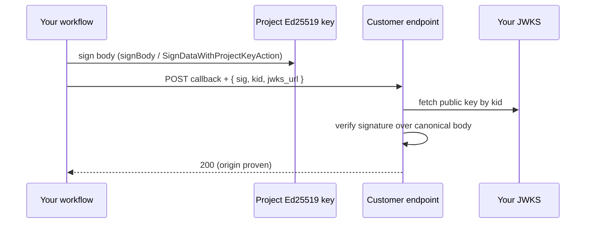

# Application signing & keys

Every application has its own **Ed25519 (EdDSA) key pair**. The private key never leaves
the runtime; the public key is published over **JWKS**. With it, your application can
**sign** outbound data so a receiver can prove the call really came from your application,
and **verify** signed data coming back in.

This is the "the owner of this call is *this application*" mechanism: when your backend
calls a customer's webhook, it can sign the body the same way payment providers sign the
callbacks they send to their consumers.

## Two key surfaces: do not conflate them

An application has **two separate** signing surfaces:

| | **User session JWTs** | **Application / service-identity signing** |
|---|---|---|
| Algorithm | **EdDSA**, signed with the auth service's own service-identity key | **Ed25519 / EdDSA**, signed with the project or service key |
| Identifies | an authenticated **user** | the **project / service** itself |
| Where | login, access token | `signBody`, `secureEvents`, `SignDataWithProjectKeyAction`, M2M tokens |
| Verified by | the auth layer | the project / service **JWKS** |

This page is about the **application** surface (Ed25519). It is **not** how user logins are
signed: the auth service mints those tokens with its own key, and a verifier resolves it
from the auth service's public-key endpoint by key id. See
[Access tokens](../system-services/authentication/access-tokens.md) for the user-JWT side.

## The project key pair and JWKS

- The project holds an **Ed25519 private key**, identified by a **kid** (key id).
- The matching **public key** is published as a JWKS document at a well-known endpoint of
  the application. The location is carried in every signature envelope as `jwks_url`.
- A receiver verifies a signature by fetching that JWKS, finding the key for the `kid`, and
  checking the signature over the exact bytes that were signed.

Signing is over a **canonical** byte form: objects are serialised as JSON with recursively
sorted keys, so the signer and verifier reproduce identical bytes regardless of property
insertion order. Ed25519 signs those bytes directly (no separate hashing step).

The standard signature **envelope** is:

```json
{ "sig": "<base64url EdDSA signature>", "kid": "<key id>", "jwks_url": "<JWKS endpoint>" }
```

`jwks_url` tells the receiver where to resolve the public key; `kid` selects which key;
`sig` is the signature itself.

## Three ways to sign

### 1. Sign an outbound API call: `ApiCallAction.signBody`

When an [`ApiCallAction`](../../spec/ApiCallAction.md) has `signBody: true`, the runtime
signs the **request body** with the project key and adds three headers to the outbound
call:

| Header | Value |
|--------|-------|
| signature header | base64url EdDSA signature over the raw body bytes |
| key id header | the key id (`kid`) |
| JWKS URL header | where the receiver resolves the public key |

The header names carry the compiler's vendor prefix and are listed in
[the compiler specification](../../compiler/index.md).

```json
{
  "name": "notifyPartner",
  "apiCallRequest": {
    "httpRequestUrl": "https://partner.example.com/webhooks/order-shipped",
    "httpRequestMethod": "POST",
    "httpRequestParameters": {
      "httpRequestBody": [
        { "name": "orderId", "value": { "js": "this.order.id" } },
        { "name": "trackingNumber", "value": { "js": "this.order.trackingNumber" } }
      ]
    }
  },
  "isArray": false,
  "signBody": true
}
```

The partner verifies the call by fetching your JWKS at the URL in the JWKS URL header and
checking the signature over the raw body. This is **the inverse of how payment-provider
callbacks are verified coming in**: here *you* are the signer.

### 2. Sign Kafka events: `serviceOptions.secureEvents`

List event **aliases** under a service's
[`serviceOptions.secureEvents`](../../spec/ServiceOptions.md) and the project's Ed25519
signature is required on those events:

```json
{
  "serviceOptions": {
    "secureEvents": ["paymentSucceeded", "order-cancelled"]
  }
}
```

- **On publish**: when this service emits an event whose alias is listed, the publisher
  wraps the payload as `{ payload, sig, kid, jwks_url }` before placing it on the resolved
  Kafka topic.
- **On subscribe**: when this service consumes a listed event, the subscriber verifies the
  signature and **drops the message on failure**.

Use it across trust boundaries: payment confirmations, audit-trail writes, cross-tenant
fan-outs. See [Event subscriptions](event-subscriptions.md) and
[Services: serviceOptions](../blueprint/services.md).

### 3. Sign arbitrary data: `SignDataWithProjectKeyAction`

[`SignDataWithProjectKeyAction`](../../spec/SignDataWithProjectKeyAction.md) signs **any**
value inside a workflow and writes the envelope to context, so later actions can attach it
to a payload, a header, or a token:

```json
{
  "name": "signWebhookPayload",
  "inputData": { "js": "{ event: 'order.shipped', orderId: this.order.id, trackingNumber: this.order.trackingNumber }" },
  "contextPropertyName": "signedEnvelope"
}
```

Downstream actions reference `this.signedEnvelope.sig`, `this.signedEnvelope.kid`, and
`this.signedEnvelope.jwks_url`. This is the general-purpose primitive behind the other two
paths and the building block for the [share-tokens](share-tokens.md) pattern.

## Verifying signed data coming in

### Provider webhooks: `VerifyWebhookAction`

[`VerifyWebhookAction`](../../spec/VerifyWebhookAction.md) verifies an **inbound** signed
callback from a payment provider. It is **provider-bound**: the verification scheme (HMAC /
RSA public key / certificate) is derived from the named provider's capabilities:

```json
{
  "name": "verifyPaymentCallback",
  "providerName": "myPaymentProvider"
}
```

`providerName` looks up a `paymentProviders[]` entry under
`projectSettings.paymentProvidersSettings`. Keep it provider-neutral: point it at whichever
provider you configured, not a hard-coded one. See [Payment workflow](payment-workflow.md)
and the action's own [reference page](../../spec/VerifyWebhookAction.md) for current status
and the canonical webhook entry point.

### Verifying a project Ed25519 signature

`VerifyWebhookAction` is for **provider** webhooks; it is not a generic verifier for the
project's own Ed25519 envelope. To verify a `{ sig, kid, jwks_url }` envelope produced by
`signBody` / `SignDataWithProjectKeyAction`, the receiver:

1. fetches the JWKS at `jwks_url`,
2. selects the public key for `kid`,
3. recomputes the canonical bytes of the payload,
4. checks the signature.

The generated service ships a verification helper for exactly this. An author-side workflow
calls it through a [service library](../../spec/ServiceLibrary.md) function invoked by a
[`FunctionCallAction`](../../spec/FunctionCallAction.md) /
[`ArrowFunctionAction`](../../spec/ArrowFunctionAction.md): there is no dedicated "verify
project signature" action in the blueprint surface today. The
[share-tokens](share-tokens.md) guide walks this verification path end to end.

## Use case: signed callbacks

The canonical use case (and the reason this surface exists): your application makes a
callback to a customer's API and **signs it** so the customer can verify the call's origin,
exactly as payment providers sign the callbacks they send to their consumers.



The customer needs nothing from you except your JWKS URL: no shared secret to rotate,
because verification uses your **public** key.

## See also

- [Access tokens](../system-services/authentication/access-tokens.md): the user-session
  side of signing.
- [Share tokens](share-tokens.md): signed-payload access tokens built on this.
- [Event subscriptions](event-subscriptions.md) and
  [Services: serviceOptions](../blueprint/services.md): `secureEvents`.
- [Payment workflow](payment-workflow.md): inbound provider webhook verification.
- Actions: [`ApiCallAction`](../../spec/ApiCallAction.md),
  [`SignDataWithProjectKeyAction`](../../spec/SignDataWithProjectKeyAction.md),
  [`VerifyWebhookAction`](../../spec/VerifyWebhookAction.md).
