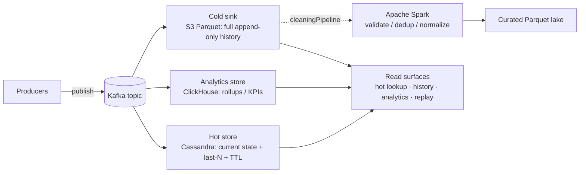
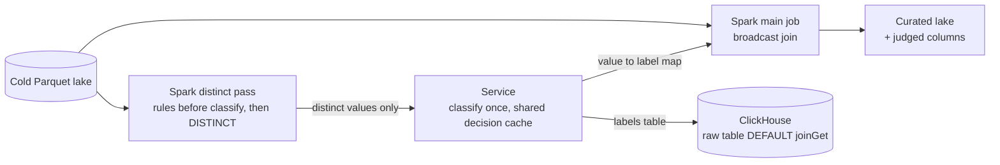
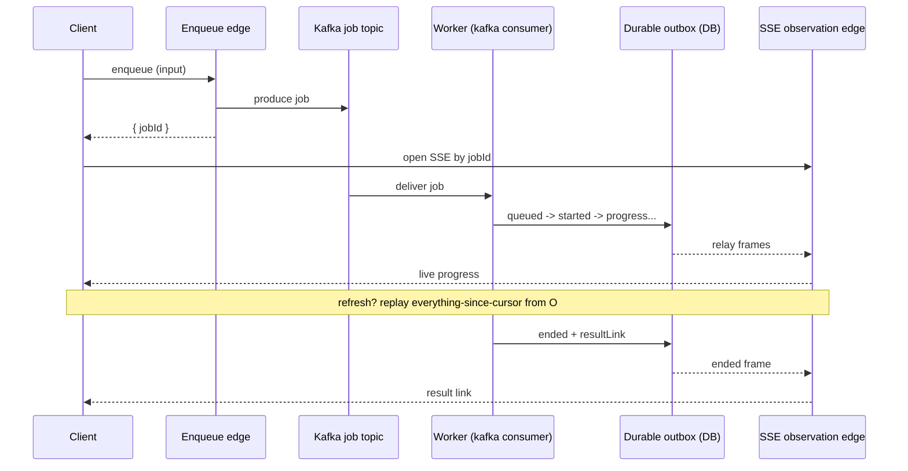
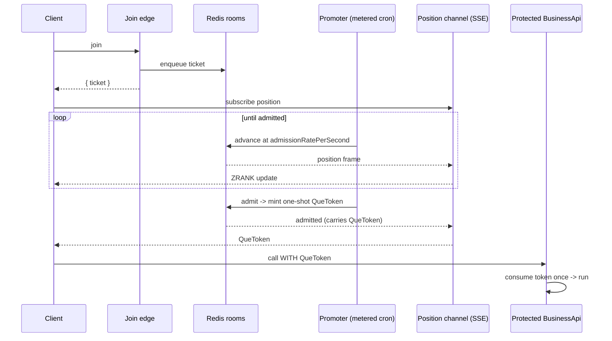

# Big-data & async logical flows

Three patterns handle high-volume and long-running work without bloating your service
code. Each declares a **logical flow** over shared primitives (Kafka, Redis, SSE, the
compute outbox) and external datastores, so the service stays a thin control plane:

| Pattern | Shape | Use it for |
|---------|-------|------------|
| **`eventStream`** | high-throughput **ingest** with a hot / cold / analytical split | telemetry, clickstream, IoT pings: write-heavy event firehoses |
| **`jobStream`** | **push**: a durable, reconnectable, observable async job | report generation, video transcoding, any slow business job |
| **`waitingRoom`** | **pull**: a metered admission-control queue | flash sales, ticket drops, any thundering-herd gate |

`jobStream` and `waitingRoom` are **independent** patterns (not a family); `eventStream`
is the headline asset of the big-load family. None of them re-implement Kafka, compute or
realtime: they **compose** them.

A fourth, service-level pattern completes the load story:
[**`loadShield`**](load-shield.md), the always-on, in-process priority load shedder that
protects *every ordinary route* against *unplanned* overload (the three flows above each
protect one declared hop). The [decision guide below](#choosing-the-protection-a-decision-guide)
picks between all four.

> **Compiler support.** The adaptive load-management behaviour described on this page
> and in [Load shield](load-shield.md) (ingest shedding, pool fast-fail timeouts, the
> closed-loop promoter, the shield) is generated by compilers that implement these
> patterns. Which targets a given compiler supports is stated in
> [the compiler specification](../../compiler/index.md).

---

## EventStream — ingest with a hot/cold/analytics split

An `eventStream` declares an ingest to hot / cold / analytical pipeline over one logical
event topic. Datastores are declared **once** in
`projectSettings.bigLoadProvidersSettings.bigLoadStores[]` (a named array exactly like
`bucketProvidersSettings`) and bound **by name**.



The engines per tier ([`BigLoadStoreProvider.engine`](../../spec/BigLoadStoreProvider.md)):
`cassandra` (write-optimised hot / time-series), `clickhouse` (columnar OLAP analytics),
`s3Parquet` (cold columnar archive) and `spark` (external ETL). The unimplemented Redis
big-load engine is retired and rejected at design time. Blank Cassandra / ClickHouse
coordinates use local defaults; the keyspace is fixed at compile time and has no runtime
override.

```json
{
  "projectSettings": {
    "bigLoadProvidersSettings": {
      "bigLoadStores": [
        { "name": "pingHot", "engine": "cassandra",
          "configuration": { "contactPoints": "$ENV:CASSANDRA_HOSTS", "localDataCenter": "dc1", "keyspace": "telemetry" } },
        { "name": "pingAnalytics", "engine": "clickhouse",
          "configuration": { "url": "$ENV:CLICKHOUSE_URL", "database": "telemetry", "username": "$ENV:CH_USER", "password": "$ENV:CH_PASS" } },
        { "name": "pingCold", "engine": "s3Parquet",
          "configuration": { "bucket": "telemetry-archive", "region": "us-east-1", "prefix": "pings/", "accessKeyId": "$ENV:S3_KEY", "secretAccessKey": "$ENV:S3_SECRET" } }
      ]
    }
  }
}
```

```json
{
  "eventStreams": [
    {
      "streamBasics": {
        "name": "vehiclePing",
        "topic": "telemetry.vehiclePing",
        "partitionKey": "vehicleId",
        "deliverySemantics": "atLeastOnce"
      },
      "hotStore":  { "provider": "pingHot", "keyspace": "telemetry", "table": "vehicle_ping", "partitionColumn": "vehicleId", "ttlSeconds": 86400 },
      "coldSink":  { "provider": "pingCold", "table": "vehicle_ping", "objectPrefix": "vehiclePing/" },
      "analytics": { "provider": "pingAnalytics", "table": "vehicle_ping_rollup", "rollups": [] },
      "retention": { "hotTtlSeconds": 86400, "coldRetentionDays": 365, "rollupCron": "0 * * * *", "archiveToParquet": true },
      "readSurfaces": [
        { "name": "currentState", "type": "hotLookup", "partitionParam": "vehicleId", "loginRequired": true }
      ],
      "cleaningPipeline": {
        "provider": "sparkCluster",
        "sourceTier": "coldSink",
        "sinkTier": "curatedStore",
        "mode": "declarativeRules",
        "schedule": "0 2 * * *",
        "rules": [
          { "name": "dropNullGps", "op": "filter", "field": "gps", "expression": { "js": "gps != null" } },
          { "name": "dedupByEventId", "op": "dedup", "field": "eventId" }
        ]
      }
    }
  ]
}
```

> **Heavy cleaning is offloaded to Spark, never run in the service.** The
> `cleaningPipeline` declares the transform in a compiler-neutral form
> (`declarativeRules`: `validate` / `dedup` / `normalize` / `filter` / `cast` / `rename`)
> which the compiler **lowers into a Spark job**; an advanced author can use
> `mode: "customScript"`. The service only schedules and monitors the Spark job; the
> cluster does the work. This mirrors how the compute layer offloads heavy math.

### Running the cleaning pipeline

The service and the Spark cluster share no filesystem. On each run the service hands the
generated cleaning script to the cluster through the stream's s3Parquet cold store (the
pipeline's source) and submits the job to the Spark provider. What an author needs to
know:

- **The object store must be readable from Spark.** The Spark image needs an S3-compatible
  connector so it can read the script and the Parquet lake.
- **Credentials travel with the submission only.** The store's access key and secret key
  are sent in the job submission, never written into the uploaded script and never
  logged. The submission endpoint (and the network between the service and it) is
  therefore inside the trust boundary of the store's credentials: run it on a private
  network, or behind TLS and authentication.
- **When a run is refused.** A run whose source store has no bucket returns
  `submitted: false` with `cleaning source store is not configured`; a failed upload
  returns `script upload failed` and the store's error. Neither contacts the Spark
  cluster.
- **v1 source rule.** A `cleaningPipeline` reads only `sourceTier: "coldSink"` on a
  stream whose cold sink is an s3Parquet store. Other tiers are refused with
  `EVENTSTREAM_CLEANING_SOURCE_TIER_UNSUPPORTED`; a cold sink that is not s3Parquet (or no
  cold sink) is refused with `EVENTSTREAM_CLEANING_SOURCE_NOT_S3PARQUET`.

How the script is staged, the optional endpoint and memory overrides of the Spark
provider, and per-target differences are described in
[the compiler specification](../../compiler/index.md).

### Judged columns: the `classify` rule

A stream can normalise, cast and rename a field, and it can also **judge** it. A
`classify` cleaning rule asks a [decision provider](decision-layer.md) ONE typed question
about a column and writes the answer as a new **judged column**, plus
`<column>Confidence` and `<column>DecidedBy` (the pinned model version). A merchant
descriptor becomes a merchant type; a device error string becomes a fault class; an
analytics rollup can then group by it.

```json
{
  "name": "judgeMerchant",
  "op": "classify",
  "field": "merchant",
  "classify": {
    "targetColumn": "merchantType",
    "providerName": "mainJev",
    "model": "jev-1.13.0",
    "question": {
      "name": "merchantType",
      "type": "choice",
      "instructions": "The kind of business the merchant descriptor names",
      "criteria": [
        { "name": "grocery", "value": "a grocery store or supermarket" },
        { "name": "travel",  "value": "an airline, hotel or travel agent" },
        { "name": "other",   "value": "none of these" }
      ]
    },
    "confidenceThreshold": 0.8
  }
}
```

**It never classifies rows.** The source column must be **enumerable**
(`sourceKind: "enumerable"`, the default): the Spark stage collects its DISTINCT values,
the service classifies that set once, and the value-to-label map is broadcast to the main
Spark job and joined. 200M transactions over 3,000 merchants are 3,000 decisions, not
200M, and every later run reuses them from the shared decision cache (the one
[fuzzy domain filters](decision-layer.md#fuzzy-domain-filters-query-time) use), so a warm
run asks nothing. One run, end to end:



- **The label is the decision, not the probability.** A `noul` stores true/false; a
  `choice` stores the option key. An answer under `confidenceThreshold`, a noul too close
  to 0.5, or a choice outside its options leaves the label NULL while the confidence and
  the model are kept, exactly like a
  [`decisionSource`](decision-layer.md#decisionsource-write-time-columns) column.
- **A column with too many distinct values stops the run** before any decision is asked
  (`CLASSIFY_CARDINALITY_EXCEEDED`; `maxDistinctValues` defaults to 1,000, framework
  ceiling 5,000).
- **A provider outage does not stop the run.** The values that were decided are labelled;
  the rest stay NULL and the next run asks for exactly those.
- **Classify rules form one block.** Rules before the block run before the distinct pass;
  rules that read a judged column (a filter on `merchantType`, say) go after it.
- `score` questions are refused: use a `choice` over the levels.

**In the analytics table.** When the stream also has an `analytics` binding, each run
publishes the map to a ClickHouse labels table, and the raw analytics table gains the
three judged columns, filled by ClickHouse at insert time. The ingest flush is unchanged
and does no per-row work. A rollup may then group by the judged column, or by
`<column>DecidedBy`:

```json
{ "name": "spendByType", "window": "1h", "groupBy": ["merchantType"], "aggregations": ["count()", "avg(amount)"] }
```

The materialised view and its aggregating merge-tree table are the ordinary rollup
emission. Each raw row keeps the label, confidence and model it was inserted with, so when
the criterion changes the rollup can be rebuilt and attributed. A row inserted before its
value was first decided carries an empty label until such a rebuild.

**Free text is not generated yet.** `sourceKind: "freeText"` (a complaint body, an error
message) would need per-partition batched calls from the Spark executors. Validation
already computes its budget at design time from `declaredRecordsPerWindow`,
`windowMinutes`, `maxRecordChars` and `requestsPerMinute` (default 30, a conservative
declared rate rather than a measured limit), and reports the arithmetic when the volume
cannot clear the window (`CLEANING_CLASSIFY_BUDGET_EXCEEDED`); the rule itself is then
refused with `CLEANING_CLASSIFY_FREE_TEXT_NOT_IMPLEMENTED`. To judge free text today,
store it in a DataObject and use a `decisionSource` column.

**Never on the ingest path.** A classify anywhere outside `cleaningPipeline.rules[]` (the
ingestion settings, the hot store, a read surface) and a classifying pipeline that sinks
into the hot store fail with `DECISION_ON_INGEST_PATH`. `loadSheddingPriority` stays a
declared enum: deciding whether to shed a request costs more than shedding it.

| Code | Meaning |
|---|---|
| `DECISION_ON_INGEST_PATH` | a classify outside `cleaningPipeline.rules[]`, or sunk into the hot store |
| `ANALYTICS_ROLLUP_GROUPBY_UNKNOWN` | a rollup groups by a name that is neither an event field nor a judged column of this stream (or by a confidence) |
| `CLEANING_CLASSIFY_SETTINGS_MISSING` | a rule is `op: classify` but declares no `classify` block |
| `CLEANING_CLASSIFY_OP_MISMATCH` | a rule carries a `classify` block but its `op` is not `classify` |
| `CLEANING_CLASSIFY_REQUIRES_DECLARATIVE_RULES` | classify rules in a pipeline whose `mode` is not `declarativeRules`; they would never run |
| `CLEANING_CLASSIFY_SOURCE_UNKNOWN` | the rule names no field to judge, or a field that is not a declared `eventSchema` field |
| `CLEANING_CLASSIFY_TARGET_MISSING` | the rule declares no `targetColumn` |
| `CLEANING_CLASSIFY_MISSING_PROVIDER` | the rule has no `providerName` |
| `CLEANING_CLASSIFY_SOURCE_KIND_INVALID` | `sourceKind` is not `enumerable` or `freeText` |
| `CLEANING_CLASSIFY_MAX_DISTINCT_INVALID` | `maxDistinctValues` is not a positive integer |
| `CLEANING_CLASSIFY_BUDGET_UNDECLARED` | a free-text rule declares no positive `declaredRecordsPerWindow` and `windowMinutes` |
| `CLEANING_CLASSIFY_BUDGET_EXCEEDED` | a free-text rule's declared volume cannot clear its window; the message carries the arithmetic |
| `CLEANING_CLASSIFY_FREE_TEXT_NOT_IMPLEMENTED` | the free-text form is specified but not generated yet |
| `CLEANING_CLASSIFY_SCORE_UNSUPPORTED` | a `score` question |
| `CLEANING_CLASSIFY_RULES_NOT_CONTIGUOUS` | other rules between two classify rules |
| `CLEANING_CLASSIFY_COLUMN_TAKEN` | the judged column or a companion collides with an event field or another rule |
| `CLEANING_CLASSIFY_CARDINALITY_EXCEEDED` | `maxDistinctValues` over the 5,000 framework ceiling |
| `DECISION_MODEL_NOT_PINNED`, `DECISION_THRESHOLD_IN_DRIFT_BAND`, `DECISION_CHOICE_NO_ESCAPE_OPTION` | the decision layer's own rules, as everywhere |

Enumerable classify rules are not available to every compilation target
(`CLEANING_CLASSIFY_LANGUAGE_UNSUPPORTED` is raised for a target without them). Where
they are generated, the behaviour is the one described above: two-pass distinct-value
classification with a Spark broadcast join, the shared decision cache, withheld/null
labels, confidence and pinned-model provenance, and judged rollup dimensions. Free-text
and score questions remain refused; classify rules must form one contiguous block and
never run on the ingest or hot-store write path. See
[`CleaningClassifySettings`](../../spec/CleaningClassifySettings.md).

### Ingest back-pressure & shedding

The ingest hop protects **itself**: it never rides the service's
[`loadShield`](load-shield.md) (`/ingest/*` is structurally exempt; two shedders on one
hop would double-reject). Three declared knobs govern it:

- **`streamBasics.maxInFlight`** (default `10000`): the maximum un-flushed records the
  ingest handler buffers. Admission past the bound is rejected with **429**; the buffer
  never grows past it.
- **`streamBasics.loadSheddingPriority`** (`low | normal | high | critical`, default
  `normal`): drop order under **aggregate** pressure across all of the service's streams:
  as the summed in-flight total fills the summed capacity, `low` streams start rejecting
  at 50% aggregate fill or more, `normal` at 75%, `high` at 90%; `critical` is never shed
  by aggregate pressure and is bounded only by its own `maxInFlight`.
- **`ingestion.rateLimitPerSecond`**: optional per-client cap (keyed by session user id,
  else remote IP); over the cap the handler answers **429 + `Retry-After`**, the same
  back-off contract as
  [`loadShield`'s `LOAD_SHED`](load-shield.md#the-rejection-contract-what-clients-must-handle).

See [`EventStreamBasics`](../../spec/EventStreamBasics.md) and
[`IngestionSettings`](../../spec/IngestionSettings.md) for the field contracts.

### Identity and tenant scope

The ingest route is **open by default**: `POST /ingest/<stream>` accepts an anonymous
caller, because device telemetry is often unauthenticated. Three opt-in `ingestion`
settings close it and make the identity in an event authoritative:

- **`ingestion.loginRequired: true`**: an anonymous ingest is answered **401
  `LOGIN_REQUIRED`** and nothing is buffered.
- **`ingestion.actorField` / `ingestion.sessionField`**: name the eventSchema fields the
  handler fills from the session's `userId` / `sessionId`. The value the client sent in
  those fields is always discarded; an anonymous caller leaves them empty (a `required`
  stamped field then fails with 400).
- **`ingestion.tenantField`** (multi-tenant projects): names the field that carries the
  tenant. Ingest stamps it with the session tenant (`<tenantName>Id`), and **every read
  surface becomes tenant-scoped**:
  - tenant field = the partition key: a caller reads only the partition named by its own
    tenant. Another tenant's partition answers like an empty one (`items: []`,
    `item: null`, `buckets: []`);
  - tenant field = another column: a caller sees only its own rows of the partition
    (`latestN` may answer fewer than `limit`, `currentState` answers `null` when the
    newest row is another tenant's). An `analyticsRollup` surface aggregates the whole
    partition, so it is refused at design time (`EVENTSTREAM_TENANT_ROLLUP_NOT_PARTITION`):
    put the tenant in the partition key instead;
  - a caller with no session tenant is refused **403 `TENANT_SCOPE_REQUIRED`**.

```json
{ "ingestion": { "loginRequired": true, "actorField": "userId", "tenantField": "storeId" } }
```

In a multi-tenant project an open ingest warns `EVENTSTREAM_INGEST_OPEN_MULTI_TENANT` and
a stream without a `tenantField` warns `EVENTSTREAM_NOT_TENANT_SCOPED`: its reads answer
any partition a caller names, whichever tenant wrote it. A `tenantField` in a
single-tenant project is an error (`EVENTSTREAM_TENANT_FIELD_SINGLE_TENANT`), since no
session carries a tenant there.

### Shutdown: the buffer is drained, not dropped

`202 Accepted` means "buffered", not "written": the row lands in the hot store on the next
`ingestion.batchSize` fill or `ingestion.flushIntervalMs` tick. On termination the
service therefore **drains every stream's buffer first and closes the hot-store client
afterwards**, so the accepted-but-unwritten window (one flush interval wide, 60 s by
default) is not a loss window on every deploy. A flush that fails on the way down is
reported **with the number of rows it had to abandon, per stream**, since those are rows
the ingest door already answered `202` for, and the client is closed anyway; a shutdown
that aborted on the first error would hold the driver's sockets past the orchestrator's
grace period. Once the drain starts, no new flush timer is armed, so nothing re-opens the
connection after it closes.

A reconnect is also self-healing: the idempotent keyspace and table creation is re-issued
on the next connect, rather than inserting into a keyspace a restarted store may no longer
have.

### Operator triggers: the `/run` routes

Each scheduled job also has an on-demand trigger, for an operator or a test sweep:

| Route | Mounted when | Runs |
|---|---|---|
| `POST /<stream>/retention/run?days=` | `retention` is set | the cold-store prune now; `days` overrides `coldRetentionDays` |
| `POST /<stream>/archive/run?since=&maxRows=` | the cold sink is an `s3Parquet` store | one `archiveToParquet` pass |
| `POST /<stream>/clean/run?timeoutMs=&pollMs=` | `cleaningPipeline` is set | submits the external Spark job and polls it |

These are operator routes, not API routes. They use the same gate as the service's
operator log surface. A caller gets in only with an admin-grant JWT that carries the
`bigload:admin` scope; the admin-grant mint issues that scope, with the others, to the
project's owner and admins. A grant without the scope, a `logs:read`-only one for example,
is refused here. The static operator tokens (the `x-admin-token` and
`x-bigload-admin-token` headers, `?adminToken=`) are retired: they are not read, and a
still-set token variable costs one boot warning and is otherwise ignored. The gate **fails
closed**: without a grant every `/run` route answers `403` (`ADMIN_TOKEN_REQUIRED`) and
starts no job. It does not fall back to network isolation. The scheduled jobs do not depend
on a credential. The service's API inventory lists these rows with `authGate: operator`.

---

## JobStream — a durable, reconnectable async job

A `jobStream` **hides** a processing BusinessApi behind an enqueue edge and a
Kafka-consumer worker, and gives the client a **reconnectable SSE observation edge**
backed by a **durable per-job outbox**. The outbox, not a live-only Kafka SSE, is what
makes reconnection work: a refreshed browser replays everything since its cursor.



```json
{
  "jobStreams": [
    {
      "streamBasics": {
        "name": "generateReport",
        "jobTopic": "jobs.generateReport",
        "partitionKey": "tenantId",
        "inputSchema": [ { "name": "reportType", "type": "String" }, { "name": "rangeStart", "type": "Date" } ]
      },
      "targetApi": { "api": "buildReport", "resultLinkField": "reportUrl" },
      "observation": { "channelName": "generateReport", "reconnectable": true, "retainEventsSeconds": 3600 },
      "jobState": { "store": "db", "resultLinkField": "reportUrl" }
    }
  ]
}
```

- `targetApi.api` binds a BusinessApi (`buildReport`) declared in **this service**.
  Binding it as a JobStream target makes it **internal by default**: its public REST
  route is suppressed; it is reached only via the worker controller (override with
  `keepPublicRoute: true`).
- The worker runs the target with the session the enqueue gate forwarded and **no
  session manager**, so a target that declares `authOptions.permissionCheck` is refused
  (403) on every run and the job is marked `failed`. Gate a JobStream target with
  `checkRoles` / `absoluteRoles` / `ownershipCheck`, which read the forwarded session;
  validation warns about a `permissionCheck` target (`PERMISSION_CHECK_ON_CALLERLESS_DOOR`).
- `observation.reconnectable` (default) retains the per-job outbox so a reconnect replays
  the full timeline.
- `jobState.store` is `db` by default (a durable, queryable job row, mirroring the compute
  outbox).

### Enqueueing from inside the service

`POST /jobstreams/<name>` is the client's enqueue edge. Server-side logic of the **same
service** (a create action's function call, a kafka-triggered api, a db-event handler, a
cron function) enqueues through the generated `enqueueJobStream` helper, taking the stream
name, the input and the caller's session and request id, instead of re-implementing the
router's payload. The helper is available to service library functions called from a
[`FunctionCallAction`](../../spec/FunctionCallAction.md), for example
`"callScript": { "js": "LIB.queueReport(this.session, this.requestId, this.reportType)" }`.

It is the POST edge without HTTP, and it is NOT a second door:

- It runs the stream's **same enqueue gate** (the target api's `loginRequired` /
  `M2MAllowed` / `absoluteRoles` / `checkRoles` and its `requiredCallerKind`) against the
  `session` you pass (the caller's own session, e.g. `this.session` in a BusinessApi). An
  absent session is an anonymous caller: only a public stream admits it. There is no
  trusted-system bypass, and a target declaring `requiredCallerKind: "machine"` refuses
  every in-process call.
- It creates the **same durable job row** (bound to the principal the gate authorised) and
  produces the **same work-topic message**, so the SSE observation edge, the snapshot edge
  and the job status lifecycle behave exactly as for a REST-enqueued job. It returns
  `{ jobId, stream }`.
- A refusal **throws** a typed error carrying the route's own `statusCode` and
  `errorCode`: the gate's `401` / `403` codes, `400 VALIDATION_ERROR` for input the
  `inputSchema` rejects, `404 JOB_STREAM_NOT_FOUND` for an unknown stream name,
  `503 QUEUE_UNAVAILABLE` when the row was created but the publish failed. Thrown inside a
  BusinessApi, it surfaces as that api's problem+json answer with the same status,
  `errorCode` and message; on the 503 the created job's id rides the answer's `errors`
  member (`errors.jobId`), so a caller can observe the queued job instead of enqueueing a
  second one.

---

## WaitingRoom — a metered admission queue

A `waitingRoom` **fronts** a public BusinessApi with staged admission rooms. A waiter
joins, sits in a Redis room, watches their position over a realtime channel, and on
admission receives a **one-shot, time-boxed `QueToken`**, which the **client** then
presents to the target API. The room never proxies the API; it only meters who may call
it.



```json
{
  "waitingRooms": [
    {
      "roomBasics": { "name": "ticketDrop", "fairnessPolicy": "fifo", "abandonmentTtlSeconds": 120 },
      "rooms": {
        "stages": [
          { "name": "lobby", "admissionRatePerSecond": 50, "capacity": 100000 },
          { "name": "checkout", "admissionRatePerSecond": 10, "capacity": 500 }
        ]
      },
      "token": { "ttlSeconds": 60, "singleUse": true },
      "targetApi": { "api": "purchaseTicket" },
      "positionChannel": { "channelName": "ticketDrop", "transport": "sse", "emitPositionEverySeconds": 5 }
    }
  ]
}
```

- `rooms.stages[]` is the ordered list of admission gates: room 0 is the entry room a join
  lands in; final admission mints the token.
- `targetApi.api` is a **public** BusinessApi (unlike a JobStream target, it keeps its
  route). The only change to it is a **`QueToken` gate** that checks the token (and
  consumes it when the room is single-use).
- `token` ([`QueTokenSettings`](../../spec/QueTokenSettings.md)) is the time-boxed
  admission credential. `singleUse: true` (the default) makes it one-shot;
  `singleUse: false` lets the same token pass the gate until its TTL ends, so a client may
  retry a failed call. There is no per-API single-use switch: the gate follows the bound
  room.
- The room's key is `codeName` when it is set (a blank `codeName` counts as unset), else
  `name`. The join route `/waitingrooms/<key>`, the Redis keys and the token's room scope
  all use that key, so a frontend joins at the `codeName`.

### Adaptive admission — the closed-loop promoter

`admissionRatePerSecond` is a **ceiling, not a constant**. The metered promoter is
closed-loop: while the service's database is healthy it drains each room at exactly the
declared rate, and under sustained database saturation an internal controller lowers the
*effective* rate toward the stage's floor, climbing back to the ceiling as the database
recovers. Admission **slows, never stops**.

What the author sets versus what self-tunes:

| Surface | Who owns it |
|---|---|
| `admissionRatePerSecond`: the ceiling (the business throttle) | **Author**, per stage; required |
| `minAdmissionRatePerSecond`: the back-off floor | **Author**, optional; defaults to `max(1, 10%)` of the ceiling; values above the ceiling are clamped to it |
| Setpoint, gains, sampling: the controller itself | **Compiler**: internal constants, never part of the blueprint |

Two degrade paths return the promoter to a plain static drain at the ceiling: an
operator kill switch for the adaptive layer, and, automatically, a service with no
relational database to observe (for example a document-store-only service), which has no
saturation signal to react to. See [`WaitingRoomStage`](../../spec/WaitingRoomStage.md)
for the field contract, and
[Load shield: operator switches](load-shield.md#operator-switches) for the switches.

---

## Choosing the protection: a decision guide

Four patterns shed or meter load; each owns exactly one hop. Pick by the shape of the
pressure:

| The pressure looks like... | Reach for | Shape | The client experiences |
|---|---|---|---|
| A **planned pull spike** on ONE known API: a ticket drop, a flash sale, an enrollment window | [`waitingRoom`](#waitingroom-a-metered-admission-queue) | opt-in, client-visible turnstile in front of one public API | waits minutes in a line, watches a live position, is admitted with a one-shot `QueToken` |
| **Unplanned overload on anything**: a viral moment, a runaway client, background pressure on ordinary CRUD/report routes | [`loadShield`](load-shield.md) | always-on, invisible-until-triggered in-process guard for the whole service | works normally, or (low-priority traffic first) gets an immediate `429 LOAD_SHED` + `Retry-After` |
| A **slow push job** the client asked for: report generation, transcoding | [`jobStream`](#jobstream-a-durable-reconnectable-async-job) | enqueue edge + worker + durable outbox + reconnectable SSE | gets a `jobId` instantly, observes progress, reconnects freely |
| An **ingest firehose**: telemetry, clickstream, IoT | [`eventStream`](#eventstream-ingest-with-a-hotcoldanalytics-split) | thin batched write path with its own declared shedding | fast 200s; over the declared bounds, `429` back-pressure |

Rules of thumb:

- **waitingRoom vs loadShield** is *planned vs unplanned* and *one API vs the whole
  service*, not either/or. **Both can coexist**: the room meters the herd upstream at a
  rate you chose; the shield still protects the service if the admitted rate plus all
  background traffic saturates the database. The shield sheds **before** the `QueToken`
  gate, so a shed request never burns the admission token a client queued for: it retries
  with the same still-valid token.
- **jobStream vs waitingRoom** is *push vs pull*: a jobStream accepts the work now and
  delivers the result later; a waitingRoom makes the client wait *before* the work is
  accepted at all.
- **eventStream vs everything**: if the traffic is a write-heavy event firehose, nothing
  else fits; its ingest path keeps its own knobs and is structurally exempt from the
  shield.

---

## See also

- [`EventStream`](../../spec/EventStream.md),
  [`BigLoadStoreProvider`](../../spec/BigLoadStoreProvider.md),
  [`EtlPipelineBinding`](../../spec/EtlPipelineBinding.md).
- [`JobStream`](../../spec/JobStream.md),
  [`WaitingRoom`](../../spec/WaitingRoom.md),
  [`QueTokenSettings`](../../spec/QueTokenSettings.md).
- [Compute & calculation layer](compute-layer.md): the async job and outbox machinery
  JobStream generalises.
- [Realtime](realtime.md): the SSE / hub channels these flows ride.
- [The decision layer](decision-layer.md): the decision pattern family the `classify` rule
  belongs to: providers, the shared decision cache, failure postures and measured
  behaviour.
- [Event subscriptions](event-subscriptions.md): the Kafka path ingestion publishes to.
- [Load shield](load-shield.md): the always-on priority load shedder these flows compose
  with.
- [DB layer: connection pool & timeouts](../data-modeling/db-layer.md#deployment-requirements-and-limits):
  the Postgres fast-fail hardening underneath all of this.
