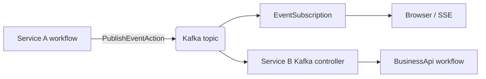

# Event subscriptions

An **EventSubscription** is a client-facing channel that streams a selected subset
of the project's Kafka events to browsers and mobile apps over WebSocket or SSE.
Each channel:

- Names one or more Kafka topics (typically the generated data object lifecycle
  topics).
- Inherits authorization from each topic's owning data object's access level
  (public / protected / private).
- Lets the author override access per topic, transform payloads, exclude sensitive
  fields, and add MScript auth / filter scripts.

Distinct from the [**Realtime hub**](realtime.md) (which is bidirectional and
handles rooms, roles, message persistence), event subscriptions are *one-way* read
channels.

## Where it lives in the blueprint

```json
{
  "serviceSettings": { "serviceBasics": { "name": "shop" } },
  "eventSubscriptions": [
    {
      "basics": {
        "name":      "orderTracking",
        "transport": "sse"
      },
      "topics": [
        {
          "name":           "orderCreated",
          "dataObjectName": "order",
          "topic":          "acme-shop-service-dbevent-order-created"
        },
        {
          "name":           "orderShipped",
          "dataObjectName": "order",
          "topic":          "order-shipped",
          "payloadMapping": { "js": "{ orderId: data.id, status: data.status }" },
          "excludeFields":  ["internalNotes"]
        }
      ],
      "auth": {
        "checkRoles":  ["customer", "support"],
        "filterScript": { "js": "data.userId == session.userId || session.roleId == 'support'" }
      }
    }
  ]
}
```

The first topic is the DB-level event of the `order` object in a project whose
codename is `acme`; the second is a topic a `PublishEventAction` of the project
publishes (see [Topic names](#topic-names)).

Each entry mounts under the service's `/<service>-api` route, at one of:

- `/<service>-api/events/<name>`: Socket.IO namespace when `transport: "websocket"`
  (Socket.IO HTTP path `/<service>-api/socket.io/`)
- `/<service>-api/events/<name>/stream`: SSE endpoint when `transport: "sse"`

For the example above that is `GET /shop-api/events/orderTracking/stream` (a
kebab-case name such as `order-tracking` is converted to camelCase when the
blueprint is validated).

## Picking the transport

`basics.transport`:

- **`websocket`**: long-lived connection where clients dynamically
  subscribe/unsubscribe to topics from the channel's set. Right for finance
  dashboards, live tickers, admin panels.
- **`sse`**: short-lived, page-scoped connection that opens on page load and closes
  on navigation. Right for product-page updates, order tracking, anywhere the client
  subscribes to "everything in this channel" for the duration of one page.

## Topics: `EventSubTopic`

Each topic in the channel binds a Kafka topic to a data object:

| Field | Notes |
|-------|-------|
| `name` | Client-facing event name: what the JS handler keys off (`orderCreated`, `reviewAdded`). |
| `dataObjectName` | The data object whose events this topic comes from. Drives default auth. |
| `topic` | The Kafka topic, written literally. There is no alias syntax: a string such as `order.created` or `dbEvent:inventory:updated` is subscribed under exactly that name, and validation warns `KAFKA_TOPIC_UNKNOWN_PRODUCER` when nothing in the project publishes it. See [Topic names](#topic-names). |
| `forceAccessLevel` | Override the data object's default access level for this topic only. `accessPublic` / `accessProtected` / `accessPrivate`. Leave it unset (the default) and the topic **inherits** the data object's own `dataObjectAccess`. |
| `payloadMapping` | Optional MScript that builds the client-facing payload. `data` is the record (the event envelope's `data`), `event` the whole envelope `{ id, type, source, time, requestId, actor, data, old? }`. Its value is what the subscriber receives. A mapping that throws **drops that event for that subscriber** (logged, rate-limited); the full record is never sent in its place, because a mapping is how fields are kept away from subscribers. |
| `excludeFields` | Final-pass field strip-list; runs after `payloadMapping`. |

The three scripts (`payloadMapping`, `authScript`, `filterScript`) are **compiled
into the generated service at build time** as plain functions over the names listed
for each; the service carries no runtime expression evaluator. A script that is not
a single expression (a statement list, an `await`) is reported by validation and
compiles to a function that fails closed (the topic is rejected / the event is
dropped), never to "no script".

### Topic names

A consumer of a project API's derived route topic, written with or without the
project codename prefix, requires that API's `apiOptions.raiseApiEvent: true`. If
the switch is false or omitted, validation reports **ERROR
`KAFKA_TOPIC_API_EVENT_DISABLED`**, naming the service and API to switch on. This
applies to event subscriptions, Kafka business APIs, edge Kafka triggers, agent
Kafka controllers, hub Kafka events, event notifications, harness Kafka triggers and
SSE Kafka progress listeners. An unrelated external topic or an unknown service
under the project prefix keeps the advisory `KAFKA_TOPIC_UNKNOWN_PRODUCER` warning.

An object's `objectSettings.basicSettings.publishDbEvents: false` is refused with
`DB_EVENTS_SWITCH_CONSUMED` when a stored DataView uses it as its main object,
aggregate or stat source. A dynamic DataView does not consume those Kafka events and
permits the switch; the source object's Elasticsearch index continues to be written.

The only rewrite a topic string gets is the project scope: a topic that a
`PublishEventAction` of this project authors (and a framework topic of this project
written without the codename prefix) goes on the wire as
`<projectCodename>-<topic>`, and the subscription consumes that wire name for you.
When the topic is one **this project produces**, the subscription subscribes to the
producer's exact spelling: the db-event producer writes
`<projectCodename>-<servicename>-service-dbevent-<objectname>-<verb>` all in
lowercase, so `...-dbevent-agendaItem-created`, with or without the project
codename, is consumed as `...-dbevent-agendaitem-created` (validation still reports
the drift as `KAFKA_TOPIC_CASE_DRIFT`; write the lowercase form). A string without
the service segment (`dbevent-agendaitem-created`) names a topic nobody writes:
validation warns `KAFKA_TOPIC_UNKNOWN_PRODUCER` and the subscription consumes it as
written. Any other string is consumed exactly as written. The service logs the
resolved wire topic and consumer group when a topic's consumer starts
(`EventSubConsumerStarted`), so a mismatch is visible in the logs rather than as a
silent empty feed. The framework topics a subscription usually names:

- **DB-level events** of a data object, raised on every create, update and delete:
  `<projectCodename>-<serviceName>-service-dbevent-<objectname>-<created|updated|deleted>`
  (all lowercase).
- **API events** of an API with `raiseApiEvent`:
  `<projectCodename>-<serviceName>-service-<raisedEvent>`.

## Auth: `EventSubAuth`

Every connection needs a logged-in session, whatever the access level of its
topics: a WebSocket handshake or an SSE request whose session carries no `userId` is
refused (see [Client protocol](#client-protocol)). On top of that, auth comes
layered:

1. **Data object default**: a topic's access level is its `forceAccessLevel`, else
   its data object's own `dataObjectAccess`. It decides who gets the topic at
   subscribe time and which events reach them:

   | Access level | Who may subscribe | Which events are delivered |
   |---|---|---|
   | `accessPublic` | any logged-in user | every event |
   | `accessProtected` | any logged-in user | the subscriber's own records when the object has an owner column; tenant-filtered (below) |
   | `accessPrivate`, object with an owner column | any logged-in user | the subscriber's own records only; tenant-filtered (below) |
   | `accessPrivate`, object without an owner column | the admin roles only: `superAdmin`, `admin`, `saasAdmin`, `tenantOwner`, `tenantAdmin` | every event; tenant-filtered (below) |

   "Own records" means the record's `_owner` marker equals the subscriber's
   `userId`. The tenant filter applies to non-public topics in a multi-tenant
   project, for an object that stores a tenant column (one with
   `objectDataIsInTenantLevel: true`); an object whose flag is false or omitted
   stores no tenant column and gets no tenant filter. The lookup is **local to the
   service that declares the subscription**: a `dataObjectName` naming an object
   this service does not own resolves nothing, so the topic fail-closes to
   `accessPrivate` behind the admin gate with no ownership filter. Validation
   reports that case as `EVENT_SUB_TOPIC_OBJECT_UNRESOLVED`; set `forceAccessLevel`
   explicitly when the topic really is another service's. The ownership and tenant
   delivery filters **fail closed**: an event record without the `_owner`
   (`_tenantId`) marker the filter reads is delivered to no one but `absoluteRoles`
   holders. Records written through the generated data layer always carry both
   markers; a hand-published event on a filtered topic must set them itself.

   **A collaborative object needs a decision here.** The ownership filter means "the
   subscriber receives *its own* records". A meeting's notes, agenda items or room
   state are written by one participant and must reach *every* participant, so with
   the object's own `accessProtected` / `accessPrivate` level the other participants
   receive nothing. A `filterScript` alone cannot fix that: it runs *after* the
   default filters, so it can only narrow what they let through. Note that `_owner`
   is the record's **creator**, never derived from the request.

   - **Recommended: replace the owner filter with an explicit audience check, and
     keep the tenant check.** Set the topic's `forceAccessLevel: "accessPublic"`
     (this turns the owner filter off) and write a `filterScript` that states both
     who may see the record and the tenant boundary, for example
     `data._tenantId != null && data._tenantId == session._tenantId && (data.participantIds || []).includes(session.userId)`.
     The participant list (or a membership id the session carries, such as
     `data.meetingId == session.activeMeetingId`) is whatever your model uses to say
     who belongs to the room.
   - **`forceAccessLevel: "accessPublic"` with no `filterScript`.** Every logged-in
     subscriber receives every event of the topic. In a multi-tenant project this
     means users of *other* tenants receive your tenant's records too, because
     `accessPublic` turns the tenant filter off as well as the owner filter. Use it
     only for data that really is public to every tenant.
2. **`absoluteRoles`**: holders get every topic: they skip the `checkRoles` gate, the
   admin gate and the ownership / tenant filters. `authScript` and `filterScript`
   still run for them.
3. **`checkRoles`**: required roles. A user holding none of them (and no absolute
   role) has every requested topic rejected.
4. **`authScript`**: MScript evaluated at *subscribe time* per requested topic, with
   `session`, `topicName` (the authored Kafka topic) and `dataObjectName`. A falsy
   result rejects that topic for that user
   (`rejected: [{ topic, reason: "Rejected by auth script" }]`); a throw rejects it
   too (`reason: "Auth script error"`) and is logged with the subscription, the
   topic and the user id, never the session.
5. **`filterScript`**: MScript evaluated per *incoming event* before delivery, after
   the default filters above, with `session`, `topicName`, `dataObjectName`, `data`
   (the record) and `event` (the envelope). A falsy result skips the event for that
   user. A throw skips the event for that user as well and is logged once per minute
   per topic (with the number of skips it suppressed); the stream and the other
   subscribers are unaffected.

The generated service **automatically splits mixed-access subscriptions**: when one
channel covers topics with different access levels, each user only gets the topics
they are allowed to, and the `subscribed` answer lists the others under `rejected`
with a reason. No per-topic connection juggling required.

> **Topic authorization is two-layered.** The data object access level is the
> baseline *token* layer (does this user's session reach this topic at all), and
> `authScript` / `filterScript` are the *right* layer (which specific topics and
> which individual events). That pairing, a coarse access gate plus per-topic and
> per-event scripts, is the model for topic-scoped realtime delivery; declare it
> inline on the subscription rather than in a separate channel-token service. In
> multi-tenant projects the baseline layer also applies tenant filtering
> automatically (see [Multi-tenancy](multi-tenancy.md)).

## Client protocol

The frames below are those of a Socket.IO WebSocket subscription. A client always
uses the topic **names** (`orderCreated`), never the Kafka topics. A name the
subscription does not declare is ignored: it appears in neither `topics` nor
`rejected`, so compare the granted `topics` with what you asked for.

### WebSocket (Socket.IO)

```js
import { io } from "socket.io-client";

// baseUrl ends with the service route, e.g. https://<host>/shop-api
const socket = io(`${baseUrl}/events/dashboard`, {
  path: "/shop-api/socket.io/",
  auth: {
    token: accessToken,       // the session JWT; the "Bearer " prefix is optional
    tenantCodename: "acme",   // multi-tenant projects only
  },
  transports: ["websocket", "polling"],
});

socket.on("connect", () => {
  // subscriptions do not survive a reconnect: subscribe on every connect
  socket.emit("subscribe", { topics: ["orderCreated", "paymentReceived"] });
});
socket.on("connect_error", (err) => console.error(err.message));
socket.on("subscribed", ({ topics, rejected }) => { /* granted names, [{ topic, reason }] */ });
socket.on("event", ({ topic, name, data }) => { /* topic === name: the client-facing name */ });
socket.on("error", ({ message }) => console.error(message));

socket.emit("unsubscribe", { topics: ["orderCreated"] });
socket.on("unsubscribed", ({ topics }) => { /* echoes the names sent */ });
```

| Frame | Direction | Payload |
|---|---|---|
| handshake `auth` | client to server | `{ token, tenantCodename? }`. Without `auth.token` the handshake's `Authorization` header is used. |
| `connect_error` | server to client | `Authentication required` (no session, or a session without a `userId`) or `Authentication failed`. |
| `subscribe` | client to server | `{ topics: string[] }` |
| `subscribed` | server to client | `{ topics: string[], rejected: [{ topic, reason }] }`, one per `subscribe`, covering only that call. |
| `event` | server to client | `{ topic, name, data }`; `data` is the shaped payload (`payloadMapping`, `excludeFields`). |
| `unsubscribe` | client to server | `{ topics: string[] }` |
| `unsubscribed` | server to client | `{ topics: string[] }` |
| `error` | server to client | `{ message }`: `"topics array is required"` for a `subscribe` without a non-empty `topics` array. |

A connection can subscribe and unsubscribe any number of times without
reconnecting.

### SSE

```
GET /shop-api/events/orderTracking/stream?topics=orderCreated,orderShipped
Authorization: Bearer <accessToken>
```

`topics` is a required, comma-separated list of names. The session is resolved the
way a REST call's is. A browser `EventSource` cannot send a header, so it passes the
token as `?access_token=<jwt>` or relies on the session cookie
(`withCredentials: true`).

| Answer | When |
|---|---|
| `401` problem+json | No session, or a session without a `userId`. |
| `400` problem+json | No `topics` parameter. |
| `403` problem+json, `errors.rejected: [{ topic, reason }]` | No requested topic was granted (also when every name is unknown; `rejected` is then empty). |
| `200 text/event-stream` | At least one topic was granted. |

The stream opens with one `subscribed` frame, then sends one `event` frame per
delivered message:

```
event: subscribed
data: {"topics":["orderCreated"],"rejected":[{"topic":"orderShipped","reason":"Rejected by auth script"}]}

event: event
data: {"topic":"orderCreated","name":"orderCreated","data":{"id":"…","status":"new"}}
```

Events are not buffered per client: events published while a client is disconnected
are not delivered to it, on both transports. Re-read the current state over REST
after a reconnect, and close the `EventSource` when the page unmounts. The opposite
can happen too: when a replica's consumer resumes its own consumer group (same
replica id, see below), it continues from the group's committed offsets, so an event
a client already received can arrive again. See
[Loading state and applying events](#loading-state-and-applying-events).

## Delivery across replicas

A subscription is a **live feed**, and every connected client lives on exactly one
replica of the service. Each replica therefore runs its own Kafka consumer per
topic, in a consumer group of its own (named after the service, the subscription,
the topic and a replica id). Every replica receives every event and evaluates the
owner / tenant filters, the `filterScript` and the `payloadMapping` for *its*
subscribers with their sessions; a client connected to any replica receives each
event once. (A single group shared by the replicas would hand a one-partition topic
to one replica only, and the clients on the other replicas would never receive
anything; fanning out through the Socket.IO adapter cannot apply another replica's
per-subscriber filters, and SSE has no adapter.)

- The **replica id** is a stable per-instance identifier (the container or pod name
  where the deployment provides one, else the machine hostname, else a per-process
  random id). Stable ids keep a restarted replica in its own group; an unstable one
  only costs an extra consumer group on the broker, which Kafka expires with the
  offsets retention (7 days by default).
- A replica's consumer **starts with the first subscriber of a topic and stops with
  the last**. The first consumer of a fresh group joins at the log end: events
  published before it has joined are not delivered. A consumer that resumes an
  existing group (a restart with the same replica id) continues from the group's
  committed offsets, which can repeat events.
- The service logs the group, the replica id and the resolved topic when a consumer
  starts (`EventSubConsumerStarted`), so "the topic is consumed on replica A but not
  on replica B" is readable per replica.

See [the compiler specification](../../compiler/index.md) for how a compiler
derives the group names and exposes the consumer census.

## Loading state and applying events

The order a client should follow:

1. **Subscribe**, and wait for the `subscribed` answer (the first `subscribed` frame
   on SSE).
2. **Load the current state over REST.**
3. **Apply each event idempotently**: key it by the record `id` and keep a change
   only when it is newer than what you hold (compare `updatedAt`), so a repeated or
   an older event changes nothing.

Why this order, and why idempotent: `subscribed` means the topic was *granted*; it is
sent before the replica's consumer has necessarily joined the broker. When the
subscription is the first one of its topic on that replica, the consumer joins the
log end a moment later, and an event published in that short window is not delivered.
Loading over REST *after* the answer covers that window, and anything it does not
cover arrives as an event you apply on top. A resumed consumer group can also hand
you an event again. So a short gap and a repeat are both possible: the feed is
neither gap-free nor exactly-once, and a client that treats every event as "set this
record to this state if it is newer" is correct in both cases.

## When to choose an event subscription vs a realtime hub

| Use case | Pick |
|----------|------|
| One-way push of existing CRUD events to clients | EventSubscription |
| Bidirectional messaging / rooms / persisted history | RealtimeHub |
| Live dashboard reading multiple Kafka topics | EventSubscription |
| Chat / game lobby / collaborative editing | RealtimeHub |
| Server-side streaming of a single API's progress | [SSE in a Business API](../business-apis/sse-streaming.md) |

## Cross-service Kafka consumption

Event subscriptions relay topics to **clients**. When another **service** needs to
react to the same topics, you wire a server-side
[`ApiKafkaSettings`](../../spec/ApiKafkaSettings.md) controller on a business API;
see [Kafka controllers](../business-apis/kafka-controllers.md). Same wire format,
different consumer. The two surfaces are independent; a topic can feed both a
browser subscription and an upstream service's Kafka controller without extra
wiring. Service-to-service trust on the Kafka side is handled by the M2M layer; see
[M2M communication](../system-services/m2m-communication.md).



## Bridging events to notifications

[`EventNotification`](../../spec/EventNotification.md) entries on a service map a
Kafka topic to the notification service: an emitted event triggers an email / SMS /
push without a business API handler in between. Use it for "user signed up, send
welcome email" wiring that does not need any decision logic.

## Emitting events

The publisher side is the [`PublishEventAction`](../../spec/PublishEventAction.md)
inside any business API workflow. Every data object also publishes its DB-level
events,
`<projectCodename>-<serviceName>-service-dbevent-<objectname>-<created|updated|deleted>`,
on every create, update and delete, with no configuration.

## See also

- [Realtime hub](realtime.md): bidirectional realtime.
- [Kafka controllers](../business-apis/kafka-controllers.md): the consumer side in a service.
- [M2M communication](../system-services/m2m-communication.md): service-to-service
  trust when the consumer is another service rather than a client.
- Specification: [`EventSubscription`](../../spec/EventSubscription.md), [`EventSubBasics`](../../spec/EventSubBasics.md), [`EventSubTopic`](../../spec/EventSubTopic.md), [`EventSubAuth`](../../spec/EventSubAuth.md).
