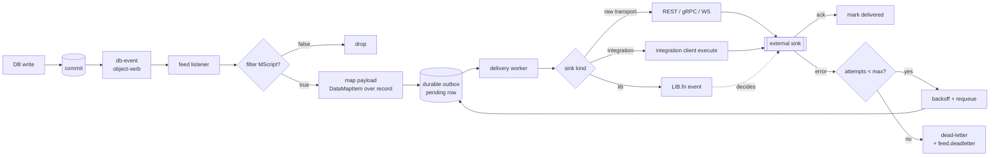

# External feeds

An **external feed** keeps a foreign system fed from the application's data:
*"whenever a record is created / updated / deleted on this DataObject, push it to
**this external sink** using **this payload shape**."* It is the outbound counterpart
of the [foreign permission check](foreign-permission-check.md): that *asks* a foreign
system a question per request; a feed *feeds* a foreign system data per record change.

Feeds keep an external store in lockstep with the application database: relationship
tuples into an authorisation engine (OpenFGA / Cedar), documents into a search index
(Meilisearch / OpenSearch / Typesense), vectors into a vector database (Qdrant /
Weaviate), events into a customer data platform (PostHog / Segment), rows into an OLAP
store (ClickHouse), or frames into a realtime fan-out (Centrifugo).

> **Schema status.** `externalFeeds[]`, the project-level `sinks[]` and the
> `preset` names on this page are not yet typed patterns in `openappl.json`. They are
> specified here as the contract a compiler that supports feeds accepts. A validator
> that works strictly from the current schema may report these keys as unknown.

> **A dead sink never blocks a write.** A feed is a pure **consumer** of the
> database event already emitted after every commit. Delivery is asynchronous through a
> durable outbox: a slow or down sink grows a backlog but can never roll back or stall
> the originating request.

## How it rides the existing seam

Every service already emits a database event per write (carrying the record, the verb,
and the old/new state on update). A feed subscribes to exactly those events, maps the
record, and delivers it through an at-least-once outbox:



Because the producer side is untouched, you get failure isolation (the event topic is
the buffer), at-least-once delivery with retry, backoff and dead-letter, and
**replay/backfill for free**: re-run the consumer from an earlier offset to rebuild a
sink from the authoritative database.

## The three sink kinds

A feed terminates at one of three kinds, a **declarative to programmable ladder**:

1. **Raw transport**: an author-supplied endpoint and payload, no preset. The manual
   escape hatch (`rest` / `grpc` / `websocket`).
2. **Integration connector**: references an existing connector from the project's
   general integrations list and reuses its client (executing a named method with the
   mapped parameters; the connector name defaults to the provider). The connector list is
   **unified**: it holds both commercial connectors (OneSignal, Segment, Twilio, ...)
   *and* first-party open-source connectors (OpenFGA, Cedar, Meilisearch, Qdrant, ...),
   each with a configurable endpoint URL. This is the data-event-driven twin of
   [`IntegrationAction`](../../spec/IntegrationAction.md): the same client, a worker
   context instead of a request context.
3. **Lib function**: hands the whole database event to a
   [service library function](../../spec/ServiceLibrary.md) (`await LIB.<fn>(event)`) and
   lets your code decide everything: conditional routing, fan-out, enrichment, or
   nothing. The data-event-driven twin of
   [`FunctionCallAction`](../../spec/FunctionCallAction.md).

> **One set of clients, two contexts.** The reuse is at the *client* layer, never the
> *action template* layer. `IntegrationAction` / `FunctionCallAction` run in the request
> context (they read `this` / the session); the feed runs in a database-event **worker**
> context with no request. A feed therefore invokes the same integration client / `LIB`
> registry against the event's record.

## Declaring a feed

`externalFeeds[]` attaches to a DataObject (the common case) or to the project (a
shared sink reused across objects). A **raw-transport** feed references a named `sink`
and maps the payload:

```jsonc
{
  "name": "membershipToOpenFga",
  "sink": "openfgaMain",                 // a project sinks[] entry (raw transport)
  "triggers": ["create", "update", "delete"],
  "filter": "this.status === 'active'",  // optional MScript gate; true => deliver
  "payload": [                            // DataMapItem mapping over the record
    { "name": "user",     "value": { "js": "'user:' + this.memberId" } },
    { "name": "relation", "value": { "js": "this.role" } },
    { "name": "object",   "value": { "js": "'workspace:' + this.workspaceId" } }
  ],
  "orderingKey": "this.id"
}
```

On update, `this.old` / `this.new` are available in the payload and filter. An
**integration** feed names a connector and a method instead of a sink; a **lib** feed
names a function and carries no payload (it gets the whole event):

```jsonc
{ "name": "userSignupToSegment", "integration": "segment", "method": "track",
  "triggers": ["create"], "payload": [ { "name": "userId", "value": { "js": "this.id" } } ] }

{ "name": "orderEventRouter", "lib": "routeOrderEvent",
  "triggers": ["create", "update"], "filter": "this.status !== 'draft'" }
```

### `sinks[]`: raw-transport config (project level)

A sink declares one endpoint, transport and delivery policy, shared by multiple feeds:

```jsonc
"sinks": [{
  "name": "openfgaMain",
  "transport": "grpc",                        // rest | grpc | websocket
  "endpoint": "$ENV:OPENFGA_GRPC_URL",
  "protoSource": "<inline .proto>", "package": "openfga.v1", "service": "OpenFGAService", "method": "Write",
  "metadata": [ { "name": "authorization", "value": "Bearer $ENV:OPENFGA_TOKEN" } ],
  "delivery": { "guarantee": "at-least-once", "maxAttempts": 8, "backoff": "exponential", "deadLetter": true, "ordered": false }
}]
```

The gRPC transport behaves like [GrpcCallAction](grpc-interservice.md) (unary call
against an inline proto); the REST transport is a plain HTTP request; WebSocket is a thin
outbound client that pushes one frame per delivery.

## Factory presets

A `preset` names a connector and a verb-to-method routing so you supply only the field
binding. Presets are all **integration** presets (open-source or commercial):

| Preset | Connector(s) | Create / Update | Delete |
|--------|--------------|-----------------|--------|
| `openfga.tuple` | OpenFGA, Keto | write tuple(s) | delete tuple(s) |
| `cedar.entity` | cedar-agent | put entity | remove entity |
| `search.document` | Meilisearch, OpenSearch, Typesense, Elasticsearch | upsert document | delete by id |
| `vector.upsert` | Qdrant, Weaviate, Milvus | embed, then upsert vector | delete by id |
| `cdp.event` | PostHog, Jitsu, Segment | post event | (no-op / tombstone) |
| `olap.row` | ClickHouse, Druid | insert row | (append-only) |
| `realtime.publish` | Centrifugo, Soketi | publish frame | publish removal |

`openfga.tuple` is the named driver: create writes the tuple a row implies, update
rewrites it (delete-old and write-new in one call), delete removes it, keeping an
authorisation store's relationship tuples in lockstep with your membership or role
table. Pair it with a [foreign permission check](foreign-permission-check.md) reading
the *same* store and you have a closed write-here / ask-there loop.

## Delivery semantics

- **At-least-once** is the contract. A pending row is persisted (dedup key = event id
  plus feed name) *before* the event message is acknowledged, so a crash re-delivers
  rather than drops.
- **Retry / backoff / dead-letter.** A retryable failure increments attempts and
  reschedules per `backoff` (`exponential` | `fixed` | `none`); on exhaustion the row
  is parked as `dead` and, if `deadLetter`, a `feed.deadletter` database event is
  emitted for operational visibility.
- **A peer's error body is never recorded.** When a REST sink or the built-in OpenFGA
  connector answers non-2xx, the row's `lastError`, the worker log and the
  `feed.deadletter` event carry only the status and the body's size (`rest sink 401
  (response body withheld, 87 chars)`): the body is remote-controlled text that can echo
  a credential. A gRPC sink failure is recorded the same way: only the numeric status
  code and its locally mapped name (`grpc sink PERMISSION_DENIED(7) (details
  withheld)`), or `grpc sink UNKNOWN (details withheld)` for any other failure; the
  peer's `details` text, the endpoint and the stack are never recorded. Look at the
  peer's own logs for the reason.
- **Idempotency is the sink's job.** At-least-once means a duplicate can reach the sink.
  Idempotent operations (FGA tuple write, search upsert, vector upsert) tolerate this
  natively; for side-effecting commercial APIs, pass the event id as the provider's
  idempotency key, and for `lib` sinks guard your side effects on the event id.
- **Ordering** is off by default (idempotent sinks converge regardless); set
  `delivery.ordered` and a feed `orderingKey` to serialise deliveries per key when a sink
  is not convergent.

## When to use a feed vs other outbound seams

| Mechanism | Sink | Use when |
|-----------|------|----------|
| [`PublishEventAction`](../../spec/PublishEventAction.md) / database event | another service of the same application | interservice choreography |
| `ServiceIndexer` / [ElasticLog](../composition/elastic-log.md) | the service's own search index | a searchable mirror of its own records |
| [`InterserviceCallAction`](../../spec/InterserviceCallAction.md) / [`GrpcCallAction`](grpc-interservice.md) | a peer, request-scoped | the current request needs a synchronous answer |
| [`IntegrationAction`](../../spec/IntegrationAction.md) | a connector, request-scoped | a request flow must call a connector as an explicit step |
| **External feed** | a **foreign** system, record-lifecycle | a foreign store must stay *fed* from a DataObject's create/update/delete |

## See also

- [External service integration](external-service-integration.md): declare the open-source
  sink (OpenFGA / Qdrant / ...) as part of the application's infrastructure and let the
  feed reach it at an internal URL.
- [Foreign permission check](foreign-permission-check.md): the inbound twin (ask a foreign
  store per request).
- [`IntegrationAction`](../../spec/IntegrationAction.md) /
  [`FunctionCallAction`](../../spec/FunctionCallAction.md): the request-driven twins of the
  integration and lib sink kinds.
- [gRPC](grpc-interservice.md): the unary gRPC call the gRPC transport reuses.
