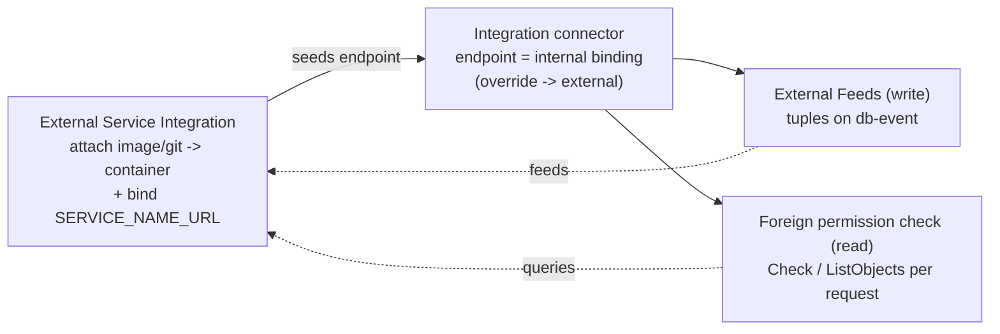

# External service integration

An application's infrastructure is normally just two things: the datastores the
compiler wires (a relational database, a cache, an event bus, ...) and the generated
services themselves. **External service integration** lets you declare a *third-party*
service (an OpenFGA authorisation engine, a Qdrant vector database, a Meilisearch
index, an Ollama language-model server, or your own hand-written microservice) as
**part of the application's infrastructure**, so the deployment environment stands it
up as a container in the same network and binds it at an internal URL. A generated
service then calls it much like a sibling.

> **Schema status.** `externalServices[]` and its `preset` catalogue are not yet typed
> patterns in `openappl.json`. They are specified here as the contract a compiler or
> deployment environment that supports external services accepts. A validator that works
> strictly from the current schema may report the key as unknown.

Two source kinds, both ending as a container at an internal `SERVICE_<NAME>_URL`:

1. **Known image**: pull a catalogue image (`openfga/openfga`, `qdrant/qdrant`, ...) and
   run it.
2. **Git URL**: the deployment environment **clones, builds, and runs** the repository.
   This covers both **your own microservice** and any deploy-ready third-party
   repository.

> **The git path runs untrusted code in your infrastructure; that is the crux.** A
> compiler otherwise only runs code it generated. Pulling an arbitrary image or
> building an arbitrary repository is a categorically larger risk, so the trust levels,
> approval gate, license gate and resource caps below exist precisely to contain it. It
> is **not** a "paste any GitHub URL" feature.

## The blueprint / deployment split

There is **one declaration with two consumers**. The blueprint carries the *logical*
half; the deployment environment owns the *physical* infrastructure. This mirrors how a
generated service's database already works: the blueprint names the database settings
and never a database container, and the environment provisions the database.

| | **Blueprint declares** | **Deployment environment materialises** |
|---|---|---|
| What | the logical declaration: source, the integration connector and its endpoint, the `SERVICE_<NAME>_URL` binding, configuration and secrets, a portable **run-spec** | the running **container**, its **backing database** (if it stores data: OpenFGA needs Postgres), its **persistent volumes**, and **networking** |

The blueprint carries no orchestrator manifests (compose, Kubernetes, volume claims).
It hands the environment a neutral run-spec (image or git ref, ports, environment,
health check, resource requirements) and the environment arranges the infrastructure.

## Declaring an external service

`externalServices[]` is a project-level array. A one-click **catalogue preset** fills
image, ports, protocol, license, trust and health-check defaults; you override only what
you need:

```jsonc
"externalServices": [{
  "name": "authz",                       // the lookup key + env prefix + binding name
  "source": "image",
  "preset": "openfga",                   // fills image/ports/protocol/license/trust/health
  "imageDigest": "sha256:abc123...",      // pin for reproducibility (tags are mutable)
  "exposeAs": "authz",                    // -> SERVICE_AUTHZ_URL + SERVICE_AUTHZ_GRPC_URL
  "env": [
    { "name": "OPENFGA_DATASTORE_ENGINE", "value": "postgres" },
    { "name": "OPENFGA_DATASTORE_URI",    "value": "$SECRET:OPENFGA_DB_URI", "secret": true }
  ],
  "requires": { "backingDb": "postgres", "volumes": [{ "name": "data", "mountPath": "/data" }] },
  "resources": { "cpu": "1.0", "memory": "512m" }
}]
```

A **git** source supplies a repository, a pinned ref and a build context instead of an
image:

```jsonc
{ "name": "pricingEngine", "source": "git", "trust": "designer-owned",
  "git": { "url": "git@gitlab.com:acme/pricing.git", "ref": "9f3c1a2", "dockerfile": "Dockerfile" },
  "internalPort": 8080, "healthCheck": { "type": "http", "path": "/healthz" },
  "env": [{ "name": "PRICING_API_KEY", "value": "$SECRET:PRICING_KEY", "secret": true }] }
```

The roughly twelve factory presets cover OpenFGA, Qdrant, Meilisearch, OpenSearch,
Valkey, ClickHouse, PostHog, Cerbos, Mailpit, Ollama, Temporal and NATS. The git path is
the open-ended alternative for anything not in the catalogue.

## Trust boundary

Each service carries a `trust` level with a different gate:

| `trust` | Source | Gate | Isolation |
|---------|--------|------|-----------|
| `designer-owned` | your own repository or image | none beyond normal deployment | standard project-network access |
| `catalog-verified` | a catalogue preset at a pinned digest | **license gate** + digest pin | resource caps recommended |
| `untrusted-thirdparty` | an arbitrary image or non-owned git repository | **explicit `approved: true`** + **mandatory** resource caps + restricted egress | isolated: limits enforced, egress default-deny, no project secrets beyond its own `env` |

- **License gate.** The compiler consults the preset's license flag and **refuses** the
  most restrictive licenses that forbid offering the software as a managed service
  (Elastic-2.0 / SSPL / CSL / SAL / fair-code) unless explicitly acknowledged, and
  **warns** on AGPL / BSL, because an application is often itself a hosted SaaS, exactly
  what those licenses restrict.
- **Strict separation (the secret blast radius).** Every external service is strictly
  separated: its own backing database, its own secrets, its own volume. The environment
  injects **only that service's own `EXTSVC_<NAME>_*` secrets**, never the project
  keypair, master database credentials, sibling service keys or any shared vault. An
  external service is a *foreign* process; it never participates in the application's
  machine-to-machine trust.
- **Shared test environments may refuse external services.** An environment that runs
  singleton infrastructure for many projects cannot honour the per-service
  strict-separation contract. It refuses `externalServices[]` with a clear message, and
  external-dependent features degrade there only. A full deployment to a dedicated
  environment provisions dedicated infrastructure.

## Calling an integrated service

The environment registers the service so generated services reach it like a sibling:
`SERVICE_<NAME>_URL` (REST) and `SERVICE_<NAME>_GRPC_URL` (gRPC). **But the trust does
not extend to it:** because a foreign process cannot verify the application's
machine-to-machine token, you call it through
[`ApiCallAction`](../../spec/ApiCallAction.md) /
[`GrpcCallAction`](grpc-interservice.md) /
[`foreignPermissionProvider`](foreign-permission-check.md) / an
[external feed](external-feeds.md), with the integrated service's *own* authentication,
and **not** through `InterserviceCallAction` (the build fails loudly if you target a
foreign service with it).

## OSS services are integration connectors

An attached open-source service is **also a first-party integration connector** in the
project's general integrations list, the same registry the commercial connectors live
in. Attaching it **defaults that connector's `configuration.endpoint` to the internal
`SERVICE_<NAME>_URL`**, so an external feed or an
[`IntegrationAction`](../../spec/IntegrationAction.md) reaches the in-infrastructure
service through the connector with no hand-wiring. Override the endpoint to an external
URL when the service runs off-infrastructure: one connector serves both, and
**internal-versus-external becomes invisible** to the consumer.

## The closed loop: four patterns, one OSS service

For a relationship store such as OpenFGA you do not just *stand it up*, you *feed* it and
*query* it. These compose as a closed loop:



**External Service Integration** stands the service up and seeds its connector endpoint;
**External Feeds** writes to it on every record change; **Foreign permission check**
reads from it per request, both over the *same* connector endpoint, whether the store is
in-infrastructure or external. There is no authorisation-engine-specific machinery: it is
four general patterns composed.

## See also

- [External feeds](external-feeds.md): keep the integrated store fed from your database
  (the write side).
- [Foreign permission check](foreign-permission-check.md): query the integrated
  authorisation engine per request (the read side).
- [Native permission system](native-permissions.md): the in-house alternative when you do
  not need an external engine.
- [gRPC](grpc-interservice.md): reaching an integrated gRPC service.
