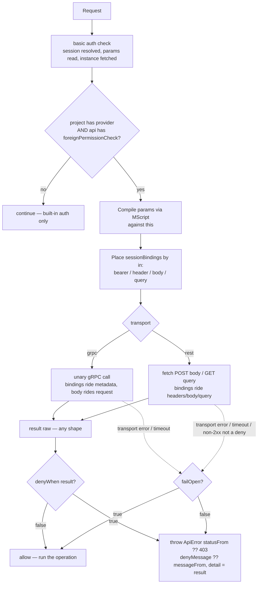

# Foreign permission check

OpenAPPL has built-in authorization (login, roles, ownership, PBAC).
Some deployments must delegate authorization to a **foreign permission
server** - a centralized policy engine - on a **per-BusinessApi** basis:
send a request shaped from the api's own context plus the caller's
session, get back allow/deny, and **403** on deny (carrying the server's
full response so the UI gets reasons/codes/role).

It is an **opt-in layer** that reuses the gRPC / REST client machinery
(see [gRPC](./grpc-interservice.md)). APIs that don't opt in
are untouched.

> **Field naming.** Use the `foreign*` names exactly: the auth-config
> section is `foreignPermissionProvider`, the per-api option is
> `foreignPermissionCheck`. The un-prefixed `permission*` names belong to
> the in-house [native permission system](native-permissions.md) - the
> resolve-it-yourself twin of this delegate-to-an-external-engine path.

## When to use it

- **A central policy engine owns "can this user do X?"** - e.g. a
  company-wide RBAC/ABAC service that every product must consult. You
  declare the server once and gate individual APIs with a question
  shaped from their context.
- **A SaaS subscription / entitlement gate.** A delete-organization API
  asks `Subscription:Manage` for `this.workspaceId`; the policy server
  answers from the customer's plan, and a `subscription_required` deny
  comes back down the same path as a permission deny.

## How it splits

Two declarations, by their natural scope:

| Concern | Where | What |
|---------|-------|------|
| **Provider** (one server, one transport, fail-policy) | `authentication.foreignPermissionProvider` | a **project constant**, generated into every service's permission client |
| **The question** (the MScript params, the deny message) | each api's `basics.authOptions.foreignPermissionCheck` | **per-api**, independent of the data pattern |

## Request flow



The gate runs **after** the post-basic-auth step and **before** the main
operation (so `this.<fetchedField>` is available), and is **skipped for
cron**.

It is also **skipped for an absolute-role session**:
`absoluteRoles` bypasses every authorization check, and this gate
is one. That covers the roles the api authors AND the automatic
`superAdmin` / `tenantOwner` pair (see
[business API auth](../system-services/authentication/business-api-auth.md#superadmin-and-tenantowner-are-automatic-hierarchy-still-is-not)).
The provider is never called for such a session - no round-trip, so an
unreachable provider does not refuse it either - and there is no per-api
opt-out. The tenant filter still applies: it is a scope, not an
authorization gate.

**The HTTP status counts (REST).** A non-2xx answer is a FAILED
check, not a verdict: a `500 { "error": ... }` or a `404` problem document
is handled exactly like a transport error (`failOpen` decides; the default
answers `403 Permission check unavailable`), is logged as
`ForeignPermissionCheckFailed` with the upstream status, and is never
cached. The one exception is a non-2xx whose body is an explicit deny
(`denyWhen` true, e.g. a `403 { "allowed": false }`): it denies with its
own `statusFrom` / `messageFrom`. A non-2xx is never an allow. Both
transports are bounded at 10000 ms (the REST fetch through an abort
signal, the grpc call through its deadline); a call that outlives it is a
transport error.

## 1. Declare the provider (project-wide)

Set [`foreignPermissionProvider`](../../spec/ForeignPermissionProvider.md)
on the `authentication` pattern. gRPC example:

```json
{
  "authentication": {
    "foreignPermissionProvider": {
      "providerBasics": {
        "type": "grpc",
        "endpoint": "$ENV:PERMISSION_GRPC_ADDR",
        "protoSource": "syntax = \"proto3\";\npackage permission;\nservice Permission { rpc Check (CheckRequest) returns (CheckResponse); }\nmessage CheckRequest { string permission = 1; string userToken = 2; string workspaceId = 3; string projectId = 4; }\nmessage CheckResponse { bool allowed = 1; string role = 2; int32 status = 3; string errorCode = 4; string message = 5; string reason = 6; }",
        "package": "permission",
        "service": "Permission",
        "method": "Check",
        "denyWhen": "!result.allowed",
        "messageFrom": "result.message || result.errorCode",
        "statusFrom": "result.status",
        "failOpen": false
      },
      "tls": { "mode": "insecure" },
      "sessionBindings": [
        { "from": "accessToken", "as": "userToken" }
      ]
    }
  }
}
```

The block has `providerBasics` (transport and decision policy), `tls` (grpc only), `headers` (rest only) and
`sessionBindings`. The fields below that sit under `providerBasics` are marked.

| Field | Meaning |
|-------|---------|
| `providerBasics.type` | `grpc` or `rest`. |
| `providerBasics.endpoint` | `host:port` (grpc) or base URL (rest); literal or `$ENV:`. |
| `providerBasics.protoSource` / `package` / `service` / `method` | **grpc only** - the foreign server's inline proto + the rpc to call. The compiler prepends `syntax`/`package` if your proto omits them. |
| `providerBasics.restMethod` / `restPath` / `requestIn` | **rest only** - `POST` (default) or `GET`; the path (required for rest); `body` (default) or `query` placement. |
| `headers[]` | **rest only** (a sibling of `providerBasics`) - static auth headers (`{ name, value }`, literal or `$ENV:`), with distinct names compared case-insensitively. |
| `tls` | **grpc only** (a sibling of `providerBasics`) - optional transport security: `mode: "insecure"` (default) or `"ssl"`, with a `caCert` reference. |
| `sessionBindings[]` (a sibling of `providerBasics`) | session field -> request placement (see below), both transports. |
| `providerBasics.denyWhen` | MScript **rule** over `result` (the raw response - any shape); `true` => **deny**. Default `result === false || result?.allowed === false`. |
| `providerBasics.messageFrom` | optional MScript over `result` -> the deny message (the api's `denyMessage` wins when set). |
| `providerBasics.statusFrom` | optional MScript over `result` -> the HTTP status to raise (e.g. honor `401` invalid-token). Default `403`. |
| `providerBasics.failOpen` | failed-check policy - a transport error, a timeout (10000 ms) or a REST non-2xx answer that is not an explicit deny: `false` (default, fail-closed -> 403) or `true` (fail-open -> allow). |
| `providerBasics.cacheTtlSeconds` | optional result cache for the permission decision, default `0` (no cache). When greater than 0 the gate caches the allow/deny outcome (message, detail and status) for that many seconds, keyed by a stable hash of the subject (the session user id, or `guest`) and the question (the compiled params) - never the volatile bearer token - and checks the cache before calling the server. Both allow and deny are cached; cache errors are fail-soft (the gate falls through to a live call). |

The result may be **any shape** - a bare boolean, an int code, a string,
or a rich object. `denyWhen` classifies it; the whole object is returned
in the 403 `detail` so the UI gets `reason` / `errorCode` / `role`.

A valid `$ENV:NAME` in `headers[].value` registers a blank `$SECRET_NAME` placeholder in all four environment maps (`dev`, `test`, `stage`, `prod`). A `tls.caCert` reference registers a blank plain `NAME` key. These references are named regardless of transport or TLS mode; headers remain REST-only at runtime. Authored project or service variables, whether plain or secret, retain their values. Literal values and malformed references do not create variables; names are used as written without trimming. Supply the deployment's header secret and CA value before using the provider.

## 2. Session binding placement - `in`

Each [`sessionBindings[]`](../../spec/ForeignPermissionSessionBinding.md)
entry places a session value by **`in`**
(`ForeignPermissionBindingIn` = `bearer | header | body | query`, default `body`):

| `in` | REST | gRPC | `as` |
|------|------|------|------|
| `bearer` | `Authorization: Bearer <value>` | `metadata.authorization = 'Bearer <value>'` | **ignored** |
| `header` | request header `<as>` | metadata entry `<as>` (lowercased) | header name |
| `body` (default) | JSON body field `<as>`, alongside params | proto message field `<as>` | body key |
| `query` | query-string param `<as>` | **ignored** (logged; validator warns) | query key |

`from` reads `this.session.<from>`; `from: 'accessToken'` reads the
caller's bearer (`this.request.headers.authorization`, else
`this.session.accessToken`). The per-api `params` always form the
body/message content; bindings layer on top per `in`. A bare
`{ from, as }` with no `in` defaults to `body` (unchanged).

### A server that wants bearer + header + body (rest)

```json
{
  "foreignPermissionProvider": {
    "providerBasics": {
      "type": "rest",
      "endpoint": "$ENV:PERM_BASE_URL",
      "restMethod": "POST",
      "restPath": "/check",
      "requestIn": "body",
      "denyWhen": "result.decision !== 'ALLOW'",
      "messageFrom": "result.reason",
      "failOpen": false
    },
    "headers": [ { "name": "X-Api-Key", "value": "$ENV:PERM_API_KEY" } ],
    "sessionBindings": [
      { "from": "accessToken", "in": "bearer" },
      { "from": "userId", "in": "header", "as": "perm-user-id" },
      { "from": "email", "in": "body", "as": "email" }
    ]
  }
}
```

This sends `POST {endpoint}/check` with `Authorization: Bearer <jwt>`, a
`perm-user-id` header, and a JSON body merging the per-api params with
`{ email: <session.email> }`. The bearer/header values never leak into the
body. The same three placements map onto gRPC as `metadata.authorization`
/ `metadata['perm-user-id']` / the proto message field `email`.

## 3. Gate an API (per-api question)

Opt in on any BusinessApi's
[`authOptions.foreignPermissionCheck`](../../spec/ApiForeignPermissionCheck.md).
`params` is a **free MScript map** ([overview](../mscript/overview.md)) - each
[`DataMapItem`](../../spec/DataMapItem.md) `{ name, value }` is whatever
the server expects; the compiler does not interpret the keys:

```json
{
  "authOptions": {
    "loginRequired": true,
    "foreignPermissionCheck": {
      "params": [
        { "name": "permission", "value": { "js": "'Subscription:Manage'" } },
        { "name": "workspaceId", "value": { "js": "this.workspaceId" } }
      ],
      "denyMessage": "You cannot manage subscriptions in this workspace."
    }
  }
}
```

At request time the gate sends
`{ permission: "Subscription:Manage", workspaceId: <this.workspaceId>, userToken: <jwt> }`
to `Permission.Check`. The server answers in the success body (it never
raises a gRPC error): `{ allowed: true, role: "admin", status: 200 }`
passes; `{ allowed: false, status: 403, errorCode: "errMsg_PermissionDenied", reason: "permission_denied" }`
trips `denyWhen` -> the api raises **403** (or **401** via `statusFrom`)
carrying the whole object in `detail`. `denyMessage` overrides
`messageFrom` when both are set; omit it to let the provider derive the
message.

## See also

- Specification: [`ForeignPermissionProvider`](../../spec/ForeignPermissionProvider.md),
  [`ForeignPermissionSessionBinding`](../../spec/ForeignPermissionSessionBinding.md),
  [`ApiForeignPermissionCheck`](../../spec/ApiForeignPermissionCheck.md).
- [gRPC](./grpc-interservice.md) - the unary gRPC call engine and inline
  proto this reuses.
- [Business API authentication](../system-services/authentication/business-api-auth.md)
  - the built-in `authOptions` this layers on.
- [Native permission system](native-permissions.md) - the in-house
  resolver (RBAC + membership + object-roles + ABAC), the alternative to a
  foreign server.
- [External feeds](external-feeds.md) - keep the foreign policy engine
  *fed* from your data (the outbound twin of asking it).
- [PBAC](../system-services/authentication/pbac.md) - OpenAPPL's native
  attribute-based authorization.
