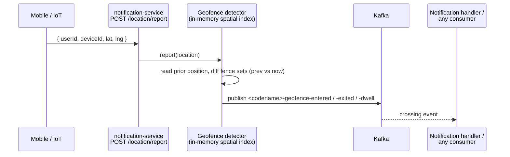

# Geography features

OpenAPPL treats location as a first-class part of the data model. Three geo property types - `GeoPoint`, `GeoRoute`, and `GeoArea` - are stored as GeoJSON, validated at the API edge, indexed for spatial search on whichever database engine the service runs (PostGIS on PostgreSQL, `2dsphere` on MongoDB, geo mappings on Elasticsearch), queryable through MScript geo operators, callable through generated db-layer helpers, and reactable through the geofence runtime that turns moving points into notifications.

This page is the comprehensive feature guide. For the short type/storage reference, see [Geography](../data-modeling/geography.md).

> **Coordinate order.** Everything on the wire and in storage is GeoJSON, which uses **`[longitude, latitude]`** order - the opposite of the spoken "lat, lng" convention. Longitude is `-180..180`; latitude is `-90..90`. The only place coordinates are written `lat, lon` is the legacy filter-string prefix syntax described below, which the parser converts for you.

---

## GeoJSON format (in and out)

Geo values are read and written as GeoJSON geometries. Each type maps to one GeoJSON geometry:

| Type | GeoJSON geometry | Stored value shape |
|------|------------------|--------------------|
| `GeoPoint` | `Point` | `{ "type": "Point", "coordinates": [lon, lat] }` |
| `GeoRoute` | `LineString` | `{ "type": "LineString", "coordinates": [[lon, lat], …] }` (≥ 2 points) |
| `GeoArea` | `Polygon` | `{ "type": "Polygon", "coordinates": [[ [lon, lat], … ]] }` (each ring ≥ 4 points, closed) |

All three use **WGS 84 / SRID 4326** - the GPS reference system.

### Input auto-coercion - on every write path

Every write of a geo column is normalized to canonical GeoJSON before it reaches the database, whatever filled the value: a declared geo request parameter, a `dataClause` MScript that composes the value, a formula, or an internal caller. The request parameters are validated at the API edge, and the db-layer write helpers - create, bulk create, update by id / id list, update by query, on both PostgreSQL and MongoDB - run the same normalizer on every geo column they write. So an author may compose a `GeoPoint` as `{ lat, lng }` in a `dataClause`; it is stored as a `Point`.

A `GeoPoint` accepts these shapes, with the coordinate ranges validated:

| Input | Example |
|-------|---------|
| Full GeoJSON | `{ "type": "Point", "coordinates": [28.97, 41.00] }` |
| Coordinates only | `{ "coordinates": [28.97, 41.00] }` |
| Bare `[lon, lat]` array | `[28.97, 41.00]` |
| Named `lon`/`lat` object | `{ "lon": 28.97, "lat": 41.00 }` (also `lng`, `longitude`, `latitude`) |

A `GeoRoute` accepts a full GeoJSON `LineString`, `{ "coordinates": [...] }`, or a bare array of 2+ points (each point in any of the forms above). A `GeoArea` accepts a full GeoJSON `Polygon`, `{ "coordinates": [...] }`, or a bare array of rings, each ring 4+ points; the service auto-closes an open ring (appends the first vertex if the last differs).

A `Polygon` may carry several rings. The first ring is the outer boundary, and every further ring is a hole cut out of it (GeoJSON semantics, honoured by PostGIS, MongoDB and Elasticsearch alike): a point inside a hole is outside the area. Each ring is validated and auto-closed on its own. A delivery zone that excludes an airport:

```json
{
  "type": "Polygon",
  "coordinates": [
    [[28.80, 40.90], [29.20, 40.90], [29.20, 41.20], [28.80, 41.20], [28.80, 40.90]],
    [[28.90, 40.97], [28.90, 41.00], [28.95, 41.00], [28.95, 40.97], [28.90, 40.97]]
  ]
}
```

The service validates the points of each ring, not how the rings relate to each other: keep every hole inside the outer ring.

A value that is not a geo value of the declared type is a **400** whose detail names the parameter (`Parameter 'location' ...`) or, for a value the backend composed, the column (`Field 'location' ...`) - never a database 500.

Typed single and bulk creates normalize every geo member before a database probe or write, so a malformed later member refuses the bulk operation before any row is written. A query update validates supplied geo values before selecting rows, and an omitted partial-update field keeps its stored value.

### Lists of geo values (`isArray`)

A geo property declared with `isArray: true` (a `GeoPoint[]` of stops, a `GeoArea[]` of service areas) is a JSON **array** of single geometries on the wire, in the request and in the response:

```json
"serviceAreas": [
  { "type": "Polygon", "coordinates": [[[29.0, 41.0], [29.1, 41.0], [29.1, 41.1], [29.0, 41.1], [29.0, 41.0]]] }
]
```

Each member accepts the shapes above and is validated on its own (a bad member is reported with its index, `serviceAreas[1]`); a single geometry sent where a list is expected is a 400. A GeoJSON `MultiPoint` / `MultiLineString` / `MultiPolygon` is also accepted as a list.

The list is stored as **one multi-geometry** - `GEOGRAPHY(MULTIPOINT | MULTILINESTRING | MULTIPOLYGON, 4326)` on PostgreSQL, a GeoJSON `MultiPoint` / `MultiLineString` / `MultiPolygon` sub-document under the `2dsphere` index on MongoDB - and unfolded back into the array by every read. The spatial predicates read a multi-geometry with "any member" semantics: `inCircle` / `mostClose` / `$geoNear` measure to the nearest member, `inBBox` / `$geoIntersects` match when any member overlaps, `inPolygon` / `$geoWithin` require every member inside. On MongoDB an empty list is stored as `null` (a `2dsphere` index rejects an empty geometry); on PostgreSQL it is the empty multi-geometry and reads back as `[]`. The array mutations `$add` / `$rem` / `$addIf` of an update-by-query operate on the list.

A MongoDB collection needs no migration step when a list is adopted: a document stored earlier as a single geometry reads back as a one-member list and is rewritten as a multi-geometry on its next write. On PostgreSQL, a column that an earlier deployment created as a scalar geometry or a geography array needs a one-time, value-preserving retype to the canonical multi-geometry geography type.

### Default values

The compiler never invents a geometry. A placeholder such as `[0, 0]` is a real place to every geo query, so a row that silently received one would show up in near / within results as if it were there.

- A **required** single geo property (`GeoPoint`, `GeoRoute`, `GeoArea`) with no authored `defaultValue` has no column default. A create that carries no value for it, or carries `null`, answers **400** naming the property (`Field 'location' is required: ...`); an update that sets it to `null` answers the same 400, while an update that does not mention it keeps the stored value.
- An authored `defaultValue` (a GeoJSON value of the declared type) is honoured on PostgreSQL and MongoDB services: a create without a value stores it. MongoDB applies the same geometry normalization as an explicit write, and each document receives its own default value. An explicit value takes precedence over the default.
- An **optional** geo property with no value stays `null`.

A required geo **list** with no value defaults to the empty list. An authored `defaultValue` on a geo list must be a JSON list (`[]`, or a list of GeoJSON values / bare coordinates); anything else is ignored with a compile warning, and the column then has no default.

---

## Making a BusinessApi geo-sensitive

> The BusinessApi system is **explicit** - there are no auto-generated CRUD routes. You make an API you author location-aware by **declaring a request parameter or a where-clause condition** (the two ways below). Separately, the generated service auto-emits a **read-only `/geo/*` REST surface** over the db-layer spatial helpers - see [The generated `/geo` REST surface](#the-generated-geo-rest-surface).

There are two ways to make a declared list API location-aware.

### 1. Spatial filter parameters on a list API

> **Current behaviour: the prefixed geo filter values are not parsed.**
> Earlier guides listed `?<geoProperty>=$bbox-<minLat>,<minLon>,<maxLat>,<maxLon>`,
> `$circle-<lat>,<lon>,<radiusMeters>`, `$polygon-...` and `=null` as values of a
> `GeoPoint` filter parameter. A generated list API does not read them:
> the value reaches the query as a plain equality term on the geo column, which
> matches nothing or fails in the driver. Use one of these instead:
>
> - the generated read-only [`/geo` routes](#the-generated-geo-rest-surface)
>   (`inCircle`, `mostClose`, `inBBox`, `inPolygon`; note their `lon,lat` order),
>   with `geoSettings.selectProperties` to choose the columns;
> - or a list API with its own request parameters and a where-clause geo
>   condition (next section), for example `$geoWithin` with a `bbox` operand for
>   a map viewport.

### 2. A geo condition in the where-clause (MScript)

For a spatial filter on a list API - a viewport, a dynamic radius, multiple geo conditions, mixing geo with regular filters - declare your own request parameters and add an **additional clause** to the API's where-clause that uses an [MScript geo operator](#mscript-geo-operators). For example, a list API with `lonCenter` / `latCenter` Double parameters:

```js
// Additional clause, doWhen: this.lonCenter != null && this.latCenter != null
{
  location: {
    $geoNear: {
      point: { type: "Point", coordinates: [this.lonCenter, this.latCenter] },
      maxDistance: 1000
    }
  }
}
```

See [Filters and lists](../business-apis/list-api.md) for the where-clause grammar and how request parameters become filters.

---

## Database helper APIs (db-layer)

For every data object with a geo property, the compiler emits three typed spatial helpers into the service's db layer - for **both engines**. The helper bodies are point-distance queries, so they are meaningful for `GeoPoint` fields. Naming pattern: `get<ModelName>List<Op>_<fieldName>` (for example `getStoreListInCircle_location`, `getStoreListMostClose_location`, `getStoreListInBBox_location`).

| Helper | Signature | Returns |
|--------|-----------|---------|
| `get<Model>ListInCircle_<field>` | `(lon, lat, radiusM, query = {}, options)` | Rows within `radiusM` metres, ordered by distance (unless disabled) |
| `get<Model>ListMostClose_<field>` | `(lon, lat, limit = 10, query = {}, options)` | The `limit` nearest rows, ordered by distance |
| `get<Model>ListInBBox_<field>` | `(minLon, minLat, maxLon, maxLat, query = {}, options)` | Rows intersecting the bounding box |

- `query` is an optional extra where-condition object, merged with the spatial predicate.
- **Options differ slightly per engine.** PostgreSQL: `{ limit, offset, orderByDistance }`. MongoDB: `{ limit, skip, radiusM }` (MongoDB uses `skip`, not `offset`).
- **Soft delete is honoured** - if the data object uses soft delete, an `isActive: true` condition is added automatically.
- **Distance** - the PostgreSQL `InCircle` / `MostClose` helpers add a computed `distance_m` attribute (`ST_Distance`). MongoDB `$nearSphere` orders by distance but does not project a distance column.

Engine mechanics:

| Helper | PostgreSQL (PostGIS) | MongoDB |
|--------|--------------------|---------|
| InCircle | `ST_DWithin` + `ST_Distance` sort | `$nearSphere` + `$maxDistance` |
| MostClose | `ST_Distance` sort (optional `ST_DWithin` cap) | `$nearSphere` (optional `$maxDistance`) |
| InBBox | `ST_Intersects` + `ST_MakeEnvelope` | `$geoIntersects` + `$geometry` (box as a Polygon) |

`InBBox` is an **overlap** test on both engines: a `GeoRoute` or `GeoArea` that crosses the box matches without fitting inside it. Use `InPolygon` (`ST_Within` / `$geoWithin` + `$geometry`) when you mean "entirely inside".

Limits on how far that parity goes - all are known per-backend differences, not defects:

- **Box edges are planar on PostGIS and geodesic on MongoDB.** PostGIS casts the column to `::geometry` and tests a flat rectangle whose north/south edges follow parallels; MongoDB tests a GeoJSON polygon on a `2dsphere` index, whose edges are great-circle arcs that bow towards the pole (≈121 m of divergence for a 1°-wide box, 3 km at 5°, 49 km at 20°). A row within that distance of a wide box's top or bottom edge, a `GeoPoint` included, can match on one engine and not the other. The parity contract is *which question the route asks* (overlap vs containment), not edge-exact row sets. Use `InPolygon` with an explicit ring to choose the intended boundary, and verify the chosen engine's geometry semantics.
- **A bbox spanning 180° of longitude or more is rejected.** MongoDB's default GeoJSON CRS always takes the smaller of the two regions a ring separates, so a hemisphere-wide ring is read as the region *outside* the box - silently returning no rows where PostGIS returns all of them. The bbox parser and the MScript `$geoWithin` + `bbox` operand both throw on such a box (`geo filter: bbox spans … degrees of longitude`), so the `/geo` route answers **400** on every engine instead of answering differently per engine. Split the viewport at a meridian, or drop the spatial filter for a whole-world view.
- **A reversed or off-planet box is rejected too, on the route and on the MScript operand alike.** `minLon` must not exceed `maxLon`, `minLat` must not exceed `maxLat`, longitudes lie in [-180, 180] and latitudes in [-90, 90]. A reversed pair is not read as a box crossing the antimeridian: `[1, 0, -1, 10]` would otherwise be a 2-degree box on MongoDB and its 358-degree complement on PostGIS. The `$geoWithin` + `bbox` operand on every MQuery target (MongoDB, PostgreSQL/PostGIS, Elasticsearch) throws the same messages the route parser reports (`geo filter: bbox minLon > maxLon`, `geo filter: bbox minLat > maxLat`, `geo filter: longitude … out of range [-180, 180]`). A viewport that straddles the antimeridian is two boxes, one on each side.

The width/range/order guard applies to `bbox` operands and the `inBBox` parser;
it is not a blanket polygon restriction. The MScript `$box` alias becomes a
Polygon `shape` (containment), rather than the viewport-overlap `bbox` form.
Explicit rings still follow each backend's geometry semantics. Elasticsearch
bbox lowering exists but has not been measured live. See the
[query reference](../mscript/query-reference.md#geospatial) for operand aliases
and the current MongoDB `geoContains` limitation.

**Indexes.** The MongoDB model gives every geo property a `2dsphere` index, whatever its `indexSettings.indexedInDb` says, so `InCircle` / `MostClose` (`$nearSphere`, which refuses an unindexed field) work on a geo property declared with default settings. PostGIS indexes geo columns unconditionally (GiST).

See [Db Layer](../data-modeling/db-layer.md) for how the db layer is generated and used.

---

## The generated `/geo` REST surface

The db-layer helpers above are also exposed over HTTP through an **auto-generated, read-only geo router**. This is the one place where the generated service emits routes you did not author by hand.

> **Gating.** The geo router is emitted **only when the service has at least one geo property** (any `DataObject` with a `GeoPoint` / `GeoRoute` / `GeoArea` field). Geo-less services get zero extra routes. The router is mounted before the per-DataObject business routes so the literal `/geo/…` paths take precedence.

For **every geo property**, the router emits one route quartet under `/geo/<objectName>/<fieldName>/…`, each wrapping the matching `get<Model>List<Op>_<field>` db-layer helper:

| Route | Query parameters | Wraps |
|-------|------------------|-------|
| `GET /geo/<object>/<field>/inCircle` | `circle=<lon>,<lat>,<radiusMeters>` (required); optional `limit`, `offset` | `get<Model>ListInCircle_<field>` |
| `GET /geo/<object>/<field>/mostClose` | `lon=` & `lat=` (required); optional `limit` (default 10), `radius` (metres) | `get<Model>ListMostClose_<field>` |
| `GET /geo/<object>/<field>/inBBox` | `bbox=<minLon>,<minLat>,<maxLon>,<maxLat>` (required); optional `limit`, `offset` | `get<Model>ListInBBox_<field>` |
| `GET /geo/<object>/<field>/inPolygon` | `polygon=<lon>,<lat>;<lon>,<lat>;<lon>,<lat>` (required, at least 3 vertices); optional `limit`, `offset` | `get<Model>ListInPolygon_<field>` |

> **Coordinate order is `lon,lat`** here - these endpoints take GeoJSON-order coordinates, **not** the legacy `lat,lon` filter-string prefix used by the list-API filter parameters above.

All four return the same JSON envelope:

```json
{ "status": "OK", "count": <n>, "items": [ … ] }
```

`items` are the rows the underlying helper returns (PostgreSQL `InCircle` / `MostClose` rows carry the computed `distance_m`; MongoDB `$nearSphere` orders by distance without a distance column - see the table above). Properties declared `hashed: true` or `isSecret: true` are removed from every item, at any depth, by the same secret scrub the Business API responses use; there is no per-route opening for them on `/geo`. Malformed geo input answers **HTTP 400** as RFC 9457 problem+json carrying an `errorCode` - for example a `circle=` without exactly three numbers, an out-of-range longitude/latitude, a non-positive radius, a `bbox` spanning 180° or more of longitude, or a `mostClose` missing `lon`/`lat`. A `400` from a `/geo` route is always an input error. A database failure is not: an outage (pool exhausted, statement timeout, connection refused) answers the retryable **503** of the shared database mapper (`errorCode` `DB_POOL_SATURATED`, `DB_STATEMENT_TIMEOUT` or `DB_UNREACHABLE`), and any other store failure, a PostGIS error included, answers the generic **500** `INTERNAL_ERROR`; neither carries the database's own message, which is logged under the request id. The `/geo` routes read the database (PostGIS or MongoDB), never Elasticsearch, so the Elasticsearch `503 ELASTIC_UNAVAILABLE` never applies to them.

```
GET /geo/store/location/inCircle?circle=28.97,41.00,5000&limit=20
GET /geo/store/location/mostClose?lon=28.97&lat=41.00&limit=10&radius=2000
GET /geo/store/location/inBBox?bbox=-74.02,40.70,-73.97,40.72
```

The router follows the object's own authorization: anything but `accessPublic` needs a logged-in session, `accessPrivate` pins the owner column to the caller, a tenant-level object is narrowed to the session's tenant, and `objectSettings.geoSettings.visibilityFilter` is merged into every route's query.

### Choosing the columns: `geoSettings.selectProperties`

By default the `/geo` items are full rows (minus secrets and the internal storage columns). On a public map surface that is usually more than the map needs, and any internal column of the object (a review note, a verification reason) reaches anonymous callers. List the columns the routes should answer with in `objectSettings.geoSettings.selectProperties` (see [`ObjectGeoSettings`](../../spec/ObjectGeoSettings.md)):

```json
"geoSettings": {
  "visibilityFilter": { "isPublished": true },
  "selectProperties": ["name", "category"]
}
```

The projection is applied at the query, on all four routes. These columns are always kept, listed or not:

- `id`;
- the geo field the route queries;
- every column the route's own filters compare: the `visibilityFilter` keys, the owner and tenant pins, the moderation and publication gates, and `isActive` on a soft-delete object;
- the computed `distance_m` of the PostgreSQL `inCircle` / `mostClose` routes.

So the example answers `id`, `location`, `name`, `category`, `isPublished` (and `isActive` on a soft-delete object). Every entry must be a property of the object (or a system column); an unknown name is a design-time error (`PROPERTY_NOT_FOUND`), and a nested path (`address.city`) is `NESTED_PROP_REFER_NOT_ALLOWED`. A secret (`hashed`, `isSecret`) or an internal storage column stays scrubbed even when listed. Leave it unset, or empty, for full rows. A compiler that has not ported the key answers full rows.

On an object moderated with
[`objectModeration`](object-moderation.md) in `mode: onPlace`, the `/geo`
routes return only `accepted` rows to a non-privileged caller - not even the
author's own unapproved rows, which the author reads through the object's
list api. See [the onPlace read gate](object-moderation.md#the-onplace-read-gate).

---

## MScript geo operators

In MScript ([overview](../mscript/overview.md)) - used in BusinessApi where-clauses, additional clauses, and action conditions - geo operators run spatial conditions against a geo field. They compile dual-engine to PostGIS / Mongo predicates, plus an Elasticsearch geo query when the field is ES-indexed.

| Operator | Meaning | Applicable types |
|----------|---------|------------------|
| `$geoNear` | Within `maxDistance` of a point (optional `minDistance` floor) | `GeoPoint` |
| `$geoWithin` | Inside a shape or bbox | `GeoPoint`, `GeoRoute`, `GeoArea` |
| `$geoContains` | Stored geometry contains the given shape | `GeoArea`, `GeoRoute` |
| `$geoIntersects` | Stored geometry intersects the given shape | all |

### `$geoNear`

```js
{
  location: {
    $geoNear: {
      point: { type: "Point", coordinates: [28.97, 41.00] },
      maxDistance: 5000,   // metres
      minDistance: 100     // metres (optional)
    }
  }
}
```

PostgreSQL: `ST_DWithin` (+ optional `ST_Distance >= minDistance`). MongoDB: `$nearSphere` with `$maxDistance` / `$minDistance`. Elasticsearch: `geo_distance`.

### `$geoWithin`

Bounding box (`[minLon, minLat, maxLon, maxLat]`) or a GeoJSON `shape`:

```js
{ location: { $geoWithin: { bbox: [-74.0, 40.7, -73.9, 40.8] } } }

{ location: { $geoWithin: { shape: { type: "Polygon", coordinates: [[…]] } } } }
```

The two operands mean different things, and both mean the same thing on every engine:

* `bbox` is a **viewport - an overlap test.** PostgreSQL `ST_Intersects` + `ST_MakeEnvelope`; MongoDB `$geoIntersects` with the box as a GeoJSON `Polygon`; Elasticsearch `geo_bounding_box`.
* `shape` is **containment.** PostgreSQL `ST_Covers` for `Polygon`/`MultiPolygon` and `ST_Within` for other shapes; MongoDB `$geoWithin` + `$geometry`; Elasticsearch `geo_shape (within)`.

So "entirely inside a box" is `{ $geoWithin: { shape: <the box as a Polygon> } }`, not `{ $geoWithin: { bbox: […] } }`.

### `$geoContains`

```js
{ serviceZone: { $geoContains: { shape: { type: "Point", coordinates: [28.97, 41.00] } } } }
```

PostgreSQL: `ST_Contains`. MongoDB: `$geoIntersects` (inverted containment). Elasticsearch: `geo_shape (contains)`.

### `$geoIntersects`

```js
{ deliveryArea: { $geoIntersects: { shape: { type: "Polygon", coordinates: [[…]] } } } }
```

PostgreSQL: `ST_Intersects`. MongoDB: `$geoIntersects`. Elasticsearch: `geo_shape (intersects)`.

See [MScript query reference](../mscript/query-reference.md) for the full operator grammar.

---

## Geofences and geofence notifications

A **geofence** is a runtime data row (a `GeoFence` record), not a design-time asset. The notification service owns the geofence runtime: a `GeoFence` data object, a `UserLocation` table (last-known position per user/device, gated by `LocationConsent`), a `GeoFenceEvent` audit log, and an in-memory **geofence detector**.

A fence is one of four **kinds**: `circle` (centre + radius), `polygon` (a `[{lat,lng},…]` ring), `country` (ISO country), or `adminArea` (country + admin level). Each fence carries optional `tags`, `metadata`, and a `dwellSeconds` threshold.

### Detector pipeline



1. **Boot** - the service loads every active `GeoFence` row into the spatial index.
2. **Hot reload** - fence create / update / toggle re-syncs the index; no restart needed.
3. **Report** - every `POST /location/report` (consent-gated) flows through the detector. The detector reads the prior position, computes the fences containing the previous point and the new point, and diffs.
4. **Diff** - fences in `now \ prev` → `enter`; fences in `prev \ now` → `exit`; fences present in both, after `dwellSeconds` of continuous occupancy → `dwell` (deduplicated per user/device/fence/dwell-start).
5. **Publish** - each crossing is published to a per-project Kafka topic derived from the project root `codename` (the raw root codename, preserving its case and characters): `<projectCodename>-geofence-entered`, `<projectCodename>-geofence-exited`, or `<projectCodename>-geofence-dwell`.

The crossing payload carries `userId`, `deviceId`, `fenceId`, `fenceName`, `action`, `lat`, `lng`, `occurredAt`, `fenceTags`, and `fenceMetadata`. Country / adminArea fences match only when the client supplies the ISO codes - the detector does not reverse-geocode.

### Geofence → notification wiring

To turn a crossing into a delivered message, declare an `EventNotification` with `eventNotificationBasics.triggerSource: 'geofence'` and a [`GeofenceTrigger`](../../spec/GeofenceTrigger.md) block. Because fences are runtime data, the trigger declares a **rule** that matches fences at crossing time rather than naming a specific fence. The notification handler subscribes to the per-action topic, then applies four filter layers, each defaulting to "match" when null:

1. `action` - which crossing kind fires this notification (`enter` / `exit` / `dwell`).
2. `fenceTags` - any-of match against the fence record's tags.
3. `fenceFilter` - MScript against the matched fence row (scope: `fence`, `crossing`), e.g. `fence.metadata.priority > 5`.
4. `condition` - MScript against the full event payload (event + fence + crossing).

```json
{
  "eventNotificationBasics": {
    "name": "alertOnHighPriorityZone",
    "jobType": "push",
    "triggerSource": "geofence"
  },
  "geofenceTrigger": {
    "action":      "enter",
    "fenceTags":   ["restricted", "alert"],
    "fenceFilter": { "js": "fence.metadata.priority > 5" },
    "condition":   { "js": "event.userId && session.role !== 'admin'" }
  }
}
```

(A fragment: `eventDataSettings` and `template` are also required on an `EventNotification` and are omitted here.)

A matched notification is then delivered through the service's configured providers (push / email / SMS / webhook). The geofence **mechanics** live here; delivery is documented in the [notification service](../system-services/notification.md).

### Consuming geofence events

- **Notification trigger** - the `EventNotification` above (delivery via the notification service).
- **Kafka controller** - bind a BusinessApi to `<projectCodename>-geofence-entered` / `-exited` / `-dwell` via [`ApiKafkaSettings`](../../spec/ApiKafkaSettings.md). See [Kafka controllers](../business-apis/kafka-controllers.md).
- **Event subscription** - surface crossings to a client over WebSocket / SSE. See [Event subscriptions](event-subscriptions.md).

### Geofence management APIs

The notification service emits the management APIs alongside the data objects, including: `POST /location/report`, `POST /location/consent` and `DELETE /location/consent`, `GET /geofences/active`, and an admin set (`/admin/geofences` CRUD, `/admin/geofences/:id/toggle`, `/admin/geofence-events`, `/admin/geofences/:id/test-trigger`).

---

## Dual-engine storage

Geo properties persist on whichever engine the service uses (`serviceOptions.dbType`), and optionally index in Elasticsearch.

| Type | PostgreSQL (PostGIS) | MongoDB | Elasticsearch |
|------|--------------------------------|--------------------|---------------|
| `GeoPoint` | `GEOGRAPHY('POINT', 4326)`, GiST | GeoJSON `Point` sub-doc, `2dsphere` | `geo_point` |
| `GeoRoute` | `GEOGRAPHY('LINESTRING', 4326)`, GiST | GeoJSON `LineString` sub-doc, `2dsphere` | `geo_shape` |
| `GeoArea` | `GEOGRAPHY('POLYGON', 4326)`, GiST | GeoJSON `Polygon` sub-doc, `2dsphere` | `geo_shape` |

- **`geo_point` vs `geo_shape`** - `GeoPoint` maps to ES `geo_point`, which supports `geo_distance` queries and distance sorting; `GeoRoute`/`GeoArea` use `geo_shape` (contains / intersects / within).
- **Every geo column is indexed.** PostgreSQL geo columns get a GiST index and MongoDB geo fields a `2dsphere` index, unconditionally (see [Database helper APIs](#database-helper-apis-db-layer) above). Don't declare anything in `compositeIndexSettings` for geo fields.
- **A stray `crs` member is sanitized before an Elasticsearch write, not before.** Elasticsearch's GeoJSON parser rejects an unrecognised `crs` key on a `geo_point`/`geo_shape` field with `document_parsing_exception`, which fails the WHOLE document, not just the geo field. The generated service strips it at the indexer boundary (or never produces one), so every write path - single, bulk, and a rebuild - ships the same `{ type, coordinates }` shape regardless of how a `crs` member got onto the value in the first place.

### PostGIS setup (PostgreSQL only)

PostGIS is required for `GEOGRAPHY` columns and `ST_*` functions. A generated service runs `CREATE EXTENSION IF NOT EXISTS postgis` against its own database at boot, before any model sync - but only when the service actually declares a `GeoPoint`/`GeoRoute`/`GeoArea` property; a non-geo service issues no extension DDL at all. If the database role lacks permission to create the extension and it isn't already installed, the boot stops at that step with a single `PostGISMissing`-tagged error naming the fix (`CREATE EXTENSION postgis;`, run once by an operator with sufficient privilege) instead of proceeding into a cascade of table-creation and query failures. The process does not exit: the service runs degraded (every request but the health routes answers 503 `SERVICE_DEGRADED`, `/health` carries `DEPENDENCY_UNSUPPORTED`), retries the step once a minute, and recovers on its own as soon as the extension exists, with no restart.

When geo writes fail with an error naming SRID `4326` or `spatial_ref_sys` while the extension is installed (seen after a database data reset), the extension's `spatial_ref_sys` table was emptied: reload it from the PostGIS install's `spatial_ref_sys.sql`, and never `DROP EXTENSION postgis` (it drops the geo columns with their data).

### Schema migration notes

PostgreSQL geo columns migrate via `ALTER TABLE … ADD COLUMN … GEOGRAPHY(<subtype>, 4326)`; the schema differ treats `GEOMETRY` and `GEOGRAPHY` as compatible to avoid needless column recreation. MongoDB has no SQL migrations - schema/index sync is schema-driven (the `2dsphere` index is ensured on model registration). When a `GeoPoint` is read back from PostgreSQL, the value is normalized to `{ type, coordinates }` so the API always returns clean GeoJSON.

---

## OpenAPI and MCP

### OpenAPI / Swagger

Each geo type has a generated schema component. `GeoPoint` is documented as a `{ lon, lat }` object (the normalized input form); `GeoRoute` / `GeoArea` as GeoJSON `LineString` / `Polygon` with typed `coordinates` arrays.

### MCP tools

Geo types are exposed to AI agents as Zod schemas in generated MCP tools:

| Type | Zod schema |
|------|------------|
| `GeoPoint` | `z.object({ lon: z.number(), lat: z.number() })` |
| `GeoRoute` | `z.object({ type: z.literal('LineString'), coordinates: z.array(z.tuple([z.number(), z.number()])) })` |
| `GeoArea` | `z.object({ type: z.literal('Polygon'), coordinates: z.array(z.array(z.tuple([z.number(), z.number()]))) })` |

### Map frontends

The geo APIs are plain JSON over GeoJSON, so any frontend can consume them and render a map however it likes. For map viewport filtering, send the visible area to `GET /geo/<object>/<field>/inBBox?bbox=<minLon>,<minLat>,<maxLon>,<maxLat>` (or to a list API whose where-clause applies `$geoWithin` with a `bbox` operand) and update it on pan / zoom. A `$bbox-` value on a list filter parameter is not parsed (see [Spatial filter parameters](#1-spatial-filter-parameters-on-a-list-api)).

---

## Validation summary

The API layer validates geo input before it reaches the database:

- **GeoPoint** - accepts GeoJSON `Point`, `{ coordinates }`, `[lon, lat]`, or `{ lon, lat }`; validates `lon ∈ [-180,180]`, `lat ∈ [-90,90]`; normalizes to a GeoJSON `Point` with `coordinates: [lon, lat]` and numeric `lon`/`lng`/`longitude` and `lat`/`latitude` aliases. Author MScript can read `this.center.lng` and `this.center.lat` after parameter validation.
- **GeoRoute** - requires `{ type: "LineString", coordinates: [[lon,lat], …] }` with ≥ 2 valid pairs; no shorthand coercion.
- **GeoArea** - requires `{ type: "Polygon", coordinates: [[[lon,lat], …]] }` with ≥ 1 ring of ≥ 4 valid pairs; rings must be closed (auto-closed if the last vertex is omitted).
- **`/geo` route parameters** - `bbox=` needs exactly 4 numbers, `circle=` exactly 3 (positive radius), `polygon=` at least 3 `lon,lat` vertices; all must be valid numbers, or the route answers 400.

---

## Best practices

1. **Use `GeoPoint` for locations.** It is the only type with input auto-coercion, the db-layer helpers, ES `geo_point` distance sorting, and map UI.
2. **Prefer the `/geo` routes for standard proximity listing**, the db-layer helpers for distance-scored results, and MScript geo operators for conditions inside a where-clause.
3. **Bound `$geoNear` with a bbox where you can** - on large tables, an envelope prunes candidates before exact distance evaluation.
4. **Index geo fields in Elasticsearch** if you need cross-dataset proximity search or distance sorting.
5. **Mind coordinate order** - GeoJSON is `[lon, lat]`; the legacy filter-prefix syntax is `lat,lon`.
6. **Keep polygons simple** - avoid thousand-vertex `GeoArea` shapes; simplify for query performance.
7. **Geofences are runtime data** - match them by `fenceTags` / `fenceFilter` rules, not by name; toggling a fence active/inactive hot-reloads the detector.

---

## See also

- [Geography](../data-modeling/geography.md) - concise type & storage reference
- [Property types](../data-modeling/property-types.md), [Db Layer](../data-modeling/db-layer.md)
- [Filters and lists](../business-apis/list-api.md), [MScript query reference](../mscript/query-reference.md)
- [Notification service](../system-services/notification.md), [Kafka controllers](../business-apis/kafka-controllers.md), [Event subscriptions](event-subscriptions.md)
- Specification: [`GeofenceTrigger`](../../spec/GeofenceTrigger.md), [`EventNotification`](../../spec/EventNotification.md), [`ApiKafkaSettings`](../../spec/ApiKafkaSettings.md)
