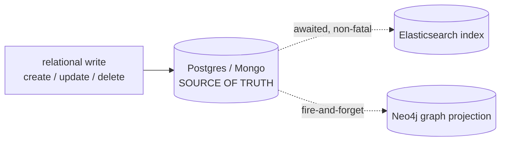
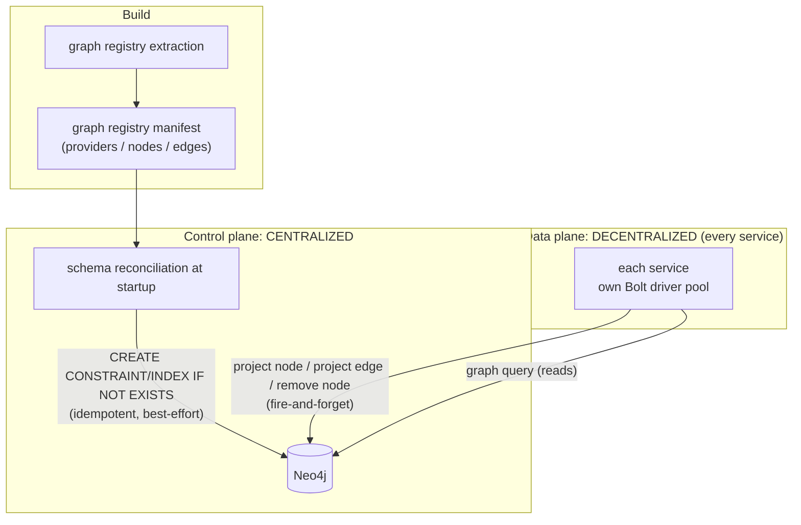

# Graph layer (Neo4j)

The graph layer projects your relational data into a **Neo4j property graph** so you can
answer questions that pure CRUD cannot: "can this user read that document, and *why*?",
"every resource reachable from here", "shortest path between these two accounts", "people
who viewed what I viewed also viewed...". A service declares which data objects and
relations project into the graph, and which graph traversals it exposes as queries. The
compiler generates the Neo4j write path, the Cypher and the schema reconciliation.

The single most important idea: **the graph is a secondary, rebuildable projection over
your relational data objects, not a separate source of truth.** The relational row in the
service's database stays authoritative; the graph is mirrored on every write, exactly the
way the Elasticsearch index is. This is the same architecture as the
[ElasticLog pattern](../composition/elastic-log.md): a registry, a centralized control
plane and a decentralized data plane.

> **Scope note.** The graph layer is generated on every language target that has an
> **official Neo4j driver**: **Node.js, Python, Java, .NET and Go**. It is **not available
> on Rust**, which has no official Neo4j driver, so declaring graph features on a `rust`
> service is rejected and no graph surface is generated. That is the one intentional
> restriction; the backend is Neo4j in every supported case. See
> [the compiler specification](../../compiler/index.md).

## Why a graph at all

Whenever an answer depends on traversing relationships of *unbounded or deep depth*, and
especially when the relationships themselves carry meaning, a property graph beats the
relational equivalent, which degrades into many self-joins or recursive CTEs that are hard
to write, index and *explain*.

| Use case | Why graph wins |
| --- | --- |
| **Authorization / permission graph** | "Can user X read resource Y?" across `User -> Group -> Team -> Org -> Folder -> Resource` is 10 to 15 relational joins; in a graph it is one `MATCH` path. |
| **Recommendation** | "Users like me also viewed..." is a collaborative-filtering traversal. |
| **Org hierarchy** | "All managers above this person", "headcount under this department." |
| **Knowledge graph / RAG** | Entity, concept and document graphs powering retrieval. |
| **Fraud / linkage** | Account, transfer and device rings; "who is at the center?" |

The flagship, and the most differentiated, hardest-to-do-with-CRUD problem, is
**explainable authorization**: a document-management system with deep folder nesting, group
membership, inherited permissions and document-level overrides, where you can ask not just
*whether* a user can see a document but *which* grant, group or folder gave them access.
That single "explain" capability is something a relational permission check structurally
cannot produce, and it is part of the layer (see
[the flagship below](#hierarchicalresourcegraph-the-flagship)).

## The mental model: a projection, never a second source of truth



Every create, update and delete of a data object already updates the Elasticsearch index.
On create and update that update is awaited (non-fatal, bounded by a wait limit) before the
change event publishes. The graph adds a sibling write next to it, and that one stays
fire-and-forget: the service does not wait for the graph, and the change event publishes
regardless.

The bulk writers do the same, per row. `createBulk` (behind `createBulkCrudActions`)
projects every row it inserted or merged, and not a row that a `stopOperation` unique
index returned without writing. A bulk update by query (behind `updateCrudActions`)
re-projects every row it updated. A bulk delete by query (behind `deleteCrudActions`)
removes the node of every row it hard-deleted, or re-projects it with `isActive: false` on
a soft delete. On MongoDB a row that reaches the projection carrying only `_id` is keyed
by that value as `id`.

The consequences of "projection, not source of truth":

- **Neo4j outages never fail a relational write** (by default). The projection is
  fire-and-forget and best-effort: the whole graph data plane resolves to a graceful no-op
  when the Neo4j driver is absent, the provider is unconfigured, or Neo4j is unreachable.
  Reads return an empty result. A write that does not land is skipped, but not silently:
  every dropped node or edge write or removal increments the in-process counter
  `graph_projection_dropped_total{op, provider, target, reason}` (`reason` is
  `unavailable`, `error` or `endpoint-missing`) and logs a `GraphProjectionDropped` warning
  on the first drop of each series and on every 100th after it. Alert on a non-zero drop
  rate when the graph backs an authorization decision.
- **Projection ordering and transient failures.** An edge with an unknown endpoint label
  matches by its key without creating a stub with a guessed label. If that endpoint is not
  projected yet, or Neo4j reports a transient error or deadlock, the write retries five
  times with 100, 200, 400, 800 and 1600 ms backoffs. An endpoint still missing after those
  retries is counted and logged as `endpoint-missing`; an exhausted transient failure
  remains `error`. Other failures are not retried. Default projection stays
  fire-and-forget; strict projection awaits the retries before rejecting.
- **Strict projection (opt-in).** Set `GRAPH_STRICT_PROJECTION=true` (every provider) or
  `GRAPH_<PROVIDER>_STRICT_PROJECTION=true` (one provider; it wins over the global switch,
  so `false` there exempts that provider). Then a graph write that does not land rejects
  with a `GraphProjectionError`, and the create, update or delete that triggered it fails
  with it. The relational write is already committed at that point (there is no
  transaction across the relational database and Neo4j), and the failure is raised before
  the change event is published: the caller learns the graph is out of step, and a retry
  of an update re-projects the row. Off by default, so the default behaviour is unchanged.
- A read also says whether it actually ran: a graph query resolves to
  `{ records, keys, ok, status }`, where `ok: false` (`status` `unavailable` or `error`)
  marks an outage and `ok: true` with no records is a real zero-row answer (see the
  `GraphQueryAction` section).
- **No day-one dual-write consistency problem.** The graph is a rebuildable index. (A
  reconcile and backfill job that replays the relational truth into the graph is
  **deferred**; eventual consistency between the row and the projection is the accepted
  semantic today.)
- **Graph-of-record mode**, with Neo4j as the *primary* store for relationships with no
  relational home, is **deferred**. Everything below is the projection model.

## The central modeling decision: properties vs edges

The graph carries the **selective projection properties** needed to filter *inside* a
traversal, so "of the documents this user can see, the ones whose category is finance" is
answered in **one** Cypher query rather than fetching ids from the graph and re-filtering
in SQL. The rule the pattern encodes:

| Attribute kind | Goes in graph as | Examples |
| --- | --- | --- |
| **Filter attribute** | a **node property** (`projectedProperties` + `filterableProperties`) | `status`, `category` (flat), `createdAt`, `tenantId`, `visibility` |
| **Domain concept with hierarchy / metadata / multi-membership** | a **node + edge** | a category that forms a hierarchy: `(:Document)-[:IN_CATEGORY]->(:Category)`; `tag`, `department` |
| **Access path** | an **edge** | `owner`, folder hierarchy, permission grant, membership |

**Do not copy everything into the graph.** Projected properties are the *selective filter
set* only: never large text, descriptions, blobs or document bodies. Fall back to the
relational store (the graph returns ids, the caller hydrates from the database) for
full-text search, detailed tabular filtering beyond the projected set, SQL-heavy
pagination and sorting, reporting, or any property not projected. So: **access control +
hierarchy + simple filter: answer in the graph; enrichment, detailed listing, reporting:
return ids and hydrate relationally.**

## Configuring a provider

The graph store is a **provider** in the same catalogue style as buckets and AI providers;
there is no separate "graph system service". You declare named connections in
`projectSettings.graphProvidersSettings`:

```jsonc
// projectSettings.graphProvidersSettings  (GraphProvidersSettings)
{
  "graphProviders": [
    {
      "name": "mainGraph",            // codeName -> GRAPH_MAINGRAPH_* env prefix
      "provider": "neo4j",            // GraphDatabaseType: neo4j is the only shipped type
      "configuration": {              // GraphProviderConfig
        "uri": "bolt://localhost:7687",   // or neo4j+s:// for Aura
        "username": "neo4j",
        "password": "<secret>",           // masked in API responses
        "database": "neo4j",
        "maxPoolSize": 50
      }
    }
  ]
}
```

`name` is both the connection identifier that every projection, edge and query references
and the environment-variable prefix. The compiler emits the secret to the environment and
the data plane resolves the connection at runtime from these variables:

| Env var | From |
| --- | --- |
| `GRAPH_<NAME>_URI` | `configuration.uri` (required; absent means the provider is treated as down) |
| `GRAPH_<NAME>_USERNAME` | `configuration.username` |
| `GRAPH_<NAME>_PASSWORD` | `configuration.password` (secret) |
| `GRAPH_<NAME>_DATABASE` | `configuration.database` |
| `GRAPH_<NAME>_MAXPOOLSIZE` | `configuration.maxPoolSize` |

`<NAME>` is the uppercased provider name, with every character that is not a letter, digit
or `_` turned into `_` (`mainGraph` becomes `GRAPH_MAINGRAPH_*`, `main-graph` becomes
`GRAPH_MAIN_GRAPH_*`). The component that reconciles the graph schema receives the same
variables. Bolt and Cypher are the integration surface, so the abstraction stays thin. See
the pattern pages [`GraphProvidersSettings`](../../spec/GraphProvidersSettings.md),
[`GraphProvider`](../../spec/GraphProvider.md) and
[`GraphProviderConfig`](../../spec/GraphProviderConfig.md).

## Projecting a node

A data object opts into the graph by adding a `graphProjection` block to its
`objectSettings`, the object-level analogue of the `indexedInElastic` property flag. It
rides on the existing data object (which already owns the identity, properties and
tenancy) rather than re-declaring them as a separate pattern.

```jsonc
// dataObjects[].objectSettings.graphProjection  (GraphProjection: node-shaped)
{
  "provider": "mainGraph",            // -> a graphProviders[].name
  "labels": ["Document"],             // Neo4j labels; the first is the primary label
  "identity": "id",                   // node-key property (the MERGE key; default "id")
  "projectedProperties": [            // properties COPIED into the node: selective only
    "id", "tenantId", "category", "status", "createdAt"
  ],
  "filterableProperties": [           // subset used in WHERE; drives Neo4j indexes
    "category", "status", "createdAt"
  ]
}
```

`provider` may be omitted when the project declares at most one graph provider: the
projection then writes to that single provider, or to `mainGraph` when none is declared
(the service's own writes and the schema reconciliation all resolve it the same way). With
two or more declared providers an omitted `provider` is refused at validation
(`GRAPH_PROJECTION_PROVIDER_REQUIRED`).

On every write the service runs an idempotent
`MERGE (n:Document {id: $key}) SET n += $props` with the `projectedProperties` subset; on a
hard delete it runs `MATCH (n:Document {id:$key}) DETACH DELETE n`.

Several labels are all written: `"labels": ["Employee", "Manager"]` emits
`MERGE (n:Employee {id: $key}) SET n:Employee:Manager, n += $props`. The MERGE stays keyed
on the primary label (the first entry). That label is the one the uniqueness constraint,
the FK-edge endpoint stubs and the hard-delete MATCH use, so a node that already exists
with only the primary label gets the others added instead of a second node being created.

`$key` is the row's `identity` value, on writes and on hard deletes alike. With
`"identity": "externalId"` the delete runs
`MATCH (n:Employee {externalId: $key}) DETACH DELETE n` bound to the deleted row's
`externalId`, not its `id`.

**An identity other than `id` is unsupported for an edge TARGET.** An edge into a node
MERGEs its endpoint by a key of its own: an FK `graphEdge` by the relation's
`relationTargetKey` (default `id`), an edge object (`projectsAsEdge`) always by `id`. When
that key is not the target's `identity`, the edge MERGEs a second, property-less
`(:Employee {id})` stub and hangs off it, so traversals through the real node never see
it, whichever of the two is written first. The validator reports this on the target's
`identity` as the warning `GRAPH_EDGE_TARGET_IDENTITY_UNSUPPORTED`, counting FK edges from
other services that name the target as `svc:object` too. Keep `identity: "id"` on any
object an edge points at; for an FK `graphEdge` only, pointing `relationTargetKey` at the
target's identity also makes the two keys agree.

Soft deletes (the auto-managed `isActive` flag) flip to a property update, not a delete,
when the flag is projected.

An edge object (`projectsAsEdge`) removes its relationship on delete. A hard delete deletes
it (`MATCH (a {..})-[r:TYPE]->(b {..}) DELETE r`, keyed by the `from.key` and `to.key`
values the deleted row carries; both endpoint nodes stay). A soft delete deletes it too
when `isActive` is not one of the edge's `edgeProperties`, since the edge would otherwise
keep looking live; when `isActive` is an edge property the relationship stays with
`isActive: false`. The edge MERGE keys a relationship on its two endpoints and its type,
so rows with the same endpoints share one relationship, and removing it for one row
removes it for all of them. An update that changes (or clears) an endpoint key, for
example re-pointing a membership from `m1` to `m2`, first deletes the relationship between
the OLD endpoints and then MERGEs the new one; an FK `graphEdge` whose foreign key an
update changes does the same. An edge object with `useSoftDelete: false` is refused at
validation (`GRAPH_EDGE_OBJECT_HARD_DELETE`): its removal is a best-effort graph write,
and if that write is dropped the row is gone, so nothing could ever find the relationship
again. `tenantId` is projected for tenant-level objects and every generated query injects a
`tenantId` predicate. See [`GraphProjection`](../../spec/GraphProjection.md).

A graph projection of an object moderated with
[`objectModeration`](object-moderation.md) in `mode: onPlace` carries no moderation
columns, so graph queries would see unapproved rows. Validation refuses this combination
(`OBJECT_MODERATION_UNGATEABLE_PROJECTION`): remove the `objectSettings.graphProjection`
block, or use `mode: staged`, which never holds an unapproved real row to project. Graph
projection activates by block presence; it has no `enabled` field. The same refusal
applies to a declared enterprise projection with its model and object references.

## The three edge origins

Relationships in the graph come from three distinct sources, and the pattern surface names
all three.

### (a) An FK relation projected as an edge: `PropertyGraphEdge`

A property that already declares a 1-hop relation (`hasRelation: true` with
`relationSettings`) opts into the graph by adding a `graphEdge` block to the *property*:

```jsonc
// the folder.parentId property (folder -> folder)
{
  "basicSettings": { "name": "parentId", "type": "ID", "hasRelation": true },
  "relationSettings": {
    "relationName": "parent", "relationTargetObject": "folder",
    "relationTargetKey": "id", "onDeleteAction": "doDelete"
  },
  "graphEdge": {                      // PropertyGraphEdge
    "relationshipType": "CONTAINS",
    "direction": "inbound",           // GraphDirection: parent CONTAINS this node, so the edge points target -> source
    "edgeProperties": []              // optional properties copied onto the relationship
  }
}
```

`direction` is the `GraphDirection` enum (`outbound` | `inbound` | `undirected`). On every
write of the owning row, the edge is upserted alongside the node. See
[`PropertyGraphEdge`](../../spec/PropertyGraphEdge.md).

**Which node the edge lands on.** The edge MERGEs its target endpoint on the label that
the target object's own `graphProjection` writes (its first `labels` entry, else the
capitalized object name), resolved from `relationTargetObject`:

- `"folder"` or the same-service qualified `"docs:folder"` (inside service `docs`): the
  label of `folder`'s projection in this service.
- A cross-service `"orgs:member"`: the label that service `orgs` projects `member` as, so
  the edge meets the node that service writes (for example `:Employee`).
- A cross-service target whose service does not project the object: the capitalized object
  name (`:Member`), a node no service writes, so the endpoint only ever exists as a
  property-less stub. The validator warns on the reference with
  `GRAPH_EDGE_TARGET_NOT_PROJECTED`; add a `graphProjection` to the target object or drop
  the `graphEdge`.

### (b) An edge object: `GraphEdgeProjection` (`projectsAsEdge`)

A data object whose *rows are relationships* (a join or grant table) projects as **edges,
not vertices**. Its `graphProjection` is edge-shaped via `projectsAsEdge` (a projection is
either node-shaped *or* edge-shaped, never both):

```jsonc
// a "permissionGrant" object -> objectSettings.graphProjection (edge-shaped)
{
  "provider": "mainGraph",
  "projectsAsEdge": {                 // GraphEdgeProjection
    "relationshipType": "CAN_READ",
    "from": { "labels": ["User", "Group"], "key": "subjectId" },     // GraphEdgeEnd
    "to":   { "labels": ["Folder", "Document"], "key": "resourceId" },
    "edgeProperties": ["action", "grantedAt"]
  }
}
```

Each `from` / `to` is a [`GraphEdgeEnd`](../../spec/GraphEdgeEnd.md) (`{ labels[], key }`).
The object's own CRUD upserts the relationship. See
[`GraphEdgeProjection`](../../spec/GraphEdgeProjection.md).

### (c) A standalone `GraphEdge`: a graph-only relationship

For relationships that exist *only* in the graph (no FK, no join object, for example a
computed `SIMILAR_TO`), `GraphEdge` is a service-level pattern under
`service.graphLayer.edges[]`. This is the only genuinely node-less pattern; (a) and (b)
ride on existing data objects.

```jsonc
// service.graphLayer.edges[]  (GraphEdge)
{
  "relationshipType": "SIMILAR_TO",
  "provider": "mainGraph",
  "from": "Document",                 // a projected node label
  "to": "Document",
  "direction": "undirected",          // GraphDirection
  "cardinality": "ManyToMany",        // GraphCardinality: OneToOne | OneToMany | ManyToMany
  "properties": [                     // standard DataProperty[]
    { "basicSettings": { "name": "score", "type": "Double" } }
  ]
}
```

See [`GraphEdge`](../../spec/GraphEdge.md).

## Querying the graph

### Declarative query archetypes: `GraphQuery`

A `GraphQuery` lives on the service at `service.graphLayer.queries[]`. It follows the exact
`ComputeJob` idiom: a `type` field (`GraphQueryType`) selects an archetype, and a single
`spec` wrapper ([`GraphQuerySpec`](../../spec/GraphQuerySpec.md)) holds every typed
sub-spec as nullable members; the active one matches `type`. Each archetype compiles to a
parameterized Cypher template at build time.

**Eleven archetypes are shipped**, each with spec-faithful, parameterized Cypher:

| `GraphQueryType` | Spec | Answers |
| --- | --- | --- |
| `reachableNodes` | [`ReachableNodesSpec`](../../spec/ReachableNodesSpec.md): `{ sourceLabel, targetLabel, edgeTypes[], maxDepth, filterProperties[] }` | "all documents user X can read where category=finance", filtered in-graph |
| `effectivePermission` | [`EffectivePermissionSpec`](../../spec/EffectivePermissionSpec.md): `{ subjectLabel, resourceLabels[], pathEdges[], maxDepth }` | "can X reach Y?" (boolean) |
| `permissionExplain` | [`PermissionExplainSpec`](../../spec/PermissionExplainSpec.md): `{ subjectLabel, resourceLabels[], pathEdges[], maxDepth }` | "**why** can X access Y: via which group, folder or grant?" (the path) |
| `ancestors` | [`HierarchyTraversalSpec`](../../spec/HierarchyTraversalSpec.md): `{ nodeLabel, edgeType, maxDepth }` | "all managers above this person" |
| `descendants` | `HierarchyTraversalSpec` | "headcount under this department" |
| `shortestPath` | [`ShortestPathSpec`](../../spec/ShortestPathSpec.md): `{ fromLabel, toLabel, edgeTypes[], maxDepth }` | "degrees of separation"; "is account A linked to flagged B?" |
| `neighborhood` | [`NeighborhoodSpec`](../../spec/NeighborhoodSpec.md): `{ centerLabel, edgeTypes[], hops }` | "everything within 2 hops" |
| `recommendation` | [`RecommendationSpec`](../../spec/RecommendationSpec.md): `{ subjectLabel, viaEdge, targetLabel, limit }` | "users like me also viewed..." (co-occurrence) |
| `custom` | [`CustomGraphQuerySpec`](../../spec/CustomGraphQuerySpec.md): `{ cypher, params[] }` | the bring-your-own-Cypher escape hatch |
| `scopedRolePermission` | [`ScopedRolePermissionSpec`](../../spec/ScopedRolePermissionSpec.md): `{ scopes[], membershipEdge, roleProperty, precedence, grant, deny }` | RBAC over ReBAC: "does X hold a role that grants permission P, at the nearest scope?" (one row: `allowed, role, scope, scopeId, denied`); see [below](#roles-over-the-graph-scopedrolepermission) |
| `scopedRoleExplain` | `ScopedRolePermissionSpec` (same spec, `type: scopedRoleExplain`) | the `scopedRolePermission` twin: every candidate membership or deny across every declared scope, not just the one picked |

A declared query produces one callable per entry (`runGraphQuery_<name>(params)`) plus a
name-keyed dispatcher (`runNamedGraphQuery(name, params)`). The runner binds the caller's
params and runs the pre-assembled Cypher, returning mapped records, or an empty result when
Neo4j is absent. Each entry also gets `runGraphQueryResult_<name>(params)` (and the
dispatcher `runNamedGraphQueryResult(name, params)`), which resolve to the full
`{ records, keys, ok, status }` outcome, so a caller can tell "Neo4j is down" apart from
"nothing matched". `ancestors` and `descendants` use `*1..N` so a node is never its own
ancestor; the reachability and permission archetypes use `*0..N`. A `custom` query must
declare in `params[]` every `$name` its Cypher uses. A `$name` that no param declares is a
validation error (`CUSTOM_QUERY_PARAM_MISMATCH`) and a build error. A declared param the
Cypher never uses is a warning (`CUSTOM_QUERY_PARAM_UNUSED`). Tokens inside string
literals, backtick-quoted names and comments are ignored. Every archetype except
`shortestPath` and `custom` injects a row-side
`(<node>.<tenantProp> IS NULL OR <node>.<tenantProp> = $tenantId)` predicate, where
`<tenantProp>` is the project's projected `<tenantName>Id`. A caller that binds no tenant
sees only untenanted nodes, never every tenant's.

```jsonc
// service.graphLayer.queries[]  (GraphQuery)
{
  "name": "explainDocAccess",
  "provider": "mainGraph",
  "type": "permissionExplain",        // GraphQueryType
  "spec": {                           // GraphQuerySpec: only the keyed sub-spec is read
    "permissionExplain": {            // PermissionExplainSpec
      "subjectLabel": "User",
      "resourceLabels": ["Folder", "Document"],
      "pathEdges": ["MEMBER_OF", "CAN_READ", "CONTAINS"],
      "maxDepth": 20
    }
  }
}
```

`permissionExplain` is **the differentiator**: it returns the matched *path*, not just a
boolean, which is exactly what an enterprise authorization audit needs. The generated
Cypher:

```cypher
MATCH p = (s:User {id: $subjectId})-[:MEMBER_OF|CAN_READ|CONTAINS*0..20]->(r:Folder {id: $resourceId})
WHERE ($tenantId IS NULL OR r.tenantId = $tenantId)
RETURN [n IN nodes(p) | {id: n.id, labels: labels(n)}] AS via, length(p) AS hops
ORDER BY hops ASC
LIMIT 5
```

See [`GraphQuery`](../../spec/GraphQuery.md).

### Raw / inline Cypher in a workflow: `GraphQueryAction`

For a one-off traversal inside a business API workflow, `GraphQueryAction` extends
`BusinessApiAction`, so it inherits `name` / `condition` / `contextPropertyName` /
`writeToResponse` / `onActionError`. Its own fields are `provider`, `query` (either a
`named:<declaredQuery>` reference or an inline Cypher string), and `params` (an MScript
expression):

```jsonc
// a GraphQueryAction inside a BusinessApi workflow
{
  "name": "fetchVisibleDocs",
  "provider": "mainGraph",
  "query": "named:explainDocAccess",  // a graphLayer.queries[].name, OR an inline cypher string
  "params": { "js": "{ subjectId: this.session.userId, resourceId: this.in.docId, tenantId: this.session.workspaceId }" },
  "contextPropertyName": "access",
  "writeToResponse": true
}
```

The action writes `{ records, total, ok, status }` to its context property. `records` and
`total` are the mapped rows. `ok` is `true` when the query ran, including when it matched
nothing. It is `false` when it did not run: `status` is `unavailable` (no usable driver:
the provider is unconfigured or the Neo4j driver is missing) or `error` (the statement
threw: Neo4j is unreachable, or the Cypher failed). A graph-backed permission decision
should read `ok` before it reads `records`. Otherwise a Neo4j outage looks the same as a
real "no path" deny:

```js
// allowed: the query ran AND matched
this.access.ok && this.access.total > 0
// the graph did not answer: an outage to report (5xx), not a deny
!this.access.ok
```

An MScript that reads only `records` / `total` behaves exactly as before: an outage still
reads as an empty answer there.

See [`GraphQueryAction`](../../spec/GraphQueryAction.md).

### Roles over the graph (`scopedRolePermission`)

`effectivePermission` and `permissionExplain` answer "does *any* path connect subject to
resource". A path is a union, so once one path exists the answer is `true` regardless of
how weak or how far away the connecting edge is. That is the wrong shape for **RBAC over
ReBAC**: a role *stamped on a membership edge* (`(User)-[:MEMBER_OF {role}]->(Project)`)
that must be **joined to a second node type** (a `Role` node with a grant edge to a
`Permission` or `Action` node) and where **the most specific scope replaces the broader
one**. A project `Viewer` must NOT be rescued by a workspace `Admin`, which is exactly what
a path-existence union would do. `scopedRolePermission` and `scopedRoleExplain` are the two
archetypes for that shape; four hand-written `custom` queries (project and workspace, each
as decision and explain) collapse into one declarative spec.

Both types read one spec class, `ScopedRolePermissionSpec`, under
`spec.scopedRolePermission` / `spec.scopedRoleExplain` (the `ComputeJob` idiom, the same as
`ancestors` and `descendants` sharing `HierarchyTraversalSpec`). A parity example that
replaces two legacy checks (by project and by workspace) with one query:

```jsonc
// service.graphLayer.queries[]  (GraphQuery)
{
  "name": "checkPermission", "provider": "permissionGraph", "type": "scopedRolePermission",
  "spec": { "scopedRolePermission": {
    "subjectLabel": "User",
    "resourceLabels": ["Project", "Workspace"],
    "scopes": [
      // ordered, most specific first
      { "name": "project",   "label": "Project",   "pathEdges": [],             "minDepth": 0, "maxDepth": 0 },
      { "name": "workspace", "label": "Workspace", "pathEdges": ["BELONGS_TO"], "minDepth": 0, "maxDepth": 1,
        "tenantRoot": true, "returnId": true }
    ],
    "membershipEdge": "MEMBER_OF", "roleProperty": "role",
    "membershipConditions": [{ "property": "status", "equals": "active" }],
    "activeProperty": "isActive",
    "precedence": "nearestScope", "roleMatch": "caseInsensitive",
    "grant": { "mode": "graph", "roleLabel": "Role", "roleKeyProperty": "key", "grantEdge": "CAN",
               "permissionLabel": "Action", "permissionKeyProperty": "key" }
  } }
}
```

A `scopes[]` entry declared with `minDepth: 0` matches the resource node itself, so this
one query answers both the project-scoped and the workspace-scoped legacy call;
`tenantRoot: true` marks `Workspace` as the tenant entity (see "Tenant scope and
`tenantRoot`" below);
`returnId: true` also returns `workspaceId` (the nearest `Workspace`, member or not). The
Cypher semantics for this spec (tenant property `organizationId`) are:

```cypher
OPTIONAL MATCH (s:User {id: $subjectId})
OPTIONAL MATCH (r {id: $resourceId})
  WHERE (r:Project OR r:Workspace) AND (r.organizationId IS NULL OR r.organizationId = $tenantId)
WITH s, r,
  CASE WHEN s IS NULL OR r IS NULL THEN [] ELSE
    [p = (r)-[*0..0]->(n0:Project)<-[m0:MEMBER_OF]-(s)
       WHERE m0.role IS NOT NULL AND m0.status = 'active' AND coalesce(m0.isActive, true)
         AND (n0.organizationId IS NULL OR n0.organizationId = $tenantId)
       | {scope: 'project', scopeRank: 0, scopeId: n0.id, role: m0.role, hops: length(p)}] +
    [p = (r)-[:BELONGS_TO*0..1]->(n1:Workspace)<-[m1:MEMBER_OF]-(s)
       WHERE m1.role IS NOT NULL AND m1.status = 'active' AND coalesce(m1.isActive, true)
         AND n1.id = $tenantId
       | {scope: 'workspace', scopeRank: 1, scopeId: n1.id, role: m1.role, hops: length(p)}]
  END AS candidates,
  CASE WHEN r IS NULL THEN null ELSE
    reduce(b = null, c IN [p = (r)-[:BELONGS_TO*0..1]->(x1:Workspace)
        WHERE x1.id = $tenantId | {id: x1.id, hops: length(p)}] |
      CASE WHEN b IS NULL OR c.hops < b.hops OR (c.hops = b.hops AND c.id < b.id)
           THEN c ELSE b END).id
  END AS workspaceId
WITH workspaceId,
  reduce(best = null, c IN candidates |
    CASE WHEN best IS NULL
           OR c.scopeRank < best.scopeRank
           OR (c.scopeRank = best.scopeRank AND c.hops < best.hops)
           OR (c.scopeRank = best.scopeRank AND c.hops = best.hops AND c.scopeId < best.scopeId)
           OR (c.scopeRank = best.scopeRank AND c.hops = best.hops AND c.scopeId = best.scopeId AND c.role < best.role)
         THEN c ELSE best END) AS pick
WITH workspaceId, pick, pick.role AS role
OPTIONAL MATCH (ro:Role)-[g:CAN]->(a:Action {key: $permission})
  WHERE role IS NOT NULL AND toLower(ro.key) = toLower(role)
    AND coalesce(ro.isActive, true) AND coalesce(g.isActive, true) AND coalesce(a.isActive, true)
    AND (ro.organizationId IS NULL OR ro.organizationId = $tenantId)
    AND (g.organizationId IS NULL OR g.organizationId = $tenantId)
    AND (a.organizationId IS NULL OR a.organizationId = $tenantId)
WITH workspaceId, pick, role, count(ro) > 0 AS granted
RETURN granted AS allowed, role, pick.scope AS scope, pick.scopeId AS scopeId,
       false AS denied, workspaceId
```

The query uses pattern comprehension and `reduce` only: no APOC, no `CALL {}` subquery and
no Neo4j-5-only label expression. The text was measured on Neo4j 5 (5.26); no Neo4j 4.x
run was made. The pick key is `(scopeRank, hops, scopeId, role)`: the declared scope order
first (the override rule itself: the nearest scope with a membership decides, full stop),
then fewest hops, then the two remaining ties broken lexically so the pick is fully
deterministic (the trailing `role` term is needed only when two roles tie on the same node
at the same distance, for example through two team memberships). `highestRank` changes
only the key to `(roleRank, scopeRank, hops, scopeId, role)`, with an unranked role sorting
last. A spec with a subject path (`subjectPathEdges` + `subjectPathMaxDepth > 0`) adds
`subjectHops` right after `hops` (below).

**Answer columns.** `scopedRolePermission` always returns exactly one row, even for an
unknown subject or resource (both sides are `OPTIONAL MATCH`), so an empty `records` only
ever means "the query did not run", already reported by `ok: false`:

| column | type | meaning |
| --- | --- | --- |
| `allowed` | boolean | the decision |
| `role` | string \| null | the picked role; `null` = not a member at any declared scope |
| `scope` | string \| null | the scope `name` the role came from |
| `scopeId` | string \| null | id of that scope node |
| `denied` | boolean | an explicit deny was hit. `role !== null && !allowed && !denied` is a plain "permission denied", distinct from an explicit deny. A subject with only a deny edge answers `role: null, denied: true` (a blocked non-member), so a reader checks `denied` first, then `role === null`, then `allowed` |
| `<name>Id` | string \| null | one per `returnId: true` scope |

**Precedence, override and deny.** `nearestScope` (the default) is itself the override
rule: the nearest declared scope that has ANY membership decides, and a weaker role there
is never rescued by a stronger role further out. This is what a path-existence union
structurally cannot express. `highestRank` instead ranks by `roleRanking` (strongest
first) across every scope regardless of distance. `deny.scopeEdge` (for example
`BLOCKED_FROM`) denies whatever the precedence picked when the subject has that edge to ANY
declared scope node; `deny.grantEdge` (for example `CANNOT`, `grant.mode: "graph"` only)
denies when the picked role has that edge to the permission node, even beside a `CAN`. A
few rules change the emitted Cypher beyond the example above:

- **Final tiebreak.** Every pick key ends in the role value itself (`nearestScope`:
  `(scopeRank, hops, [subjectHops,] scopeId, role)`; `highestRank`:
  `(roleRank, scopeRank, hops, [subjectHops,] scopeId, role)`), so two roles tied on the
  same node at the same distance (for example reached via two different team hops) still
  pick deterministically.
- **`granted` also honors `deny.grantEdge`.** In `scopedRoleExplain`, a candidate's
  `granted` column folds in the role-level deny: a role that carries both `CAN` and
  `CANNOT` to the same permission node reads `granted: false`, not `true`.
- **`activeProperty` is not applied to deny edges.** The soft-delete
  `coalesce(x.<activeProperty>, true)` guard runs on the membership edge, the role node,
  the grant edge and the permission node, never on a `deny.scopeEdge` or `deny.grantEdge`
  relationship. A deny always wins, fail-closed, whether or not the deny edge itself is
  soft-deletable.
- **`hops` is the scope distance.** It counts the scope walk from the resource to the scope
  node plus the membership edge itself, NOT the subject-group hop, so inside one scope the
  nearest scope NODE wins whoever holds the membership there: a team membership on the
  nearest folder beats a direct membership on a folder further out. With a subject path
  the group hops are carried apart as `subjectHops` (0 for a direct membership) and ordered
  right after `hops`, so on the SAME node a direct membership beats a team one. The
  candidate binds the subject-path relationships (`()<-[sp0:IN_TEAM*0..2]-(s)`) and reads
  `hops: length(p) - size(sp0), subjectHops: size(sp0)`; a spec without a subject path
  keeps `hops: length(p)` and no `subjectHops`. The explain's `hops` column is the same
  scope distance.

**Tenant scope and `tenantRoot`.** The row-side tenant term
(`n.<tenantProp> IS NULL OR n.<tenantProp> = $tenantId`) goes on the resource node, every
scope node, the role node, the grant edge and the permission node. A tenant's custom role
named `admin` can therefore never grant in another tenant, and neither can a
tenant-stamped grant edge between two global role and permission nodes. **Scope denies
carry no tenant term**: the `deny.scopeEdge` walk (decision and explain rows) follows the
subject's own edge to a node the resource reaches and matches whatever tenant the caller
binds. A deny can only remove access, so evaluating it tenant-agnostically is fail-closed;
with the tenant term a `tenantRoot` deny would be invisible to a caller binding no tenant
or another one while a grant on a tenantless resource still resolved. **Role-level denies
are tenant-local, like the grants they override**: the `deny.grantEdge` join matches the
role and the permission node by KEY, so it carries the same row-side terms as the grant
join. One tenant's own role `admin` with `CANNOT deploy` therefore never denies `admin` in
another tenant; a `CANNOT` with no tenant stamp denies in every tenant, a tenant-stamped
one only in its own. The subject node itself is never filtered (users cross tenants; the
membership decides, as with every other archetype). A scope marked `tenantRoot: true` is
different: the tenant entity's own node carries no tenant property of its own (there is
nothing to compare it to), so that scope instead requires `n.id = $tenantId`. A caller
that binds no `tenantId` therefore resolves **nothing** at a `tenantRoot` scope: it fails
closed (absence never widens access), never "every tenant's". On a single-tenant project
both terms are vacuous and `tenantRoot` is a validator warning
(`SCOPED_ROLE_TENANT_ROOT_SINGLE_TENANT`), because it would deny every call.

**Scope direction: `outbound` or `inbound`.** Each `scopes[]` entry walks its `pathEdges`
from the resource in its `direction` (enum `ScopedRoleScopeDirection`, default
`outbound`). `outbound` follows the edges, `(r)-[:E*min..max]->(scope)`, which fits
containment written **child -> parent** (`BELONGS_TO`, an edge object such as
`CONTAINED_IN`). `inbound` walks against them, `(r)<-[:E*min..max]-(scope)`, which fits
containment written **parent -> child**, the FK `CONTAINS` convention: a `folder.parentId`
or `doc.folderId` `graphEdge` with `direction: inbound` points parent -> child, so
**containment edges written parent -> child are walked with `direction: "inbound"`** and
the existing FK edge serves as the scope path directly (no second, child -> parent edge to
project). The direction applies to the whole scope: the candidate list, the
`deny.scopeEdge` term, the `returnId` lookup and the explain rows all walk the same way. A
Drive-style folder scope over `CONTAINS`
(`{ "name": "folder", "label": "Folder", "pathEdges": ["CONTAINS"], "minDepth": 0,
"maxDepth": 10, "direction": "inbound" }`) lowers its candidate list to (single-tenant):

```cypher
    [p = (r)<-[:CONTAINS*0..10]-(n0:Folder)<-[m0:HAS_ROLE_ON]-(s)
       WHERE m0.role IS NOT NULL AND coalesce(m0.isActive, true)
         AND (n0.tenantId IS NULL OR n0.tenantId = $tenantId)
       | {scope: 'folder', scopeRank: 0, scopeId: n0.id, role: m0.role, hops: length(p)}]
```

A scope declared without `direction` (or `outbound`) emits the original text. Walking
`CONTAINS` **outbound** from a document reaches its children, never its folders, so every
folder membership would be invisible; the validator reports that as
`SCOPED_ROLE_SCOPE_DIRECTION_UNREACHABLE` (below) whenever it can prove from the projected
writers that no resource label reaches the scope label in the declared direction.

**Revocation.** A deleted membership stops granting only when the delete reaches the
membership edge. An edge-object membership cannot **hard-delete**: an edge object with
`useSoftDelete: false` is refused (`GRAPH_EDGE_OBJECT_HARD_DELETE`), and a hard delete that
does run removes the relationship. A **soft-deleting** edge object re-projects the row with
`isActive: false`: when `isActive` is not one of the edge's `edgeProperties` the
relationship is deleted, so the role stops granting; when it is, the relationship stays
with `isActive: false`, which revokes only when the spec declares
`activeProperty: "isActive"`. `SCOPED_ROLE_REVOCATION_NOT_PROJECTED` warns on a
soft-deleting writer whose relationship SURVIVES the delete when the spec declares no
`activeProperty` or reads another flag than `isActive`: always for an FK `graphEdge` owner
(its soft delete re-`MERGE`s the edge either way, so it is also warned when the spec reads
`isActive` but this owner does not project it), and for an edge object only when it also
projects `isActive` (one that does not removes its relationship on delete instead, so none
of these problems applies to it). An edge object that hard-deletes is refused separately,
as `GRAPH_EDGE_OBJECT_HARD_DELETE` (an FK `graphEdge` owner that hard-deletes is fine: its
node is `DETACH DELETE`d).

**The explain twin: `scopedRoleExplain`.** The same candidate lists (plus one
deny-candidate list per scope when `deny.scopeEdge` is set), unwound into one row per
candidate instead of reduced to a single pick. The Cypher for the parity example above:

```cypher
OPTIONAL MATCH (s:User {id: $subjectId})
OPTIONAL MATCH (r {id: $resourceId})
  WHERE (r:Project OR r:Workspace) AND (r.organizationId IS NULL OR r.organizationId = $tenantId)
WITH s, r,
  CASE WHEN s IS NULL OR r IS NULL THEN [] ELSE
    [p = (r)-[*0..0]->(n0:Project)<-[m0:MEMBER_OF]-(s)
       WHERE m0.role IS NOT NULL AND m0.status = 'active' AND coalesce(m0.isActive, true)
         AND (n0.organizationId IS NULL OR n0.organizationId = $tenantId)
       | {kind: 'membership', scope: 'project', scopeRank: 0, scopeId: n0.id, role: m0.role, hops: length(p)}] +
    [p = (r)-[:BELONGS_TO*0..1]->(n1:Workspace)<-[m1:MEMBER_OF]-(s)
       WHERE m1.role IS NOT NULL AND m1.status = 'active' AND coalesce(m1.isActive, true)
         AND n1.id = $tenantId
       | {kind: 'membership', scope: 'workspace', scopeRank: 1, scopeId: n1.id, role: m1.role, hops: length(p)}]
  END AS candidates
WITH candidates,
  reduce(best = null, c IN candidates |
    CASE WHEN best IS NULL
           OR c.scopeRank < best.scopeRank
           OR (c.scopeRank = best.scopeRank AND c.hops < best.hops)
           OR (c.scopeRank = best.scopeRank AND c.hops = best.hops AND c.scopeId < best.scopeId)
           OR (c.scopeRank = best.scopeRank AND c.hops = best.hops AND c.scopeId = best.scopeId AND c.role < best.role)
         THEN c ELSE best END) AS pick
UNWIND candidates AS c
WITH DISTINCT c, pick
OPTIONAL MATCH (ro:Role)-[g:CAN]->(a:Action {key: $permission})
  WHERE c.kind = 'membership' AND toLower(ro.key) = toLower(c.role)
    AND coalesce(ro.isActive, true) AND coalesce(g.isActive, true) AND coalesce(a.isActive, true)
    AND (ro.organizationId IS NULL OR ro.organizationId = $tenantId)
    AND (g.organizationId IS NULL OR g.organizationId = $tenantId)
    AND (a.organizationId IS NULL OR a.organizationId = $tenantId)
WITH c, pick, count(ro) > 0 AS granted
RETURN c.kind AS kind, c.scope AS scope, c.scopeId AS scopeId, c.hops AS hops, c.role AS role,
       granted, coalesce(c = pick, false) AS selected
ORDER BY c.scopeRank ASC, c.hops ASC, c.scopeId ASC, c.kind ASC, c.role ASC
LIMIT 25
```

`WITH DISTINCT c, pick` after the `UNWIND` means identical candidate maps reached by two
different paths collapse into ONE row (in every grant mode). The `ORDER BY` carries
`scopeRank, hops, scopeId` plus `kind, role`, so the row order is a **total order**, never
an arbitrary one among equal-looking candidates (with a subject path,
`coalesce(c.subjectHops, 0)` follows `hops`; a deny row is a direct edge). Columns: `kind`
(`membership` \| `deny`), `scope`, `scopeId`, `hops` (the scope distance: walk plus
membership or deny edge, never the subject-group hops), `role`, `granted`, `selected` (the
exact row `scopedRolePermission` would have picked). At most 25 rows are returned; zero
rows means no membership and no deny at any declared scope.

**Validator codes** (`SCOPED_ROLE_SPEC_MISSING` lives on the `GraphQuery` pattern itself,
since it needs both `type` and `spec`):

| code | tier | when |
| --- | --- | --- |
| `SCOPED_ROLE_SPEC_MISSING` | ERROR | `type` is one of the two types but `spec.<type>` is absent |
| `SCOPED_ROLE_NO_SCOPES` | ERROR | `scopes` is empty |
| `SCOPED_ROLE_SCOPE_DUPLICATE` | ERROR | two scopes share a `name` |
| `SCOPED_ROLE_IDENTIFIER_INVALID` | ERROR | a label, edge type, property or scope name is not a bare identifier (they are spliced into the Cypher text); in `resourceLabels`, `subjectPathEdges` and `scopes[].pathEdges` every entry except null / `""` counts, a whitespace-only entry included |
| `SCOPED_ROLE_DEPTH_INVALID` | ERROR | `minDepth > maxDepth`, a negative depth, or `maxDepth > 50` |
| `SCOPED_ROLE_GRANT_INCOMPLETE` | ERROR | `graph` mode missing `roleLabel` / `grantEdge` / `permissionLabel`; `roleList` mode with no `allowedRoles` |
| `SCOPED_ROLE_RANKING_MISSING` | ERROR | `highestRank` with an empty `roleRanking` |
| `SCOPED_ROLE_CONDITION_VALUE_INVALID` | ERROR | a literal (`membershipConditions[].equals`, `roleRanking[]`, `grant.allowedRoles[]`) is not a boolean / plain decimal number (no exponent form such as `1e21`) / safe string; a null entry of `roleRanking` / `allowedRoles` too |
| `SCOPED_ROLE_COLUMN_COLLISION` | ERROR | a `returnId` column `<name>Id` equals a fixed answer column or another scope's |
| `SCOPED_ROLE_DENY_EDGE_MODE` | ERROR | `deny.grantEdge` outside `grant.mode: "graph"` |
| `SCOPED_ROLE_LABEL_NOT_PROJECTED` | WARNING | a subject, resource, scope, role or permission label that no projection in the project writes |
| `SCOPED_ROLE_EDGE_NOT_PROJECTED` | WARNING | a membership, path, grant or deny edge type that no projection writes |
| `SCOPED_ROLE_PROPERTY_NOT_PROJECTED` | WARNING | `roleProperty`, a condition property, or `activeProperty` is missing from the membership edge's `edgeProperties`: the role never reaches the graph, every check answers `role: null` |
| `SCOPED_ROLE_TENANT_NOT_PROJECTED` | WARNING | multi-tenant project, a scope's object is tenant-scoped, but its projection does not project the tenant prop |
| `SCOPED_ROLE_TENANT_ROOT_UNMARKED` | WARNING | multi-tenant project, a scope's object is not tenant-scoped and no scope is `tenantRoot` |
| `SCOPED_ROLE_TENANT_ROOT_SINGLE_TENANT` | WARNING | `tenantRoot: true` on a single-tenant project (would deny every call) |
| `SCOPED_ROLE_UNTYPED_TRAVERSAL` | WARNING | `maxDepth > 0` (scope or subject path) with empty `pathEdges` / `subjectPathEdges`: walks every relationship type |
| `SCOPED_ROLE_RANKING_IGNORED` | WARNING | `roleRanking` given with `precedence: "nearestScope"` (never read) |
| `SCOPED_ROLE_SCOPE_DIRECTION_UNREACHABLE` | WARNING | given the projected writers of a scope's `pathEdges` (edge-object `from`/`to` labels, FK `graphEdge` owner and target by its direction, `graphLayer.edges` `from`/`to`), no resource label can walk in the declared `direction` to the scope label within `maxDepth` (only when provable: an unknown endpoint label means no finding); the message says when the other direction would reach it |
| `SCOPED_ROLE_REVOCATION_NOT_PROJECTED` | WARNING | a soft-deleting role-carrying writer whose relationship SURVIVES the delete cannot revoke: the spec declares no `activeProperty`, reads another flag than `isActive`, or (FK `graphEdge` owner) reads `isActive` while this owner does not project it (an FK `graphEdge` owner always keeps its relationship on delete; an edge object keeps it only when it also projects `isActive`). An edge object that hard-deletes is refused separately, as `GRAPH_EDGE_OBJECT_HARD_DELETE` (an `isActive` that no writer projects stays `SCOPED_ROLE_PROPERTY_NOT_PROJECTED` only) |

**When to use `custom` instead.** Reach for a hand-written `custom` Cypher query only when
the RBAC shape itself does not fit `ScopedRolePermissionSpec`: role bindings modeled as
their own nodes rather than an edge property
(`(User)-[:BOUND]->(Binding)-[:OF_ROLE]->(Role)`), role inheritance
(`(Role)-[:INHERITS]->(Role)`), or a "list every resource I may act on" query (the
`reachableNodes` shape, not this one). These are not supported by the scoped-role
archetypes.

## `HierarchicalResourceGraph`: the flagship

A single high-level declaration in `service.graphLayer.resources[]` expands at build time
into the whole document-management authorization graph: node projections, the
containment, membership and permission edges, an inheritance policy, and the synthesized
permission queries. You write one block and get the flagship.

```jsonc
// service.graphLayer.resources[]  (HierarchicalResourceGraph)
{
  "name": "documentAccessGraph",
  "provider": "mainGraph",
  "nodes": ["user", "group", "folder", "document"],   // DataObjectName[] -> projected node labels
  "edges": [                                           // HierarchicalEdge[]
    { "relationshipType": "MEMBER_OF", "from": "user",            "to": "group" },
    { "relationshipType": "CONTAINS",  "from": "folder",          "to": "folder" },
    { "relationshipType": "CONTAINS",  "from": "folder",          "to": "document" },
    { "relationshipType": "CAN_READ",  "from": ["user", "group"], "to": ["folder", "document"] },
    { "relationshipType": "CAN_EDIT",  "from": ["user", "group"], "to": ["folder", "document"] }
  ],
  "inheritance": {                                     // PermissionInheritancePolicy
    "permissionsFlowDown": true,      // a grant on a folder grants its subtree
    "denyOverridesAllow": true,       // an explicit deny beats an inherited allow
    "documentOverrideAllowed": true   // a document-level grant overrides the folder
  }
}
```

The expansion (a build-time pass over the service model) produces:

1. **Node projections.** A default `graphProjection` on every named `nodes[]` data object
   (it never clobbers an author-provided projection). Tenant and soft-delete props are
   projected so the queries can filter inside the traversal.
2. **Edges.** A single-`from`, single-`to` containment or membership edge with an FK home
   becomes a property `graphEdge` (origin **a**, `inbound`); permission edges
   (`CAN_READ` / `CAN_EDIT`, with `from[]` / `to[]` label sets) and FK-less hierarchies
   become standalone `GraphEdge`s (origin **c**), one per `fromLabel x toLabel` pair so
   the registry sees each concrete relationship.
3. **Permission queries.** `...EffectivePermission`, `...PermissionExplain` and
   `...ReachableNodes`, whose Cypher honors the
   [`PermissionInheritancePolicy`](../../spec/PermissionInheritancePolicy.md): flow-down
   through `CONTAINS*0..N`, deny-override through a negative-path `WHERE NOT exists(...)`
   filter.

> **How inheritance shapes the Cypher.** When the policy is **allow-only**
> (`denyOverridesAllow: false`) the expansion emits the *typed* archetype specs
> (`effectivePermission` / `permissionExplain` / `reachableNodes`) and the standard query
> templates render them. When `denyOverridesAllow` is **true**, the typed specs cannot
> express a negative-path filter, so the expansion emits the three queries as `custom`-type
> with inline Cypher carrying the deny-override `WHERE NOT exists(...)` clause. Either way
> the projection and query generation consume the result unchanged.

The deny-aware `effectivePermission` looks like this (allow path, minus any resource
reached by an explicit `DENY` / `CANNOT_*` grant):

```cypher
MATCH (s {id: $subjectId}), (r {id: $resourceId})
WHERE ($tenantId IS NULL OR r.tenantId = $tenantId)
WITH s, r, exists((s)-[:MEMBER_OF*0..3]->()-[:CAN_READ|CAN_EDIT]->()-[:CONTAINS*0..20]->(r)) AS allowed
RETURN (allowed AND NOT exists(
  (s)-[:MEMBER_OF*0..3]->()-[:DENY|CANNOT_READ|CANNOT_EDIT]->()-[:CONTAINS*0..20]->(r)
)) AS allowed
```

See [`HierarchicalResourceGraph`](../../spec/HierarchicalResourceGraph.md),
[`HierarchicalEdge`](../../spec/HierarchicalEdge.md) and
[`PermissionInheritancePolicy`](../../spec/PermissionInheritancePolicy.md).

## Control plane vs data plane

The graph reuses the ElasticLog split exactly.



- **Control plane: centralized.** A build step walks every projection, property
  `graphEdge`, standalone `GraphEdge` and provider across the *whole project* into an
  owner-independent manifest (label to key constraint, filterable props to indexes,
  relationship types). At startup the project's backend-for-frontend service issues
  idempotent `CREATE CONSTRAINT ... IF NOT EXISTS` (uniqueness on each node key) and
  `CREATE INDEX ... IF NOT EXISTS` (on each filterable property). The same idempotent
  statements can safely run from several peers. It is best-effort and never blocks
  startup; Neo4j being absent is tolerated.
- **Local schema reconciliation.** A service that projects graph nodes also reconciles its
  own labels (their MERGE key and filterable properties) with the same idempotent
  statements, after its port is bound, even when the central service is configured: that
  configuration does not prove the peer owns these labels. `GRAPH_SCHEMA_RECONCILE=service`
  (or `always`) also runs locally; `mcpbff`, `off` or `never` explicitly disables it and
  requires constraints to be provisioned elsewhere. Concurrent node and FK endpoint-stub
  MERGEs require uniqueness on each label's MERGE key to prevent duplicate nodes.
  Reconciliation stays best-effort: unavailable drivers or rejected DDL are logged, not
  fatal. Existing duplicates need separate cleanup before a uniqueness constraint can be
  installed; this does not repair them.
- **Data plane: decentralized.** Every service holds its own Bolt driver pool (one driver
  cached per provider) and writes projections and runs reads **directly**, with no
  interservice hop. The driver is loaded lazily; an absent driver package, an unconfigured
  provider or an unreachable Neo4j all resolve to "no driver", so the caller no-ops.

The registry is the contract any service resolves a label or relationship shape from,
without depending on the owner's code.

## What the layer provides vs what's on the roadmap

Be precise about this when planning.

**The graph layer provides:**

- The full pattern schema (provider settings, node and edge projections, the three edge
  origins, all query archetypes, the hierarchical-resource composite, the graph-IO block).
- The runtime data plane: Bolt driver pool, parameterized Cypher, record mapping and
  registry resolution, generated per target.
- The control plane: the build extractor plus the schema reconciler, and each
  node-projecting service's local reconcile.
- Projection generation and the write seam: a graph projection and removal emitted next to
  the Elasticsearch write in create, update and delete, **gated on `graphProjection`**.
- All eleven `GraphQuery` archetypes as spec-faithful parameterized Cypher, including the
  RBAC-over-ReBAC pair `scopedRolePermission` / `scopedRoleExplain` (see above).
- The `HierarchicalResourceGraph` expansion, honoring the inheritance policy.
- The `graphIO` compute write-back wiring: the
  [`ComputeJobGraphIO`](../../spec/ComputeJobGraphIO.md) block (with
  [`GraphIORead`](../../spec/GraphIORead.md) and
  [`GraphIOWrite`](../../spec/GraphIOWrite.md)) produces the graph read and computed-edge
  write-back around a `ComputeJob` body (see the meeting-point note below).

A service with no graph surface gets no graph code at all, so graph-free services are
unaffected.

**On the roadmap (genuine future work, not a language gap):**

- The **reconcile / backfill job** (the durability backstop that rebuilds the projection
  from relational truth). Eventual consistency is the accepted semantic today.
- **Graph-of-record mode** (Neo4j as a primary store).
- **Additional providers**: Memgraph, Neptune, ArangoDB (the `GraphDatabaseType` enum
  ships `neo4j` only).
- **Neo4j Graph Data Science algorithms** (PageRank, community detection, centrality) as an
  in-database query spec: the alternative to the Python-compute hybrid (see the companion
  page).

## Graph + compute: the meeting point

The graph layer and the [compute layer](compute-layer.md) are complementary: the graph is
*relationship memory + cheap traversal*; compute is *heavy calculation, learning and
scoring*. The meeting point is [`ComputeJobGraphIO`](../../spec/ComputeJobGraphIO.md), a
`graphIO` block on a `ComputeJob` that declares a graph **read** (a `GraphQuery` whose
result feeds the recipe) and a graph **write** (computed edges projected back), so a batch
job can read the `VIEWED` subgraph, compute recommendation scores, and write `RECOMMENDED`
edges that the graph then serves cheaply.

The `graphIO` block on a `ComputeJob` wires the graph into the compute workers: it produces
the graph read (the input subgraph) and the computed-edge write-back around the job body.
The full treatment lives on the companion page.

See **[Graph intelligence: graph + compute](graph-and-compute.md)** for the hybrid
pipeline, how the two layers compose, and where Neo4j Graph Data Science fits.

## When to use it

- **Explainable authorization**: the flagship. Folder hierarchy, group membership,
  inherited permissions, document-level overrides and an "explain why" query. Use
  `HierarchicalResourceGraph`.
- **Deep or variable-length hierarchy**: org charts, category trees, dependency graphs. Use
  `ancestors` / `descendants`.
- **Linkage and shortest path**: fraud rings, degrees of separation. Use `shortestPath` /
  `neighborhood`.
- **Simple co-occurrence recommendation**: "users like me also viewed". Use a
  `recommendation` query. (Learned or ML recommendation is the compute layer's job; see the
  companion page.)
- **Role-based access with scope precedence**: a role stamped on a membership edge,
  most-specific-scope-wins, explicit denies. Use `scopedRolePermission` /
  `scopedRoleExplain` (see [above](#roles-over-the-graph-scopedrolepermission)), not
  `effectivePermission`, whose path-existence union cannot express override.

For a **shallow, bounded** hierarchy with no inheritance or explain requirement, a
`WITH RECURSIVE` query in the relational database is enough and avoids a second store. The
graph layer is opt-in precisely so you do not pay for it when a CTE suffices.

## See also

- [Graph intelligence: graph + compute](graph-and-compute.md): the hybrid pipeline and the
  full `graphIO` treatment.
- [ElasticLog pattern](../composition/elastic-log.md): the sibling secondary-projection
  pattern (same registry and control/data-plane split).
- [Data objects](../data-modeling/data-objects.md): the relational source of truth the
  graph projects from.
- [The compiler specification](../../compiler/index.md): which language targets support the
  graph layer (every target with an official Neo4j driver, all except Rust).
- Patterns: [`GraphProvidersSettings`](../../spec/GraphProvidersSettings.md),
  [`GraphProvider`](../../spec/GraphProvider.md),
  [`GraphProviderConfig`](../../spec/GraphProviderConfig.md),
  [`GraphProjection`](../../spec/GraphProjection.md),
  [`GraphEdgeProjection`](../../spec/GraphEdgeProjection.md),
  [`GraphEdgeEnd`](../../spec/GraphEdgeEnd.md),
  [`PropertyGraphEdge`](../../spec/PropertyGraphEdge.md),
  [`GraphEdge`](../../spec/GraphEdge.md),
  [`GraphServiceLayer`](../../spec/GraphServiceLayer.md),
  [`GraphQuery`](../../spec/GraphQuery.md),
  [`GraphQuerySpec`](../../spec/GraphQuerySpec.md),
  [`GraphQueryAction`](../../spec/GraphQueryAction.md),
  [`ReachableNodesSpec`](../../spec/ReachableNodesSpec.md),
  [`EffectivePermissionSpec`](../../spec/EffectivePermissionSpec.md),
  [`PermissionExplainSpec`](../../spec/PermissionExplainSpec.md),
  [`HierarchyTraversalSpec`](../../spec/HierarchyTraversalSpec.md),
  [`ShortestPathSpec`](../../spec/ShortestPathSpec.md),
  [`NeighborhoodSpec`](../../spec/NeighborhoodSpec.md),
  [`RecommendationSpec`](../../spec/RecommendationSpec.md),
  [`CustomGraphQuerySpec`](../../spec/CustomGraphQuerySpec.md),
  [`ScopedRolePermissionSpec`](../../spec/ScopedRolePermissionSpec.md),
  [`ScopedRoleScope`](../../spec/ScopedRoleScope.md),
  [`ScopedRoleCondition`](../../spec/ScopedRoleCondition.md),
  [`ScopedRoleGrant`](../../spec/ScopedRoleGrant.md),
  [`ScopedRoleDeny`](../../spec/ScopedRoleDeny.md),
  [`HierarchicalResourceGraph`](../../spec/HierarchicalResourceGraph.md),
  [`HierarchicalEdge`](../../spec/HierarchicalEdge.md),
  [`PermissionInheritancePolicy`](../../spec/PermissionInheritancePolicy.md),
  [`ComputeJobGraphIO`](../../spec/ComputeJobGraphIO.md),
  [`GraphIORead`](../../spec/GraphIORead.md),
  [`GraphIOWrite`](../../spec/GraphIOWrite.md).
