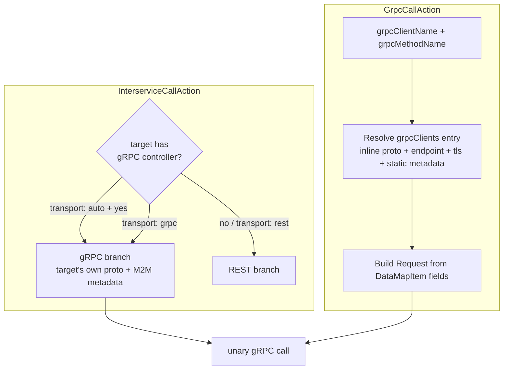

# gRPC — interservice & foreign servers

A BusinessApi with a gRPC controller exposes a gRPC **server** (see
[gRPC controllers](../business-apis/grpc-controllers.md)). This page covers the gRPC
**client** side, which has two entry points:

1. **Interservice calls auto-select gRPC** when the target service of the same
   application exposes a gRPC controller, with zero author configuration.
2. **`GrpcCallAction`** calls a **foreign** (non-OpenAPPL) gRPC server declared once as a
   service-level `grpcClients[]` entry with an inline proto.

The distinction is *who owns the proto*: a target in the same application has a
generated proto and carries machine-to-machine trust, so it is automatic; a foreign
server's proto is unknown, so the author supplies it and calls it explicitly.



## Part A: interservice auto-gRPC

[`InterserviceCallAction`](../../spec/InterserviceCallAction.md) has an optional
**`transport`** field (`auto | rest | grpc`, default `auto`):

| `transport` | Behaviour |
|-------------|-----------|
| `auto` (default) | gRPC **when the target BusinessApi has a gRPC controller** (`grpcSettings.hasGrpcController`), otherwise REST. For a gRPC-only target this is the only path that works. |
| `rest` | force the target's normal REST route (with the forwarded caller bearer). |
| `grpc` | force gRPC (requires the target to expose a gRPC controller). |

**The blueprint is otherwise unchanged**: the same `targetService` / `targetApi` /
`apiParameters` as a REST interservice call. The compiler reads the target's gRPC flag
(the whole project is compiled together, so the caller knows the target's contract),
maps `apiParameters` to the proto request by name, carries the trust in gRPC
**metadata** (a signed machine-to-machine token, `authorization: Bearer` when
`forwardCallerToken`, the request id and the session id: exactly what the server
handler reads), and unwraps the response per the fixed gRPC shape before applying
`responseProperty` / `isArray`. Single-item methods return the resource message
directly; list methods return `<Method>Response { repeated data; Paging paging }`. There
is no configurable response format. A list's `paging` is handed to the workflow in REST's
camelCase form (`{ page, pageSize, totalCount, totalPages }`, or `{ pageSize,
nextCursor }` for a `cursorMode` target), not the wire's snake_case `Paging` message, so
`paging.totalCount` reads the same whichever transport the call took.

On a multi-tenant project the receiving gRPC handler resolves the tenant from the call
metadata the same way the REST face resolves it from the request headers: the tenant
codename entry (or the project's configured tenant header name) is looked up before the
session is read. A named tenant that does not exist answers gRPC `NOT_FOUND`, a tenant
lookup that could not be answered answers `UNAVAILABLE` (retryable), and a session of
another tenant under a named tenant answers `PERMISSION_DENIED`. A call that names no
tenant keeps the root default, as on REST.

The endpoint resolves from `SERVICE_<TARGET>_GRPC_URL`, else the host is derived from
`SERVICE_<TARGET>_URL` plus the gRPC port (default `50051`).

```json
{
  "name": "fetchDepartmentUnit",
  "targetService": "orgGovernance",
  "targetApi": "getDepartmentUnit",
  "transport": "auto",
  "forwardCallerToken": true,
  "isArray": false,
  "apiParameters": [
    { "name": "departmentUnitId", "value": { "js": "this.departmentUnitId" } }
  ]
}
```

With `transport: "auto"` (the default), if `orgGovernance.getDepartmentUnit` exposes a
gRPC controller this call goes over gRPC automatically; if not, it falls back to REST.
Either way the result is identical.

A target create / update on an object with
[`objectModeration`](object-moderation.md) is moderated for an interservice caller like
for any other (only cron and `API.*` internal calls bypass the seam), and the caller's
copy of the target's proto carries the same `moderation` field (tag 1000) as the
target's own. A held write therefore parks a result whose resource fields are empty
(proto defaults) beside `moderation: { id, status, message }` (over REST it is the `202`
`{ moderation }` body), so a workflow that uses the record tests `moderation.status`
first. See
[Object content moderation: what a gRPC caller sees](object-moderation.md#what-a-grpc-caller-sees).

A call to a BusinessApi in the caller's *own* service follows the same rule: with `auto`
or `grpc`, a target with a gRPC controller is called over gRPC (the service's own gRPC
listener must be reachable through `SERVICE_<OWN_SERVICE>_GRPC_URL`); explicit `rest`
keeps the REST route and its path-parameter checks. A gRPC call does not require
bindings for REST URL segments.

### Use case: a gRPC-only target

A high-throughput internal API that exposes *only* a gRPC controller (no REST route) is
unreachable over REST. With `transport: "auto"` an interservice caller reaches it
transparently. For a gRPC-only target, auto-selection is the *correctness* path, not
just an optimisation.

## Part B: `GrpcCallAction` to a foreign gRPC server

### Step 1: declare the client once

Add a [`grpcClients[]`](../../spec/GrpcClientConfig.md) entry to the service's
`serviceSettings`. It carries the **foreign** server's inline proto, endpoint, optional
static metadata (auth headers) and optional TLS:

```json
{
  "serviceSettings": {
    "serviceBasics": { "name": "billing" },
    "grpcClients": [
      {
        "name": "paymentGrpc",
        "endpoint": "$ENV:PAYMENT_GRPC_URL",
        "package": "payment",
        "service": "PaymentService",
        "protoSource": "syntax = \"proto3\";\npackage payment;\nservice PaymentService { rpc CreateCharge (ChargeRequest) returns (ChargeResponse); }\nmessage ChargeRequest { int64 amount = 1; string currency = 2; string customerId = 3; }\nmessage ChargeResponse { Charge charge = 1; }\nmessage Charge { string id = 1; string status = 2; }",
        "metadata": [
          { "name": "authorization", "value": "$ENV:PAYMENT_GRPC_TOKEN" },
          { "name": "x-api-key", "value": "$ENV:PAYMENT_API_KEY" }
        ],
        "tls": { "mode": "insecure" }
      }
    ]
  }
}
```

| Field | Meaning |
|-------|---------|
| `name` | unique codeName; referenced by `GrpcCallAction.grpcClientName`. |
| `endpoint` | `host:port` literal or `$ENV:VAR`. Prefer `$ENV:` so it is not baked in. |
| `protoSource` | the **foreign** server's `.proto`, **inline** as proto text. Must declare the named `package` and `service`. |
| `package` / `service` | must match the proto. `GrpcCallAction.grpcMethodName` must be one of the service's rpc methods. |
| `metadata[]` | static [`GrpcClientMetadataItem`](../../spec/GrpcClientMetadataItem.md) headers (`{ name, value }`, literal or `$ENV:`) sent on every call. There is no application machine-to-machine trust to a foreign server: declare whatever auth it requires here. |
| `tls` | optional [`GrpcClientTls`](../../spec/GrpcClientTls.md): `mode: insecure` (development default) or `ssl` with an optional `caCert` (PEM or `$ENV:`) for a private or self-signed CA. |

### Step 2: call a method from an action

[`GrpcCallAction`](../../spec/GrpcCallAction.md) mirrors `ApiCallAction`, but the
transport is gRPC. The request `fields` are generic
[`DataMapItem`](../../spec/DataMapItem.md) `{ name, value }` entries: **`name` is the
proto Request field**, `value` is an MScript expression evaluated against the API
context:

```json
{
  "name": "chargeCard",
  "grpcClientName": "paymentGrpc",
  "grpcMethodName": "CreateCharge",
  "request": {
    "fields": [
      { "name": "amount", "value": { "js": "this.order.totalCents" } },
      { "name": "currency", "value": { "js": "this.order.currency" } },
      { "name": "customerId", "value": { "js": "this.session.userId" } }
    ]
  },
  "responsePath": "charge.id",
  "isArray": false,
  "streaming": false
}
```

At runtime the action resolves `paymentGrpc` (proto, package, service, endpoint, TLS and
static metadata), builds the `ChargeRequest` from the fields by `name`, resolves any
`$ENV:` endpoint or metadata, calls `CreateCharge`, then extracts `responsePath`
(`charge.id`) from the decoded `ChargeResponse`. Omit `responsePath` to store the whole
decoded message.

> **Field-name note.** Both `GrpcCallAction.request.fields` and the foreign-permission
> check `params` use the generic `DataMapItem` (`{ name, value }`). The key is **`name`**
> (not `protoField` or `key`); do not invent a separate field type.

### Server-streaming

For a foreign method declared `rpc X(Req) returns (stream Resp)`, set
`streaming: true`. The call **collects every streamed message into an array** and returns
it, the simplest result for a BusinessApi value:

```json
{
  "name": "streamPrices",
  "grpcClientName": "paymentGrpc",
  "grpcMethodName": "WatchPrices",
  "request": { "fields": [ { "name": "symbol", "value": { "js": "this.symbol" } } ] },
  "responsePath": "price.amount",
  "isArray": true,
  "streaming": true
}
```

When `streaming: true`, `responsePath` is applied **per streamed message** and the result
is always the collected array (`isArray` is ignored). The stream is drained to
completion before the action resolves. Client-streaming, bidirectional streaming and an
async-iterator stream-to-client consumption mode are not supported yet.

A BusinessApi of the same application can itself be a server-streaming interservice
target when its `grpcSettings.responseType` is `"stream"`; the interservice action
collects its messages in arrival order and applies `responseProperty` to each collected
message. Whether a given compiler can emit a streaming server is stated in
[the compiler specification](../../compiler/index.md).

## TLS

For a foreign server behind TLS:

```json
{
  "tls": {
    "mode": "ssl",
    "caCert": "$ENV:PAYMENT_GRPC_CA"
  }
}
```

`mode: insecure` (or omitting `tls`) uses plaintext credentials: fine for development and
trusted networks, and the default the interservice path uses. `mode: ssl` enables TLS;
`caCert` (literal PEM or `$ENV:`) overrides the system trust roots when the server
presents a private or self-signed certificate.

## See also

- [`GrpcCallAction`](../../spec/GrpcCallAction.md),
  [`GrpcClientConfig`](../../spec/GrpcClientConfig.md),
  [`GrpcClientTls`](../../spec/GrpcClientTls.md),
  [`GrpcClientMetadataItem`](../../spec/GrpcClientMetadataItem.md).
- [`InterserviceCallAction`](../../spec/InterserviceCallAction.md): the `transport` field.
- [gRPC controllers](../business-apis/grpc-controllers.md): the **server** side.
- [M2M communication](../system-services/m2m-communication.md): the metadata trust the
  interservice gRPC path carries.
- [Foreign permission check](foreign-permission-check.md): reuses the same unary call for a
  gRPC policy server.
