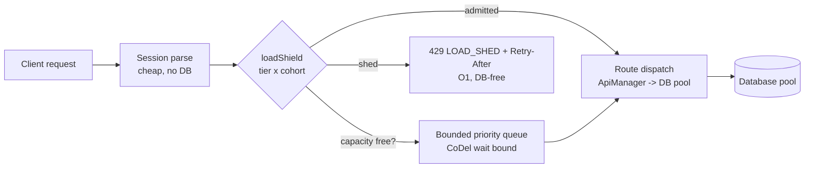

# Load shield — priority load shedding

A `loadShield` is a service's **always-on, in-process overload guard**. Where a
[`waitingRoom`](big-data-and-async-flows.md#waitingroom-a-metered-admission-queue) is an
opt-in turnstile you place in front of ONE known-stampede API for a *planned* spike, the
shield protects **every ordinary route of the whole service** against *unplanned*
overload: a viral moment, a runaway batch client, a misbehaving integration. It is modelled
on Uber's Cinnamon load shedder: a bounded **priority queue in front of route dispatch**, a
CoDel-style latency bound, and (in adaptive mode) a feedback-controlled rejection
threshold, with **zero per-service tuning**.

Declared at most **once per service** as the optional `service.loadShield` chapter (a
singular object, not an array: the shield guards one shared resource, the service's
database pool and event loop). A service that does not declare it behaves as an
unshielded one; declaring an **empty shield is already a correct configuration**, since
every route gets a sensible derived tier.

> **Compiler support.** Which compilation targets implement the load-shield runtime, and
> how, is stated in [the compiler specification](../../compiler/index.md). The behaviour
> described on this page (the tiers, the cohorts, the `429 LOAD_SHED` contract, the
> degraded and adaptive modes) is what a conforming compiler provides.



The shield runs **after** the session parse (the cohort needs the decoded auth context,
never a database or Redis lookup) and **before** everything else: a shed request is
answered before any handler, any database or cache work, and before a waiting-room
`QueToken` gate could consume a one-shot admission token.

---

## Declaring a shield

```json
{
  "loadShield": {
    "shieldBasics": { "name": "mainShield", "enabled": true, "targetQueueLatencyMs": 5 },
    "tiers": {
      "assignments": [
        { "api": "purchaseTicket", "tier": 1 },
        { "api": "order", "action": "listOrders", "tier": 4 },
        { "api": "monthlyRevenueReport", "tier": 5 }
      ]
    },
    "exemptions": { "apis": ["stripeWebhook"] }
  }
}
```

The blueprint surface is deliberately minimal; this is the pattern's load-bearing
property (the reason a shedder can be on everywhere is that nobody has to tune it):

- **`tiers.assignments[]`**: per-API/action shed priority (optional; defaults derived
  below). `api` names a BusinessApi or edge controller in **this** service; `action`
  optionally narrows to one action; a dangling name fails validation. Each assignment also
  carries an asset `name` (derived from `api`/`action` when you omit it) so one assignment
  is addressable at `services/<svc>/loadShield/tiers/assignments/<name>`.
- **`apiOptions.loadShedTier`** (on the BusinessApi itself; edge controllers use
  `edgeControllerOptions.loadShedTier`): the same tier 0-5, declared *where the API is
  authored* instead of centrally. The shield's central assignments always override it (see
  the precedence chain below), and without a declared shield the property is inert; the
  validator warns (`LOADSHIELD_TIER_WITHOUT_SHIELD`) so you notice.
- **`shieldBasics.targetQueueLatencyMs`**: the only latency tunable: how long a request
  *should* wait in the shield queue before the shield considers itself congested (default
  an internal constant of about 5 ms; leave it absent unless you have a measured reason).
- **`shieldBasics.enabled`** (default `true`) and **`exemptions.apis[]`**: on/off and the
  escape hatch.

Everything else (controller gains, cohort count, queue capacity, `Retry-After` clamps,
concurrency bounds) is an internal compiler constant, never blueprint, never per-project
tuning.

## Tiers: who is shed first

Tier is an integer **0-5**: `0` = never shed, `5` = first to shed. Routes without an
explicit assignment get a tier **derived from the action's nature**:

| Route class | Derived tier |
|---|---|
| Health/liveness, platform internals (M2M interservice) | **0**: never shed, bypasses the queue entirely |
| Auth/session routes (login, token refresh, session read) | **1** |
| Core-object writes: create/update/delete CRUD, write-shaped composites | **2** |
| Single reads: get-by-id, single-object composites | **3** |
| Lists / search / reporting: list CRUD, query surfaces, aggregates | **4** |
| *(never auto-assigned, explicit only)* bulk/batch/analytics you mark expendable | **5** |

A route's tier resolves through a fixed **precedence chain**, most specific wins:

1. central **action-narrowed** assignment: `{ api, action, tier }` in
   `loadShield.tiers.assignments[]`
2. central **api-level** assignment: `{ api, tier }`
3. the API's own **`loadShedTier`**: `basics.apiOptions.loadShedTier` on a BusinessApi,
   `edgeControllerOptions.loadShedTier` on an edge controller
4. the **derived default** from the table above

Both declaration surfaces are legitimate: an author states an API's importance where the
API lives (`loadShedTier`, the eventStream `loadSheddingPriority` idiom), while the
shield's central `assignments[]` remain the architect's override view: a central
assignment always beats the per-API property. The derivation encodes an opinion: under
saturation, keep the writes that represent committed user intent, then point reads, and
shed the wide scans first, because list and report queries are exactly the ones that
amplify database load. A failed read retries for free; a shed checkout is lost revenue.
Tier 5 is never auto-assigned so "shed me first" is always an explicit author statement.

`loadShedTier` on a service that declares **no** shield changes nothing, and validation
surfaces a warning rather than an error (the tier becomes meaningful the moment you
declare the shield).

**Never in the shield's path at all:** big-load `/ingest/*` routes (eventStream ingest
keeps its [own declared shedding](big-data-and-async-flows.md#ingest-back-pressure-shedding);
two shedders on one hop would double-reject), non-HTTP controllers (kafka/cron/gRPC:
their back-pressure is the broker or the schedule), and exempted APIs. SSE/WebSocket
routes are admission-checked at **connect time only**: an established stream is never
shed mid-flight.

**Exemptions vs tier 0.** Prefer a tier over an exemption: a tier-0 route still
contributes to the shield's saturation picture, while an exempted route gives the
controller nothing to work with. Reserve `exemptions` for the rare route that must never
even be classified, such as a third-party webhook whose caller retries destructively.

## Cohorts: stable per-caller fairness inside a tier

At runtime every request also gets a **cohort 0-63** within its tier: a stable hash of, in
fallback order, session `userId`, then `tenantId`, then client IP. Effective priority =
`tier x 64 + cohort`, a single ordinal on a **384-point scale**. Operationally this means:

- **Partial tiers shed before whole tiers.** The rejection threshold moves cohort by
  cohort, so the shield can shed 10% of tier 4, not all of it.
- **A given caller is consistently in or out** at a given load level. A user sees either a
  working app or a clear back-off, not a 50%-of-clicks lottery that reads as flaky and
  triggers retry storms.
- **Per-tenant fairness.** One tenant's runaway script hashes into specific cohorts; as the
  threshold moves it sheds that traffic band while other tenants in admitted cohorts keep
  working.

Cohort derivation is database-free and store-free, and the cohort value is an internal
detail: it is never echoed to clients.

**The cohort lottery rotates.** A permanently fixed hash would make the same callers
first-to-shed in every overload event, forever. Instead the cohort salt is derived from a
coarse **time bucket** (default period: one hour), so the mapping is redrawn each period,
giving long-run fairness across load events. Two properties make this operationally safe:

- **Stability within a period.** A caller keeps exactly one cohort for a full rotation
  period, so everything above (consistent in-or-out, coherent client back-off) holds
  throughout any given incident.
- **Staggered, per-caller flips.** Each caller's bucket boundary is phase-shifted by a hash
  of its own identity (a separate hash from the cohort one, so flip moments carry no
  correlation with cohort values). Callers therefore flip cohorts at individual moments
  spread uniformly through the period; there is never a synchronised mass reshuffle at the
  top of the hour that would swap everyone's identity mid-incident.

The period is an internal constant; operators can override it (see
[Operator switches](#operator-switches)), and setting it to `0` pins the pre-rotation
fixed mapping.

## The rejection contract (what clients must handle)

A shed request receives **HTTP 429** with a **`Retry-After`** header (seconds, clamped to
1-30) and the standard error envelope:

```json
{
  "status": "ERROR",
  "statusCode": 429,
  "requestId": "<correlation id>",
  "errorCode": "LOAD_SHED",
  "error": "Service is shedding load; retry after the indicated delay.",
  "details": { "tier": 4, "retryAfterSeconds": 3 }
}
```

- `errorCode: "LOAD_SHED"` is the stable machine-readable signal: the same
  429-and-back-off voice the eventStream ingest limiter uses.
- `details.tier` tells the caller which tier was shed; cohort is not echoed.
- Clients (and generated SDKs) should treat `Retry-After` as the back-off hint and retry
  after that delay: the request did nothing wrong and the service is not down, which is
  why this is 429 and never 503.
- A shed happens **before** the waiting-room `QueToken` gate, so a shed request never burns
  the one-shot admission token the client waited for: retry with the same still-valid
  token.
- Rejection is O(1) and database-free, so shedding excess load is itself cheap enough to
  survive.

**Tier 0 is never shed, structurally.** Tier-0 routes bypass the queue and the rejection
threshold can never reach their band. If tier-0 traffic alone saturates the service, the
service behaves as an unshielded one: the shield never converts a health check into a
429.

## Degraded mode: the static shedder

The baseline mode, and the automatic fallback whenever the adaptive controller has nothing
to work with. No feedback loop:

- a **static concurrency cap** on in-flight shielded requests (an internal constant,
  currently 32);
- a **bounded priority queue** for arrivals while the cap is saturated, ordered by
  effective priority, FIFO within equal priority;
- a **CoDel-style wait bound** derived from `targetQueueLatencyMs`: the setpoint says how
  long a queued request *should* wait; x20 (the classic CoDel target-to-interval ratio) is
  how long it *may* wait before it is shed;
- when the queue is full, the **worst-priority request loses**: the newcomer is rejected
  unless it outranks the worst queued entry, which is then evicted in its favour.

Even without adaptivity this delivers most of the value over nothing: bounded memory,
priority ordering, and early database-free rejection instead of every request silently
hanging on the connection pool.

## Adaptive mode: zero-tuning feedback control

With the adaptive layer active, two coupled loops ride the service's shared
database-saturation signal (an exponentially weighted average over pool-acquire waits,
pool utilisation and query latency: the same signal the adaptive waiting-room promoter
uses, so the two controllers never fight):

1. **A PID controller moves the rejection threshold** along the 384-point tier-by-cohort
   scale. Healthy database: threshold 384 (admit everything, byte for byte the degraded
   behaviour). Sustained saturation: the threshold walks smoothly down, shedding tier-5
   cohorts first, then tier-4, cohort by cohort, and walks back up as saturation clears.
   The floor is 64, the start of the tier-1 band: tiers 1 and above can be squeezed, tier 0
   never.
2. **An AIMD tuner replaces the static concurrency cap**: additive climb while the
   database has headroom and the queue drains inside the setpoint; multiplicative back-off
   on congestion evidence. The cap tracks what *this* database on *this* hardware can
   actually sustain, within fixed bounds (currently 8-128, starting from the static 32).

**You configure nothing for this.** Tiers and the optional setpoint are the whole
surface; gains, cadences and bounds are compiler constants validated by load tests.

**Auto-degrade.** A service with no relational pool to observe (for example a
document-store-only service), or whose signal read fails, drops to degraded mode on its
own (threshold pinned at 384, static cap) and logs the transition. No override needed.

**Observability.** Two structured log events carry the whole story:

- a shed summary (rate-limited to one per second):
  `{ shed, byTier, byReason, inFlight, queued, mode, threshold, maxConcurrent, saturation }`.
  `threshold` is the live controller output (384 = admit all, 64 = floor),
  `maxConcurrent` the live cap, `byReason` distinguishes `adaptiveThreshold` sheds from
  static `queueFull` / `waitBoundExceeded`.
- a mode-change event on every adaptive-to-degraded flip with a reason (`boot`,
  `killSwitch`, `noDbSignal`).

Watching tier-2 writes hold near-100% success while tier-5/4 shed is the headline health
metric under load.

## Coexisting with a waitingRoom

The two compose, and a stampede API can carry both:

- the **waitingRoom** meters the *planned* herd upstream: clients wait minutes, see a
  position, get admitted at a controlled rate;
- the **loadShield** still protects the service if the room's admitted rate *plus* all
  background traffic saturates the database: clients wait milliseconds in the queue or get
  an immediate 429.

Each shedding point owns exactly one hop: planned spikes go to `waitingRoom`; firehose
ingest to `eventStream`'s own knobs; everything else, always, to `loadShield`. See the
[decision guide](big-data-and-async-flows.md#choosing-the-protection-a-decision-guide) for
picking between them.

## Operator switches

The load-management family exposes a small set of **operations** switches. None of them is
part of the blueprint, and the names, defaults and exact semantics are defined by the
compiler ([the compiler specification](../../compiler/index.md)). The behaviours a
conforming service provides are:

| Switch | What it does / when to touch it |
|---|---|
| Shield kill switch | Passes everything through untouched: byte-exact unshielded behaviour, no queue, no 429s, no shield logs. The operational escape hatch if shedding itself is ever suspected. |
| Shield adaptive kill switch | Disables only the adaptive layer; the shield stays on in **degraded** mode (static cap, priority queue, CoDel bound). Use to isolate whether a symptom comes from the controller or the static shedder. |
| Cohort rotation period | The cohort-salt rotation period in seconds (default 3600): each caller keeps one cohort for a full period and flips at a per-caller staggered moment. `0` pins the fixed (non-rotating) mapping, for example while correlating a specific caller's shed behaviour across incidents. Invalid values fall back to the default. |
| Waiting-room adaptive kill switch | Reverts every room to a **static** drain at exactly its `admissionRatePerSecond` ceiling. Use when diagnosing admission-rate behaviour or if the adaptive back-off is suspected of misbehaving. |
| Database statement timeout | Server-side statement timeout on request-path connections (default 30 s): a longer-running statement is cancelled and surfaces as `503 DB_STATEMENT_TIMEOUT`. `0` disables. The document-store twin applies a maximum execution time to every request-path query and surfaces the same `503` / `DB_STATEMENT_TIMEOUT`. |
| Search timeout | Server-side timeout on every DataView list search (default 30 s). A cluster that cuts the search short returns PARTIAL hits with `timed_out: true`, which the service refuses to present as a page: it answers `503` with `errorCode: "SEARCH_TIMEOUT"` instead. |
| Pool acquire timeout | Fast-fail pool acquisition (default 5 s): a saturated pool returns `503 DB_POOL_SATURATED` instead of hanging. |

See [DB layer: connection pool & timeouts](../data-modeling/db-layer.md#deployment-requirements-and-limits)
for the full database table and failure envelopes.

## See also

- [`LoadShield`](../../spec/LoadShield.md),
  [`LoadShieldBasics`](../../spec/LoadShieldBasics.md),
  [`LoadShieldTiers`](../../spec/LoadShieldTiers.md),
  [`LoadShieldTierAssignment`](../../spec/LoadShieldTierAssignment.md),
  [`LoadShieldExemptions`](../../spec/LoadShieldExemptions.md): the field-level contracts.
- [Big-data & async flows](big-data-and-async-flows.md): the `eventStream` / `jobStream` /
  `waitingRoom` family and the protection-pattern decision guide.
- [DB layer: connection pool & timeouts](../data-modeling/db-layer.md#deployment-requirements-and-limits):
  the Postgres hardening the shield sits in front of.
