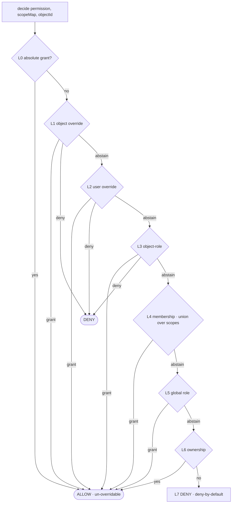

# Native permission system

OpenAPPL ships an **in-house, declarative authorization system** that
resolves "can this subject do this permission?" in **two directions** from
a single model:

- a **check** - gate one request (the row about to be touched), and
- a **list-objects** - compile the same decision into a WHERE filter that
  selects exactly the rows the subject may see, at millions of rows.

It is the **native twin** of the [foreign permission check](foreign-permission-check.md):
native resolves authorization *itself* against the project's own store;
foreign *delegates* the question to an external policy engine. The
`permission*` names below are the native system; the `foreign*` names are
the delegation path. They can coexist on the same project.

> **Where it slots in.** This is the structured layer above the coarse
> [`authOptions`](../system-services/authentication/business-api-auth.md)
> primitives (`checkRoles` / `absoluteRoles` / `ownershipCheck`). Those
> still work and still run first; the native `permissionCheck` gate adds
> the fine-grained, per-permission, instance-aware resolution. See the
> [permissions strategy](../best-practices/permissions-strategy.md) for
> how all the primitives compose.

## Gate an API - `permissionCheck`

Opt a BusinessApi into native resolution with
[`authOptions.permissionCheck`](../../spec/ApiPermissionCheck.md):

```json
{
  "authOptions": {
    "loginRequired": true,
    "permissionCheck": {
      "permission": "canEditDocument",
      "scopeFields": ["orgId", "projectId"]
    }
  }
}
```

| Field | Meaning |
|-------|---------|
| `permission` | the permission name to resolve. Must be a declared permission. |
| `scopeFields` | optional - the target object's own scope-FK fields whose ids feed multi-scope membership / object-role resolution (e.g. a `doc` carries `orgId` + `projectId`). The default scope name is the FK minus its `Id` suffix. |

The gate runs at **two timings**, automatically:

- **type-level**, right after the basic auth check - "may the subject do this
  permission *at all*?"
- **object-level**, after the instance is fetched (update/delete/get) -
  "may the subject do it *on this row*?", with per-row overrides and scope
  membership resolved against the loaded instance.

A type-level deny **defers** to the object-level pass, so a positive
per-object grant can still allow an action the subject's role denies in
general (most-specific-wins, below). When `permissionCheck` is absent the
legacy auth path is unchanged - this is purely opt-in.

### Doors with no caller session

The gate is decided by the caller's **session manager** - the permission
resolver the REST session middleware attaches to every request. Four
generated doors build their own request instead, and on those a
`permissionCheck` api is **refused with 403** when there is no session manager
to ask, never passed:

| door | identity it carries | a `permissionCheck` api answers |
|------|---------------------|---------------------------------|
| an api-backed AI agent tool of a run with no live HTTP caller | the run's session, if any | 403 |
| a **Kafka controller** (`controllers.kafkaSettings.hasKafkaController`) | the event envelope's `actor` | 403 |
| the **JobStream worker** of a JobStream's `targetApi` | the session the enqueue gate forwarded | 403 (the job is marked `failed`) |
| a **gRPC controller** (`controllers.grpcSettings.hasGrpcController`) call whose credential resolved no session | none; a call whose credential resolved a session carries its session manager and is decided exactly as over REST | 403 (`PERMISSION_DENIED`) |

The refusal comes after the arms that decide without a resolver, which keep
their answers: a trusted system trigger (`cron`, an `internal` call) bypasses
the gate as before, a verified machine caller the api admits (`M2MAllowed`)
keeps its bypass, and a caller holding one of the api's `absoluteRoles` passes.
Every other caller of such a door is refused, because there is nobody to decide
the permission for.

So gate an event-driven api with the checks that read the forwarded identity
directly - `checkRoles` / `absoluteRoles`, or `ownershipCheck` where it applies
(a JobStream target; on a Kafka consumer see `KAFKA_API_OWNERSHIP_UNRESOLVABLE`)
- and keep `permissionCheck` for apis a caller with a session reaches (REST,
gRPC, SSE). Validation reports a `permissionCheck` api behind a Kafka controller
or a JobStream as a WARNING, `PERMISSION_CHECK_ON_CALLERLESS_DOOR`.

On the gRPC door the refusal only concerns a call without a session, which
reaches the permission gate only on an api that admits anonymous callers
(`loginRequired: false`; with the default `loginRequired: true` it is refused at
the login gate first). Validation reports that combination - a
`permissionCheck` api with a gRPC controller and `loginRequired: false` - with
the same WARNING code (`details.door: "grpc"`), beside the
`PUBLIC_API_WITH_ROLE_GATE` ERROR about the `loginRequired: false` contradiction
itself. Set `loginRequired: true` to have the permission decided for every gRPC
caller.

### `this.session` is always the caller - no parameter may be named `session`

The generated gates - this permission gate, the role and ownership
gates, session-bound columns, event actors - read the caller's session and
session manager from private slots captured when the api manager is built, so
no request value can stand in for them. Author MScript reads the public
`this.session` (a where clause scoped to `this.session.userId`, a condition, a
default), and every parameter binds as `this.<name>`. So a Business API
parameter named `session`, or a data column an api binds as a parameter (a
create / update api binds every column it writes, an authored route binds its
`:segments`), is a design-time **ERROR**, `PARAM_NAMED_SESSION`, in every
language: rename it (e.g. `sessionValue`; for a column, rename the data
property). The ERROR refuses saving the slice and building the service; it is
not in the non-bypassable security list, since no generated gate reads the
bound value.

## The resolver - `decide`, layered most-specific to least-specific

`decide(permission, scopeMap, objectId?)` walks a fixed precedence and
returns `{ effect, reason }` (the `reason` is the deciding layer, for
explainability). The **caller** builds `scopeMap` from the object's own
scope-FK fields - there is **no parent-tree walk** inside the resolver.

| # | Layer | Source | Emits |
|---|-------|--------|-------|
| **L0** | Absolute grant | session role in `absoluteRoles` | **ALLOW, un-overridable** (short-circuit). There is **no absolute deny.** |
| **L1** | Object override | a `givenPermission` row on this exact `objectId` | ALLOW / **DENY** (most specific). |
| **L2** | User override | a `givenPermission` row for `(user, permission)` across the type | ALLOW / **DENY**. |
| **L3** | Object-role | a `givenPermission` row `{subjectUserId, objectId, roleId}` (role on a scope/object), expanded via the global role->permission map | ALLOW / DENY. |
| **L4** | Membership | per scope in `scopeMap`, the membership role's `rolePermissions` map - **unioned across scopes** | ALLOW. |
| **L5** | Global role | the session role's role->permission grant (today's `checkRoles`) | ALLOW. |
| **L6** | Ownership | `object.owner == subject` (today's `ownershipCheck`) | ALLOW. |
| **L7** | Default | - | **DENY** (deny-by-default). |

**Precedence rule:** an absolute grant short-circuits to ALLOW and can
**never** be revoked (no deny at any layer beats it). Otherwise the first
non-abstaining layer decides, and within a layer an explicit **DENY beats
an ALLOW**. The net is **most-specific-wins both ways** - a more-specific
grant overrides a less-specific deny *and* a more-specific deny overrides
a less-specific allow. This is exactly what "override a role's permission
for a specific user, positive or negative" requires.



## Where the data lives - store vs roster

The model keeps storage partitioned by purpose:

- **Decision data** - the global role->permission map, user/object
  overrides, and object-roles - lives in the **`givenPermission`** store,
  owned by the auth service (host a `permissionCheck`-guarded object there
  via [`ProjectAuthentication.dataObjects`](../../spec/ProjectAuthentication.md)).
  Object-roles are managed with the generated `createObjectRole` /
  `deleteObjectRole` / `listObjectRoles` APIs.
- **The membership roster** - "these people are on this project with these
  roles" - lives in its own membership objects (see
  [Membership](../composition/membership.md)). Its `rolePermissions`
  map is **config-only**: read from the blueprint at request time, never
  copied into `givenPermission`.

### Seeding role permissions

Role->permission defaults are seeded from the blueprint:
[`RBACSettingsConfig.rolePermissions`](../../spec/RBACSettingsConfig.md)
(a list of [`RolePermission`](../../spec/RolePermission.md) entries)
emits the global-role `givenPermission` rows at deploy. The seed `roleId`
is byte-exact the session `roleId` (the `RoleItem` value), so the
global-role layer (L5) grants correctly. In a multi-tenant project the
rows belong to the root tenant, which every tenant's permission read
admits, so one seeded grant applies to the role in every tenant. The
seed only rewrites those root rows on later boots; a tenant's own
binding for the same role and permission is left alone.

At runtime, every auth permission door that takes a `roleId`
(`createGivenPermission`, `createRolePermission`,
`createPermissionForRoleAndGroup`, `createObjectPermissionForRole`,
`createObjectPermissionForRoleAndGroup`, `updateGivenPermission`,
`createObjectRole`) accepts only a declared role - a system role of the
project's tenancy or, with RBAC active, a `RoleItem` value - compared
case-insensitively and stored in its declared spelling. Anything else is
refused with `400 ROLE_NOT_DEFINED`: no user can hold an undeclared role, so
a grant for one could never apply. In a multi-tenant project `admin` and
`user` are not declared roles (the end users there are
`tenantUser` / `saasUser`), so a grant or a seed `rolePermissions` entry for
either is refused (`ROLE_NOT_DEFINED` at runtime, `ROLE_NOT_FOUND` at design
time).

Grant permissions to roles, not roles to people as rewards: **roles are not
badges**. A label a user earns (premium, gold, verified seller) is a
badge - an ordinary data object with its own apis that a `permissionCheck` /
ABAC rule or a data-clause reads - not a
role change. The rare real role change after an operation goes through a
machine-to-machine-only auth api (see [Users](../system-services/authentication/users.md#roleid)),
which the service lets store only a declared role that is neither an
administrator nor a SaaS-level (`saasAdmin`, `saasUser`) role.

```json
"rolePermissions": [
  { "role": "admin",  "permissions": ["canEditDocument"] },
  { "role": "editor", "permissions": ["canEditDocument"] }
]
```

(Each entry binds a declared role - the `RoleItem` name or a built-in system role - to permission names declared in a `PermissionGroup`; the seed resolves the role to its session `roleId` value. Entries must have distinct roles, compared case-insensitively; an unknown role is `ROLE_NOT_FOUND`, an unknown permission `PERMISSION_NOT_FOUND`.)

## Multi-scope membership (roles on objects)

A membership carries a **role on a scope object** ("admin member of org
X"), and that membership's role grants permissions to every object under
that scope. Declare the role + its permissions on
[`MembershipSettingsConfig`](../../spec/MembershipSettingsConfig.md):

```json
"membershipSettings": {
  "hasMembership": true,
  "configuration": {
    "membershipObjectName":     "orgMember",
    "membershipObjectIdProperty": "orgId",
    "membershipUserIdProperty": "userId",
    "roleField": "role",
    "rolePermissions": [
      { "role": "admin", "permissions": ["canEditDocument", "canDeleteDocument"] },
      { "role": "viewer", "permissions": ["canViewDocument"] }
    ]
  }
}
```

Because the gate passes `scopeMap` (e.g. `{ org: doc.orgId, project:
doc.projectId }`) and L4 reads **each** scope's `rolePermissions` and
**unions** them, the classic case falls out for free:
`canEditDocument = (org-role grants it) ∪ (project-role grants it)`. No
parent-tree walk, no per-level configuration - just the object's own
scope ids plus per-scope role maps. A membership row with no role resolves
to the built-in **`member`** role, so roleless membership still
contributes.

> Genuinely **unbounded recursion** (folder-in-folder with no fixed scope
> count) and **policy-scripted** access (Zanzibar tuplesets, Rego/Cedar)
> are deliberately *out of native scope* - delegate those to an external
> engine via the [foreign permission check](foreign-permission-check.md).

## The list direction - `compileListFilter`

The same model compiles into a bounded **id-list filter** for listing.
`compileListFilter(permission, ...)` returns a decision **side**, which the
list path injects into the existing WHERE builder (so it works
**identically on SQL and on Elasticsearch / DataView**):

| Side | Meaning | Filter injected |
|------|---------|-----------------|
| **ALL** | the subject may see every row | *(no filter)* |
| **NONE** | the subject may see nothing | `{ id: { $in: [] } }` -> **zero rows** |
| **INCLUDE** | only a bounded allow-set | `{ id: { $in: allowIds } }` |
| **EXCLUDE** | everything except a bounded deny-set | `{ id: { $nin: denyIds } }` |

The resolver picks **whichever side is bounded** - a user is a member of a
handful of orgs even when there are millions of documents, so the
allow-set (their scope ids) is the small side. Multi-scope memberships and
object-roles fold into scope-keyed `{ <scopeFK>: { $in } }` clauses.

> **The NONE leak guard.** NONE compiles to `{ id: { $in: [] } }`, which
> lowers to *matches-nothing* on SQL, Mongo, and Elasticsearch
> (`terms: []`) - never to "no filter / all rows." A `null`/empty result
> is always zero rows, never an open door.

## ABAC conditions

Attach an MScript ([overview](../mscript/overview.md)) **condition** to a permission rule (an
[`ABACDefinition`](../../spec/ABACDefinititon.md)); the rule contributes
its verdict only when the condition is true for `{ subject, object, env }`.

- **Check** runs the condition inline through the `runMScript` envelope,
  **fail-closed** (a non-4xx throw -> false; no condition -> true). The
  condition is evaluated *before* the grant/deny check, so a deny row with
  a false condition simply abstains (it never flips to allow).
- **List** translates a bounded condition (`object.<col> OP literal`, with
  `subject.*` filled from the session) into an **MQuery filter** ANDed
  into the WHERE - so `object.amount > 1000` becomes `{ amount: { $gt:
  1000 } }` on SQL *and* ES. A condition that can't be translated to a
  column predicate is marked **check-only** (a build warning) and enforced
  by re-checking each returned row (`filterListRows`, fetch-then-filter) -
  a `null` filter is **never** "allow all."

## Native vs foreign - which to use

| | **Native** (this page) | **[Foreign](foreign-permission-check.md)** |
|---|---|---|
| Decides where | in-house, against the project's `givenPermission` store + membership roster | delegated to an external policy engine over gRPC/REST |
| Model | declarative RBAC + multi-scope membership + object-roles + overrides + ABAC | whatever the foreign engine implements (Zanzibar tuplesets, Rego, Cedar, ...) |
| List filtering | compiles to a bounded `$in`/`$nin` WHERE filter (SQL + ES) | n/a - the foreign engine answers per request |
| Field prefix | `permission*` | `foreign*` |

Reach for **native** for the common declarative cases (it's faster, has no
extra infrastructure, and uniquely fuses ABAC into the list filter).
Reach for **foreign** for arbitrary-depth recursion or policy-scripted
access - and feed that external engine from your data with
[external feeds](external-feeds.md).

For how the generated service implements the resolver and the list compiler, see [the compiler specification](../../compiler/index.md).

## See also

- [Foreign permission check](foreign-permission-check.md) - the
  delegate-to-an-external-engine twin.
- [Permissions strategy](../best-practices/permissions-strategy.md) - the
  full set of enforcement primitives and how they compose.
- [Permission & membership filters](../composition/permission-and-membership-filters.md)
  - the list-filter families the native gate compiles into.
- [`PermissionCheckAction`](../../spec/PermissionCheckAction.md) /
  [`ObjectPermissionCheckAction`](../../spec/ObjectPermissionCheckAction.md)
  - the in-workflow check actions (for decisions that depend on data
  fetched mid-flow).
- Specification: [`ApiPermissionCheck`](../../spec/ApiPermissionCheck.md),
  [`RolePermission`](../../spec/RolePermission.md),
  [`RBACSettingsConfig`](../../spec/RBACSettingsConfig.md),
  [`MembershipSettingsConfig`](../../spec/MembershipSettingsConfig.md),
  [`MembershipRolePermission`](../../spec/MembershipRolePermission.md),
  [`ProjectAuthentication`](../../spec/ProjectAuthentication.md).
