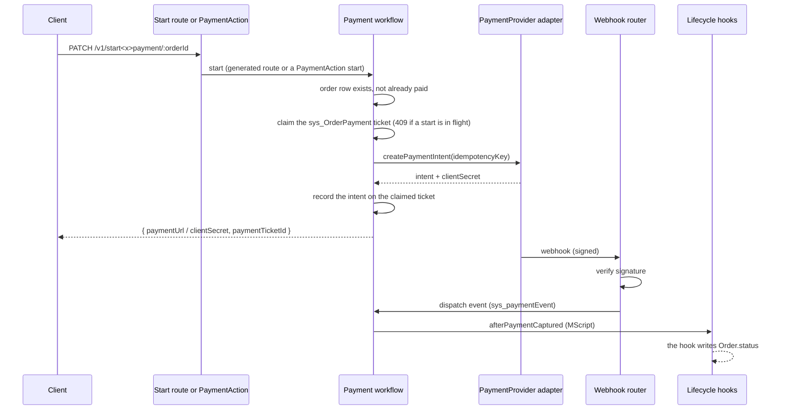

# Payment workflow

OpenAPPL's payment model is **declarative and provider-neutral**:

1. Configure one or more named **payment providers** at the project level.
2. Annotate the relevant `DataObject` with a **CheckoutConfig**, a
   **SubscriptionConfig** or a **MarketplaceConfig**, binding its properties
   (amount, currency, status, owner) to payment fields.
3. Let the **generated routes** run the lifecycle. The checkout opt-in mounts
   `PATCH /v1/start<x>payment/:orderId`, the refresh route, the provider
   browser-return routes and the webhook route
   `POST /v1/payments/webhook/<providerName>`; the frontend calls them and the
   provider posts to them. A Business API adds a `PaymentAction` only when the
   start must sit inside the author's own workflow (or to save the card while
   paying on Stripe and Adyen); `RefundAction`, `SubscriptionAction` and
   `PayoutAction` cover refunds, subscriptions and payouts the same way.

An author does not write provider-specific method names; the blueprint says
*which provider*, *which DataObject's properties hold the payment state*, and
*which lifecycle stage is being advanced*.

How a payment that needs the buyer (3-D Secure, a hosted page) completes on each
provider, and what the frontend renders for it, is on one page:
[3-D Secure and buyer redirects](payment-3ds-and-redirects.md). A blueprint never
authors a `complete`, `callback` or webhook Business API for Stripe, iyzico or
Adyen.

Throughout, `<x>` is the lowercase model name of the order object (`Order` ->
`/v1/startorderpayment/:orderId`) and `<providerName>` is the provider entry's
`name`. The route paths on this page are the contract of the generated service;
how a compiler emits them is described in
[the compiler specification](../../compiler/index.md).



The in-workflow `PaymentAction` (`stage: start` or `simple`) and the generated
start-payment route write the same `sys_<X>Payment` ticket through the same
per-object payment manager. When the provider settles the intent synchronously
(a saved card confirmed at create), the `payment.captured` event is recorded and
dispatched before the API answers, so the lifecycle hooks do not wait for a
webhook. See [`PaymentAction`](../../spec/PaymentAction.md).

## One start per order at a time

Both entry points CLAIM the order's ticket before the provider is charged, so two
starts of one order that overlap (a double click, a retried request, the route
and a workflow at once) charge once: the second answers
`409 PAYMENT_START_IN_FLIGHT` without a provider call. Every charge carries the
attempt's provider idempotency key. A capture webhook that arrives before the
start recorded its ticket waits for the service's replay worker instead of being
dropped.

- Only a definite refusal of the charge (a decline) releases the claim. A charge
  whose answer was lost (a timeout, a lost connection, a provider 5xx) KEEPS the
  claim and its key, so a retry inside the claim's time-to-live answers 409 and
  the first start after it charges under the same key, which the provider
  dedupes. Accepted edge: Stripe stores the answer of a keyed request that
  reached it, a 500 included, so after a genuine provider 500 the order keeps
  failing until the key expires (up to 24 hours).
- A start whose charge LANDED while its answer was lost never records the
  payment. Once the claim is older than the claim's time-to-live, a replay of the
  provider's capture webhook binds the payment to the claim and settles it
  through the normal path (the capture-amount gate, the capture claim,
  `afterPaymentCaptured`, the invoice bridge and the settlement accrual, once).
  It binds only when the report carries the attempt key the start sent (Stripe:
  the PaymentIntent's `metadata.mbStartKey`; iyzico: the payment's
  `conversationId`) and that key is exactly the claim's. While the claim is still
  fresh such a report is deferred and retried with a backoff; a report without
  the key keeps waiting on the ordinary replay backoff. A refresh of a claim
  answers `409` and records nothing.
- A start that took over a STALE claim (its start crashed before recording) and
  is then definitely refused does not delete a row that carries the ticket's
  history (for example `metadata.retiredAttempts`, through which the return
  routes find a late capture of a payment a start left behind): the row becomes a
  `canceled` tombstone (`paymentId` `start-released:<ms>:<attempt>`,
  `paymentStatus` `start_released`, no idempotency key) that keeps that metadata
  and the last `returnUrl`. It names no provider payment: a refresh or a complete
  answers `400` as for an order with no payment, the next start opens a new
  attempt over it, and a capture that still lands on a retired payment is
  recorded in the `captured_after_cancel` review. A claim with nothing but
  start-owned metadata (a first start's inserted claim) is deleted.

## Resuming an open intent

A start on an order whose ticket still holds an OPEN intent (a 3-D Secure
challenge the buyer closed) never opens a second one: the start reads the intent
from the provider and, when the order, the amount and the payment method are
unchanged, answers THAT intent (`pendingIntentReused: true`, with its buyer step)
so the buyer resumes it. A changed amount, currency, order or payment method
(another saved method, or a switch between none and one; the ticket records
`metadata.startMethodRef`) answers `409 PAYMENT_START_INTENT_PENDING` until the
first intent is completed, failed or canceled at the provider; so does a provider
that cannot be read (except the same iyzico start, which resumes the step kept on
the ticket while it has not expired).

Stripe's resumed step is read live (`client_secret`, `next_action`). iyzico's
reads return no step, so an iyzico ticket keeps it in `metadata.resumeAction`: the
hosted page's `paymentPageUrl` until its token expires, or the 3-D Secure
`threeDSHtmlContent` until the step's time-to-live (default 10 minutes; a form
over 32768 characters is not kept). The resume answers it with
`next_action.actionExpiresAt`. An iyzico intent that provably cannot capture any
more is left behind for a NEW attempt when the method or amount changed or the
recorded step expired:

- a hosted page whose token expired (plus 60 seconds) with no payment under way
  on it (its detail still reads `INIT_CHECKOUT_FORM`; a form reading
  `INIT_THREEDS` / `CALLBACK_THREEDS` is in flight and is never left behind);
- a 3-D Secure payment still at `INIT_THREEDS`, which the service never
  authorises once the ticket names another attempt.

Otherwise the 409 names why. The claim of that new attempt compares the ticket's
status with the one the decision read, so a capture recorded on the same payment
in between makes the start answer the 409 instead of overwriting it. A restart
keeps the ticket metadata it does not own (`amountMismatch`, refund records);
`returnUrl`, `startMethodRef` and `resumeAction` are each attempt's own.

## Adyen: a first card and the 3-D Secure round trip

On an object whose checkout provider is Adyen, the start route also takes a
**first card** - the `state.data.paymentMethod` that Adyen Drop-in / Components
hands the frontend - as `paymentUserParams.paymentMethodData`:

```http
PATCH /v1/start<x>payment/:orderId
{ "paymentUserParams": {
    "paymentMethodData": { "type": "scheme",
      "encryptedCardNumber": "adyenjs_...", "encryptedExpiryMonth": "adyenjs_...",
      "encryptedExpiryYear": "adyenjs_...", "encryptedSecurityCode": "adyenjs_...",
      "holderName": "J Doe", "brand": "visa" },
    "return_url": "https://shop.example/checkout/return" } }
```

- It is its own field, not a provider option: `providerOptions.paymentMethod` is
  still refused. Only the keys above plus `checkoutAttemptId` are accepted,
  `type` must be `scheme`, the card number and both expiry fields are required,
  and every value is a string of at most 4096 characters. A raw card value (an
  `encrypted*` field made only of digits, spaces and dashes) is refused, and an
  unencrypted `test_` value is accepted only while the provider runs in Adyen's
  test environment. Any other key (a raw `number` / `cvc`, a
  `storedPaymentMethodId`, a network token ...) is a
  `400 PAYMENT_METHOD_DATA_INVALID` that names the key and never the value;
  nothing is sent to Adyen.
- Also `400 PAYMENT_METHOD_DATA_INVALID`: `paymentMethodData` together with a
  `paymentMethodId`, and a start without `return_url` (Adyen requires it; the
  3-D Secure redirect returns the buyer there).
- Saving the first card for later charges follows the stored-method opt-in (the
  checkout or subscription configuration's `storePaymentMethod: true`): the start
  sends `storePaymentMethod: true`, a `recurringProcessingModel` and the buyer's
  `shopperReference` (refused `400` without a provider customer), and once the
  payment is paid (at once, or through the complete route) the reference Adyen
  answers is filed as `<shopperReference>:<recurringDetailReference>` in the
  wallet of the payment ticket's owner (the identity owner's machine-only write;
  needs an identity owner and a ticket owner column). It then appears in the
  buyer's stored methods. Without the opt-in nothing is stored. A payment the
  buyer never returns from is filed only by the `RECURRING_CONTRACT`
  notification.
- The start route of an Adyen-bound object reads the field, and so does the
  in-workflow PaymentAction start / simple on a checkout order object (its
  declared `paymentMethodData` or `paymentUserParams` parameter); an action with
  no checkout object behind it refuses a first card `400` (no ticket for its
  3-D Secure step). Every other provider's adapter refuses a `paymentMethodData`
  handed to it with `400 PAYMENT_METHOD_DATA_NOT_SUPPORTED`, but the start route
  of a non-Adyen object never hands it over: there it is not a payment source,
  and like any other request key it rides along in the order hints (the answer's
  echo and the provider's metadata), so never send it to such an object.
- The card is sent to Adyen as `paymentMethod` and nowhere else: the start answer
  echoes `paymentMethodData` as `{ type, brand }` only (in `paymentUserParams`
  and in `metadata`), and it never reaches the ticket, a log line or the request
  metadata.

When Adyen asks the buyer for a redirect or a 3-D Secure challenge, its answer can
carry no `pspReference` yet. The ticket then records the payment under a
placeholder id `adyen-action:<idempotency key>` and stays `started`. The frontend
runs the action with Drop-in and sends what it returns to the **complete route**,
which exists only on Adyen-bound objects:

```http
PATCH /v1/complete<x>payment/:orderId
{ "paymentUserParams": { "details": { "redirectResult": "..." }, "paymentData": "..." } }
```

- Guards as refresh: a session, the checkout role gate, and the order's
  ownership. The body is closed: `details` (only `redirectResult`,
  `threeDSResult`, `threeds2.fingerprint`, `threeds2.challengeResult`, `MD`,
  `PaRes`, each a string of at most 16384 characters) and an optional
  `paymentData`; anything else is `400 PAYMENT_DETAILS_INVALID`. The route's body
  limit is 128 kb.
- The ticket must be `started` and hold the placeholder or a real `pspReference`
  (else `409 PAYMENT_NOT_AWAITING_DETAILS`). A paid answer must name this order
  (Adyen's `merchantReference`); an answer for another order - or for another
  ATTEMPT of this order (below) - is refused with
  `409 PAYMENT_DETAILS_ORDER_MISMATCH`. The ticket is written only if it still
  holds the id it held before the call, is still `started` and still names the
  same provider (`409 PAYMENT_DETAILS_CONFLICT` otherwise; it is never
  re-pointed). An answer without a `pspReference` keeps the placeholder.
- The capture-amount check runs as on every capture path (`amount_mismatch` for a
  wrong amount), and the lifecycle hooks run once.

**One merchant reference per attempt.** Every start attempt is sent to Adyen as
`reference: "<orderId>:<attempt>"` (the attempt id of the start claim, the last
segment of its `Idempotency-Key`), so a retry of the same attempt keeps its
reference and a new attempt gets a new one. The ticket records its ACTIVE attempt
(`metadata.adyenAttempt` / `adyenReference`) and keeps the earlier ones in
`metadata.adyenPriorAttempts`; the capture-amount check still compares the base
order id.

A notification from Adyen for a payment no ticket holds yet is bound to the
order's placeholder ticket only when its HMAC-verified `merchantReference` names
the ticket's ACTIVE attempt. Success notifications (AUTHORISATION with
`success: true`, CAPTURE) and the attempt's confirmed END (AUTHORISATION
`success: false`, CANCELLATION, EXPIRE) bind; a notification of an EARLIER attempt
never touches the newer ticket - a late success of one is refused (no hook, no
invoice, no settlement) and logged at ERROR for reconciliation - and a legacy
order-only reference never binds a placeholder. An AUTHORISATION keeps the ticket
`started`; only a CAPTURE or the complete route marks it paid. Adyen documents the
CAPTURE notification for its `/captures` call; the generated service captures
automatically, so whether an order can be marked paid by a notification alone
depends on the merchant account's notification settings.

**An abandoned challenge.** Adyen offers no read of an unfinished payment. When an
action is recorded the ticket gets the absolute local expiry
`metadata.adyenActionExpiresAt` = now + the action's time-to-live (default
30 minutes), once per attempt. Before it, a start of the same order with the same
amount and currency RESUMES that attempt from the ticket (`pendingIntentReused:
true`: the same `paymentId`, redirect and action, no charge); a changed amount or
payment method answers `409 PAYMENT_START_INTENT_PENDING`. After it the start
still answers `409 PAYMENT_START_INTENT_PENDING`: the expiry is local, not a
cancellation at Adyen, so it never opens a new attempt by itself. The order is
freed when Adyen confirms the end of that attempt (a failure / cancel / expire
notification of it moves the ticket to `failed` / `canceled`) or by an operator's
reconciliation (`POST
/v1/payments/admin/adyen-attempts/:objectName/:orderId/release`; it moves the
expired attempt to `canceled` with an audit record and sends nothing to Adyen). An
order whose challenge Adyen never ends is not unlocked automatically. This applies
to a stored card that Adyen challenges too. A refresh of an Adyen payment answers
the ticket as recorded (`refreshedFrom: "ticket"`, no provider call). The
mock-only `POST /v1/<x>mockauthenticate/:orderId` route (see
[Testing with mock mode](#testing-with-mock-mode)) has no session guard; on Adyen,
a body without `paymentUserParams.providerOptions.details` confirms with the
payment's own id, and a body with them is held to the same closed `details` set.

Adyen's request `metadata` does not mirror the order row (merchant-initiated
recharges included). It is the caller's `providerOptions.metadata`, then
`orderId`, `description` (cut to 80 characters) and, on the mock transport only,
`mockScenario` when the request carries one - string values only, at most 20
pairs, keys up to 20 and values up to 80 characters. A caller metadata that
breaks those limits is refused with `400 PAYMENT_METADATA_INVALID` before Adyen is
called.

## Stripe: no server complete, saving the card, subscription 3-D Secure

- **No complete call.** A Stripe intent that needs 3-D Secure is finished by
  Stripe after the browser's `stripe.handleNextAction` /
  `stripe.confirmPayment`; the webhook route records the capture and runs
  `afterPaymentCaptured`, and the refresh route is the backstop. A
  `PaymentAction` with stage `complete` is not part of a Stripe flow.
- **Save the card while paying.** Under the opt-in
  `objectSettings.checkout.configuration.storePaymentMethod: true` (the switch of
  a checkout-only order) or
  `objectSettings.subscription.configuration.storePaymentMethod: true` (either
  switch enrols), a `PaymentAction` start / simple stage sends Stripe
  `setup_future_usage: "off_session"`. Stripe attaches the card to the buyer's
  customer when the payment succeeds, and the `payment_method.attached` webhook
  stores it in `sys_paymentMethod` (same opt-in). A caller cannot ask for it
  (`providerOptions.setup_future_usage` is refused), and the generated start route
  does not store cards.
- **Subscription first payment.** `subscriptions.create` runs with
  `payment_behavior: "allow_incomplete"` and the first invoice expanded. A first
  payment that needs 3-D Secure (or is declined) answers
  `statusLiteral: "past_due"` with `nextAction` (`clientSecret`, `paymentStatus`,
  `hostedInvoiceUrl`) for `stripe.confirmCardPayment`; `invoice.paid` makes the
  row `active`, and Stripe expires an unfinished one after 23 hours. Stripe
  `incomplete` is stored `past_due`, never `trialing`.
- **Renewals needing the buyer.** `invoice.payment_action_required` reaches
  `afterInvoicePaymentFailed` (`invoice.payment_failed`) with
  `resource.requiresAction: true` and `resource.hostedInvoiceUrl`.
- **Off-session charging is opt-in** on Stripe (`savedCardOffSession: "verified"`
  beside `savedCardThreeDSMode: "verifyOnce"`): only a `PaymentAction` start or
  simple declared `buyerAbsent: true`, on a stored card already 3-D Secure
  verified, is charged `off_session`, a merchant-initiated charge with no
  liability shift, for buyer-absent charges only. Off by default; a request can
  never ask for it.

## iyzico: both card shapes completed by the service

- **Hosted Checkout Form** (a start without `paymentMethodId`): the frontend
  navigates to `redirectToUrl`; iyzico POSTs the form token to
  `POST /v1/payments/checkout-return/<providerName>`, which reads the form
  detail, settles the ticket, runs the hooks and `303`s to the start's
  `return_url`.
- **Saved card, 3-D Secure** (a start with `paymentMethodId`
  `<cardUserKey>:<cardToken>`): the frontend renders the decoded
  `next_action.threeDSHtmlContent`; iyzico POSTs the bank's outcome to
  `POST /v1/payments/threeds-return/<providerName>`, which calls `3dsecure/auth`
  itself, settles the ticket, runs the hooks and `303`s to `return_url` plus
  `orderId` and `status`.
- **Buyer who never returns** from the hosted form: iyzico's
  `CHECKOUT_FORM_AUTH` webhook settles the payment through the same logic, once.
  The provider must be configured to deliver its notifications to
  `POST /v1/payments/webhook/<providerName>`.
- **One `cardUserKey` per buyer**, minted by iyzico on the buyer's first save and
  stored by the service on the buyer's payment-customer mapping
  (`sys_paymentCustomer.cardStorageKey`); never a request field.
- **Save the card while paying** on the hosted form under either
  `storePaymentMethod` switch: the form opens with the buyer's key and the card is
  filed in the ticket owner's wallet when the payment settles.
- **A card entered on the author's own frontend** (`directCardEntry: true`): the
  start carries `paymentUserParams.cardInfo` (and `paymentUserParams.saveCard`)
  and ends on the same 3-D Secure return, or settles at once below
  `newCardThreeDSThreshold`. It widens the PCI scope. A `PaymentAction` start (a
  `payOrder`-style API) must DECLARE `cardInfo` (Object) and `saveCard` (Boolean)
  as request parameters: an undeclared card is silently dropped and the hosted
  form opens.
- **Subscriptions**, hosted mode (the default): they start on iyzico's hosted
  subscription Checkout Form; the subscribe answers `pending_provider` plus
  `checkoutForm`, and
  `POST /v1/payments/subscription-checkout-return/<providerName>` confirms the
  row. Tokenized mode (`subscriptionMode: tokenized`, required on a
  marketplace-activated account): the opening payment saves the card, the buyer
  subscribes after it settled through its 3-D Secure return, and the recharge
  scheduler charges the card every period without 3-D Secure.
- **Marketplace accounts** (`marketplaceActive: true`): a sale whose order names a
  seller is split to it; a sale with none is the platform's own sale
  (`paymentGroup: LISTING` by default).
- **The service's public URL is required**: every callback URL is derived from it,
  and a start without it is refused `400` before iyzico is called.

The cross-provider matrix is in
[3-D Secure and buyer redirects](payment-3ds-and-redirects.md).

## Project-level providers

```json
"projectSettings": {
  "paymentProvidersSettings": {
    "paymentProviders": [
      {
        "name":     "defaultStripe",
        "provider": "stripe",
        "configuration": [
          { "name": "secretKey",      "value": "..." },
          { "name": "publishableKey", "value": "..." },
          { "name": "webhookSecret",  "value": "..." }
        ]
      }
    ]
  }
}
```

Sensitive `configuration` values are masked in API responses and handed to the
generated service as deployment secrets, not written into code. The exact
required keys per provider are on the provider's own documentation page of the
compiler in use; see
[the compiler specification](../../compiler/index.md).

`capabilities` defaults are derived from `provider` by the compiler. Leave them
unset unless narrowing intentionally (for example disabling subscriptions on a
Stripe entry that only does one-time donations). See
[`PaymentProvider`](../../spec/PaymentProvider.md) and
[`PaymentCapabilities`](../../spec/PaymentCapabilities.md).

## DataObject-side bindings

The DataObject opts in to payments by adding one of three config blocks. Property
bindings use **`PropRefer`** (paths into the parent DataObject) - not arbitrary
MScript.

### One-time payments: `Checkout`

```json
"objectSettings": {
  "basicSettings": { "name": "Order" },
  "checkout": {
    "objectIsAnOrderObject": true,
    "configuration": {
      "providerName":         "defaultStripe",
      "orderName":            "Order",
      "orderIdProperty":      "id",
      "amountProperty":       "totalAmount",
      "currencyProperty":     "currency",
      "orderStatusProperty":  "paymentStatus",
      "orderStatusUpdateDateProperty": "paymentUpdatedAt",
      "orderOwnerIdProperty": "userId",
      "mapPaymentResultToOrderStatus": {
        "paymentResultStarted":  { "js": "'pending'" },
        "paymentResultSuccess":  { "js": "'paid'" },
        "paymentResultFailed":   { "js": "'failed'" },
        "paymentResultCanceled": { "js": "'canceled'" }
      },
      "lifecycleHooks": [
        {
          "name":    "markOrderPaid",
          "trigger": "afterPaymentCaptured",
          "script":  { "js": "await API.markOrderPaid({ orderId: payment.orderId })" }
        }
      ]
    }
  }
}
```

The hook script uses bare names (`payment`, the `sys_<X>Payment` ticket;
`resource`, the normalized intent), never `this.`; `API.markOrderPaid` is a
same-service Business API of the author's that declares an internal-call
controller (see [`LifecycleHook`](../../spec/LifecycleHook.md)). When the capture
can also be reported inside an internal call (a `PaymentAction` on an API that is
itself reached as `API.<name>`, for example a cron's dispatcher), the hook fires
at depth 1 and an `API.*` call in it throws
(`INTERNAL_CALL_HOOK_FIRED_AT_DEPTH_1`): do the hook's work through `LIB` or the
data layer instead.

An order created both by its buyer (REST) and by a trusted internal job (a cron, a
Kafka consumer, an internal call) declares
`sessionSettings.ownerProvenance: "sessionOrInternalPayload"` on its owner column
(keeping `sessionParam`): the caller-facing creates stamp the owner from the
session, and the internal-only creates write it from their own `dataClauseItems`
entry.

`objectIsAnOrderObject: true` is the activation flag; `configuration` carries the
[`CheckoutConfig`](../../spec/CheckoutConfig.md) shape. `orderIdProperty` is the
order's primary key `id` (or left unset): the `sys_<X>Payment` ticket, the start
claim and the reuse of a still-pending intent are keyed by the order's `id`, and
any other column (a reference the buyer can write on their own order) is the
design-time ERROR `CHECKOUT_ORDER_ID_NOT_PRIMARY_KEY`. The generated start keys by
the row's `id` whatever the binding names.

**Tenancy of the payment tables.** In a multi-tenant project every per-object
table (`sys_<X>Payment`, `Refund`, `Dispute`, `Subscription`, `Invoice`,
`ConnectedAccount`, `Payout`, `EarningsEntry`, `SettlementInstruction`) takes its
tenancy from the order object `X`. A tenant-level `X` gets tenant-level tables,
and the ticket's tenant is read from the PERSISTED order row only, never from the
request, the session or the provider metadata: an order row whose tenant column is
null or blank is refused `400 PAYMENT_ORDER_TENANT_UNRESOLVED` before any provider
customer, start claim or provider call. A global (non tenant-level) `X` gets
tables with no tenant column. Such a table supplies no tenant for the
machine-only customer APIs described below.

**Server-initiated starts.** A `start` / `simple` `PaymentAction` (or a
`subscribe` `SubscriptionAction`) run by a session-less system caller (a cron or
internal-call controller, or a Kafka controller declared `loginRequired: false`)
carries no buyer bearer. When the order row names no provider customer, the
provider customer is created for the order row's OWNER column
(`sessionSettings.isOwnerField`, never `orderOwnerIdProperty`) and its mapping is
written through the authentication service's machine-only
`createPaymentCustomerForMachine`, which refuses a user already mapped to another
customer. An object with no owner column cannot be served that way: such an action
on it is the design-time ERROR `PAYMENT_SESSIONLESS_ACTION_ORDER_UNOWNED`. Any
other caller with no bearer (an anonymous or service HTTP call) is refused
`401 PAYMENT_CUSTOMER_SESSION_MISSING` before a provider customer exists.

For a global order in a multi-tenant project, a start with no user bearer that
needs to resolve a missing provider customer is refused
`400 PAYMENT_SESSIONLESS_TENANT_UNRESOLVED` before any identity-owner or provider
call: the authentication service's machine-only customer APIs are tenant-scoped,
and the global row supplies no tenant. This refusal concerns customer resolution;
an order row that already names its provider customer does not require that
resolution. An intent-creating `PaymentAction` (`start` or `simple`), or a
`SubscriptionAction` (`subscribe`), that a session-less system caller runs on such
a global object raises the design-time WARNING
`PAYMENT_SESSIONLESS_START_GLOBAL_ORDER`: such runs may be refused at runtime. Run
the stage from an API the paying user calls with their own session, or make the
order object tenant-level (`objectDataIsInTenantLevel`).

#### Tickets, lifecycle hooks and the order status

The service manages a `sys_<X>Payment` record alongside the author's `Order` row
(written by the start-payment route and by an in-workflow `PaymentAction` start /
simple alike) and drives its state transitions from webhooks and synchronous
provider answers. The order's own status property is not written by the generated
payment layer: `orderStatusProperty` and `mapPaymentResultToOrderStatus` are
declarative, and an `afterPaymentCaptured` / `afterPaymentFailed` /
`afterPaymentCanceled` lifecycle hook (or the author's own Business API) is what
writes the order status.

- `afterPaymentCanceled` fires when the provider reports an uncaptured intent
  canceled, voided or expired (`payment.canceled`) and the ticket moves to its
  terminal `canceled` status; a cancel report for an intent that was already
  captured does not move the ticket and does not fire it.
- `afterPaymentFailed` follows the same rule: it fires when a `payment.failed`
  report moves the ticket to `failed` (or finds a ticket another writer, such as
  the start, already wrote `failed`); a late failure report for a payment that was
  captured, refunded, disputed, canceled or is under amount review does not move
  the ticket and does not fire it.
- `afterPaymentCaptured`, `afterPaymentFailed` and `afterPaymentCanceled` run ONCE
  per payment and outcome: the report that applies the outcome is named on the
  ticket (`metadata.captureLifecycleEventId`, `metadata.failureLifecycle`,
  `metadata.cancelLifecycle`) in the same conditional write that moves the ticket,
  so the synchronous record and the provider webhook of one capture, failure or
  cancellation, in either order or at the same instant, run the hooks once. Every
  provider report is stored and processed, also one that arrives after the
  synchronous record: a capture report the claim refuses runs no hook and books no
  money again (the invoice bridge, the settlement accrual and the settlement
  release run once per payment), but its own provider fee is recorded on the
  ticket, under `metadata.captureFees.<providerEventId>` (one record per capture
  report, two partial captures keep two), and on `fee` when the ticket had none.
  Its event row is stored `skipped` with `capture refused, lifecycle not applied:
  the capture lifecycle of this payment was applied by event <id>; ...`.
  Replaying the claiming cancellation or receiving a further report ID for that
  intent runs no cancellation hook or lifecycle event. Its claim is
  `{ intentId, eventId }`; a different intent on the same ticket remains eligible
  for its own cancellation. A retry with another payment on the same ticket is its
  own failure.
- Two more checkout triggers are service notices rather than provider events.
  `afterPaymentStarted` fires once when a start records a NEW intent on the ticket
  (the start route and a `PaymentAction` start / simple alike), after the ticket is
  written and before a synchronous capture's `afterPaymentCaptured`; a start that
  resumes the order's still-open intent (`pendingIntentReused: true`) does not
  fire it again. `afterPaymentAmountMismatch` fires once when a capture is refused
  into `amount_mismatch` (see the capture-amount gate below). On both, `resource`
  is the NormalizedIntent with `resource.orderId` set to the ticket's order, and
  `event.eventType` is `payment.started` / `payment.amount_mismatch`. A compiler
  documents which target languages provide these notices. A design that mirrors
  the payment state onto its order hooks all six: started, captured, failed,
  canceled, refunded and amount mismatch.
- A third notice, `afterPaymentCapturedAfterCancel`, is the push signal of a
  capture the order no longer expected; see below.

An outcome the provider reports synchronously (a capture confirmed in the start
call, a refund answered `succeeded` in the create call) is recorded as the same
payment event a webhook would deliver and dispatched at once, so the lifecycle
hooks do not wait for a webhook; the later webhook for the same capture or refund
is stored and not dispatched a second time. A payment settled by a browser-return
route (iyzico's checkout-return and 3-D Secure return) follows the same rule in
both orders: the vendor webhook that arrives after the route is stored `skipped`,
and when it arrives first, the route's own event is the one stored `skipped`, so
`afterPaymentCaptured` and the invoice bridge run once per payment. iyzico's
hosted Checkout Form webhook (`CHECKOUT_FORM_AUTH`) is not such a vendor report:
it settles the payment through the checkout-return route's own logic and writes
the route's own `cf-return-<token>` event, so a buyer who paid and never came back
is still captured, and whichever of the two arrives first is the only one that
runs anything.

### The capture-amount gate

The ticket records the amount and currency the service took from the order row at
start, and a payment is marked paid only when the provider CAPTURED exactly that.
Two halves enforce it:

1. **The charge request is the service's.** Every adapter writes the amount, its
   currency, the order attribution, the return / callback URLs and the capture mode
   after the caller's `providerOptions`, so a caller can add provider extras but
   cannot ask the provider for another amount. The start answer reports what the
   provider was asked (`amount`, `currency`, read off the created intent) next to
   the order's own `orderAmount` / `orderCurrency`.
   - **Money routing** - who receives the money - is the service's too: it comes
     from the marketplace binding (the split on iyzico) or the provider
     configuration (the Mangopay credited wallet), and a caller that sends a
     routing field (Stripe `transfer_data` / `application_fee_amount` /
     `on_behalf_of`, Adyen `splits`, PayPal `payee` / `payment_instruction`,
     Mangopay `creditedWalletId` / `feeAmount`, iyzico `subMerchantKey` /
     `subMerchantPrice` in a basket item) is refused with `400`
     `PAYMENT_ROUTING_FIELD_FORBIDDEN` naming the key. Any other key must be on the
     adapter's list of accepted provider extras
     (`PAYMENT_PROVIDER_OPTION_NOT_ALLOWED` otherwise). `providerOptions` must be a
     plain object; arrays and other non-plain values are refused with
     `400 PAYMENT_PROVIDER_OPTION_NOT_ALLOWED` before any provider call. `null` and
     an omitted value mean no options.
   - The **payment source** is the service's as well: which saved card, token,
     vault id or customer pays, and whether the charge is merchant-initiated, comes
     only from the service's own resolution for the buyer (Stripe `customer` /
     `payment_method` / `off_session`, Adyen `paymentMethod` / `shopperInteraction`
     / `recurringProcessingModel`, PayPal `paymentSource`, iyzico `paymentCard` are
     refused; an Adyen first card has its own field, `paymentMethodData`, see
     above). An accepted extra that is itself an object (Adyen `additionalData`,
     Stripe `payment_method_options` ...) is checked at every depth for the capture
     mode, an amount, a routing key and the payment source, so
     `additionalData.manualCapture` is refused naming its full path.
   - As defence in depth, a provider answer of "authorised, not captured" (Stripe
     `requires_capture`, a PayPal capture still `PENDING`, an Adyen authorisation
     reported with manual or delayed capture) is never `success`; every Adyen
     payment asks for immediate capture (`captureDelayHours: 0`), so an Adyen
     account-level capture delay no longer applies.
   - The **price** is the service's: Paddle always charges an inline price for the
     order amount, never a catalog `price_id` taken from request metadata or from
     the caller's `paymentMethodId`.
   - **3-D Secure / SCA** are the service's: Adyen `executeThreeD` /
     `scaExemption` / `attemptAuthentication` / `threeDS2RequestData`, Stripe
     `request_three_d_secure` / `moto`, iyzico `forceThreeDS` and Mangopay
     `secureMode` are refused.
   - A key outside printable ASCII, or an object nested deeper than 12 levels,
     inside an accepted extra is refused rather than skipped. Keys are checked for
     their **structure** before any name list, at every depth and on every
     provider: a key containing `[` or `]` (Stripe's SDK form-encodes with
     brackets, so `card][moto` inside `payment_method_options` would reach Stripe
     as `payment_method_options[card][moto]`), and the names `__proto__`,
     `constructor` and `prototype`, are refused with `400`
     `PAYMENT_PROVIDER_OPTION_NOT_ALLOWED`; inside `metadata` too. Denied names are
     compared case-insensitively and inside arrays.
   - A **saved payment method the caller names** (`paymentMethodId`: a PayPal vault
     id, a Stripe `pm_...`) must be the caller's own - one of the caller's stored
     `sys_paymentMethod` rows, or for Stripe a fresh token or a method attached to
     the caller's own provider customer; anything else answers `403`
     `PAYMENT_METHOD_NOT_OWNED` before the provider is called, on the REST start
     and in a `PaymentAction` alike. "The caller's own" is the stored method's
     `userId` compared with the caller's user id, so an absolute role (a tenant
     owner, a super admin) that can LIST every user's methods still cannot pay with
     a customer's. A stored row is only a claim (the identity service's attach
     route stores what the caller posts), so it counts once its `customerId` is
     proven the caller's own provider-customer mapping and the method is attached
     to that customer at the provider (Stripe's owner read, or the provider's list
     of that customer's methods: a read, never a charge; iyzico lists per buyer
     key, so there the id's `cardUserKey` must equal the caller's own stored key,
     `sys_paymentCustomer.cardStorageKey`, and the card must be listed under it).
     An unproven row does not grant access: Stripe can still prove a fresh token or
     an attached method through its owner read against the charge's customer;
     otherwise the method answers the same `403`. An identity-service outage during
     that proof fails the start instead of passing it. The id is normalised once:
     it is trimmed, and the trimmed value is both checked and sent; a
     `paymentMethodId` that is not a non-empty string (a number, an array, an
     object, blanks) answers `400` `PAYMENT_METHOD_ID_INVALID`.
2. **Every paid transition checks the capture.** The synchronous start, complete
   and refresh, a `PaymentAction` stage, the hosted-checkout return route and every
   dispatched provider webhook compare the captured amount and currency with the
   ticket, and the order with the ticket's order (never with the provider's
   metadata alone). A report that carries no amount (an iyzico webhook) is
   completed once from the provider first.

The comparison is exact in the currency's minor units. A surcharge the provider
adds on top of the order price is taken off before comparing:

| Provider | Compared figure |
|---|---|
| Stripe | the PaymentIntent `amount` |
| PayPal | the capture (else purchase unit) `amount.value` |
| iyzico | `price`, the order price; `paidPrice` above it (installment interest) is the surcharge |
| Adyen | `amount.value` |
| Paddle | `totals.total`, less `totals.tax` on a tax-exclusive price (merchant of record) |
| Lemon Squeezy | `total`, less `tax` (merchant of record); the order amount is sent as `custom_price` |
| Mangopay | `DebitedFunds.Amount` |

A discount applied at the provider is NOT taken off: the capture then no longer
matches the order and is reviewed.

**What an author sees on a mismatch.** The `sys_<X>Payment` ticket's
`statusLiteral` is `amount_mismatch` and `metadata.amountMismatch` records the
reason, both figures and the provider payment id; the service logs one error line.
No `afterPaymentCaptured` hook, invoice bridge, settlement accrual or captured
metric runs, and the start / complete / refresh / `PaymentAction` answer says
`amount_mismatch`. The ticket stays under review: later reports of the same
payment do not move it to `success`. The money the provider took is still there,
so the payment stays REFUNDABLE: a refund moves the ticket to `partially_refunded`
/ `refunded` (the refundable amount is the CAPTURED amount in
`metadata.amountMismatch`, not the order's), and a dispute can open on it. That
captured-amount cap applies when the mismatch record's `providerIntentId` matches
the ticket's current `paymentId`, or when the record has no intent id (legacy).
After a restart, a carried mismatch for an earlier attempt remains an audit
record; the new fully captured ticket uses its own `amount` as refund headroom,
and reversing its last refund restores `success`. On a platform-settled
marketplace the refund claws back nothing from the seller: a refused capture never
accrued earnings, and a clawback reverses only what the refunded payment itself
accrued.

**A canceled payment the provider captures anyway.** When the buyer pays at the
last moment while this side canceled the payment, the ticket is NOT moved to
`success`: the first path that sees the capture (the provider webhook, the hosted
Checkout Form return or its webhook, the complete / refresh routes, a
`PaymentAction` complete / refresh / callback) writes it `captured_after_cancel`,
once, with `metadata.capturedAfterCancel` (provider status, captured amount and
currency, whether they match the order, the payment id, the path, the time) and
one error log line. No success lifecycle runs (no `afterPaymentCaptured` hook, no
invoice, no settlement accrual) and no hook fires for the review itself: the log
line and the state are the signal. Nothing is refunded automatically - an operator
decides whether to refund the capture (the state stays REFUNDABLE: a refund moves
it to `partially_refunded` / `refunded`, a dispute on it is tracked on the dispute
record, and a refund the provider later reverses returns it to
`captured_after_cancel`, never to `success`) or to fulfil the order. Later reports
of the same payment do not move it, the answers of those routes and of the buyer
status read say `captured_after_cancel`, and a new start for the order is refused
(`400`), so the buyer is never charged twice.

The per-object manager's callback seam (for author code that reports a callback by
hand) proves nothing about the payment it is handed, and a genuine new attempt
never reaches it on a canceled ticket: a new start re-binds the ticket to its new
payment (`started`) before anything can capture. So a capture it reports for a
DIFFERENT payment than the one the canceled ticket records is the same review, not
a new paid attempt: the ticket is written `captured_after_cancel`, stays bound to
its own payment, and both the record and the error line name both payments
(`providerIntentId` = the reported one, `ticketPaymentId` = the ticket's,
`otherPayment: true`). If the reported payment is real, it is refunded at the
provider. Any other report it makes for another payment of a canceled ticket
(`started`, `failed`, ...) writes nothing and answers `canceled`.

The same holds for every state past the capture (`amount_mismatch`,
`captured_after_cancel`, `partially_refunded`, `refunded`, `disputed`): a refresh
applies only a forward move of the payment state machine that the provider reports
(such as a refund or a dispute) and otherwise answers the ticket as recorded
(`refreshedFrom: "ticket"`), the complete route and a `PaymentAction` complete
answer `400`, and a `PaymentAction` refresh / callback answers the stored status.
None of them writes `success` back over a refund, a dispute or a review.

**The `afterPaymentAmountMismatch` hook.** Every path that writes
`amount_mismatch` (the provider webhook, the start / complete / refresh routes, a
`PaymentAction`, the hosted Checkout Form return and its webhook, the 3-D Secure
return) runs this checkout hook once, after the ticket is written; a replayed
webhook or any later report for a ticket already under review does not run it
again. `resource.orderId` is the TICKET's order (never the provider's claim) and
`resource.metadata.amountMismatch` (the same record as
`payment.metadata.amountMismatch`) carries both figures. What to write: mark the
order as under review so the buyer reads "payment received, amount under review, do
not pay again" from the order itself (the buyer cannot read the ticket), and notify
an operator. Do not mark the order paid or failed, and do not refund from the hook:
an operator decides. While the ticket reads `amount_mismatch` a new start for the
order is refused (`400`, as for `captured_after_cancel`) and claims no new attempt,
so the refused capture keeps its review and the buyer is not charged a second time.
The same holds for every other state past the capture (`partially_refunded`,
`refunded`, `disputed`): the order was paid, a start answers `400` like a paid
order and claims nothing, and an order that should be paid again after a full
refund is a new order.

```json
{
  "name": "orderUnderReview",
  "trigger": "afterPaymentAmountMismatch",
  "script": { "js": "await API.markOrderPaymentReview({ orderId: resource.orderId, amountMismatch: resource.metadata?.amountMismatch })" }
}
```

#### The afterPaymentCapturedAfterCancel hook

A buyer can still pay on a payment the order left behind: an iyzico hosted
Checkout Form a start retired when the buyer switched method (iyzico cannot
invalidate a form token), a 3-D Secure step a new attempt superseded, or the
payment a `canceled` ticket records. The service never records such a capture as
the order's payment: the ticket moves to the `captured_after_cancel` review, or,
when the order is already paid, the capture is listed under
`payment.metadata.retiredAttemptCaptures` (the order is paid twice), with one error
log line. This checkout hook is the same fact as a push signal. It runs once per
recorded capture, right after the write that recorded it, on every path that
records one: the hosted Checkout Form return and its webhook, the 3-D Secure
return, the complete / refresh routes (and the provider review sweeper, which
refreshes), a `PaymentAction`, the provider webhook and the retired-form expiry
backstop. It rides the write, not the list, so two captures recorded at the same
moment run it twice. `event.eventType` is `payment.captured_after_cancel`;
`resource` is the CAPTURED payment (`resource.providerIntentId` may not be the
payment `payment.paymentId` names) and `resource.metadata.lateCapture` carries:

| Field | Meaning |
|---|---|
| `case` | `capturedAfterCancel`: the order was not paid; the ticket is in the `captured_after_cancel` review. `paidTwice`: the order already held a capture; this one is listed and is the one to refund. `pending`: listed beside an attempt of the order still being charged or decided (a start claim, or an attempt the provider holds for its review, a bank fraud check or an unmapped status: the order is not known unpaid, so the ticket is not moved); when that attempt is decided (by whichever writer lands the decision, a later late capture that moves the ticket into the review included) the hook runs ONCE more for the same capture with `resolves: 'pending'` and the decided case (`paidTwice`: it captured too, the entry gains `orderPaidTwice: true`; `capturedAfterCancel`: it ended and the ticket moved into the review). A listing never decided gets no follow-up. |
| `resolves` | `'pending'` on that follow-up notice only; absent otherwise. |
| `origin` | `retiredAttempt` (a payment a start left behind) or `canceledPayment` (the payment the ticket records `canceled`). |
| `orderId`, `ticketId`, `providerName`, `paymentId`, `ticketPaymentId`, `ticketStatus` | the order, its ticket, the captured payment and what the ticket names and reads after the write. |
| `amount`, `currency`, `amountMatches`, `providerStatus` | the captured money and whether it matches the order. |
| `capturedAt` | when this service RECORDED the capture (the record's `detectedAt`), not iyzico's payment time: a capture the expiry backstop finds is recorded at least 6 minutes after the form's token expired. |
| `source` | the path that recorded it (`checkout-return`, `checkout-webhook`, `checkout-backstop`, `threeds-return`, `payment-refresh`, `payment-complete`, `payment-action`, `payment-callback`, `webhook`). |

It runs no capture lifecycle, never moves the order and refunds nothing (a refund
stays an operator's decision): bind it to a notification or an operator task.

```json
{
  "name": "lateCaptureToOps",
  "trigger": "afterPaymentCapturedAfterCancel",
  "script": { "js": "await API.openPaymentReviewTask({ orderId: resource.orderId, lateCapture: resource.metadata?.lateCapture })" }
}
```

The ticket stores the same fact as `metadata.capturedAfterCancel` (or, beside an
order that is already paid, `metadata.retiredAttemptCaptures`, whose entry reads
`orderPaidTwice: true`), while this hook's payload carries it as
`resource.metadata.lateCapture`: write the script against the payload. Pass
`resource.metadata.lateCapture` whole to an API, as above, or read its fields in
the script (`resource.metadata.lateCapture.case`,
`resource.metadata?.lateCapture?.orderId`): the hook's `metadata` is typed loosely,
so a read below it compiles. Guard a level that may be missing, and narrow a value
with `typeof x === 'string'` or `String(x)` before passing it on, because nothing
checks its type.

**Settlement earnings, in order and under failure.** One payment accrues ONCE,
however many capture events report it (a hosted-checkout return and the vendor
webhook of the same payment), and a refund that arrives before the capture's
accrual is netted from it. Each ledger step (claim, balance move, booking) is
idempotent per source event: dispatching the same event again never moves the
balance a second time. The event's lifecycle fan-out runs at most once per event
row, and the admin replay re-dispatches only an event whose dispatch failed - a
processed event answers 409 `REPLAY_ALREADY_PROCESSED` - so a ledger step that
failed half-way inside a processed event is reconciled by an operator, not by a
replay. A refund reported failed before its success report is recorded on the
payment's balance, so the late success claws back nothing (see
[`RefundAction`](../../spec/RefundAction.md)). A partial refund's platform-fee
share is rounded to the cent, so uneven partial refunds can leave a 0.01 residue:
the gross always nets to 0, and the cent stays on that order's earnings entries
(the fee side keeps it, the seller's net carries the opposite cent). The buyer can
start a new payment for the order (a start is refused only for a `success`
ticket).

### Recurring: `Subscription`

```json
"subscription": {
  "objectIsSubscriptionObject": true,
  "configuration": {
    "providerName":              "defaultStripe",
    "planProperty":              "planCode",
    "customerProperty":          "userId",
    "trialDaysProperty":         "trialDays",
    "cancelAtPeriodEndProperty": "cancelAtPeriodEnd",
    "statusProperty":            "subStatus",
    "lifecycleHooks": [
      {
        "name":    "notifyOnRenewed",
        "trigger": "afterSubscriptionRenewed",
        "script":  { "js": "await API.notifySubscriptionRenewed({ subscriptionId: subscription.id })" }
      }
    ]
  }
}
```

Requires `capabilities.supportsSubscriptions=true` on the bound provider. The
service manages a `sys_<X>Subscription` record. On Stripe a subscription whose
first payment still needs 3-D Secure is stored `past_due` and its subscribe answer
carries `nextAction` (see the Stripe section above); grant a plan on `active`, not
on `afterSubscriptionCreated`. Property bindings use the
[`SubscriptionConfig`](../../spec/SubscriptionConfig.md) shape.

### Role gates on the injected routes

The start / refresh / read / refund routes a `checkout` block injects and the
subscribe / cancel / re-price routes a `subscription` block injects are emitted by
the service, so no Business API `authOptions` gates them. They always carry the
login gate and the per-row ownership gate; each block can add a ROLE gate on top,
with the same two fields:

| | `checkout.configuration` | `subscription.configuration` |
|---|---|---|
| `checkRoles: [...]` | the six checkout routes require one of these roles | the three subscription routes require one of these roles |
| `routeAccess: "inherit"` | the DEFAULT: derive the gate from the object's authored APIs | the DEFAULT: derive the gate from the object's authored APIs |
| `routeAccess: "open"` | no role gate, and says so | no role gate, and says so |
| `routeAccess` unset | same as `inherit` | same as `inherit` |

A caller outside the list gets `403 PAYMENT_ROLE_REQUIRED`; `admin` / `superAdmin`
and a verified inter-service (M2M) caller pass. The checkout block has ONE list for
all of its routes. The subscription block's `checkRoles` is its SHARED list, and
each subscription route can have its own:

| `subscription.configuration` | Gates |
|---|---|
| `subscribeRoles: [...]` | `POST /v1/subscribe<x>/:orderId` only |
| `changeRoles: [...]` | `PATCH /v1/<x>subscription/:subscriptionId` only |
| `cancelRoles: [...]` | `DELETE /v1/<x>subscription/:subscriptionId` only |
| `nonOperatorReprice: true \| false` | may a non-operator send a `providerPlanId` on the PATCH |
| `nonOperatorImmediateCancel: true \| false` | may a non-operator send `?when=immediately` on the DELETE |

A non-empty per-route list gates its route whatever `checkRoles` and `routeAccess`
say; an empty one keeps the shared gate. The two switches refuse
(`403 SUBSCRIPTION_OPERATOR_REQUIRED`) when `false`, and also when unset on a block
that declares any per-route list. A platform payment operator (`superAdmin` /
`admin` / `saasAdmin`; `superAdmin` / `saasAdmin` on a multi-tenant project) and a
service caller that names no user are never refused by them. A block that sets none
of the five keys lets a role on the shared list subscribe, cancel and re-price. Put
a buyer role in `subscribeRoles` (a tokenized iyzico subscribe must use the route),
not in `checkRoles`.

Derivation takes the union of the authored APIs' `checkRoles`, and only when every
human-facing authored API on the object declares one, so the derived gate is never
stricter than the object's own surface. One ungated human-facing API on the object
(a login-only create or list, the usual buyer shape) means the default derives
nothing and the routes carry no role gate, exactly as that API does. When the order
object's owner cannot be session-fed (no `sessionSettings.isOwnerField`, for example
an object written only by cron or internal-call APIs) the ownership gate cannot
bind, and validation warns `PAYMENT_CHECKOUT_ROUTES_UNGATED` until the block
declares `checkRoles`, gates every authored human-facing API (so the default derives
a gate), or says `routeAccess: "open"`.

A checkout object whose authored APIs ALL declare `checkRoles` gets those roles on
its six injected routes (seven on an Adyen-bound object: the complete route), and a
caller holding none of them is refused `403 PAYMENT_ROLE_REQUIRED`. Validation names
every such block with the WARNING `PAYMENT_CHECKOUT_ROUTES_GATE_INHERITED` (the
roles it now requires). If buyers who hold none of those roles must drive their own
payments, set `routeAccess: "open"` (the routes carry no role gate) or list the
buyer role in `checkRoles`; to keep the derived gate, set `routeAccess: "inherit"`.
Writing either value silences the warning.

The same decision reaches two other surfaces. The injected Business APIs
`get<Order>PaymentByOrderId` / `get<Order>PaymentByPaymentId` (the bare
`/<order>paymentbyorderid/:orderId` and `/<order>paymentbypaymentid/:paymentId`
routes) decide like the `/v1` ticket reads: the payment admin roles read any
ticket, everyone else needs the checkout roles above and must own the payment (the
order row answers first), and a tenant owner or tenant admin gets no bypass of its
own (one that does not own the payment is answered `404`). An author-written API
whose workflow runs a PaymentAction at stage `start` or `simple` authorizes the
persisted order before anything reaches the provider, with the start route's
ownership rule: the order's owner, a payment admin (`admin` / `superAdmin`;
`superAdmin` / `saasAdmin` in a multi-tenant project) or a verified inter-service
caller the API itself admits may start it; another buyer is refused `403 NOT_OWNER`
before any intent, ticket or charge. On an order object with no
`sessionSettings.isOwnerField` a buyer can therefore not start it at all, and
validation warns `PAYMENT_START_ORDER_OWNERSHIP_UNBOUND` for a start API a buyer can
reach. The check covers the payment action only: what an earlier action of the same
workflow read is the API's own authorization to answer.

**The refund route has its own gate.** `POST /v1/<x>refundpayment/:orderId` moves
money back through the provider, and its handler authorizes by order ownership,
which admits the order owner. Under the checkout gate above that would mean a buyer
who could start a payment could also refund their own paid order through the raw
route, without the refund rules an authored RefundAction API runs (refund window,
order-state preconditions, approval, earnings holds).
`checkout.configuration.refundRouteAccess` decides it separately; start / refresh /
checkoutrefresh and the two ticket reads are not affected:

| `refundRouteAccess` | the refund route |
|---|---|
| `operator` (the DEFAULT; unset means operator) | requires a platform payment operator (`superAdmin`, `admin`, `saasAdmin` - `superAdmin`, `saasAdmin` in a multi-tenant project - or the `paymentOperator` permission; plus an `x-admin-token` header when the service has a payment admin token configured) or a verified inter-service (M2M) caller that names no user (a service token whose payload names a user, `userId` or `sub`, is that user and gets `403 OPERATOR_REQUIRED`). Owning the order is not enough: `403 OPERATOR_REQUIRED`. `checkRoles` / `routeAccess` do not apply to it. |
| `inherit` | the same gate as start / refresh, so the order owner can refund. Validation warns `PAYMENT_REFUND_ROUTE_BUYER_REACHABLE` when that gate is buyer-facing (`routeAccess: "open"`, no role gate derived, or a role list with any role besides `superAdmin` / `admin` / `saasAdmin` - `superAdmin` / `saasAdmin` in a multi-tenant project, which has no role named `admin`). |
| `disabled` | not mounted (404); refunds go only through an authored RefundAction API. |

Buyer-initiated refunds belong on an authored Business API with a RefundAction,
where the author's rules run. A buyer or non-operator staff member who calls the raw
refund route gets `403 OPERATOR_REQUIRED` under the default; move that flow to a
RefundAction API, or set `refundRouteAccess: "inherit"` explicitly (unsafe on a
buyer-facing checkout, and warned).

### Marketplace: `Marketplace`

```json
"marketplace": {
  "objectIsMarketplaceObject": true,
  "configuration": {
    "providerName":           "connectedStripe",
    "sellerAccountProperty":  "sellerId",
    "amountProperty":         "totalAmount",
    "applicationFeeProperty": "platformFee",
    "currencyProperty":       "currency"
  }
}
```

Requires `capabilities.supportsMarketplace=true`. See
[`MarketplaceConfig`](../../spec/MarketplaceConfig.md).

In a multi-tenant project, the object carrying the marketplace block must declare
`objectSettings.authorization.objectDataIsInTenantLevel: true`. Blueprint
validation refuses a non-tenant seller with `MARKETPLACE_SELLER_NOT_TENANT_LEVEL`
before code generation or any provider account creation. The rule covers hosted
onboarding, manual account binding, and `sellerOnboarding` provisioning alike: the
connected-account ledger and charge lookup need the tenant persisted on the seller
row. Single-tenant projects keep their existing object shapes.

#### Seller onboarding: provisioning the connected account

`sellerAccountProperty` says where the seller's provider-side account id **lives**.
It does not say where that id **comes from**, so without the block below an author
has to paste a sub-merchant key into the row by hand. `sellerOnboarding` closes
that: it maps provider-neutral **roles** onto properties of the seller-bearing
object, and the service mints the connected account from them.

```json
"marketplace": {
  "objectIsMarketplaceObject": true,
  "configuration": {
    "providerName":          "iyziMarket",
    "sellerAccountProperty": "sellerAccountId",
    "amountProperty":        "total",
    "allowedSellerTypes":    ["PRIVATE_COMPANY", "LIMITED_OR_JOINT_STOCK_COMPANY"],
    "sellerOnboarding": {
      "sellerTypeProperty":       "sellerType",
      "legalNameProperty":        "sellerLegalName",
      "taxIdProperty":            "sellerTaxId",
      "taxOfficeProperty":        "sellerTaxOffice",
      "identityNumberProperty":   "sellerIdentityNumber",
      "addressProperty":          "sellerAddress",
      "emailProperty":            "sellerEmail",
      "ibanProperty":             "sellerIban"
    }
  }
}
```

**Where the roles resolve.** Every role names a property of the data object that
carries the marketplace block, the same object `sellerAccountProperty` resolves
against. A design whose seller facts live on a separate profile object puts the
marketplace block *there*; there is no relation walk, so one block never reads two
rows.

**Who collects the data.** The *product* owns the form; the *blueprint* owns the
requirements. A seller signup screen, an admin back-office edit or an import writes
these properties through the object's ordinary CRUD, long before any provisioning
call: provisioning reads them off the persisted row. Design time then checks, for
every legal form listed in `allowedSellerTypes`, that the roles that form needs are
mapped, and names the missing ones (`MARKETPLACE_ONBOARDING_ROLE_UNMAPPED`).

**When the block is not needed at all.** A hosted-onboarding provider (Stripe
Connect onboarding, PayPal partner referrals) collects the seller's legal identity
on its own pages, so the platform never holds these facts and `sellerOnboarding`
stays absent. So does a project that is not onboarding sellers yet. An absent block
raises no role-map finding and changes no generated behaviour. The exception is
seller self-service (next section): a seller can only start their own hosted
onboarding on an object that declares the block, so a hosted provider binds at least
one role there (`emailProperty` is enough).

Two rules worth knowing before mapping:

- `ibanProperty` gates **settlement**, not registration. A sub-merchant is created
  without it; approving a *settlement* for an IBAN-less sub-merchant is refused by
  the vendor and surfaces as a typed 422 naming the field. It is therefore never
  reported as a missing registration requirement: bind it whenever the platform
  pays sellers out.
- `sellerTypeProperty` is **required once `allowedSellerTypes` admits more than one
  legal form**: the per-type requirement matrix is selected by that row-level fact.
  A single-form policy implies its one form and may leave it null.

See [`SellerOnboardingConfig`](../../spec/SellerOnboardingConfig.md) for the full
role list.

**Provisioning identity.** Each seller row is provisioned under a deterministic key,
`<ownerModel>:<rowId>:<providerName>`. On a multi-tenant service the persisted row
tenant is appended (`<ownerModel>:<rowId>:<providerName>:tenant:<tenant>`, the
tenant percent-escaped), so the same row id in two tenants never shares an identity,
and a seller row without a tenant is refused (`failed`, nothing looked up or
created). The lookup of an earlier record for the row is scoped to the object's
provider and the row's tenant; a record stored under the older tenantless key keeps
healing its own row. On iyzico the key becomes the sub-merchant's
`subMerchantExternalId` (after `subMerchantPrefix`), and a create that iyzico
refuses as a duplicate is resolved to the existing sub-merchant only for the
service's own provisioning attempt. Hand onboarding
(`POST /v1/payments/connected-accounts`) may still name a
`metadata.subMerchantExternalId`, but an id containing `:` is reserved: it is
refused with `400 CONNECTED_ACCOUNT_EXTERNAL_ID_RESERVED` before any call to iyzico.
A colon-free id that iyzico already knows answers iyzico's duplicate refusal; it
never binds the existing sub-merchant.

**When the provider refuses.** Provisioning never fails the seller's own write: a
refused create is logged and retried on the next qualifying write of the row. Each
failure is described by a reason code, a message (at most 300 characters,
credentials redacted) and, when the adapter names one, a remedy. The **first
definite refusal** is kept next to the latest attempt, so a retry that iyzico
answers with a generic "System error" does not hide the refusal that named the
cause:

- `GET /v1/payments/connected-accounts` answers `provisioningFailures` beside
  `items`: one entry per seller that has no connected account yet (`ownerModel`,
  `ownerRowId`, `providerName`, `firstFailure`, `lastFailure`; on a multi-tenant
  service only the session tenant's sellers). It is kept by the service process: a
  restart forgets it, the log lines keep every attempt.
- An account that already exists carries the same pair on `metadata.provisioning`
  (`firstFailure`, `lastFailure`, `lastError`), read through
  `GET /v1/payments/connected-accounts/:accountId/onboarding/progress`.

Reason codes: the adapter's own named code when it raised one, otherwise
`PROVIDER_UNAVAILABLE` (transport, timeout, 5xx), `PROVIDER_REFUSED` or
`PROVISIONING_FAILED`. iyzico's "This service is only available for marketplace" is
`PROVIDER_MARKETPLACE_NOT_ACTIVATED`: the merchant account (often a sandbox one)
does not have the marketplace product, so no sub-merchant can be created on it
whatever the seller supplies. Ask iyzico to activate it (for the sandbox, use a
sandbox merchant with marketplace enabled and set its keys on the provider entry),
then save the seller row again. The hand-onboarding route
`POST /v1/payments/connected-accounts` answers the same refusal
`409 PROVIDER_MARKETPLACE_NOT_ACTIVATED` with that remedy.

#### Seller-owned hosted onboarding: the seller starts and resumes their own flow

The connected-account routes above are a **payment-operator console**: every one of
them requires the payment-operator capability, lists every seller, and opens any
account's onboarding. A seller does not get those powers. Instead, a seller starts
and resumes **their own** hosted onboarding through two seller routes:

| Route | What it does |
|---|---|
| `POST /v1/payments/seller-onboarding/:sellerId` | Start or resume. Provisions the seller row's connected account if it has none yet, then returns the provider's seller-facing hosted link. |
| `GET /v1/payments/seller-onboarding/:sellerId` | Status. Returns the account's KYC state and pending steps, refreshed from the provider when the provider can read the account. It opens no link and creates nothing. |

`:sellerId` is the id of the seller's own row on the marketplace object. When
several objects qualify, `?ownerModel=<Model>` picks one. The default is the first
qualifying object.

**When the routes exist.** They are generated for a marketplace object that meets
all three of these conditions:

- it declares `sellerOnboarding` with at least one role, plus
  `sellerAccountProperty`, so the service can provision its sellers;
- it does not set `sellerAccountObject` (an order object that delegates its sellers
  has no seller rows of its own);
- it has an **owner column**, a property flagged `sessionSettings.isOwnerField`.

An object that misses any of these gets no seller routes, and onboarding there
stays operator-only.

**Who may call them.** The caller needs a user session. Service tokens are not
admitted. The addressed seller row must satisfy both of these:

- its owner column equals the session's user id;
- in a multi-tenant project, its tenant column equals the session's tenant.

Anything else is answered `404 NOT_FOUND` before any provider call, and the answer
does not reveal whether the row exists. Ownership comes from the persisted row and
the verified session. It is never read from request input.

**Which account is used.** Start runs the same provisioning engine as the eager
path, which is idempotent. The account is created once and its id is written back
into `sellerAccountProperty`. A repeated start reuses that account and only mints a
fresh link, because hosted links are single-use. Before any link is opened, the
account record must carry this seller row's provisioning key
(`<Model>:<rowId>:<provider>`, with the `:tenant:<tenant>` suffix of the persisted
row tenant on a multi-tenant service; a record stored under the older tenantless
key is accepted only inside the row's own tenant). If a row's
`sellerAccountProperty` names an account that was not provisioned for that row, the
route answers `409 SELLER_ACCOUNT_NOT_BOUND`. That covers an operator-created
account and an id copied from another seller. A payment operator onboards such an
account through the operator routes.

**The answer** contains only this seller's own account:
`{ ownerModel, sellerId, accountId, kycMode, provisioned, kycStatus, payoutEnabled,
url, expiresAt, pendingSteps }`.

- `url` is set only by start, and only for the seller-facing hosted modes
  (`hosted-url`: Stripe; `partner-referrals`: PayPal).
- In the `hosted-stepwise` and `document-api` modes, the provider's link is an
  operator dashboard link. The seller routes never return it: they answer
  `url: null` with the pending steps.

**Refusals** (RFC 9457 problem+json):

- `422 SELLER_ONBOARDING_INCOMPLETE`: a mapped role the provider requires is still
  empty on the seller row, and the message names it.
- `409 SELLER_ONBOARDING_REFUSED`: the provider refused the account, with the
  reason code and remedy of the first refusal.
- `409 SELLER_ONBOARDING_UNSUPPORTED`: the bound provider cannot open a connected
  account.
- `409 SELLER_ACCOUNT_NOT_BOUND`: see "Which account is used" above.

**Not supported:**

- sellers listing accounts;
- sellers onboarding a row they do not own;
- an admin or operator onboarding *on behalf of* a seller through these routes (use
  the operator routes);
- seller self-service on an object without an owner column.

## Business-API actions

| Action | Purpose | Key field |
|--------|---------|-----------|
| [`PaymentAction`](../../spec/PaymentAction.md) | Advance the one-time payment lifecycle inside the author's own workflow (optional: the generated routes run it by default). `complete` only for PayPal's buyer-approved capture; never Stripe, iyzico or Mangopay (the browser, a generated return route or the provider completes them), and Adyen uses the generated complete route; see [3-D Secure and buyer redirects](payment-3ds-and-redirects.md) | `stage`: `start` / `complete` / `refresh` / `callback` |
| [`RefundAction`](../../spec/RefundAction.md) | Issue refunds against a captured payment; refuses (409) a refund beyond the captured amount or of a fully refunded payment; writes the refund row before the provider call, so a concurrent repeat of the same refund never reaches the provider (409 `REFUND_IN_PROGRESS`) | `paymentIntentIdProperty`, optional `refundAmountProperty` |
| [`SubscriptionAction`](../../spec/SubscriptionAction.md) | Create / cancel / refresh subscriptions | `stage`: `subscribe` / `cancelSubscription` / `refresh` |
| [`PayoutAction`](../../spec/PayoutAction.md) | Trigger marketplace payouts | `connectedAccountProperty`, `amountProperty` |
| [`VerifyWebhookAction`](../../spec/VerifyWebhookAction.md) | Validate + parse an inbound provider webhook outside the payment lifecycle; not needed for payment events (the generated webhook route verifies them) | `providerName`: the signature scheme is picked from the provider's `webhookStyle` |

Each action accepts `providerName`. When omitted, the service reads it from the
parent DataObject's `CheckoutConfig` / `SubscriptionConfig` / `MarketplaceConfig`.

Property bindings on these actions use `PropRefer`: they name properties on the
parent DataObject, not arbitrary expressions.

## Legacy compat

`PaymentAction.gateway: "stripe"` (deprecated) auto-promotes a `legacyStripe`
provider entry at runtime, derived from the old `stripeSettings`. New work should
reference a named entry in `paymentProvidersSettings.paymentProviders[]`. The same
compat shim applies to `VerifyWebhookAction.provider`.

## Webhook routing

For each provider entry, the service exposes a webhook handler at
`POST /v1/payments/webhook/<providerName>` on the service that opted in. The
handler runs the `VerifyWebhookAction` matching the provider's webhook style
(`hmac` / `cert` / `signature`) automatically; a Mangopay entry also gets `GET` on
the same path, because Mangopay hooks are unsigned and the adapter re-reads the
named resource instead (`refetch`). Authors do not construct that route
themselves; they reference the resulting events from `lifecycleHooks`. The provider
must be configured to deliver its notifications to that URL.

Every verified event is stored in `sys_paymentEvent` before it is dispatched, and
the hooks read the STORED row. What the row keeps: the normalized event (event
type, ids, the typed resource) plus the provider payload with its sensitive fields
(tokens, secrets, card data, e-mail / phone) replaced by `[REDACTED]`. A
credential-named `name=value` pair inside a stored string value is masked the same
way, URL queries and fragments included: Stripe's 3-D Secure URL is stored as
`...?payment_intent_client_secret=%5BREDACTED%5D`. Typed resource fields are kept as
hook input (a connected account's `email`, an invoice's `hostedInvoiceUrl`), with
one exception: the buyer hand-off of an open payment step is not stored. A stored
resource's `nextAction` keeps its flags (`requiresAction`, `requiresRedirect`, ...)
and `publishableKey`, but `clientSecret` and `redirectToUrl` are `null` and `raw` is
absent. A hook that needs the buyer step reads it from the synchronous start /
complete answer, never from a webhook event.

## Testing with mock mode

Mock mode is **a mode, not a separate provider**. The real provider adapter runs
unchanged; only the provider SDK or HTTP transport it talks to is swapped for an
**in-process fake** that returns the provider's *native* shapes. Payment flows can
therefore be exercised in CI and local runs without touching the live provider.

Three adapters implement it: **Stripe** (an SDK-shaped fake), **iyzico** and
**Adyen** (HTTP-transport-shaped fakes, so the adapter's own signing, body building
and mappers all run unchanged). The other brands have no mock yet; see
"Brands without a mock transport" below for what they do in the meantime.

Mock mode is enabled automatically when the provider's credentials are absent from
the deployment, or explicitly, by a per-entry `mock: true` on the provider
configuration (a compiler may offer a deployment-level switch as well).

### Automatic fallback when credentials are absent

A payment provider whose required credentials are missing or empty **falls to mock
mode automatically**, and logs a loud warning naming the bypassed provider, its
brand, and the missing variable *names*. It never throws at construction and never
blocks boot. This is deliberate, and it is the normal state of a non-production
deployment where nobody has attached a real merchant account yet: the payment flows
stay exercisable end to end instead of failing on the first user who tries to pay.
In a production deployment the same incompleteness is additionally reported at ERROR
level in the boot credential report and on the health surface.

**The cost is stated in the warning, and should be taken literally: no real money
moves.** Charges, refunds, payouts and subscriptions created while a provider is in
mock mode exist only in that process's memory, the ids they return do not exist at
the provider, and a restart empties the state, so rows persisted during a fallback
window can never be reconciled upstream.

### Simulated captures are for mock mode only

`POST /v1/payments/admin/simulate-capture/<objectName>/<orderId>` drives a started
payment to captured without a browser: it records a synthetic `payment.captured`
event, so the lifecycle hooks, the settlement accrual and the invoice bridge run as
after a real capture. It answers only to a platform operator (`superAdmin`,
`admin`, `saasAdmin`) on a non-production deployment, and only for a provider that
is **in mock mode** (`mock: true` in `GET /v1/payments/mock-status`, whatever the
reason: blank keys included). Live provider credentials answer `404` whatever the
mock says, and so does a production deployment. A
provider on real sandbox credentials (`mock: false` in
`GET /v1/payments/mock-status`) is answered `409 SIMULATE_CAPTURE_REAL_PROVIDER` and
nothing is written: the real sandbox never captured that sale, and a simulated
capture would issue an invoice and submit a fiscal document to a real test
integrator for it. Pay a real sandbox order through the provider's own sandbox
checkout with its test cards.

Its other answers: `404` when the order has no payment ticket yet (start the payment
first); `409 PAYMENT_NOT_CAPTURABLE` for a ticket that is `failed`, `canceled`,
`refunded` or disputed; `200` with `outcome: "already-recorded"` for a ticket
already captured (nothing runs twice); and `409 SIMULATE_CAPTURE_TICKET_MOVED` when
the ticket changed while the call ran (retry it). The settlement accrual and the
lifecycle hooks run for a simulated capture like for a real one and carry no mark of
their own; a later provider webhook for the same intent is stored and not
dispatched, so the invoice stays marked.

A simulated capture is marked on every row it produces:

| Row | Mark |
|---|---|
| `sys_<X>Payment` ticket | `metadata.simulated: true`, `metadata.simulatedBy: "admin-simulate-capture"` |
| the invoice the capture issues | `metadata.simulated: true`, `metadata.simulatedBy: "admin-simulate-capture"` |
| its fiscal document | `metadata.simulated: true` |

A simulated invoice is never submitted to a real fiscal integrator. The mock fiscal
provider (an integrator entry whose credentials are absent outside production)
takes it as usual. With a credentialed integrator the submission is skipped before
any fiscal row or vendor call, and the service logs that it skipped the submit; a
manual submit or resubmit of such a document is refused
`409 FISCAL_SIMULATED_SOURCE_REFUSED`.

### Which brands have a mock transport

`GET /v1/payments/mock-status` reports, per provider, whether it is in mock mode
(`mock: true`) and whether its mock transport is available:
`transport: 'present'` is a working simulated checkout, `transport: 'absent'` means
the adapter constructs and then refuses every payment call by name. A provider that
is `mock: true` with `transport: 'absent'` is also listed in the response's
top-level `blocking` array, and `health` reads `blocked`: checkout cannot be
exercised on that deployment at all.

A present transport can still cover only part of its adapter. Each provider entry
also carries `transportFamilies`. For a brand that itemizes its mock it maps each
call family (`checkout`, `storedMethods`, `marketplace`, `transfer`, `payout`,
`dispute`) to `{ coverage, operations, note? }`. For any other brand it is `null`.
The Adyen mock reports every family present: account holders and onboarding,
transfers, payouts and dispute defence / acceptance run over the same in-process
state machine as the Stripe mock. A family the mock refuses
(`501 MOCK_UNHANDLED_PATH`, nothing sent) is never reported present.

**What the iyzico mock simulates** is the HTTP surface the adapter calls: Checkout
Form initialize + detail, 3-D Secure initialize + auth, postauth, cancel, payment
detail, refund + refund detail, card storage (save / list / delete), sub-merchant
onboarding with settlement approval, and the subscription module. The state machine
is the real one: initialize answers a token with no paymentId yet, the mock
authenticate route (`POST /v1/<x>mockauthenticate/:orderId`) or an admin
simulate-capture drives it to SUCCESS, cancel reverses it, and a refund never
exceeds what the item transaction still holds. Card storage answers a token plus
bin / last4 / brand: a card number handed to it is never stored and never echoed. A
path the adapter calls but the mock does not model answers a named 501 refusal
rather than a fabricated success.

Card storage MINTS the `cardUserKey` on a save that sends none (every such save, as
live iyzico does), refuses a key it never issued (on save, list, delete and 3-D
Secure initialize), refuses a card token presented with another card's key, and
refuses a save that names a key minted for another buyer (one key per buyer, the
`externalId` it was minted for); a minted key carries a signature over its own text,
so a card saved before a restart is still recognised although the in-memory card
store is gone. The stored-card 3-D Secure initialize answers a `threeDSHtmlContent`
form whose `action` is the request's `callbackUrl` (the service's `POST
/v1/payments/threeds-return/<providerName>`) with the fields iyzico posts after a
passed bank challenge (`status=success`, `paymentId`, `conversationId`,
`conversationData`, `mdStatus=1`). A browser that renders that form therefore lands
on the 3-D Secure return route exactly as it does live, and the route's
`3dsecure/auth` completes the payment; the `decline` scenario declines at that auth,
as iyzico does. Only the bank's challenge page itself is simulated. In live iyzico
the same route is the only completion of a saved-card payment: no authored
`complete` stage and no `mockauthenticate` call is involved.

**What the Adyen mock simulates** is the Checkout and Recurring calls the adapter
issues, answered in Adyen's native JSON: `POST /payments` for a stored method
(customer-initiated `Ecommerce`, and merchant-initiated `ContAuth` with a
`recurringProcessingModel`, the recharge scheduler's shape) and for a new card,
`POST /payments/details`, `POST /payments/:psp/captures`, `/cancels` and `/refunds`
(Adyen's `201 received` answers; a refund never exceeds the captured remainder), and
Recurring `listRecurringDetails` / `disable`. The `mockScenario` hint picks the
branch: `success` is `Authorised`; `decline` is `Refused` with a `refusalReason`
(HTTP 200, as Adyen answers it); `requires_action` is `RedirectShopper` with a
redirect `action` on the non-existent host `mock-3ds.local` and, as at Adyen, **no
pspReference**: the pspReference, amount and merchant reference arrive with
`/payments/details`, submitted with the `redirectResult` carried in that URL or
through the mock 3-D Secure completion `POST /v1/<x>mockauthenticate/:orderId`. That
route has no session guard (it answers only while the provider is in mock mode).
Adyen's request contract is enforced: `amount`, `merchantAccount`, `paymentMethod`
and `reference` are required, `returnUrl` on every customer-present charge, and
`metadata` takes string values only, at most 20 pairs (Adyen error `177`), keys up
to 20 and values up to 80 characters; a breach answers Adyen's own `422` error JSON.
A retried call with the same `Idempotency-Key` answers the first result.

Adyen has no `GET /payments/{pspReference}`, and the adapter never calls it
(refresh answers from the ticket; capture, cancel and refund take the service's
recorded figures), so the mock does not model it. One thing the Adyen mock
deliberately does NOT paper over:

- **Cards.** A mock client key cannot load Drop-in's secure fields, so a frontend in
  a non-production deployment sends Adyen's documented test values instead of
  encrypted ones: `encryptedCardNumber: "test_4111111111111111"`,
  `encryptedExpiryMonth: "test_03"`, `encryptedExpiryYear: "test_2030"`,
  `encryptedSecurityCode: "test_737"` (an opaque `adyenjs_...` Drop-in value is
  accepted too). A bare digit string is refused as undecryptable (`174`) and raw
  `number` / `cvc` / expiry keys are refused outright. The mock keeps the last four
  digits and the brand of a `test_` card and nothing else: a card number or security
  code is never stored and never echoed.

Any other Adyen path (Adyen for Platforms accounts, transfers and payouts, the
Disputes API) answers a named `501 MOCK_UNHANDLED_PATH`, having sent nothing. With a
mock webhook target configured, the mock self-fires Adyen's native notifications
(`AUTHORISATION`, `CAPTURE`, `CANCELLATION`, `REFUND`) HMAC-signed with the
provider's own `hmacKey` (in mock mode a valid hex default when none is set), so the
adapter's signature check accepts them.

### Brands without a mock transport

A brand with no native-shape mock that falls back constructs successfully (boot is
never broken and every other route is unaffected) and then **refuses each payment
call by name**, having sent nothing. Refusing beats the alternative: a real outbound
request to a live payment API carrying a placeholder key.

**What the Stripe mock simulates** is the SDK surface the adapter calls (customers,
payment methods, payment intents create/confirm/capture/cancel/retrieve, refunds,
products + prices, subscriptions, webhook `constructEvent`, and the stateful
marketplace/dispute surfaces: connected accounts, onboarding links, transfers,
payouts, disputes), returning native shapes (minor units, unix seconds, prefixed
ids). The marketplace surfaces model real transitions rather than constants: a new
connected account is **not** chargeable until an onboarding link has been issued and
the account re-read; a transfer requires a completed account and moves a balance the
charges funded; a payout draws that balance down (an overdraw is refused) and
settles `pending → in_transit → paid` across reads; a dispute goes
`needs_response → under_review` on evidence and refuses evidence once closed. A
per-call **`mockScenario`** hint (carried in `metadata.mockScenario` or
`providerOptions.mockScenario`) drives the branch:

| Scenario | Behavior |
|----------|----------|
| `success` (default) | Settles immediately |
| `requires_action` | Provider asks the client to complete 3DS / redirect |
| `decline` | Provider rejects the charge (mock throws a card-error-shaped object the adapter wraps) |

**Webhooks.** Self-firing of mock webhooks is **off by default**; when a mock
webhook target is configured, the mock best-effort POSTs a native webhook envelope
back to the service's webhook endpoint after a short delay. A provider in mock mode
verifies webhooks exactly as a live one does: there is no unsigned path in any
environment. When no webhook key is configured, the key is **derived per service,
deployment slot and provider** from the service's own secrets (the same on every
instance of one slot, different between stage and production; none, and nothing
verifies, when the inputs are missing), and the mock signs its self-fired webhooks
with it. To deliver a webhook of your own to a mocked provider, ask the payment
admin console to sign it: `POST /v1/payments/admin/mock-webhook-sign/:providerName`
with `{ "payload": <the provider-native event> }`, as a platform operator, on a
non-production deployment. It answers `{ body, headers, webhookPath }`; POST exactly
that body with those headers to the webhook path.

## See also

- [3-D Secure and buyer redirects](payment-3ds-and-redirects.md): per provider and entry shape.
- [Intermediation vs reseller billing](intermediation-vs-reseller-billing.md) and
  [The invoice to fiscalization chain](invoice-fiscalization-chain.md): the documents and money model that start from a captured payment.
- Patterns: [`PaymentProvider`](../../spec/PaymentProvider.md), [`PaymentAction`](../../spec/PaymentAction.md), [`RefundAction`](../../spec/RefundAction.md), [`SubscriptionAction`](../../spec/SubscriptionAction.md), [`PayoutAction`](../../spec/PayoutAction.md), [`VerifyWebhookAction`](../../spec/VerifyWebhookAction.md), [`CheckoutConfig`](../../spec/CheckoutConfig.md), [`SubscriptionConfig`](../../spec/SubscriptionConfig.md), [`MarketplaceConfig`](../../spec/MarketplaceConfig.md).
