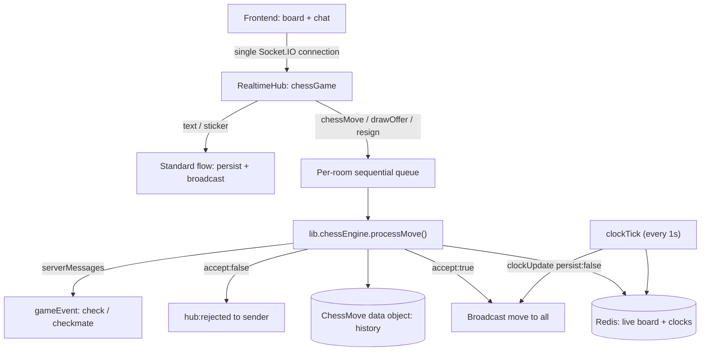

# Realtime hub: worked examples

Worked configurations for the [Realtime hub](realtime.md), from a plain chat hub to
a complete online chess platform with server-side game logic. Each example uses
current patterns: hubs are `realtimeHubs[]` chapters, custom message types declare
typed `fields`, and server-side logic lives in `hubLogic`, calling service-library
functions.

For one-way delivery alternatives referenced below, see
[Event subscriptions](event-subscriptions.md) (Kafka to client) and
[SSE in a Business API](../business-apis/sse-streaming.md) (one stream from one
API).

## 1. WhatsApp-style messenger

1-on-1 and group conversations with every media type, read/delivery receipts,
typing indicators, reactions, and auto-bridged membership events. Authorization
comes from a `conversationMember` join table: admins get the `admin` role, everyone
else `member`.

```json
{
  "hubBasics": {
    "name": "messenger",
    "description": "WhatsApp-style messaging hub with 1-on-1 and group conversations"
  },
  "roomSettings": {
    "roomDataObject": "conversation",
    "authSources": [
      { "name": "conversationAdmin", "sourceObject": "conversationMember", "userField": "userId", "roomField": "conversationId", "condition": { "js": "conversationMember.role == 'admin'" }, "hubRole": "admin" },
      { "name": "conversationMember", "sourceObject": "conversationMember", "userField": "userId", "roomField": "conversationId", "hubRole": "member" }
    ]
  },
  "hubRoles": [
    { "name": "admin", "canRead": true, "canSend": true, "canModerate": true, "canDeleteAny": true, "canManageRoom": true },
    { "name": "member", "canRead": true, "canSend": true }
  ],
  "messageSettings": {
    "dataObjectName": "ChatMessage",
    "messageTypes": ["text", "image", "video", "audio", "document", "sticker", "contact", "location", "system"],
    "enableReplyTo": true,
    "enableReaction": true,
    "enableForwarded": true
  },
  "eventSettings": {
    "enableTypingIndicator": true,
    "enableRecordingIndicator": true,
    "enableReadReceipts": true,
    "enableDeliveryReceipts": true,
    "enablePresence": true,
    "autoBridgeDataEvents": true
  },
  "historySettings": { "historyEnabled": true, "historyLimit": 50 },
  "guardrails": {
    "maxUsersPerRoom": 1024,
    "maxRoomsPerUser": 500,
    "messageRateLimit": 30,
    "maxMessageSize": 65536,
    "connectionTimeout": 600000
  }
}
```

## 2. Chess game hub

Players see a chess board plus a side chat. Standard `text` / `sticker` messages
flow normally; `chessMove` and `drawOffer` are typed custom messages. This hub
broadcasts moves without server validation; see
[example 7](#7-online-chess-platform-with-hublogic) for the version that validates
moves server-side.

```json
{
  "hubBasics": { "name": "chessLobby", "description": "Real-time chess game hub with move broadcasting and chat" },
  "roomSettings": {
    "roomDataObject": "chessMatch",
    "authSources": [
      { "name": "matchPlayer", "sourceObject": "matchPlayer", "userField": "playerId", "roomField": "matchId", "hubRole": "player" }
    ]
  },
  "hubRoles": [ { "name": "player", "canRead": true, "canSend": true } ],
  "messageSettings": {
    "dataObjectName": "ChessMessage",
    "messageTypes": ["text", "sticker", "system"],
    "enableReaction": true,
    "customMessageTypes": [
      {
        "name": "chessMove",
        "description": "A chess piece move with board coordinates",
        "fields": [
          { "name": "from", "fieldType": "String", "required": true },
          { "name": "to", "fieldType": "String", "required": true },
          { "name": "piece", "fieldType": "Enum", "required": true, "enumValues": "pawn,rook,knight,bishop,queen,king" },
          { "name": "captured", "fieldType": "Enum", "required": false, "enumValues": "pawn,rook,knight,bishop,queen" },
          { "name": "isCheck", "fieldType": "Boolean", "required": false, "defaultValue": "false" },
          { "name": "isCheckmate", "fieldType": "Boolean", "required": false, "defaultValue": "false" }
        ]
      },
      { "name": "drawOffer", "description": "Player offers or responds to a draw",
        "fields": [ { "name": "action", "fieldType": "Enum", "required": true, "enumValues": "offer,accept,decline" } ] }
    ]
  },
  "eventSettings": {
    "enablePresence": true,
    "autoBridgeDataEvents": true,
    "customEvents": [
      { "name": "clockUpdate", "description": "Timer sync from server", "ephemeral": true, "direction": "serverToRoom" }
    ]
  },
  "historySettings": { "historyEnabled": true, "historyLimit": 200 },
  "guardrails": { "maxUsersPerRoom": 10, "maxRoomsPerUser": 5, "messageRateLimit": 120, "maxMessageSize": 4096, "connectionTimeout": 1800000 }
}
```

## 3. Live dashboard with a Kafka bridge

A read-mostly hub: viewers see backend metrics and alerts pushed from Kafka. The
`dashboardOwner` role has `canSend: false`: clients never send; the service bridges
external Kafka topics into the relevant dashboard room.

```json
{
  "hubBasics": { "name": "liveDashboard", "description": "Real-time dashboard streaming backend metrics and events" },
  "roomSettings": {
    "roomDataObject": "dashboard",
    "authSources": [
      { "name": "dashboardOwner", "sourceObject": "dashboard", "userField": "createdBy", "roomField": "id", "hubRole": "dashboardOwner" }
    ]
  },
  "hubRoles": [ { "name": "dashboardOwner", "canRead": true, "canSend": false, "canManageRoom": true } ],
  "messageSettings": { "dataObjectName": "DashboardEvent", "messageTypes": ["system"] },
  "eventSettings": {
    "autoBridgeDataEvents": true,
    "kafkaEvents": [
      { "name": "metricUpdate", "topic": "analytics-events", "filterExpression": { "js": "data.type === 'metric'" }, "targetRoomExpression": { "js": "data.dashboardId" } },
      { "name": "alertTriggered", "topic": "analytics-events", "filterExpression": { "js": "data.type === 'alert'" }, "targetRoomExpression": { "js": "data.dashboardId" } }
    ]
  },
  "historySettings": { "historyEnabled": false },
  "guardrails": { "maxUsersPerRoom": 200, "maxRoomsPerUser": 10, "messageRateLimit": 10, "maxMessageSize": 8192, "connectionTimeout": 900000 }
}
```

`filterExpression` is MScript over the parsed Kafka `data` (return `true` to
bridge); `targetRoomExpression` extracts the room id to broadcast into. For the
consumer-side comparison (push to **clients** vs react in a **service**), see
[Event subscriptions](event-subscriptions.md).

## 4. Customer support chat

Support tickets become rooms. Agents are matched by `absoluteRoles` (full `system`
role, bypassing the pipeline); the ticket creator gets `customer`. A custom
`internalNote` type lets agents annotate the thread.

```json
{
  "hubBasics": { "name": "supportChat", "description": "Customer support live chat tied to support tickets" },
  "roomSettings": {
    "roomDataObject": "supportTicket",
    "absoluteRoles": ["supportAgent", "supportLead"],
    "authSources": [
      { "name": "ticketCreator", "sourceObject": "supportTicket", "userField": "createdBy", "roomField": "id", "hubRole": "customer" }
    ]
  },
  "hubRoles": [ { "name": "customer", "canRead": true, "canSend": true } ],
  "messageSettings": {
    "dataObjectName": "SupportMessage",
    "messageTypes": ["text", "image", "document", "system"],
    "customMessageTypes": [
      { "name": "internalNote", "description": "Internal note visible only to support agents",
        "fields": [
          { "name": "note", "fieldType": "Text", "required": true },
          { "name": "isResolution", "fieldType": "Boolean", "required": false, "defaultValue": "false" }
        ] }
    ]
  },
  "eventSettings": { "enableTypingIndicator": true, "enableReadReceipts": true, "enablePresence": true, "autoBridgeDataEvents": true },
  "historySettings": { "historyEnabled": true, "historyLimit": 100 },
  "guardrails": { "maxUsersPerRoom": 10, "maxRoomsPerUser": 20, "messageRateLimit": 30, "maxMessageSize": 65536, "connectionTimeout": 600000 }
}
```

## 5. Auction bidding room

Only verified bidders may join (`checkRoles`), and they may send only `text` and
`bid` messages (`allowedMessageTypes`). External Kafka events drive the "ending soon"
and "closed" signals into the listing room.

```json
{
  "hubBasics": { "name": "auctionRoom", "description": "Live auction bidding with real-time bid updates and timer" },
  "roomSettings": {
    "roomDataObject": "auctionListing",
    "roomEligibility": { "js": "auctionListing.status == 'active'" },
    "checkRoles": ["verifiedBidder"],
    "authScripts": [ { "name": "allVerifiedBidders", "script": { "js": "true" }, "hubRole": "bidder" } ]
  },
  "hubRoles": [ { "name": "bidder", "canRead": true, "canSend": true, "allowedMessageTypes": "text,bid" } ],
  "messageSettings": {
    "dataObjectName": "AuctionActivity",
    "messageTypes": ["text", "system"],
    "customMessageTypes": [
      { "name": "bid", "description": "A bid placed on the auction listing",
        "fields": [
          { "name": "amount", "fieldType": "Decimal", "required": true },
          { "name": "currency", "fieldType": "String", "required": true, "defaultValue": "USD" },
          { "name": "isAutoBid", "fieldType": "Boolean", "required": false, "defaultValue": "false" }
        ] }
    ]
  },
  "eventSettings": {
    "enablePresence": true,
    "autoBridgeDataEvents": true,
    "kafkaEvents": [
      { "name": "auctionEnding", "topic": "auction-events", "filterExpression": { "js": "data.type === 'auction.ending'" }, "targetRoomExpression": { "js": "data.listingId" } },
      { "name": "auctionClosed", "topic": "auction-events", "filterExpression": { "js": "data.type === 'auction.closed'" }, "targetRoomExpression": { "js": "data.listingId" } }
    ]
  },
  "historySettings": { "historyEnabled": true, "historyLimit": 200 },
  "guardrails": { "maxUsersPerRoom": 10000, "maxRoomsPerUser": 30, "messageRateLimit": 10, "maxMessageSize": 2048, "connectionTimeout": 1800000 }
}
```

For settling each bid atomically server-side (validate the amount, update the high
bid, reject losers), add a `hubLogic.messageHandlers` entry on `bid`, in the same
shape as the chess move handler below.

## 6. Multiplayer world with ticks

A persistent world where the server advances state on a clock. The `scheduledAction`
runs per active room: it starts when the first player joins and stops when the last
leaves (set `keepAlive: true` for a world that must keep ticking when empty).

```json
{
  "hubBasics": { "name": "gameWorld", "description": "Tick-driven multiplayer world" },
  "roomSettings": {
    "roomDataObject": "worldInstance",
    "authSources": [ { "name": "worldPlayer", "sourceObject": "worldPlayer", "userField": "userId", "roomField": "worldId", "hubRole": "player" } ]
  },
  "hubRoles": [ { "name": "player", "canRead": true, "canSend": true } ],
  "messageSettings": {
    "dataObjectName": "WorldMessage",
    "messageTypes": ["system"],
    "customMessageTypes": [
      { "name": "playerInput", "description": "A player's per-tick input",
        "fields": [
          { "name": "action", "fieldType": "Enum", "required": true, "enumValues": "move,attack,interact" },
          { "name": "dx", "fieldType": "Decimal", "required": false },
          { "name": "dy", "fieldType": "Decimal", "required": false }
        ] }
    ]
  },
  "eventSettings": { "enablePresence": true },
  "historySettings": { "historyEnabled": false },
  "guardrails": { "maxUsersPerRoom": 200, "messageRateLimit": 600, "maxMessageSize": 1024, "connectionTimeout": 1800000 },
  "hubLogic": {
    "stateScript": { "js": "lib.world.snapshot(roomId, session)" },
    "messageHandlers": [
      { "messageType": "playerInput", "script": { "js": "lib.world.queueInput(roomId, session, message)" } }
    ],
    "scheduledActions": [
      { "name": "worldTick", "intervalMs": 100, "keepAlive": false, "script": { "js": "lib.world.tick(roomId, lib)" } }
    ]
  }
}
```

The `messageHandler` only **queues** input (returns
`{ accept: true, broadcast: false }`); the `scheduledAction` is the single authority
that advances the world every 100 ms and broadcasts the new frame via
`serverMessages` (with `persist: false` so frames are not stored). Hold live state
in Redis; persist only significant events to a data object.

## 7. Online chess platform with HubLogic

A complete platform: two players play chess with a side chat, moves are **validated
server-side**, the live board lives in Redis, and move history is persisted for
replay. Chat (`text`, `sticker`) flows through standard mechanics; `chessMove`,
`drawOffer`, and `resign` are intercepted by `hubLogic`.

### Data objects

| Data object | Purpose |
|-----------|---------|
| `ChessGame` | Room record: players, status (`waiting`/`active`/`completed`), result, winner, time control. |
| `ChessGameMessage` | Generated message data object: chat AND moves (via the `messageType` enum). |
| `ChessMove` | Dedicated move history: from, to, piece, promotion, notation, moveNumber, fen. |
| `ChessGameMembership` | Player membership: userId, color, joined timestamp. |

### Hub configuration

Players join via `ChessGameMembership`; spectators join when the room allows it via
an `authScript`. Each role's `allowedMessageTypes` limits what it can send.

```json
{
  "hubBasics": { "name": "chessGame", "description": "Online chess with real-time moves, chat, and spectator mode" },
  "roomSettings": {
    "roomDataObject": "ChessGame",
    "roomEligibility": { "js": "chessGame.status !== 'completed'" },
    "absoluteRoles": ["superAdmin"],
    "authSources": [
      { "name": "player", "sourceObject": "ChessGameMembership", "userField": "userId", "roomField": "chessGameId", "hubRole": "player" }
    ],
    "authScripts": [
      { "name": "spectatorAccess", "script": { "js": "room.allowSpectators === true" }, "hubRole": "spectator" }
    ]
  },
  "hubRoles": [
    { "name": "player", "canRead": true, "canSend": true, "allowedMessageTypes": "text,sticker,chessMove,drawOffer,resign" },
    { "name": "spectator", "canRead": true, "canSend": true, "allowedMessageTypes": "text,sticker" }
  ],
  "messageSettings": {
    "dataObjectName": "ChessGameMessage",
    "messageTypes": ["text", "sticker", "system"],
    "enableReaction": true,
    "customMessageTypes": [
      { "name": "chessMove", "description": "A chess move on the board",
        "fields": [
          { "name": "from", "fieldType": "String", "required": true },
          { "name": "to", "fieldType": "String", "required": true },
          { "name": "promotion", "fieldType": "String", "required": false }
        ] },
      { "name": "drawOffer", "description": "Offer or respond to a draw",
        "fields": [ { "name": "action", "fieldType": "String", "required": true } ] },
      { "name": "resign", "description": "Player resigns the game", "fields": [] },
      { "name": "gameEvent", "description": "Server-generated game events (check, checkmate, draw, time)",
        "fields": [
          { "name": "event", "fieldType": "String", "required": true },
          { "name": "winner", "fieldType": "String", "required": false },
          { "name": "reason", "fieldType": "String", "required": false }
        ] }
    ]
  },
  "eventSettings": { "enableTypingIndicator": true, "enablePresence": true, "autoBridgeDataEvents": true },
  "historySettings": { "historyEnabled": true, "historyLimit": 100 },
  "guardrails": { "maxUsersPerRoom": 50, "maxRoomsPerUser": 5, "messageRateLimit": 30, "maxMessageSize": 4096, "connectionTimeout": 1800000, "authCacheTTL": 600 },
  "hubLogic": {
    "stateScript": { "js": "lib.chessEngine.getState(roomId, session)" },
    "messageHandlers": [
      { "messageType": "chessMove", "script": { "js": "lib.chessEngine.processMove(roomId, session, message, lib)" } },
      { "messageType": "drawOffer", "script": { "js": "lib.chessEngine.handleDrawOffer(roomId, session, message, lib)" } },
      { "messageType": "resign",    "script": { "js": "lib.chessEngine.handleResign(roomId, session, message, lib)" } }
    ],
    "scheduledActions": [
      { "name": "clockTick", "intervalMs": 1000, "keepAlive": false, "script": { "js": "lib.chessEngine.clockTick(roomId, lib)" } }
    ]
  }
}
```

The MScript hooks stay thin: each is a single `lib.chessEngine.*` call. All the
chess logic lives in a service-library module (a [`LibModule`](../../spec/LibModule.md)
under the service's `library.functions`), where the author has the full target
language, imports, and testability.

### Service library: `chessEngine`

The library functions are written in the service's programming language, so their
bodies are not shown here. The hub queues intercepted messages **per room**, so
`processMove` never races against itself for one game. The contract of each
function:

- **`getState(roomId, session)`** runs on join and on `hub:requestState`. It reads
  the board position and the game metadata (players, clocks, status) from Redis and
  returns the snapshot that arrives as `hub:state.state`: the position, whose turn
  it is, whether the side to move is in check, whether the game is over, the
  players, both clocks and the status. The `legalMoves` list is included **only for
  the player whose turn it is**. It returns `null` when no game has been
  initialised.
- **`processMove(roomId, session, message, lib)`** is the core handler. It rejects
  with `{ accept: false, rejectReason }` when the game is not initialised
  (`"Game not initialized"`), not active (`"Game is not active"`), when the sender
  is not the player to move (`"Not your turn"`) or when the rules engine refuses the
  move (`"Illegal move"`: pins, checks, en passant, castling, promotion are all
  validated by the engine). For a legal move it persists a `ChessMove` row, updates
  the game record when the move ends the game (checkmate, stalemate or draw), writes
  the new position and metadata back to Redis, and returns the hub-logic envelope:

  ```json
  {
    "accept": true,
    "broadcast": true,
    "broadcastTo": "all",
    "modifiedContent": { "from": "e2", "to": "e4", "promotion": null, "piece": "p", "captured": null, "notation": "e4", "fen": "<new position>", "isCheck": false },
    "serverMessages": [
      { "type": "gameEvent", "content": { "event": "check" }, "to": "all", "persist": false }
    ]
  }
  ```

  The `serverMessages` carry a `gameEvent` of `checkmate` (with the `winner`),
  `draw` (with the `reason`) or `check` (not persisted), as the position requires.
- **`handleDrawOffer`** records or resolves a draw offer; **`handleResign`** ends
  the game in favour of the opponent. Both follow the same read-Redis, mutate,
  write, return-`serverMessages` shape.
- **`clockTick(roomId, lib)`** is the scheduled action, every second. It decrements
  the active player's clock and ends the game on a flag-fall (a `timeout`
  `gameEvent` with `winner` and `loser`, and the game record updated). Ordinary
  ticks are broadcast as a `gameEvent` `clockUpdate` carrying both clocks with
  `persist: false` so the timeline is not flooded:

  ```json
  {
    "serverMessages": [
      { "type": "gameEvent", "content": { "event": "clockUpdate", "whiteClock": 540, "blackClock": 552 }, "to": "all", "persist": false }
    ]
  }
  ```

  It returns `{ "serverMessages": [] }` when the game is not active.

The service may use an external rules library for move validation, legal-move
generation and game-over detection rather than hand-rolling the rules; how a
compiler target takes on such a dependency is part of
[the compiler specification](../../compiler/index.md).

### Frontend integration

The frontend opens one Socket.IO connection to the hub namespace, joins the game
room, renders `hub:state`, and reacts to `chessMove` / `gameEvent`:

```javascript
import { io } from "socket.io-client";

const socket = io(`${baseUrl}/chess-api/hub/chessGame`, {
  auth: { token: `Bearer ${accessToken}` }, // add tenantCodename for multi-tenant projects
  transports: ["websocket"],
});

socket.emit("hub:join", { roomId });
socket.on("hub:state", ({ state }) => renderBoard(state));         // board + clocks + my legal moves
socket.on("hub:messageArrived", ({ message }) => {
  if (message.messageType === "chessMove") applyMove(message.content); // { from, to, fen, ... }
});
socket.on("hub:rejected", ({ reason }) => showError(reason));      // illegal move / not your turn
socket.on("hub:error", ({ error }) => showError(error));

// make a move
socket.emit("hub:send", { roomId, messageType: "chessMove", content: { from: "e2", to: "e4" } });
```

### Architecture summary



Live state in Redis (board, clocks) for speed; significant events persisted to data
objects (moves) for replay and analysis. The `stateScript` reads Redis; the message
handler writes both. See [Realtime hub: Best practices](realtime.md#best-practices)
for the full guidance.

## See also

- [Realtime hub](realtime.md): the concept doc (architecture, room auth, hubLogic, events).
- [Event subscriptions](event-subscriptions.md): one-way Kafka to client streams.
- [SSE in a Business API](../business-apis/sse-streaming.md): single-API streaming.
- Specification: [`RealtimeHub`](../../spec/RealtimeHub.md), [`HubLogic`](../../spec/HubLogic.md),
  [`HubScheduledAction`](../../spec/HubScheduledAction.md), [`LibModule`](../../spec/LibModule.md).
