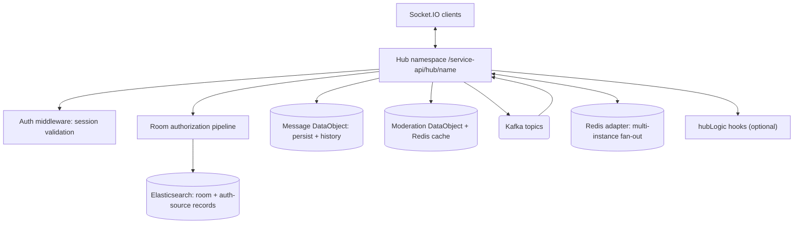
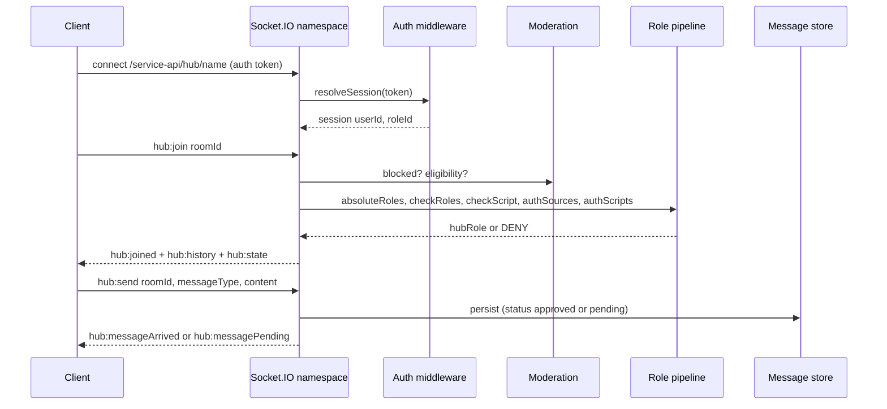

# Realtime hub

The realtime layer of a blueprint is built on **Socket.IO**. A service that
declares one or more `realtimeHubs[]` ships with bidirectional messaging, rooms,
role-based permissions, persisted messages, Kafka event bridging, runtime
moderation (block / silence / message approval), and per-hub MScript hooks for
stateful logic. The service-level Socket.IO configuration lives under
`serviceSettings.realtimeConfig` of the service.

The hub is a **feature of a service**, not a separate service: any service can
declare hubs alongside its data objects and APIs. It is one of three related
delivery surfaces. A hub is **bidirectional** (rooms, roles, persisted messages);
an [`EventSubscription`](event-subscriptions.md) is a **one-way** client stream of
Kafka events; and [`EmitSseEventAction`](../../spec/EmitSseEventAction.md) is a
**one-way** SSE stream of intermediate workflow values from a single business API.
Reach for a hub when clients send as well as receive.

For end-to-end configurations (a messenger, a live dashboard, an auction, and a
complete online chess platform) see
[Realtime hub: worked examples](realtime-examples.md).

## Architecture

A hub sits between Socket.IO clients and the rest of the service. The generated
service owns every box except the room / auth-source data objects and the optional
`hubLogic` scripts the author writes:



What the generated service handles for every hub:

1. **Authentication**: a token-based middleware validates each socket connection
   through the same session layer as the HTTP APIs.
2. **Room authorization**: a configurable pipeline of role checks, scripts, and
   data-object-based auth sources decides who may join a room and what hub role
   they get.
3. **Message types**: built-in types with known schemas plus author-defined custom
   types.
4. **Persistence**: every hub auto-generates a Message data object; messages
   persist with system fields, a `messageType` discriminator, a `content` JSON
   column, and denormalized sender identity.
5. **Standard events**: typing / recording indicators, read / delivery receipts,
   and presence as toggles (broadcast only, never persisted).
6. **Auto-bridge**: create / update / delete events of the service's data objects
   (the room, membership and message objects among them) reach the room each
   record names, via Kafka.
7. **External Kafka bridge**: events from unrelated topics bridge into rooms.
8. **REST endpoints**: message history, deletion, and REST-based sending.
9. **Horizontal scaling**: a Redis adapter for multi-instance deployments.

The sections of a hub map to these concerns: `hubBasics`, `roomSettings`,
`hubRoles`, `messageSettings`, `eventSettings`, `historySettings`, `guardrails`
(plus optional `hubLogic`). The service-level `realtimeConfig` configures the
Socket.IO server itself.

## RealtimeHub: the chapter

Each hub is one Socket.IO namespace + generated REST endpoints + two generated
data objects (one for messages, one for moderation records). Hubs are scoped to a
service. The sketch below is a fragment: each `...` stands for the section
described in the comment.

```jsonc
{
  "serviceSettings": { "serviceBasics": { "name": "chat" } },
  "realtimeHubs": [
    {
      "hubBasics":       { "name": "room", "description": "Per-room chat." },
      "roomSettings":    { /* which data object represents rooms + join auth */ },
      "hubRoles":        [ /* role -> permissions list */ ],
      "messageSettings": { /* built-in + custom message types */ },
      "eventSettings":   { /* typing, presence, receipts, Kafka bridges */ },
      "historySettings": { /* join-time history settings */ },
      "guardrails":      { /* max users, rate limits, moderation */ },
      "hubLogic":        { /* server-side MScript hooks (optional) */ }
    }
  ]
}
```

`hubBasics.name` is the runtime identifier. The following values are derived from
it:

| Derived value | Shape | Example (service `chat`, hub `room`) |
|---------------|-------|---------------------------------------|
| Socket.IO namespace | `/<service>-api/hub/<hubName>` | `/chat-api/hub/room` |
| REST base path | `/<kebab(hubName)>` (mounted on the service's API server) | `/room` |
| Message data object | `<hubName>Message` (or `messageSettings.dataObjectName`) | `roomMessage` |
| Moderation data object | `<hubName>Moderation` | `roomModeration` |

The service-api prefix is taken from the owning service's `name` (lowercased).
Validation requires that the generated data object names do not collide with any
existing data object of the project.

## Auto-generated Message data object

Every hub emits a Message data object. It carries one row per sent message;
reading history goes through Elasticsearch. The base columns are fixed:

| Column | Type | Description |
|--------|------|-------------|
| `id` | ID | Primary key. |
| `roomId` | ID | Foreign key to the room data object record. |
| `senderId` | ID | The authenticated sender's user id. |
| `senderName` | String | Denormalized from the session at send time. |
| `senderAvatar` | String | Denormalized from the session at send time. |
| `messageType` | Enum | All selected built-in types + every custom type name. |
| `content` | JSON | Type-specific payload (see schemas below). |
| `timestamp` | DateTime | Send time (ISO 8601). |
| `status` | Enum | `pending`, `approved` or `rejected` (set by the moderation flow). |

If `messageSettings.enableReplyTo`, `enableReaction`, or `enableForwarded` are on,
the data object also gets the `replyTo` (JSON), `reaction` (JSON), and `forwarded`
(Boolean) columns respectively.

> The denormalized `senderName` / `senderAvatar` fields exist so the client does
> not have to do a separate user lookup when rendering a message timeline.
> `hub:messageArrived` events also include a `sender: { id, fullname, avatar }`
> envelope alongside the persisted record.

The message object is an ordinary data object: it has REST CRUD, Kafka lifecycle
events, and Elasticsearch indexing like any other. See
[Data objects](../data-modeling/data-objects.md) for the underlying mechanics.

## Built-in message content schemas

`messageSettings.messageTypes[]` selects from a fixed catalogue of built-in types.
Each type validates its `content` payload at send time:

| Type | Required `content` fields | Use case |
|------|---------------------------|----------|
| `text` | `body` | Plain text message. |
| `image` | `mediaUrl` (commonly with `thumbnail`, `caption`, `width`, `height`) | Image attachment. |
| `video` | `mediaUrl` (commonly with `thumbnail`, `caption`, `duration`) | Video attachment. |
| `audio` | `mediaUrl` (commonly with `duration`, `waveform`) | Voice note / audio clip. |
| `document` | `mediaUrl`, `fileName` (commonly with `fileSize`, `mimeType`) | File attachment. |
| `sticker` | `stickerUrl` (commonly with `stickerPackId`) | Sticker image. |
| `contact` | `contactName` (commonly with `contactPhone`, `contactUserId`) | Shared contact card. |
| `location` | `lat`, `lng` (commonly with `address`, `label`) | Location pin. |
| `system` | `systemAction` (commonly with `systemData`) | Auto-generated system message (member joined, room renamed, etc.). |

> The `document` content type here is the chat-message kind (file attachment). It
> is unrelated to any project-documentation service.

### Custom message types

For application-specific payloads, declare custom message types in the same block.
Each custom type adds its name to the `messageType` enum and defines a field schema
validated at runtime:

```json
{
  "messageSettings": {
    "dataObjectName": "GameChatMessage",
    "messageTypes": ["text", "sticker"],
    "customMessageTypes": [
      {
        "name": "chessMove",
        "description": "A chess piece move with board coordinates",
        "fields": [
          { "name": "from", "fieldType": "String", "required": true },
          { "name": "to", "fieldType": "String", "required": true },
          { "name": "piece", "fieldType": "Enum", "required": true,
            "enumValues": "pawn,rook,knight,bishop,queen,king" },
          { "name": "isCheck", "fieldType": "Boolean", "required": false,
            "defaultValue": "false" }
        ]
      }
    ]
  }
}
```

Field types are `String`, `Text`, `Integer`, `Decimal`, `Boolean`, `ID`,
`DateTime`, `Enum` (with `enumValues`), or `JSON`. The schema is enforced
server-side before persistence and broadcast.

A field's `defaultValue` (written as a string) is converted to the field type when
the service is generated, and the hub fills it in when a message leaves the field
out, on `hub:send` and on the REST send, before the content is validated, stored
and broadcast. A field the client sends explicitly, `null` included, keeps the
client's value. A default that cannot be converted (an `Integer` of `"abc"`, a
`Boolean` of `"yes"`, an `Enum` value missing from `enumValues`, invalid `JSON` or
`DateTime`) is a validation error, `HUB_CUSTOM_FIELD_DEFAULT_INVALID`. See
[the compiler specification](../../compiler/index.md) for which compiler targets
apply defaults.

Cross-cutting toggles add JSON columns to every message:

| Toggle | Adds | Meaning |
|--------|------|---------|
| `enableReplyTo` | `replyTo: { id, preview }` | Any message can quote another. |
| `enableReaction` | `reaction: [{ emoji, userId, timestamp }]` | Emoji reactions. |
| `enableForwarded` | `forwarded: Boolean` | "This was forwarded." |

## Roles + room auth

`hubRoles[]` is the named permission set. `roomSettings` defines a **layered
authorization flow** that runs once per join (and on every call to the hub's
[REST endpoints](#rest-endpoints), through the same checker) and assigns the user a
role on success.

```
1. Fetch room record from Elasticsearch.
2. If roomEligibility evaluates false  ->  DENY (blocks everyone).
3. If user is blocked (moderation)     ->  DENY.
4. If a Redis auth cache entry exists  ->  ALLOW with the cached role.
5. If user.roleId in absoluteRoles     ->  ALLOW with the built-in "system" role.
6. If checkRoles is set and user.roleId not in it  ->  DENY.
7. If checkScript returns false        ->  DENY.
8. authSources, top-to-bottom: first match wins.
9. authScripts, top-to-bottom: first match wins.
10. No match                           ->  DENY.
```

Only steps 5, 8 and 9 grant a role; `checkRoles` and `checkScript` can only refuse.
A hub whose `absoluteRoles`, `authSources` and `authScripts` are all empty
therefore admits nobody, and validation warns about it (`HUB_NO_AUTH_PATH`).
`roomDataObject` must name a data object of the same service (warning
`DATA_OBJECT_NOT_FOUND` otherwise): step 1 resolves every room through it. Both are
warnings, not errors, so an existing project still builds, but such a hub refuses
every join and every REST call until it is fixed.

A worked `roomSettings` that uses every stage:

```json
{
  "roomSettings": {
    "roomDataObject": "catalogEvent",
    "roomEligibility": { "js": "catalogEvent.chatEnabled == true" },
    "absoluteRoles": ["superAdmin"],
    "checkRoles": ["premiumUser", "subscriber"],
    "checkScript": { "js": "user.city == catalogEvent.city" },
    "authSources": [
      { "name": "eventOwner",   "sourceObject": "catalogEvent", "userField": "createdBy",   "roomField": "id",      "hubRole": "owner" },
      { "name": "eventHost",    "sourceObject": "eventHost",    "userField": "userId",      "roomField": "eventId", "hubRole": "moderator" },
      { "name": "ticketHolder", "sourceObject": "issuedTicket", "userField": "ownerUserId", "roomField": "eventId", "condition": { "js": "issuedTicket.status == 'active'" }, "hubRole": "attendee" }
    ],
    "authScripts": [
      { "name": "vipAccess", "script": { "js": "lib.checkVIPAccess(user, room)" }, "hubRole": "viewer" }
    ]
  }
}
```

### Auth sources: `HubAuthSource`

Each entry queries an Elasticsearch-indexed data object to find whether the user
has a relationship with the room. Evaluated top-to-bottom; **first match wins**, so
order highest-privilege first.

| Field | Description |
|-------|-------------|
| `name` | Identifier for this source (logs/docs). |
| `sourceObject` | Data object to query: the room object itself (ownership), a join/membership table, or any indexed object. |
| `userField` | Property on `sourceObject` matched against the authenticated user's id (defaults to `userId`). |
| `roomField` | Property on `sourceObject` matched against the room id (use `id` when checking the room object directly). |
| `condition` | Optional MScript on the found record. Context variable is the `sourceObject` name (e.g. `issuedTicket.status == 'active'`); generic alias `record`. |
| `hubRole` | Role granted on match. `null` gives the default `member`. Otherwise must name a `hubRoles` entry. |

**When the row ends, the socket leaves.** The hub listens to the `updated` and
`deleted` events of every `sourceObject`. When a row for a user and room changes so
that it no longer grants access (it was deleted, deactivated, or its `condition`
became false), the hub runs the full authorization above again for that user's
sockets in that room and evicts the ones it now refuses. A row whose `userField` or
`roomField` changes (a membership handed to another user, an owner transferred) is
checked again for the user and room it left as well: the service that owns the
`sourceObject` publishes the previous values of those two fields with the update.
An evicted socket gets the same frame as a moderator block,
`hub:blocked { roomId, reason, code, evicted: true }`, and is removed from the room
on every instance of the service. Another auth source, an auth script or an
absolute role that still grants keeps the socket in. The cached decision for that
user and room is dropped at the same time, so a re-join or REST call is refused at
once rather than after `authCacheTTL`. An update that still grants (a changed
`lastReadAt`, for example) costs nothing. This is always on and needs no setting.

### Auth scripts: `HubAuthScript`

Checked after all auth sources. Each runs an MScript with `user` (session) and
`room` (room record) in context and may call library functions.

| Field | Description |
|-------|-------------|
| `name` | Identifier (logs/docs). |
| `script` | Boolean MScript; `true` matches. e.g. `lib.checkVIPAccess(user, room)` or `user.tier == 'gold' && room.isPublic`. |
| `hubRole` | Role granted when the script returns `true`. `null` gives the default `member`. |

### Cross-service auth sources

Auth-source queries run against **Elasticsearch**, not a direct database query. So
the data object in `sourceObject` can live in a **different service**: as long as it
is indexed (the default for all data objects), the hub reads it across service
boundaries. The index name is derived from the project codename and the data object
name. This is how a chat hub in one service authorizes joins from a membership or
ticket object owned by another service.

Every data object is projected whatever its `dataObjectAccess`, and that setting
does not restrict a cross-service read: an `accessPrivate` object can be an auth
source. An auth-source lookup that cannot read the index (the owning service never
built it, or Elasticsearch did not answer) matches nobody, so the join is denied.

### Per-role permission matrix

`HubRole` carries the granular permissions checked at runtime:

| Field | Default | Description |
|-------|---------|-------------|
| `name` | none | Role identifier. Referenced by `authSources` / `authScripts.hubRole`. |
| `canRead` | `true` | Receives the room: `hub:history`, `hub:state`, broadcast messages and events, REST `GET .../messages`. `false` = write-only (see below). |
| `canSend` | `true` | Can send messages. `false` = viewer / read-only. |
| `allowedMessageTypes` | all | Comma-separated allow-list of message types this role can send. |
| `moderated` | `false` | Messages from this role land as `pending` and need moderator approval. |
| `canModerate` | `false` | Can approve / reject pending messages, block / silence users. |
| `canDeleteAny` | `false` | Can delete any message in the room. |
| `canManageRoom` | `false` | Can update room settings, kick users. |

A built-in `system` role (all permissions true) is assigned automatically to users
matched by `absoluteRoles`. If a hub omits `hubRoles` entirely and every
`authSource` / `authScript` has `hubRole: null`, all members get an implicit
`member` role with read + send and no moderation, which suits the simplest
single-permission hubs.

**Write-only roles (`canRead: false`).** The member joins the room's write-only
side channel instead of its broadcast channel: it can send, it is found by block /
silence / speak commands, and it is told when its own pending message is rejected,
but it gets no `hub:history` (`hub:joined` carries `canRead: false`), no `hub:state`
(`hub:requestState` answers `hub:error { code: "HUB_READ_FORBIDDEN" }`), no room
broadcasts, and `GET .../messages` answers `403 HUB_READ_FORBIDDEN`. A moderator
always reads (it has to receive the pending messages it approves), so
`canRead: false` on a `canModerate: true` role has no effect and validation warns
about it (`HUB_ROLE_MODERATOR_READS`).

```json
{
  "hubRoles": [
    { "name": "owner",     "canRead": true, "canSend": true,
      "canModerate": true, "canDeleteAny": true, "canManageRoom": true },
    { "name": "moderator", "canRead": true, "canSend": true,
      "canModerate": true, "canDeleteAny": true },
    { "name": "attendee",  "canRead": true, "canSend": true,
      "allowedMessageTypes": "text,image", "moderated": true },
    { "name": "viewer",    "canRead": true, "canSend": false }
  ]
}
```

## Moderation: block, silence, message approval

Moderation actions are persisted in the generated `<hubName>Moderation` data object
and cached in Redis for fast authorization lookups. Every moderation command
requires `canModerate` on the caller's hub role.

### Block / silence

| Action  | Effect | Persistence |
|---------|--------|-------------|
| Block   | User cannot enter the room. If currently connected, they are force-removed (their socket is removed from the room). | Moderation data object + Redis cache. |
| Silence | User stays in the room and can read, but `canSend` is forced to `false`. | Moderation data object + Redis cache. |

Both support a `duration` (seconds): `0` or omitted = permanent; a positive value
expires automatically.

Socket events:

| Event | Direction | Payload |
|-------|-----------|---------|
| `hub:block` | client to server (moderator) | `{ roomId, userId, reason?, duration? }` |
| `hub:unblock` | client to server (moderator) | `{ roomId, userId }` |
| `hub:silence` | client to server (moderator) | `{ roomId, userId, reason?, duration? }` |
| `hub:unsilence` | client to server (moderator) | `{ roomId, userId }` |
| `hub:blocked` | server to blocked user | `{ roomId, reason }` (then force-leave). Also sent, with `code` and `evicted: true`, when the user's auth-source row ended (see "Auth sources" above). |
| `hub:unblocked` | server to user | `{ roomId }` (may rejoin) |
| `hub:silenced` | server to user | `{ roomId, reason }` |
| `hub:unsilenced` | server to user | `{ roomId }` |

### Default-silenced rooms and request-to-speak

When `guardrails.defaultSilenced` is `true`, every joining role has its `canSend`
overridden to `false`. Users with `canModerate` are exempt. Others must explicitly
request speak permission. Useful for webinars, classrooms, and town-hall rooms.

| Event | Direction | Payload |
|-------|-----------|---------|
| `hub:requestSpeak` | client to server | `{ roomId }` |
| `hub:speakRequested` | server to moderators | `{ roomId, userId }` |
| `hub:grantSpeak` | moderator to server | `{ roomId, userId }` |
| `hub:revokeSpeak` | moderator to server | `{ roomId, userId }` |
| `hub:speakGranted` | server to user | `{ roomId }` |
| `hub:speakRevoked` | server to user | `{ roomId }` |

A silence, unsilence, grant or revoke changes the user's send permission on every
socket the user has in the room, whichever instance of the service holds it, before
the frame is sent.

### Message approval queue

When a role has `moderated: true` or `guardrails.globalModeration` is `true`, the
message is persisted with `status: "pending"` instead of `approved`; it does **not**
reach normal room subscribers. Only sockets with `canModerate` see the pending
message. Moderators explicitly approve or reject:

| Event | Direction | Payload |
|-------|-----------|---------|
| `hub:approve` | moderator to server | `{ roomId, messageId }` |
| `hub:reject` | moderator to server | `{ roomId, messageId, reason? }` |
| `hub:messagePending` | server to sender | `{ roomId, messageId }` |
| `hub:messagePending` | server to moderators | `{ roomId, sender, message }` |
| `hub:messageRejected` | server to room readers + the sender | `{ roomId, messageId, reason }` |

Approved messages are re-emitted to the room as `hub:messageArrived` (the standard
delivery event).

This queue is decided by people. Decision-moderated writes (a decision provider
judging each write against a policy, a review queue, reviewer accept / reject) are
[Object content moderation](object-moderation.md), which works on data object
create / update APIs. The hub writes its message rows below that layer, so enabling
`objectModeration` on the hub's message object does not judge socket messages. To
judge hub messages, set `contentModeration` on the hub: the same verdict and review
queue applied to every message a user sends, before it reaches the room (see
[Object content moderation](object-moderation.md#hub-messages-and-outbound-notifications)).
A decision-accepted message then still follows this queue when the hub or role
pre-moderates.

The server loads the message before acting: only a **pending message of the
moderator's own room** is approved or rejected. A message id of another room (or an
unknown id) answers `hub:error { roomId, messageId, code: "MESSAGE_NOT_FOUND" }`
(the other room's message is not revealed to exist) and a message that is no longer
pending answers `code: "MESSAGE_NOT_PENDING"`; nothing is updated or broadcast.

## Standard events

A client sends every signal that is not a message as `hub:event`
`{ roomId, event, data }` on a room it has joined (otherwise
`hub:error { error: "Must join room before emitting events" }`). The
`eventSettings` toggles decide which `event` values the hub handles itself:

| Toggle | Client sends `event` | The room receives | To whom |
|--------|----------------------|-------------------|---------|
| `enableTypingIndicator` | `typing`, `stopTyping` | `hub:typing`, `hub:stopTyping` `{ roomId, userId }` | every reader except the sender |
| `enableRecordingIndicator` | `recording`, `stopRecording` | `hub:recording`, `hub:stopRecording` `{ roomId, userId }` | every reader except the sender |
| `enableReadReceipts` | `messageRead`, `data: { lastReadTimestamp? }` | `hub:messageRead` `{ roomId, userId, lastReadTimestamp }` (now when not sent) | every reader, sender included |
| `enableDeliveryReceipts` | `messageDelivered`, `data: { messageId }` | `hub:messageDelivered` `{ roomId, userId, messageId }` | every reader, sender included |
| `enablePresence` | none | `hub:online` (a socket's first join of a room), `hub:offline` (its disconnect), `{ roomId, userId }` | every reader |
| `autoBridgeDataEvents` | none | see below | none |

All of these are broadcast only; nothing is persisted, receipts included. Any other
`event` value, including a standard one whose toggle is off, is re-broadcast to the
room's readers, sender included, as `hub:<event>` with
`{ roomId, userId, ...data }`. A blocked user's `hub:event` is refused (`hub:error`),
and a write-only member (`canRead: false`) receives none of these broadcasts.

### Auto-bridged data object events

When `autoBridgeDataEvents` is `true` (the default), the hub consumes the index-sync
events of **every** data object of its service (the room object, membership
objects, the hub's own message and moderation objects and any other) and relays
each create, update and delete to one room:

- the event is `hub:<objectName>.<created|updated|deleted>` (the declared casing,
  for example `hub:catalogEvent.updated` or `hub:chatMessage.created`), with the
  payload `{ roomId, ...record }`;
- the room is the record's `<roomDataObject>Id` field (for a room object named
  `catalogEvent`, `catalogEventId`), else its `roomId`, else its own `id` (which is
  how an update of the room record itself reaches its room). A record that yields no
  room id is not relayed.

If the hub also has `system` in `messageTypes`, every relayed event is also stored
as a `system` message `{ systemAction: "<objectName>.<verb>", systemData: record }`
in that room's history.

### Custom and external Kafka events

`customEvents[]` declares app-specific signals beyond the standard set. Each entry
has a `direction`:

| Direction | What the generated hub does |
|-----------|-----------------------------|
| `clientToRoom` | A client's `hub:event { roomId, event: "<name>", data }` is re-broadcast to the room's readers, sender included, as `hub:<name>` with `{ roomId, userId, ...data }`. |
| `serverToRoom` | Declarative only: no handler is generated. Server-side traffic reaches a room through `hubLogic` server messages (`hub:messageArrived`), a `kafkaEvents[]` bridge (`hub:<eventName>`) or the auto-bridge. |
| `serverToClient` | Declarative only, like `serverToRoom`; a `hubLogic` handler reaches one user with `serverMessages[].to: ["<userId>"]`. |

The `ephemeral` flag is not read: custom events are never persisted.

`kafkaEvents[]` bridges arbitrary Kafka topics into the hub:

```json
{
  "eventSettings": {
    "kafkaEvents": [
      {
        "name": "orderStatusChanged",
        "topic": "order-events",
        "filterExpression": { "js": "data.type === 'status.changed'" },
        "targetRoomExpression": { "js": "data.dashboardId" }
      }
    ]
  }
}
```

`data` is the record: the envelope's `data` for a framework event, the parsed
message itself for a producer that does not wrap. `filterExpression` returns `true`
to bridge; one that throws skips the message (logged, rate limited, as
`HubKafkaFilterSkipped`). `targetRoomExpression` picks the room (default
`data.roomId || data.id`); a message that yields no room is dropped. The room's
readers receive `hub:<name>` with `{ roomId, ...record }`. Nothing is persisted.

### Consumers of the hub bridges

Every bridge consumer the hub starts is an independent Kafka subscriber, named after
the binding (hub, object and verb, or hub and event name) rather than after the
topic:

- **Several hubs may bridge the same topic.** Two hubs in one service that
  auto-bridge the same data object, or two `kafkaEvents` entries pointing at one
  topic, each receive every message. They are separate logical subscribers, not
  competitors for one queue.
- **Instances still load-balance.** Every instance of the service runs the same
  bindings under the same names, so the partitions of a topic are shared across the
  instances of one binding.

The consumer name is derived from authored names only, so it is stable across
regenerations and the committed offset survives an ordinary redeploy.

Renaming a hub or a `kafkaEvents` entry renames its consumer. The new consumer has
no committed offset and starts at the topic's current end, so the events published
while the renamed binding was being deployed are not relayed. For a hub whose
`messageSettings.messageTypes` includes `system`, those events also leave no system
message in the room's history; `kafkaEvents` bridges persist nothing either way.

## History on join: `historySettings`

Controls whether recent messages are delivered to a client when it joins a room.
When enabled, the server queries the message data object for the most recent
messages and emits them as `hub:history` immediately after the join confirmation.

```json
{
  "historySettings": { "historyEnabled": true, "historyLimit": 50 }
}
```

| Property | Default | Description |
|----------|---------|-------------|
| `historyEnabled` | `true` | Send recent messages on join. Requires the hub's generated message data object. |
| `historyLimit` | `50` | Number of most recent messages to send. |

Set `historyEnabled: false` for ephemeral hubs (live dashboards, tick-driven worlds)
where past messages have no value. The richer "current state" delivered on join (a
game board, scoreboard, or auction price) comes from
[`hubLogic.stateScript`](#state-script), not from message history; the two are
independent.

## Guardrails

`guardrails` is mandatory. Defaults are conservative; tune them for production:

| Property | Default | Purpose |
|----------|---------|---------|
| `maxUsersPerRoom` | `1000` | Cap on room members. Not every compiler target enforces it (see [the compiler specification](../../compiler/index.md)), so do not rely on it alone to protect a room. |
| `maxRoomsPerUser` | `50` | Per-user cap. |
| `messageRateLimit` | `60` | Max messages per user per minute; `hub:send` and the REST send share the budget. |
| `maxMessageSize` | `65536` | Reject messages over 64 KB. |
| `connectionTimeout` | `300000` | Not enforced: no runtime reads it, so an idle connection is never disconnected for inactivity. A dead connection is dropped through the Socket.IO heartbeat, `realtimeConfig.heartbeatInterval` / `heartbeatTimeout`. |
| `authCacheTTL` | `300` | Redis cache TTL for join authorization, in seconds. `0` is not portable: some targets disable caching, others read it as the default `300`. Set a positive value. |
| `globalModeration` | `false` | When true, **every** message in the hub is moderated regardless of role. |
| `defaultSilenced` | `false` | Forces `canSend: false` for non-moderators on join (see [request-to-speak](#default-silenced-rooms-and-request-to-speak)). |

These ship as part of the generated service; clients cannot bypass them.

## Server-side logic: `hubLogic`

Optional. Three hook points that turn the hub from a "message router" into a
stateful coordinator (game moves, auction bids, collaborative editors).

### Message handlers

A `messageHandler` intercepts a specific custom message type. The matched type is
**not** broadcast through the standard flow. The service calls your MScript with
sender session, message body, room record, and the service library, and acts on the
return value.

Per-room sequential queue: intercepted messages for the same room are processed one
at a time. This prevents race conditions in games, auctions, and collaborative
editing.

Context:

| Variable | Type | Description |
|----------|------|-------------|
| `session` | object | Sender session (`userId`, `roleId`, `fullname`, `avatar`, ...). Sensitive fields stripped. |
| `message` | object | `{ type, content }`. |
| `roomId` | string | The room being sent into. |
| `room` | object | Room data object record (from Elasticsearch). |
| `lib` | object | Service library functions. |

The script must return an object:

```js
{
  accept:           true,          // false -> message rejected, sender gets hub:rejected
  rejectReason:     "Not your turn",
  broadcast:        true,          // false -> accept silently (e.g. validated-only)
  broadcastTo:      "all",         // "all" | "others" | "sender" | ["userId-1", "userId-2"]
  modifiedContent:  { ... },       // replaces content before broadcast and persistence
  persist:          true,          // false -> broadcast without writing to the message data object

  serverMessages: [                // additional messages emitted by the server
    {
      type:     "gameEvent",
      content:  { event: "check" },
      to:       "all",             // "all" | "others" | "sender" | ["userId-1"]
      persist:  true
    }
  ]
}
```

If the handler returns nothing or a non-object, the sender gets `hub:error`
(`"Logic script returned invalid result"`).

Built-in types (text, image, ...) and custom types **without** a handler keep the
standard flow: validate, persist with appropriate `status`, broadcast to the room.
The handler list is opt-in per type.

### State script

A `stateScript` returns the room's current state (typically held in Redis or a
sidecar table) and is delivered to a single client. The server runs it in two
situations:

1. **On join.** After history is sent, the service runs the `stateScript` and emits
   `hub:state` to the joining socket only.
2. **On `hub:requestState`.** A client can re-request the state of a room it has
   joined at any time. After a reconnect the socket has joined nothing, so the
   client sends `hub:join` again, which delivers the state on its own.

Context: `session`, `roomId`, `room` (the room record), `lib`. The return value is
delivered as-is in `hub:state.state`; any shape works. Often it is the current game
board, scoreboard, auction price, or document snapshot.

### Scheduled actions

Each `scheduledAction` runs an MScript on a fixed interval per active room, driving
game-clock ticks, world updates, auction countdowns. Lifecycle:

- Starts when the **first** user joins a room.
- Stops when the **last** user disconnects, unless `keepAlive: true`.
- Each room has its own timer; rooms run independently.

Context: `roomId`, `room`, `lib`. Return shape is the same
`{ serverMessages: [...] }` envelope as a message handler.

| Field | Type | Default | Description |
|-------|------|---------|-------------|
| `name` | String | none | Identifier for logs. |
| `intervalMs` | Integer | `1000` | Milliseconds between invocations. |
| `keepAlive` | Boolean | `false` | When true, keeps running even with no connected users. |
| `script` | MScript | none | Called each tick. |

### Worked example: chess

```json
{
  "hubLogic": {
    "stateScript": { "js": "lib.chess.getState(roomId, session)" },
    "messageHandlers": [
      { "messageType": "chessMove",  "script": { "js": "lib.chess.processMove(roomId, session, message, lib)" } },
      { "messageType": "drawOffer",  "script": { "js": "lib.chess.handleDrawOffer(roomId, session, message, lib)" } },
      { "messageType": "resign",     "script": { "js": "lib.chess.handleResign(roomId, session, message, lib)" } }
    ],
    "scheduledActions": [
      { "name": "clockTick", "intervalMs": 1000, "script": { "js": "lib.chess.clockTick(roomId, lib)" } }
    ]
  }
}
```

A `processMove` function returns
`{ accept: true, broadcastTo: "all", serverMessages: [...] }` when the move is
legal, or `{ accept: false, rejectReason: "..." }` to deny it. The full design
(a `chessEngine` service library, an external rules library, Redis state, clock
ticks, and frontend wiring) is in
[Realtime hub: worked examples](realtime-examples.md#7-online-chess-platform-with-hublogic).

## Service-level config: `RealtimeConfig`

```json
{
  "serviceSettings": {
    "serviceBasics": { "name": "chat" },
    "realtimeConfig": {
      "adapter":              "redis",
      "heartbeatInterval":    25000,
      "heartbeatTimeout":     20000,
      "maxConnectionsPerUser": 10
    }
  }
}
```

The block configures the one Socket.IO server of the service, which exists when the
service has at least one `realtimeHub` or a `websocket` `EventSubscription`; every
value has a default, so the block is optional.

`adapter` defaults to `"redis"`: broadcasts reach the sockets of every instance of
the service through Redis pub/sub, except in a development environment. When the
adapter cannot be loaded or Redis does not connect, the service logs it and keeps
the in-memory adapter, which reaches only the sockets of its own instance.
`"memory"` always uses the in-memory adapter (single instance).

`heartbeatTimeout` must be less than `heartbeatInterval` (defaults 25000 and 20000
ms). `maxConnectionsPerUser` (default 10) is checked by a middleware on the server's
main namespace (`/`), keyed on a `userId` the client puts in its handshake `auth`
payload; hub and event-subscription namespaces do not pass through it, so it does
not limit their connections.

Through the gateway a client uses `/<service>-api/socket.io/` as its Socket.IO
`path`.

## REST endpoints

Each hub mounts these endpoints on the service's API server at
`/<kebab(hubName)>/...`:

| Method | Path | Description |
|--------|------|-------------|
| `GET`  | `/<hub>/:roomId/messages` | Paginated message history. Query: `limit` (default 50), `offset`. |
| `POST` | `/<hub>/:roomId/messages` | Send a message via REST. Body = the `hub:send` payload `{ messageType, content, replyTo? }`, validated and stored like a socket send (so it appears in history). Also broadcasts `hub:messageArrived` to connected clients. |
| `DELETE` | `/<hub>/:roomId/messages/:messageId` | Delete a message; broadcasts `hub:messageDeleted`. |
| `GET`  | `/<hub>/:roomId/eligible` | Evaluates `roomEligibility` for a room. |

These are the fallback / server-to-server surfaces; bidirectional clients should use
the Socket.IO namespace.

Every leg requires a login and runs the **same room authorization as a socket join**
(the flow in Roles + room auth above), so a user who could not join a room cannot
read, post into or delete from it over REST either. Refusals are
`application/problem+json`:

| Status | `errorCode` | When |
|--------|-------------|------|
| `401` | `UNAUTHORIZED` | No (valid) session. |
| `403` | `HUB_ROOM_FORBIDDEN` | The room refuses the caller (not a member, blocked, role or script check); `detail` is the join's reason text. |
| `404` | `HUB_ROOM_NOT_FOUND` | The room does not exist. |
| `403` | `HUB_READ_FORBIDDEN` | `GET .../messages`: the hub role is write-only (`canRead: false`, not a moderator). |
| `400` | `HUB_INVALID_MESSAGE` | `POST`: missing or unknown `messageType`, `content` missing a field its type requires, or a type handled by `hubLogic` (socket only). |
| `413` | `HUB_MESSAGE_TOO_LARGE` | `POST`: body over `guardrails.maxMessageSize`. |
| `403` | `HUB_SEND_FORBIDDEN` | `POST`: the role may not send this `messageType` (`allowedMessageTypes`), or the effective hub role has `canSend: false` (including a non-moderator on a `defaultSilenced` hub, since speak grants live on sockets), or the caller is silenced. |
| `429` | `TOO_MANY_REQUESTS` | `POST`: the per-user `messageRateLimit`, shared with `hub:send`. |
| `403` | `HUB_DELETE_FORBIDDEN` | `DELETE`: the caller is neither the message's sender nor a hub role with `canDeleteAny` (an `absoluteRoles` user has it). |
| `404` | `HUB_MESSAGE_NOT_FOUND` | `DELETE`: no such message in **this** room; a message of another room is never reached through it. |
| `503` | `MOD_LOOKUP_UNAVAILABLE` | The block / silence lookup could not be completed (fails closed). |

`GET .../eligible` keeps its verdict shape: a missing room answers
`200 { success: true, eligible: false, reason: "Room not found" }` and an ineligible
one `200 { success: true, eligible: false, reason }`; `eligible: true` means the
caller may join. A `POST` from a moderated role (or on a `globalModeration` hub) is
stored as `status: "pending"`, sent to the room's moderators as
`hub:messagePending`, and not broadcast to the room until approved. There is no REST
(or socket) edit route.

Every leg answers `application/problem+json` rather than a degraded 200 when its
backing store cannot be read. `GET .../messages` answers 5xx on an Elasticsearch
outage instead of returning an empty page with `"total": 0`, so an empty `data` array
is a genuine empty page. `GET .../eligible` answers `503` with
`errorCode: "HUB_STORE_UNAVAILABLE"` when the room record cannot be resolved, while
a room that really does not exist still answers
`200 { success: true, eligible: false, reason: "Room not found" }`. Retry the 5xx
with backoff; do not render it as "no messages" or as "realtime is off".

A store failure is always a 5xx on these legs, never a 4xx, and the body never
carries the store's own words. Elasticsearch answers `404 index_not_found_exception`,
`403 security_exception`, `400` parse faults and `429 circuit_breaking_exception`;
each describes the service account or the cluster, not the caller, so the router
donates none of them and answers `500` with a generic detail, keeping the cluster
status, index name and message in the server log. The only 404 that means "no such
room" is the one carrying `errorCode: "HUB_ROOM_NOT_FOUND"`. See
[Store failures are never business answers](#store-failures-are-never-business-answers).

## Connection + handshake flow



## Connecting from a client

```js
import { io } from "socket.io-client";

const socket = io("https://your-service.example.com/chat-api/hub/room", {
  // Socket.IO HTTP path; defaults to /socket.io/. The gateway
  // typically routes /<service>-api/socket.io/ to the service instance.
  path: "/chat-api/socket.io/",
  auth: {
    token: "Bearer <jwt>",
    // tenantCodename is required for multi-tenant projects:
    tenantCodename: "my-tenant"
  },
  transports: ["websocket", "polling"]
});

// Room memberships live on the socket: a reconnect gets a fresh socket that
// has joined nothing, so (re-)join every room on each "connect".
socket.on("connect", () => {
  for (const roomId of openRooms) socket.emit("hub:join", { roomId });
});
socket.on("hub:joined",         ({ roomId, hubRole, userInfo, canRead }) => { /* hubRole is the role name */ });
socket.on("hub:history",        ({ roomId, messages, historyUnavailable }) => { /* render */ });
socket.on("hub:state",          ({ roomId, state }) => { /* snapshot */ });
socket.on("hub:messageArrived", ({ roomId, sender, message }) => { /* ... */ });
socket.on("hub:error",          ({ roomId, error, code }) => { /* see the event reference */ });
```

A re-join runs the room authorization again and re-sends `hub:history` and
`hub:state`, so a reconnecting client catches up on what it missed from the history
window; signals sent while it was away (typing, receipts, bridged events) are not
replayed.

> Pass `tenantCodename` in `auth`, not in `extraHeaders`. Browsers cannot send
> custom headers over the WebSocket transport; the `auth` payload is delivered over
> **all** transports.

### Multi-tenant connection

In a [multi-tenant](multi-tenancy.md) project, a socket connection must carry the
tenant codename so the service resolves the right tenant session. Put it in the
`auth` payload alongside the token:

```js
const socket = io("https://your-service.example.com/chat-api/hub/room", {
  path: "/chat-api/socket.io/",
  auth: {
    token: "Bearer <jwt>",
    tenantCodename: "acme"   // required for multi-tenant projects
  },
  transports: ["websocket", "polling"]
});
```

The reason it goes in `auth` and not `extraHeaders`: only the HTTP polling transport
receives `extraHeaders`, but `auth` is delivered over **both** WebSocket and
polling, so it is the only reliable channel for the tenant context. Room auth,
message persistence, and Elasticsearch auth-source queries all then run within that
tenant's scope, exactly as the [multi-tenancy guide](multi-tenancy.md) describes for
HTTP requests.

## Full event reference

| Event | Direction | Payload |
|-------|-----------|---------|
| `hub:join` | client to server | `{ roomId, meta? }` |
| `hub:joined` | server to client | `{ roomId, hubRole, userInfo: { fullname, avatar }, canRead? }`: `hubRole` is the role **name**; `canRead: false` only for a write-only role |
| `hub:leave` | client to server | `{ roomId }` |
| `hub:presence` | server to room | `{ event: "joined", roomId, user: { id, fullname, avatar, hubRole, ...meta } }`, or `{ event: "left", roomId, user: { id, fullname, avatar } }` on a leave or disconnect |
| `hub:send` | client to server | `{ roomId, messageType, content, replyTo?, forwarded? }` |
| `hub:messageArrived` | server to room | `{ roomId, sender: { id, fullname, avatar }, message }`: `message` is the stored record, `id` included |
| `hub:history` | server to client | `{ roomId, messages[], historyUnavailable? }`, newest first |
| `hub:state` | server to client | `{ roomId, state }` |
| `hub:requestState` | client to server | `{ roomId }` |
| `hub:event` | client to server | `{ roomId, event, data }` (see [Standard events](#standard-events)) |
| `hub:typing` / `hub:stopTyping` | server to room, sender excluded | `{ roomId, userId }` |
| `hub:recording` / `hub:stopRecording` | server to room, sender excluded | `{ roomId, userId }` |
| `hub:messageRead` | server to room | `{ roomId, userId, lastReadTimestamp }` |
| `hub:messageDelivered` | server to room | `{ roomId, userId, messageId }` |
| `hub:online` / `hub:offline` | server to room | `{ roomId, userId }` |
| `hub:<event>` | server to room | `{ roomId, userId, ...data }`: a custom or unhandled `hub:event` re-broadcast |
| `hub:block` / `hub:silence` | moderator to server | `{ roomId, userId, reason?, duration? }` |
| `hub:unblock` / `hub:unsilence` | moderator to server | `{ roomId, userId }` |
| `hub:blocked` / `hub:silenced` | server to user | `{ roomId, reason }`; an auth-source eviction's `hub:blocked` adds `code` and `evicted: true` |
| `hub:unblocked` / `hub:unsilenced` | server to user | `{ roomId }` |
| `hub:requestSpeak` | client to server | `{ roomId }` |
| `hub:grantSpeak` / `hub:revokeSpeak` | moderator to server | `{ roomId, userId }` |
| `hub:speakRequested` | server to moderators | `{ roomId, userId }` |
| `hub:speakGranted` / `hub:speakRevoked` | server to user | `{ roomId }` |
| `hub:approve` / `hub:reject` | moderator to server | `{ roomId, messageId }` / `{ roomId, messageId, reason? }` |
| `hub:messagePending` | server to sender | `{ roomId, messageId }` |
| `hub:messagePending` | server to moderators | `{ roomId, sender, message }` |
| `hub:messageRejected` | server to room readers + the sender | `{ roomId, messageId, reason }` |
| `hub:rejected` | server to sender | `{ roomId, messageType, reason }` (logic-handler rejection) |
| `hub:messageDeleted` | server to room | `{ roomId, messageId, deletedBy }` (REST delete) |
| `hub:<objectName>.<verb>` | server to room | `{ roomId, ...record }` ([auto-bridge](#auto-bridged-data-object-events)) |
| `hub:<eventName>` | server to room | `{ roomId, ...record }` (`kafkaEvents[]` bridge) |
| `hub:error` | server to client | `{ roomId?, messageId?, error, code? }` |

Most `hub:error` frames carry only the `error` text, a business verdict that
retrying will not change. A `code` names the case:

| `code` | Meaning |
|---|---|
| `HISTORY_UNAVAILABLE`, `MOD_LOOKUP_UNAVAILABLE`, `ROOM_UNAVAILABLE` | A backing store could not be read; transient, retry. |
| `HUB_READ_FORBIDDEN` | `hub:requestState` from a write-only role. |
| `MESSAGE_NOT_FOUND`, `MESSAGE_NOT_PENDING` | `hub:approve` / `hub:reject` on a message that is not a pending message of that room. |

### Store failures are never business answers

A hub lookup that could not be completed does not degrade into a value that looks
like a legitimate answer. `[]` means the room is empty, `null` means the room does
not exist, and "not blocked" means the user is not blocked, each only when it is
true.

- **History.** A failed backlog read arrives as
  `hub:history { messages: [], historyUnavailable: true }` plus
  `hub:error { code: "HISTORY_UNAVAILABLE" }`. On REST,
  `GET /<hub>/:roomId/messages` answers a 5xx rather than
  `{ data: [], pagination: { total: 0 } }`.
- **Moderation.** If the block/silence lookup cannot be completed the join and the
  send are **refused**, not allowed. An infrastructure outage never converts into a
  moderation bypass.
- **Room resolution.** If the room record cannot be resolved, `/eligible` answers
  `503` (not `200 { eligible: false }`), the join is refused, and hubLogic message
  handlers and scheduled actions **do not run**: author MScript is never evaluated
  against `room: null`, so a transient outage cannot re-decide business logic and
  persist the result.

## Best practices

1. **Select only the message types you need.** Do not enable all built-in types if
   you only send text and images: fewer types means a smaller API surface and
   simpler clients.
2. **Use custom message types for structured app data.** Chess moves, bids, poll
   votes: anything with a defined schema. The service validates the fields before
   broadcast and persistence.
3. **Keep custom payloads light.** Store large media as URLs into the file storage
   layer; keep the `content` JSON under a few KB.
4. **Enable the `system` type for auditable hubs.** Combined with
   `autoBridgeDataEvents`, the hub generates system messages for membership and room
   changes, a visible activity log.
5. **Prefer standard event toggles over custom events.** Typing, receipts, and
   presence are built in; reserve custom events for truly app-specific signals.
6. **Leave `autoBridgeDataEvents` on.** It keeps connected clients in sync with
   REST/API changes for free; disable only with a specific reason.
7. **Use the Redis adapter in production.** `memory` works only on a single
   instance; two or more instances behind a load balancer need `redis`.
8. **Set conservative guardrails.** Start tight: `messageRateLimit` about 10 to 30
   for chat, about 60 to 120 for games, and size `maxUsersPerRoom` to real
   expectations (not every compiler target enforces it).
9. **Order `authSources` by privilege.** The pipeline stops at the first match, so
   the order decides which role a multi-match user receives.
10. **Use `roomEligibility` to gate the UI too.** If a room can toggle chat on/off,
    the frontend can read the same field to show/hide the widget while the backend
    enforces it at join time.
11. **Keep `hubLogic` scripts thin.** Each `messageHandler` / `scheduledAction`
    should be a single `lib.*` call; put the real logic in service-library functions
    where you have full programming-language support and tests.
12. **Store fast state in Redis, history in the database.** For stateful hubs, hold
    live state (board, clocks, scores) in Redis and persist significant events to a
    data object for replay. The `stateScript` reads Redis; the handler writes both.
13. **Use `persist: false` for ephemeral server messages.** Clock ticks and
    transient notifications do not need to be stored.

See [Realtime hub: worked examples](realtime-examples.md) for these applied end to
end.

## When to use it

- **Chat / messaging features**: built-in message types + rooms + history cover it
  without custom code.
- **Live dashboards**: turn on `autoBridgeDataEvents` and viewers see updates as
  they happen.
- **Game lobbies / collaborative editors / auctions**: combine custom message types
  with `hubLogic` for the stateful server-side loop.

For *one-way* server-driven push to many clients without rooms or moderation, use an
[`EventSubscription`](event-subscriptions.md). For a single SSE stream from one
business API to one caller (intermediate workflow results), use
[`EmitSseEventAction`](../../spec/EmitSseEventAction.md).

## See also

- [Realtime hub: worked examples](realtime-examples.md): full configurations (messenger, dashboard, auction, online chess platform).
- [Multi-tenancy guide](multi-tenancy.md): connecting to a hub in a multi-tenant project.
- [Event subscriptions](event-subscriptions.md): one-way Kafka to client streams.
- [Data objects](../data-modeling/data-objects.md): the underlying object model the Message data object inherits from.
- [`EmitSseEventAction`](../../spec/EmitSseEventAction.md): SSE alternative for one-shot workflows.
- Specification: [`RealtimeHub`](../../spec/RealtimeHub.md), [`HubBasics`](../../spec/HubBasics.md), [`HubRoomSettings`](../../spec/HubRoomSettings.md), [`HubRole`](../../spec/HubRole.md), [`HubMessageSettings`](../../spec/HubMessageSettings.md), [`HubCustomMessageType`](../../spec/HubCustomMessageType.md), [`HubEventSettings`](../../spec/HubEventSettings.md), [`HubGuardrails`](../../spec/HubGuardrails.md), [`HubLogic`](../../spec/HubLogic.md), [`HubMessageHandler`](../../spec/HubMessageHandler.md), [`HubScheduledAction`](../../spec/HubScheduledAction.md), [`RealtimeConfig`](../../spec/RealtimeConfig.md).
