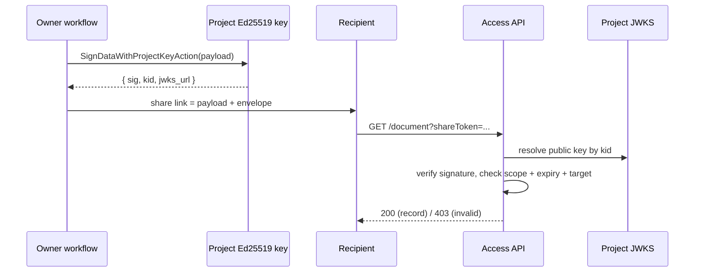

# Using share tokens to authorize access

A **share token** grants a recipient access to a specific record with
specific rights for a limited time - the "share this document by link"
pattern (Google-Docs style). OpenAPPL has **no dedicated share-token
pattern**; you build one by composing existing patterns. That makes this the
canonical example of **customizing access rules with a non-defined
capability** using current building blocks.

This page covers the **stateless, signed-payload** approach: the token *is*
the proof, verified by signature with no database row. The **stateful**
variant is a random token stored as a row and validated by fetching it
(`FetchObjectAction` + `ValidationAction`); the comparison table below
contrasts the two. Both are valid; both validate **without** a membership
check.

> A share token is **not** a [membership](../composition/membership.md).
> Membership is a managed per-resource grant checked with
> `MembershipCheckAction`; a share token here is a self-contained signed
> credential. Do not validate a share token with a membership check.

## The idea: a signed payload as a credential

A share token is a small **data payload** describing what it grants:

```json
{
  "targetObject": "Document",
  "targetObjectId": "doc-uuid-123",
  "rights": ["read"],
  "expiresAt": "2026-06-01T00:00:00.000Z"
}
```

You **sign** that payload with the project's **Ed25519** private key,
producing a verifiable envelope. The share token is the payload plus its
envelope. The recipient presents it to an access API, which **verifies the
signature with the project's public key** (resolved via JWKS). The signature
is the proof - there is no row to look up, nothing to revoke server-side, and
no membership involved. It is fully **stateless**.

This builds directly on [Application signing & keys](application-signing.md)
- same Ed25519 project key, same `{ sig, kid, jwks_url }` envelope.



## Step 1 - Mint the token (sign the payload)

In the "create share link" business API, build the payload and sign it with
[`SignDataWithProjectKeyAction`](../../spec/SignDataWithProjectKeyAction.md):

```json
{
  "actions": {
    "signDataWithProjectKeyActions": [
      {
        "name":                "signShareToken",
        "inputData":           { "js": "{ targetObject: 'Document', targetObjectId: this.data.documentId, rights: ['read'], expiresAt: new Date(Date.now() + 7*24*3600*1000).toISOString() }" },
        "contextPropertyName": "shareEnvelope"
      }
    ]
  }
}
```

The action writes `this.shareEnvelope = { sig, kid, jwks_url }`. Combine it
with the payload into a single compact, URL-safe token - for example
base64url-encode `{ payload, envelope }` - and return it as the share link.
The signing is over a canonical (sorted-key) form, so the verifier reproduces
identical bytes regardless of property order.

> Only authorize an owner (or someone with the right to share) to mint a
> token - gate this API with your normal role / ABAC / ownership rules. The
> token's `rights` should never exceed what the minter is allowed to grant.

## Step 2 - Verify the token on the access API

On the API that consumes the share token, the flow is:

1. **Decode** the token back into `{ payload, envelope }`.
2. **Verify** the envelope's signature against `payload` using the project
   **public** key (resolved from `envelope.jwks_url` by `kid`).
3. **Authorize** from the *verified* payload: the requested record matches
   `targetObjectId` / `targetObject`, the required scope is in `rights`, and
   `expiresAt` is in the future.

### The verification path (mind the action gap)

There is **no dedicated "verify project signature" action** in the blueprint
surface today, and the existing
[`VerifyWebhookAction`](../../spec/VerifyWebhookAction.md) is
provider-bound (payment HMAC/RSA), not a generic Ed25519 verifier. So the
verification runs through a **service-library function** invoked by a
[`FunctionCallAction`](../../spec/FunctionCallAction.md) (or
`ArrowFunctionAction`). The library function fetches the project public key
via JWKS and verifies the envelope - the generated service ships a
`verifyProjectData(payload, envelope)` helper in its project-identity
layer for exactly this: it throws on a bad signature or an untrusted JWKS
and otherwise lets the library function return the trusted payload. This
library-function step is itself a clean illustration of the
pattern-customization story. For how the helper is provided in the generated
service, see [the compiler specification](../../compiler/index.md).

Wire it into the access API: a
[`FunctionCallAction`](../../spec/FunctionCallAction.md) whose `callScript`
invokes the library function (`shareTokenLib.verify`, which decodes the
base64url token, verifies the envelope and returns the payload), then a
[`ValidationAction`](../../spec/ValidationAction.md) against the verified
payload:

```json
{
  "actions": {
    "functionCallActions": [
      {
        "name":                "verifyShareToken",
        "callScript":          { "js": "LIB.shareTokenLib.verify(this.shareToken)" },
        "contextPropertyName": "shareClaim"
      }
    ],
    "validationActions": [
      {
        "name":             "shareTokenAllows",
        "validationScript": { "js": "this.shareClaim.targetObject === 'Document' && this.shareClaim.targetObjectId === this.documentId && this.shareClaim.rights.includes('read') && new Date(this.shareClaim.expiresAt) > new Date()" },
        "shouldBeTrue":     true,
        "errorMessage":     "This document requires a valid, in-scope, unexpired share token.",
        "errorStatus":      "403"
      }
    ]
  }
}
```

Because everything the access decision needs is **inside the verified
payload**, no `ShareToken` row is read and no `MembershipCheckAction` runs.

## Stateless vs stateful - choosing

| | **This guide (stateless, signed)** | **Stateful, stored** |
|---|---|---|
| Token | signed payload `{ target, rights, expiresAt }` | random string |
| Storage | none - token carries everything | a `ShareToken` row (hash) |
| Validation | verify signature + check claims | `FetchObjectAction` + `ValidationAction` |
| Revocable early | no (only via short `expiresAt`) | yes (delete the row) |
| Scales | trivially (no lookup) | one read per use |
| Pattern | [`SignDataWithProjectKeyAction`](../../spec/SignDataWithProjectKeyAction.md) + JWKS verify | `FetchObjectAction` + `ValidationAction` |

Pick **stateless** when you want zero server state and easy distribution and
can live with expiry-only revocation. Pick **stateful** when you need to
revoke links on demand. **Neither uses a membership check** - that is a
separate, managed access dimension covered by the
[Membership](../composition/membership.md) composition.

## See also

- [Application signing & keys](application-signing.md) - the Ed25519 key and envelope this builds on.
- [Membership](../composition/membership.md) - the managed per-record grant (distinct from share tokens).
- Actions: [`SignDataWithProjectKeyAction`](../../spec/SignDataWithProjectKeyAction.md),
  [`FunctionCallAction`](../../spec/FunctionCallAction.md),
  [`ValidationAction`](../../spec/ValidationAction.md).
