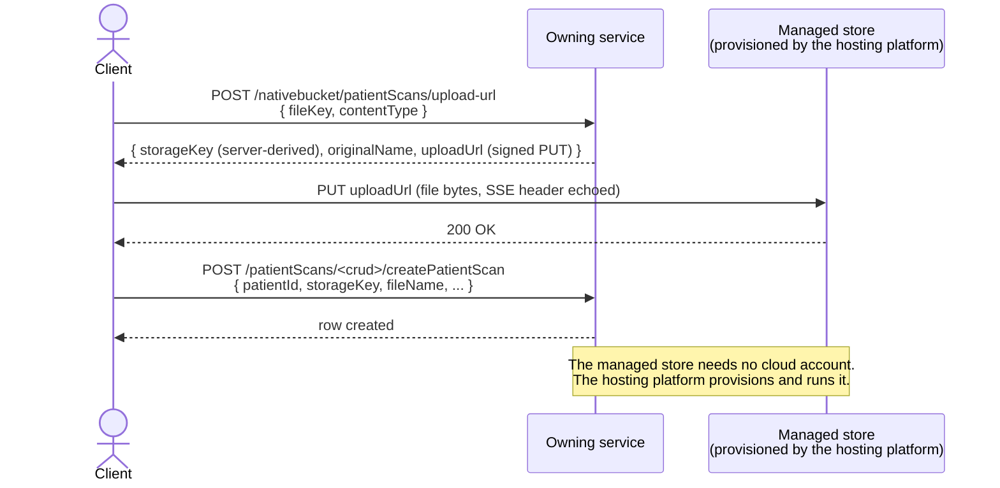

# Native buckets

A [`NativeBucket`](../../spec/NativeBucket.md) is a file bucket backed by a
**managed object store provisioned by the hosting platform**: full S3-style
object semantics (presigned upload/download, large files, streaming,
server-side encryption) with **no cloud account, no cloud credentials, and no
cloud cost**. The author just declares the bucket; the hosting platform stands
up and manages the store behind it. This makes native buckets the natural
choice for on-prem / air-gapped / data-sovereignty deployments where files
must stay inside the project's own infrastructure.

The managed store speaks the S3 API and is driven through the *same* S3
adapter that serves S3 / R2 / s3Compatible [remote buckets](remote-buckets.md).
A NativeBucket is therefore a RemoteBucket with the provider taken out of your
hands: same upload flow, same presign/SSE/CORS behaviour, same metadata
model, but you never name a provider, supply credentials, or pay a cloud
bill.

> **The managed store is the platform's choice, not yours.** Which object
> store backs native buckets is an implementation detail of the hosting
> platform. You declare a NativeBucket, not "a store of brand X". If you want
> to point at *your own* S3-compatible store (your own MinIO or any other
> S3-compatible server), that is a [RemoteBucket](remote-buckets.md) with the
> `s3Compatible` provider, not a NativeBucket.

## Intake and inline opt-ins

`bucketBasics.allowPresignedUpload` is Boolean, default false. A scanned RemoteBucket or NativeBucket exposes `/upload-url` only with this explicit opt-in; otherwise send multipart bytes through `/upload`. Effective scanning includes public-read auto-promotion. Scanning plus opt-in reports `VIRUS_SCAN_BYPASSED_BY_PRESIGNED_INTAKE`, because direct provider PUTs are not scanned. Unscanned buckets keep `/upload-url`. A public-delivery bucket still refuses presigned uploads; on a scanned public bucket without the opt-in the route is absent rather than returning 405.

S3 binds `Content-Type` and the exact key in the PUT signature; GCS already binds both. Clients must send every returned upload header. Azure cannot bind PUT Content-Type and relies on inert downloads. Presigned PUTs cannot enforce sniffing, scanning or a size limit. Through-server uploads refuse a declared signature-bearing type with a different or unknown sniff (`400 MIME_TYPE_MISMATCH`) before scanning or writing, even without an allow-list or under image/*. The only accepted differences are APNG declared PNG and PostScript inside a %PDF- container declared PDF; both retain their declared type. Ordinary PostScript is not PDF.

`bucketBasics.serveActiveInline` is Boolean, default false. Inline requires an exact declared active MIME type and recorded file metadata. The actual signed storage URL must use HTTPS whose registrable domain matches a project domain in `SERVICE_URL`, `FRONTEND_URL`, `ALLOWED_ORIGINS` or `COOKIE_DOMAINS`. Provider/shared hosting names (including S3, GCS, Azure Blob and GitHub Pages) are always refused. Both service and frontend URLs must be configured. Unrelated or provider storage hosts, unknown metadata, malformed origins or missing identity keep attachment serving. This conservative origin check uses the Public Suffix List. Existing stored attachment metadata is overridden only on an eligible signed GET. DbBucket refuses the field and proxy responses keep attachment, nosniff and sandbox CSP; public delivery still refuses active MIME declarations.

## Native vs remote vs DB buckets

There are three bucket flavours, all declared as chapters on a
[`Service`](../../spec/Service.md):

| | **DbBucket** | **RemoteBucket** | **NativeBucket** |
|---|---|---|---|
| Bytes live in | the service DB (`BYTEA`) | your cloud provider (S3/R2/s3Compatible/GCS/Azure) | the store managed by the hosting platform |
| You supply | nothing | a provider + credentials | nothing |
| Cloud account | none | yours | none |
| Best for | small files, transactional consistency | large files, CDN reach, regional placement | large files **without** a cloud account: on-prem / data-sovereignty |

A NativeBucket gives you the object-store ergonomics of a RemoteBucket
(presigned direct upload/download, no DB bloat) while keeping the
"declare it and forget it" simplicity of a DbBucket (no provider, no
secrets).

## Declaring a native bucket

A native bucket is declared under `services[].nativeBuckets[]`. The shape
mirrors a [remote bucket](remote-buckets.md), with **one difference**: the
`bucketStorage` block has **no `providerName`**: the managed store is
implicit and project-scoped.

```json
{
  "nativeBuckets": [
    {
      "bucketBasics": {
        "name":             "patientScans",
        "description":      "Medical imaging that must stay on-prem.",
        "maxFileSizeMb":    250,
        "allowedMimeTypes": "application/dicom,image/png,application/pdf",
        "virusScan":        true
      },
      "bucketStorage": {
        "nativeBucketName":     null,
        "keyPrefix":            "scans/",
        "presignTTLSeconds":    900,
        "serverSideEncryption": true
      },
      "bucketAuthorization": {
        "readAccess":      "private",
        "writeAccess":     "authenticated",
        "writeCheckRoles": ["clinician"]
      },
      "ownerDataObject": {
        "hasOwnerDataObject": true,
        "configuration": { "dataObjectName": "patient", "relationProperty": "patientId" }
      }
    }
  ]
}
```

### `bucketStorage` ([`NativeBucketStorage`](../../spec/NativeBucketStorage.md))

The slim, provider-less variant of `RemoteBucketStorage`:

| Field | Required | Notes |
|-------|----------|-------|
| `nativeBucketName` |  | Optional override for the physical bucket name in the managed store. When null, falls back to the project's managed default bucket (`<codename>-native`), which the hosting platform creates. Bucket names are shared by every project of the cluster, so an authored name must start with `<codename>-` followed by a name (e.g. `<codename>-kyc-docs`); any other name is refused at design time (`NATIVE_BUCKET_NAME_FOREIGN`). When set it must also be a valid S3 bucket name (3 to 63 characters, lowercase letters, digits, dots and hyphens, starting and ending with a letter or digit, no adjacent dots, not IP-shaped); a camelCase name such as `kycDocs` is a design-time error (`NATIVE_BUCKET_NAME_INVALID`). The bucket is provisioned for you, never the author's job. |
| `keyPrefix` |  | Path prefix prepended to every stored object key (e.g. `scans/` gives `scans/<uuid>`). Lets multiple native buckets share the managed default physical bucket. |
| `presignTTLSeconds` |  | Presigned URL lifetime in seconds. Default 900 (15 minutes). Downloads return a short-lived signed URL and the client transfers bytes directly to/from the managed store. |
| `serverSideEncryption` |  | When true, enables SSE-S3 / AES256 on the managed store. Default **false**: opt-in, because the managed store only accepts the header when it was provisioned with an SSE-S3 key; without one every upload answers 500 InternalError while bucket creation still succeeds. |
| `objectCacheControl` |  | Cache-Control of the bucket's objects; works as on a remote bucket (see below). |

Note there is **no `providerName`**, which is the whole point. Everything
else (`bucketBasics`, `bucketAuthorization`, `ownerDataObject`) is shared
verbatim with [remote buckets](remote-buckets.md), so virus scanning,
MIME sniffing, read/write authorization, access keys, and owner pairing
all behave identically. The one exception is `bucketBasics.imageVariants`:
[image variants](remote-buckets.md#image-variants-thumbnails) are created for
remote buckets only, so a native bucket accepts the field
with the warning `IMAGE_VARIANTS_NOT_IMPLEMENTED` and creates no variants.

## What the generated service provides per native bucket

- **A metadata data object** named `{bucketName}RemoteFile`: the same twin
  suffix a [remote bucket](remote-buckets.md) gets, because native and remote
  buckets share one mechanism. Its columns are `fileName`, `mimeType`, `fileSize`,
  `storageKey`, `accessKey`, `owner`, plus the scan columns when `virusScan`
  is on and the owner FK when `ownerDataObject` is set. Binary content lives
  in the managed store, not the row. The twin is materialized when the service is
  built, so a listing of the blueprint's authored data objects never contains it;
  it is nevertheless a legal `childObject` / fetch target at design time, and
  the validator resolves it from the bucket declaration.
- **System upload / download routes** under `/nativebucket/{bucketName}/`:
  `upload-url` (presigned PUT), `upload` (through-server), `download/:key`,
  and `object/:key` (delete). It is the same surface as a remote bucket, only
  the prefix differs. As there, `:key` is sent as
  `encodeURIComponent(storageKey)`, and a service may also accept the key
  with plain slashes (what `%2F` becomes behind a proxy that decodes it).

### Browser-reachable presigned URLs (`NATIVEBUCKET_PUBLIC_PRESIGN_BASE`)

The managed store's own endpoint is typically an in-cluster address: the
service dials it, a browser cannot. Presigned `upload-url` and `download/:key`
URLs are therefore signed against `NATIVEBUCKET_PUBLIC_PRESIGN_BASE`, the
publicly routable base URL of the native store (scheme + host[:port], behind
your ingress). The URL is SIGNED for that host (SigV4 binds the Host header),
not rewritten after signing, so the ingress must forward the public Host to the
store unchanged. This also covers a remote bucket that fell back to the managed
store because its provider credentials are incomplete.

- Unset on the native store: presigning refuses with
  `NativeBucketPublicPresignBaseMissing` (the message names the variable)
  instead of handing out a URL nobody can reach. The through-server `upload`
  route and server-side reads, writes and deletes keep working without it.
- A real cloud provider (AWS S3, R2, a public MinIO) is presumed
  client-reachable and presigns against its own endpoint as before
  (`BucketProviderConfig.publicPresignBase` is the equivalent switch for an
  `s3Compatible` provider behind a proxy).
- The variable is set per deployment slot by the hosting platform or the
  operator; where it is not set, presigned URLs are refused on that slot.

## Reading, writing and deleting objects from service code

Service code never needs the `NATIVEBUCKET_*` names. The generated bucket
layer exposes the same in-process helpers for native and remote buckets:

- `readBucketObject(bucketName, storageKey, { maxBytes? })`: the object's
  bytes, through the managed store the bucket's routes use. A trusted
  server-side read (no read gate): see
  [Reading an object's bytes in service code](remote-buckets.md#reading-an-objects-bytes-in-service-code)
  for the contract and the typed `BucketObjectError` codes.
- `deleteBucketObject` / `writeBucketObject`: a cron or internal api
  deleting or storing its own objects, through the bucket's own route body;
  see
  [Deleting and writing objects in service code](remote-buckets.md#deleting-and-writing-objects-in-service-code).

When a RemoteBucket and a NativeBucket on the same service share a name,
pass `{ kind: 'native' }` (or `'remote'`) to pick one.

## How the managed store is wired

The store is resolved at runtime from project-scoped `NATIVEBUCKET_*`
environment (endpoint, default bucket, root credentials), with
path-style addressing always on. You never set these by hand: the hosting
platform provisions the store and injects the binding into the service. For
how a compiler and its platform wire the store, see
[the compiler specification](../../compiler/index.md).

The store's key pair (`NATIVEBUCKET_ACCESS_KEY_ID` /
`NATIVEBUCKET_SECRET_ACCESS_KEY`) is never required at boot. A service with
no native bucket does not read it at all. A service that declares one but
starts with the pair blank still starts: it logs one
`NativeBucketStoreNotConfigured` warning, `/health` reports
`nativeBucketStore: { status: "degraded", code: "BUCKET_PROVIDER_NOT_CONFIGURED" }`,
and only the file operations that reach the store fail, with
`503 BUCKET_PROVIDER_NOT_CONFIGURED`. Every other route works.

Because native buckets ride the same S3 adapter as the S3-family remote
buckets, the full object-store contract holds: presigned PUT/GET,
`x-amz-server-side-encryption: AES256` on presign (when the managed store
carries an SSE key), CORS for browser-direct uploads, and byte-exact
round-trips.

## Upload sequence



The storage key is server-derived on both upload paths, exactly as on a remote
bucket: `fileKey` and the multipart file name are name hints that
supply the extension and come back as `originalName`, while the key itself is
16 CSPRNG bytes. See
[Remote buckets](remote-buckets.md#the-storage-key-is-server-derived) for the
reasoning and for what it costs.

`bucketStorage.objectCacheControl` works here exactly as it does on a remote
bucket: null (the default) means
`public, max-age=31536000, immutable`, and a value set on the bucket is written
into the stored object metadata, into the `Cache-Control` entry of the `headers`
map the presigned upload returns, and into the signed GET-side response
override, all three from one resolved value, because the read-time override wins
over what is stored. The managed store is S3-API, so both carriers apply and an
object already in the bucket is re-labelled at GET time; the stored metadata
still only changes for objects written after the change. A malformed value is
an authoring-time error naming the bucket. See
[Per-bucket Cache-Control](remote-buckets.md#per-bucket-cache-control).

## When to reach for a native bucket

- **Data sovereignty / on-prem.** Files must not leave the project's own
  infrastructure (healthcare, government, regulated industries).
- **No cloud account.** You want object-store ergonomics (presign, large
  files) without signing up for, paying for, or rotating credentials on a
  cloud provider.
- **Self-contained deploys.** An air-gapped or single-tenant install that
  ships everything it needs.

Reach for a [RemoteBucket](remote-buckets.md) instead when you *want* a
specific cloud provider (CDN reach, regional placement, an existing
bucket, or your own self-managed S3-compatible store). Reach for a
[DbBucket](db-buckets.md) for small files that should live transactionally
with the row.

## See also

- [Remote buckets](remote-buckets.md): the provider-backed sibling
  (S3 / R2 / s3Compatible / GCS / Azure), including how to point a RemoteBucket
  at your own S3-compatible store via the `s3Compatible` provider.
- [DB buckets](db-buckets.md): in-database file storage.
- [DataObject capabilities](../data-modeling/object-capabilities.md): the
  three bucket flavours in context.
- Patterns: [`NativeBucket`](../../spec/NativeBucket.md),
  [`NativeBucketStorage`](../../spec/NativeBucketStorage.md),
  [`RemoteBucketBasics`](../../spec/RemoteBucketBasics.md),
  [`RemoteBucketAuthorization`](../../spec/RemoteBucketAuthorization.md),
  [`RemoteBucketOwnerConfig`](../../spec/RemoteBucketOwnerConfig.md).
