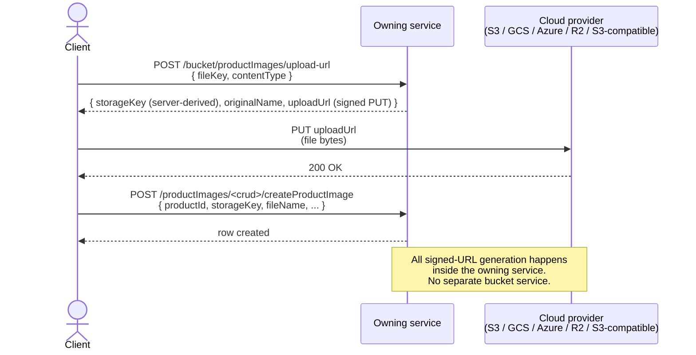

# Remote buckets

A [`RemoteBucket`](../../spec/RemoteBucket.md) is a cloud-storage-backed file bucket. Files are uploaded to an external provider (S3, R2, any S3-compatible endpoint, GCS, or Azure Blob) and only their metadata is stored in the service database. The bucket router of the generated service dispatches on `provider.provider` and calls the same canonical methods regardless of backend. Use remote buckets for large files (images, videos, documents) and anywhere CDN reach, regional placement, or provider-side lifecycle policies are required.

There is no separate "bucket service". Each bucket lives as a chapter on the owning [`Service`](../../spec/Service.md) and its upload and download routes are emitted directly into that service. Provider credentials are declared once on the project under [`projectSettings.bucketProvidersSettings`](../../spec/BucketProvidersSettings.md); buckets reference a provider by name.

For in-database file storage (small files, transactional consistency with the row), see the sister page [DB buckets](db-buckets.md). For the same object-store ergonomics **without** a cloud account (a store managed by the hosting platform, friendly to on-prem and data-sovereignty needs), see [Native buckets](native-buckets.md).

## Intake and inline opt-ins

`bucketBasics.allowPresignedUpload` is Boolean, default false. A scanned RemoteBucket or NativeBucket exposes `/upload-url` only with this explicit opt-in; otherwise send multipart bytes through `/upload`. Effective scanning includes public-read auto-promotion. Scanning plus opt-in reports `VIRUS_SCAN_BYPASSED_BY_PRESIGNED_INTAKE`, because direct provider PUTs are not scanned. Unscanned buckets keep `/upload-url`. A public-delivery bucket still refuses presigned uploads; on a scanned public bucket without the opt-in the route is absent rather than returning 405.

S3 binds `Content-Type` and the exact key in the PUT signature; GCS already binds both. Clients must send every returned upload header. Azure cannot bind PUT Content-Type and relies on inert downloads. Presigned PUTs cannot enforce sniffing, scanning or a size limit. Through-server uploads refuse a declared signature-bearing type with a different or unknown sniff (`400 MIME_TYPE_MISMATCH`) before scanning or writing, even without an allow-list or under image/*. The only accepted differences are APNG declared PNG and PostScript inside a %PDF- container declared PDF; both retain their declared type. Ordinary PostScript is not PDF.

`bucketBasics.serveActiveInline` is Boolean, default false. Inline requires an exact declared active MIME type and recorded file metadata. The actual signed storage URL must use HTTPS whose registrable domain matches a project domain in `SERVICE_URL`, `FRONTEND_URL`, `ALLOWED_ORIGINS` or `COOKIE_DOMAINS`. Provider/shared hosting names (including S3, GCS, Azure Blob and GitHub Pages) are always refused. Both service and frontend URLs must be configured. Unrelated or provider storage hosts, unknown metadata, malformed origins or missing identity keep attachment serving. This conservative origin check uses the Public Suffix List. Existing stored attachment metadata is overridden only on an eligible signed GET. DbBucket refuses the field and proxy responses keep attachment, nosniff and sandbox CSP; public delivery still refuses active MIME declarations.

Some of these behaviours are implemented per target language; see [the compiler specification](../../compiler/index.md).

## Declaring a remote bucket

A remote bucket is declared under `services[].remoteBuckets[]`:

```json
{
  "remoteBuckets": [
    {
      "bucketBasics": {
        "name":             "productImages",
        "description":      "Product cover images and gallery photos.",
        "maxFileSizeMb":    25,
        "allowedMimeTypes": "image/png,image/jpeg,image/webp",
        "virusScan":        false
      },
      "bucketStorage": {
        "providerName":         "mainStorage",
        "remoteBucketName":     "shop-prod-images",
        "keyPrefix":            "products/",
        "presignTTLSeconds":    3600,
        "serverSideEncryption": true
      },
      "bucketAuthorization": {
        "readAccess":       "public",
        "writeAccess":      "authenticated",
        "writeCheckRoles":  ["seller", "admin"]
      },
      "ownerDataObject": {
        "hasOwnerDataObject": true,
        "configuration": {
          "dataObjectName":   "product",
          "relationProperty": "productId"
        }
      }
    }
  ]
}
```

## Sub-blocks

A remote bucket has three required sub-blocks and two optional ones.

### `bucketBasics` ([`RemoteBucketBasics`](../../spec/RemoteBucketBasics.md))

| Field | Required | Notes |
|-------|----------|-------|
| `name` | ✓ | Unique within the service. Drives route paths, table names, and API names. Must be a valid codeName. |
| `description` | ✓ | Human-readable purpose. |
| `maxFileSizeMb` |  | Hard upload cap. Default 100 MB. |
| `allowedMimeTypes` |  | Comma-separated MIME whitelist. An entry is an exact `type/subtype`, a family wildcard `type/*` (`image/*` accepts every image subtype) or `*/*`; matching is case-insensitive and ignores `;` parameters, and any other shape fails generation naming the bucket and the entry. Note that `image/*` also admits `image/svg+xml`, which is XML the magic-byte sniff cannot identify (it is accepted on the declared type alone); a bucket that means raster images should list `image/png,image/jpeg,image/webp,...` explicitly. The service additionally sniffs the file's magic bytes: a client-spoofed `Content-Type` is rejected when the sniffed type doesn't match. Null means allow any type. |
| `virusScan` |  | When true, an upload that goes THROUGH this service (`POST /bucket/{name}/upload`) is ClamAV-scanned before being written to the provider. Unlike a DbBucket this is a property of that ROUTE and not of the file row: a `{name}RemoteFile` row carries a `storageKey` and no bytes, so there is nothing at row creation to scan. A presigned PUT from `/upload-url` never passes through this service and is never scanned, and a business api that writes the twin row itself records a key for bytes nothing here saw. An intake that must accept files from anonymous or untrusted callers belongs in a DbBucket, whose scan is attached to the row. Auto-promoted to true when `readAccess: 'public'`. The verdict lands in the `scanStatus` / `scanResult` / `scannedAt` columns of the metadata data object, which every twin carries whether or not scanning is on. |
| `virusScanMode` |  | `block` (HTTP 422, nothing written) or `quarantine` (uploaded to a `_quarantine/` prefix, row marked infected, downloads refused). Falls back to `projectSettings.clamAvSettings.configuration.defaultMode` (default `block`). See [Scan-mode precedence](#scan-mode-precedence). |
| `imageVariants` |  | Resized copies (thumbnails) created on upload: `[{ name, width, height?, fit, format, quality, withoutEnlargement }]` ([`ImageVariant`](../../spec/ImageVariant.md)). See [Image variants](#image-variants-thumbnails). |
| `allowPresignedUpload` |  | Boolean, default false. See [Intake and inline opt-ins](#intake-and-inline-opt-ins). |
| `serveActiveInline` |  | Boolean, default false. See [Intake and inline opt-ins](#intake-and-inline-opt-ins). |

### `bucketStorage` ([`RemoteBucketStorage`](../../spec/RemoteBucketStorage.md))

| Field | Required | Notes |
|-------|----------|-------|
| `providerName` | ✓ | Matches an entry under `projectSettings.bucketProvidersSettings.bucketProviders[]`. The service reads credentials from `BUCKET_<NAME>_*` environment variables. |
| `remoteBucketName` |  | Physical bucket name at the provider. Falls back to the provider's `defaultBucketName`. The bucket must exist: it is not auto-created. |
| `keyPrefix` |  | Path prefix prepended to every stored object key (e.g. `avatars/` produces keys like `avatars/<uuid>`). Lets multiple buckets share one physical provider bucket. |
| `presignTTLSeconds` |  | Presigned URL lifetime in seconds. Default 900 (15 minutes). |
| `serverSideEncryption` |  | When true, provider-side encryption is enabled (SSE-S3 for AWS, default encryption for GCS/Azure). Default **false**: SSE is opt-in, because a store with no SSE-S3 key configured answers 500 InternalError to every PUT carrying the header. Turn it on for AWS S3 (always supported) or any store you know accepts SSE-S3. |
| `objectCacheControl` |  | Cache-Control the bucket's objects are stored and served with. Null means the default `public, max-age=31536000, immutable`. See [Per-bucket Cache-Control](#per-bucket-cache-control). |
| `delivery` |  | `presigned` (default) or `public`. See [Public delivery](#public-delivery-public-content-buckets). |
| `publicBaseUrl` |  | With `delivery: 'public'`: the https URL that maps to the root of the physical bucket. |

### `bucketAuthorization` ([`RemoteBucketAuthorization`](../../spec/RemoteBucketAuthorization.md))

| Field | Notes |
|-------|-------|
| `readAccess` | `public` (anyone, including via access key), `private` (owner + admins; default), `authenticated` (any signed-in user), `roles` (holders of a `readCheckRoles` role). |
| `writeAccess` | `authenticated` (default), `adminOnly`, or `roles` (holders of a `writeCheckRoles` role). Governs upload only. |
| `deleteAccess` | `owner` (default: the account that uploaded the file, plus admin roles), `adminOnly`, or `authenticated` (any authenticated user may delete any file; keep it only as a deliberate choice). |
| `enableKeyAccess` | When true, a 12-character random `accessKey` issued at upload time grants read access regardless of `readAccess`. Useful for shareable links. |
| `readAbsoluteRoles` / `writeAbsoluteRoles` | Roles that bypass all checks. |
| `readCheckRoles` / `writeCheckRoles` | Roles required for read / write when `readAccess` / `writeAccess` is `roles`. Every name in the four role lists must be a defined role (a system role, a `roleItems` name or value, or a `customRoleLookups` name): an undefined one is the warning `UNDEFINED_BUCKET_GATE_ROLE`, and a check list in force (`roles` mode) whose every name is undefined, with no defined role in the matching absolute list, is that code as an error, because the bucket then admits no defined-role session. A business membership accessLevel (for example `businessAdmin`) is not a session role. |
| `readAuthScript` / `writeAuthScript` | MScript expressions evaluated against the request context. Must return `true` to permit. On a download `readAuthScript` runs after the `{name}RemoteFile` twin lookup and sees that row as `data`; a key with no twin row is answered `404 NOT_FOUND` without running the script, and a denial answers the same, so a script never turns into an existence oracle (a presign-uploaded object with no twin is therefore not readable through a scripted bucket, absolute roles excepted). |

**Admin roles.** The "admins" of `private` reads, of `adminOnly` uploads and deletes, of the owner-delete allowance and of the image-variant backfill are the project's platform operator roles: `superAdmin` and `saasAdmin` on a multi-tenant project (`admin` is not a role there, and a tenant administrator such as `tenantAdmin` is not admitted), `superAdmin`, `admin` and `saasAdmin` on a single-tenant project. `readAbsoluteRoles` / `writeAbsoluteRoles` widen a bucket for other roles deliberately.

### `ownerDataObject` (optional, [`RemoteBucketOwnerConfig`](../../spec/RemoteBucketOwnerConfig.md))

When set, every file row carries an FK to the named data object. Enables "list files for this product" / "delete this product, cascade its images". Set `hasOwnerDataObject: true` and configure `configuration.dataObjectName` (the local data object name) plus an optional `relationProperty` (defaults to `<dataObjectName>Id`).

The pairing is an upload-time contract: `POST /bucket/{name}/upload` requires the owner id in the multipart body (`400 OWNER_REQUIRED` without it), and by default no download route consults it. `configuration.downloadRequiresActiveOwner: true` (default `false`) is the opt-in that makes every download route of the bucket check the owner before serving:

- **What runs.** After the bucket's read gate (`readAccess`, roles, `readAuthScript`) has allowed the request, the route loads the file's metadata row, reads the owner id from it, and loads the owner through the owner object's default `get<Owner>ById`, which excludes soft-deleted rows (`isActive: false`). If the metadata row is missing, carries no owner id, or the owner row is missing or inactive, the route answers `404 NOT_FOUND`, the same answer a never-existing key gets. A hidden, merged or deleted owner therefore leaks nothing through its files, provided you model those states as a soft delete (or any state the default read excludes).
- **Order matters.** The gate runs first, so an unauthorised caller still gets `401`/`403` and never learns whether the owner exists. `readAuthScript` sees the `{name}RemoteFile` twin as `data` (a key with no twin row is answered as missing before the script runs); this policy is the router's own check all the same, not something a script has to do.
- **RemoteBucket / NativeBucket.** The metadata row is the `{name}RemoteFile` twin, looked up by `storageKey`. The through-server upload (`POST /bucket/{name}/upload`) writes that row itself, owner FK included. A presigned `POST /bucket/{name}/upload-url` upload never passes through the service and writes no row, so such a file is not served under this policy unless your own business logic persists its twin row.
- **DbBucket.** The `{name}File` row already carries the owner FK; the check covers `/download/:id`, `/download/key/:accessKey`, the `/shared/:key` link and the metadata route `GET /bucket/{name}/object/:key`. That last one matters more than it sounds: the metadata response spreads the whole file row minus the byte columns, so every custom business column the author added travelled with it while the bytes were already answering 404. Metadata is as owner-scoped as the bytes.
- The owner must be a local (same-service) data object; a cross-service reference fails generation with a message naming the bucket. A missing owner data-layer function at runtime answers `503 OWNER_OBJECT_NOT_DECLARED` after the gate.

### `remoteBucketSettings` (optional, [`RemoteBucketSettings`](../../spec/RemoteBucketSettings.md))

#### Extra columns on the RemoteFile twin

The `{name}RemoteFile` twin has a fixed set of columns owned by the compiler. A bucket whose files need more (a lifecycle `status`, a foreign key to the record the file will belong to, a `messageId`, any bucket-specific metadata) declares them in `remoteBucketSettings.additionalColumns` instead of hand-rolling a second data object that repeats `fileName` / `mimeType` / `storageKey`. You cannot author a data object named `{name}RemoteFile` yourself (`REMOTE_BUCKET_NAME_CONFLICT`), so this is the one place to extend it.

```json
{
  "remoteBucketSettings": {
  "additionalColumns": [
    {
      "basicSettings": {
        "name": "status", "type": "Enum", "enumOptions": ["PENDING", "ATTACHED"],
        "isRequired": true, "defaultValue": "PENDING", "isArray": false, "allowUpdate": true
      },
      "indexSettings": { "indexedInDb": true },
      "uploadSettings": { "fromUploadField": true }
    },
    {
      "basicSettings": { "name": "ticketId", "type": "ID", "isRequired": false, "isArray": false, "allowUpdate": true },
      "relationSettings": { "relationName": "ticket", "relationTargetObject": "ticket", "relationTargetKey": "id", "onDeleteAction": "setNull", "relationIsRequired": false }
    }
  ]
  }
}
```

- **Each entry is a full [`DataProperty`](../../spec/DataProperty.md)**, validated by the same rules as a property of an authored data object (type, enum options, defaults, relations, index settings). The columns are appended to the twin after its base columns and the owner FK; the generated model, data layer and CRUD APIs carry them like any other property.
- **Names are reserved.** A column may not repeat a base column, the owner FK, the tenant column or a system column (`id`, `createdAt`, `updatedAt`, `isActive`, `_archivedAt`, `recordVersion` and their snake spellings) or the `_type` record discriminator every outgoing record carries; names compare case-insensitively (`REMOTE_BUCKET_COLUMN_NAME_RESERVED`).
- **The upload route writes the base columns, plus the columns flagged `uploadSettings.fromUploadField`.** A required column therefore needs a `defaultValue` or `defaultFn` (`REMOTE_BUCKET_COLUMN_REQUIRED_WITHOUT_DEFAULT`), which fills it when the upload inserts the row without it. Write the other extra columns afterwards through a `createCrudAction` / `updateCrudAction` with `childObject: "{name}RemoteFile"`, or a BusinessApi whose `dataObjectName` is the twin; the validators resolve the declared columns there exactly as they do on an authored object.
- **Setting a column at upload time.** A column that declares `"uploadSettings": { "fromUploadField": true }` is copied by the through-server upload (`POST /bucket/{name}/upload`, `POST /nativebucket/{name}/upload` and the in-process `writeBucketObject` helper's `fields`) from the multipart text field of the SAME name, so a client that knows the file's `status` or its target record id at upload time needs no second call. Only flagged columns are read; every other multipart field, a base column's name included, never reaches the row, and the base columns are written after the flagged ones so none can be replaced. The value is checked against the column type first: `ID` (a UUID or a 24-hex ObjectId), `String` (at most 255 characters), `Text`, `Integer`, `Short`, `Double`, `Float`, `Decimal` (a plain decimal number), `Boolean` (`true` / `false`), `Date` (ISO 8601) or `Enum` (an exact option). A mismatch, or a field sent twice, answers `400` with `errorCode: "UPLOAD_FIELD_INVALID"`, the `field` and the `expected` shape, before the bytes are scanned or stored; a field left out keeps the column default. Array columns, `Object` / Geo / `Blob` types and columns with another value source (`autoIncrement`, `sessionSettings`, `staticJoin`, `decisionSource`) cannot be flagged (`REMOTE_BUCKET_UPLOAD_FIELD_UNSUPPORTED`), nor can a column named `file` or `fileKey`, which the route reads itself (`REMOTE_BUCKET_UPLOAD_FIELD_NAME_RESERVED`). The presigned `/upload-url` path writes no row, so it carries no fields. A target language whose upload routes do not copy the fields yet is reported with the warning `REMOTE_BUCKET_UPLOAD_FIELD_NOT_IMPLEMENTED`; on an ordinary data object the flag means nothing (`PROPERTY_UPLOAD_FIELD_OUTSIDE_BUCKET_TWIN` warning).
- **Relations** to a stored data object are allowed; a relation to a virtual (response-only) data object is refused (`VIRTUAL_OBJECT_REFERENCE`).
- **Adding a column to a deployed bucket.** On the next deploy the schema sync of the service adds the column to the existing twin table; rows that already exist get the column's default, or NULL for an optional column without one. That is one more reason a required column must declare a default: a NOT NULL column without one cannot be added to a table that already holds rows.
- **Target languages and bucket kinds.** A target language that persists no `{name}RemoteFile` twin cannot carry the columns; when the service's build language is known at validation time, the validator says so with the `REMOTE_BUCKET_COLUMNS_NOT_PERSISTED` warning. Both `RemoteBucket` and `NativeBucket` accept `remoteBucketSettings.additionalColumns` with the same reserved-name and required-column default rules. See [the compiler specification](../../compiler/index.md).

`remoteBucketSettings.compositeIndexSettings` declares composite indexes on the twin with the normal [`CompositeIndex`](../../spec/CompositeIndex.md) contract (`indexName`, ordered `indexFields`, `onDuplicate`, optional `partialWhere`); field references must resolve to a base column, the owner FK, the tenant column or an additional column.

## Project-level provider

The bucket references a named provider declared once on the project:

```json
{
  "projectSettings": {
    "bucketProvidersSettings": {
      "bucketProviders": [
        {
          "name":     "mainStorage",
          "provider": "s3",
          "configuration": {
            "region":            "us-east-1",
            "defaultBucketName": "shop-prod-images",
            "endpoint":          null,
            "forcePathStyle":    false
          }
        }
      ]
    }
  }
}
```

The `provider` is one of `s3`, `gcs`, `azure`, `r2` or `s3Compatible` ([`BucketProvider`](../../spec/BucketProvider.md), [`BucketProviderConfig`](../../spec/BucketProviderConfig.md)). Credentials (`accessKeyId`, `secretAccessKey`) are read at runtime from `BUCKET_MAINSTORAGE_ACCESS_KEY_ID` / `BUCKET_MAINSTORAGE_SECRET_ACCESS_KEY`. The blueprint never carries secrets.

The physical bucket is `bucketStorage.remoteBucketName`, else the provider's `defaultBucketName`; it must already exist at the provider. Both names are checked against the provider brand's naming rules at design time (`BUCKET_NAME_INVALID`, an error except on `s3Compatible`; an empty effective name is `REMOTE_BUCKET_NAME_EMPTY`); a bucket the provider does not know answers `503 BUCKET_NOT_FOUND` (below).

**Set `region` to where the bucket really lives.** Real AWS answers a request signed for the wrong region with `301 PermanentRedirect`. The two upload paths recover differently:

- The through-server calls (`/upload`, delete, the CORS setup) are sent by the service, and the S3 client follows the region AWS names in the redirect's `x-amz-bucket-region` header, so a wrong region costs one extra round trip on those calls, not the request.
- S3 and GCS upload/download presigns for the same provider client and bucket await one shared CORS read/merge attempt, including concurrent first calls. The settled attempt stays cached for the process lifetime. CORS read or write failures warn once and still permit presigning; operators must then configure browser CORS themselves. Restarting the process resets the cache.
- A presigned `/upload-url` is sent by the end user's browser, so nothing on the server sees the redirect: the upload fails in the browser. Validation warns (`BUCKET_PROVIDER_AWS_REGION_UNCONFIRMED`) when an `s3` provider with no `endpoint` leaves the region unset or at the `us-east-1` default.

When the storage provider itself refuses a server-side call, the route answers `503` with the fault named in `errorCode` instead of a bare `500 INTERNAL_ERROR`:

- `BUCKET_NOT_FOUND`: the configured bucket does not exist at the provider (S3 `NoSuchBucket`, a GCS 404 on the bucket, Azure `ContainerNotFound`). The body carries `provider` (the bucket provider's name, `native` for the managed store) and `bucket` (the configured bucket name), and `detail` names both. This one is recognised on every brand.
- `BUCKET_PROVIDER_REGION_MISMATCH`: a redirect that named no region, or a signature scoped to the wrong one.
- `BUCKET_PROVIDER_REJECTED`: the provider refused the service's credentials (`InvalidAccessKeyId`, `SignatureDoesNotMatch`, `ExpiredToken`, `InvalidToken`). A bare S3 `AccessDenied` is not classified: S3 also answers it for a missing key when the principal lacks `s3:ListBucket`, so it keeps the generic `500`.
- `BUCKET_PROVIDER_NOT_CONFIGURED`: no credentials, and the managed native store is unconfigured too.

No answer carries the provider's raw message or a credential, and the full error is still logged server-side. Apart from `BUCKET_NOT_FOUND`, the classification reads the S3 SDK's error names, so it covers the S3 family (`s3`, `r2` and `s3Compatible` providers, and the managed native store); any other GCS or Azure fault keeps the generic `500`.

## What the generated service provides per bucket

For each `RemoteBucket` entry, the owning service provides:

- **A metadata data object** named `{bucketName}RemoteFile`. Its base columns are `fileName`, `mimeType`, `fileSize`, `storageKey`, `accessKey`, `uploaderUserId`, `scanStatus`, `scanResult` and `scannedAt` (the scan columns exist on every twin), plus the owner FK property when `ownerDataObject` is set, the tenant column (`<tenantName>Id`) on a multi-tenant project, and any column declared in `remoteBucketSettings.additionalColumns` (see [Extra columns on the twin](#extra-columns-on-the-remotefile-twin)). CRUD APIs land at the standard `/{service}/...` routes.
- **System upload / download routes** under `/bucket/{bucketName}/` (see the note on the prefix below):
  - `POST /bucket/{name}/upload-url`: issue a presigned PUT URL the client uploads directly to. Response: `{ storageKey, uploadUrl, contentType, ... }`.
  - `POST /bucket/{name}/upload`: through-server upload (multipart). Used when magic-byte sniffing or virus scanning must happen before bytes hit the provider.
  - `GET /bucket/{name}/download/:key`: returns a 302 redirect to a short-lived signed GET URL; the client downloads directly from the provider.
  - `DELETE /bucket/{name}/object/:key`: remove the remote object (and its image variants, when the bucket declares any).
  - `POST /bucket/{name}/variants/backfill`: only on a bucket with `imageVariants`: admin roles create the variants older objects miss (see [Image variants](#image-variants-thumbnails)).

  `:key` is the `storageKey` the upload returned. Build the URL with `encodeURIComponent(storageKey)` (`/download/book-covers%2FXa9.png`); a service may also accept the same key with plain slashes (`/download/book-covers/Xa9.png`), which is what the encoded form becomes behind a proxy or ingress that decodes `%2F`, so a download works behind any gateway. Either form is decoded the same way, and a key with an empty, `.` or `..` segment, a leading `/`, a backslash or a NUL character answers `400 BUCKET_OBJECT_KEY_INVALID`.
- **A `variants` column** on the metadata data object, only when the bucket declares `imageVariants`.

> Note on route prefix: `RemoteBucket` mounts under `/bucket/{name}/`, the same prefix `DbBucket` uses, deliberately, so client code can move a bucket between the two kinds without touching a URL. `NativeBucket` alone mounts under `/nativebucket/{name}/`. The `/remotebucket/{name}/` prefix that some older material cites is not mounted.

## Scan-mode precedence

Two different knobs decide what an infected upload does, and they resolve in two different phases. Getting them confused is how a bucket declared `quarantine` ends up returning 422.

**Design time, per bucket.** The compiler resolves one value per bucket and builds it into the service:

1. the bucket's own `bucketBasics.virusScanMode`, if set;
2. otherwise `projectSettings.clamAvSettings.configuration.defaultMode`;
3. otherwise `block`.

Because this is resolved per bucket, two buckets in the same service can legitimately have different modes. The project-level `defaultMode` is a fallback for buckets that left the field null, never an override of buckets that set it.

**Runtime, per process.** The `CLAMAV_DEFAULT_MODE` environment variable is an operational escape hatch that overrides the resolved mode for every bucket in the process. It works in both directions: `quarantine` forces quarantining, `block` forces rejection. Only those two spellings count (trimmed, case-insensitive); unset, empty or anything unrecognised means no override, and the per-bucket value wins.

Do NOT wire a deployment to emit `CLAMAV_DEFAULT_MODE` from `clamAvSettings.configuration.defaultMode`. The project default is already folded into the per-bucket value at step 2, so re-injecting it as the process-wide override makes it beat every per-bucket value and inverts the precedence above.

Not every target language implements this precedence in full; see [the compiler specification](../../compiler/index.md).

## The scanner transport

A RemoteBucket upload is scanned by the same runtime client as a DbBucket: by default the platform's ClamAV REST service named by the defaults of [`ClamAvSettingsConfig`](../../spec/ClamAvSettingsConfig.md) (`POST <url>/api/v1/scan`, one file per request in the multipart field `FILES`), or a self-hosted clamd with `projectSettings.clamAvSettings.configuration.protocol: clamd`. The default endpoint is plain HTTP, so the file bytes travel in clear text to that host. A file over the service's 100 MB limit is not sent and counts as a scan that could not run. The transport choice, the env vars, the answer mapping and the per-environment `CLAMAV_ON_ERROR` defaults are described in [DbBucket, section "The scanner: where the bytes go"](db-buckets.md#the-scanner-where-the-bytes-go).

What the `{name}RemoteFile` row records: `scanStatus` is `clean`, `infected`, `quarantined` or `error`, and `scanResult` is the detection's signature name for an infected upload, `null` for a clean one, and the fixed text `scan could not run` when the scanner could not run (accepted under `CLAMAV_ON_ERROR=skip`, or quarantined in quarantine mode). The scanner's own reason names its internal host, port and error code, so it never lands in the row or in a response: the service logs it on the request's `VirusScanSkipped` or `VirusScanQuarantined` line, stamped with that request's id.

## Upload sequence



Through-server upload (`/upload`) compresses the two-step flow into one round trip and is required when `allowedMimeTypes` enforcement or `virusScan: true` is set: those checks must inspect the bytes before they're persisted.

### The storage key is server-derived

The client does not choose the object's storage key, on either upload path. The key is `keyPrefix` + 16 CSPRNG bytes as base64url (22 characters) + at most a file extension copied from the name the client sent, matched as `[A-Za-z0-9]{1,10}` after the last dot, so no separator, dot-segment or percent escape can reach the key. `fileKey` on `/upload-url` and the multipart file's own name are therefore **name hints**, not keys: they supply the extension and come back as `originalName`.

The reason is that a storage provider has no per-object ownership: the storage key *is* the object's identity. While the caller named it, any principal that passed the write gate could name an object another user already owned and overwrite its bytes; with the immutable `Cache-Control` below, a client holding a cached signed URL would keep serving the old bytes for a year while the key held new content.

What this costs: you cannot overwrite an object by re-uploading under a known key (the "one `avatar.png` per user" idiom). Delete, then upload, and persist the `storageKey` the response returns; every download, share and delete route already addresses objects by it. Store `originalName` in the `{bucket}RemoteFile` twin's `fileName` column if you want to show the user's own name back to them. The through-server `/upload` reads the multipart file name as UTF-8 (the raw bytes a browser sends in `filename="..."`; an RFC 5987 `filename*=UTF-8''...` works too), so `originalName` and the twin's `fileName` keep a non-ASCII name byte for byte.

## Read shape

Reading a file row returns the metadata. To download, hit the bucket's download route with the row's `storageKey`. The route 302s to a short-lived signed GET issued by the provider: the client downloads directly from the provider, never through the service. URL expiry is `presignTTLSeconds`.

Caching is split in two: the 302 carries `Cache-Control: no-store` (its `Location` is a bearer credential that expires with the presign TTL, so nothing may cache or replay it), while the object bytes are stored with `Cache-Control: public, max-age=31536000, immutable` at upload (`CacheControl` on the S3 PUT, `cacheControl` metadata on GCS, `blobCacheControl` on Azure) and the provider serves that header on every GET. On the presigned-upload path the client sends the `headers` map returned by `/upload-url` (`Content-Type`, `Cache-Control`, provider extras): the URL itself carries none of them, and no provider SIGNS `Cache-Control` either, because all three take it as a plain request header and store what arrives, so the client's PUT is where the object's properties come from and echoing the whole map is the whole contract. Omitting `Cache-Control` costs the object its cache header and nothing else; omitting `Content-Type` breaks the signature. Objects written before the service started sending the header have none stored, so the presigned GET asks the provider to serve it anyway (S3 `ResponseCacheControl`, Azure `rscc`); GCS has no cache-control response override, so a pre-existing GCS object keeps the bucket default until it is rewritten. The `immutable` in that policy is honest: the storage key is server-derived on both upload paths (see [The storage key is server-derived](#the-storage-key-is-server-derived) above), so a caller cannot overwrite an object it did not create and the bytes under a key do not change underneath a cached copy. An author who rewrites a key through the provider SDK is the one remaining case, and even there a cache entry is keyed by the signed URL, which is minted per request, so a newly minted URL can see the new bytes. A browser reusing an old signed URL can keep its immutable cached bytes for up to one year (`max-age=31536000`), even after the presign TTL expires; the TTL limits provider authorization, not the lifetime of an already cached response. Always resolve a fresh URL through the no-store redirect.

### Per-bucket Cache-Control

`bucketStorage.objectCacheControl` replaces that framework-wide policy for ONE bucket. Null (the default) means `public, max-age=31536000, immutable`, so a bucket that says nothing behaves as it always did. Set it when a year and `immutable` are the wrong promise: `no-cache` for a rendered report that is rewritten in place through the provider SDK, `private, max-age=60` for a regulated bucket whose bytes should not sit in a shared cache, `public, max-age=300` for a scratch area.

**Both sides carry it, and they must agree.** The value is written into the stored object metadata (`CacheControl` on the S3 PUT, `metadata.cacheControl` on GCS, `blobCacheControl` on Azure), into the `Cache-Control` entry of the `headers` map `/upload-url` hands the client, AND into the signed GET-side response override (S3 `ResponseCacheControl`, Azure `rscc`). The override is what the browser sees, so a per-bucket value set only on the write side would be silently replaced by the default on every download. All of them read one resolved value, which is what keeps them from drifting.

**GCS has no cache-control response override at all**: it honours `response-content-type` and `response-content-disposition` only. On GCS the stored metadata is therefore the ONLY carrier, so changing `objectCacheControl` applies to objects written AFTER the change and never retroactively; objects already in the bucket keep the header they were stored with until they are rewritten. On S3 and Azure the GET-side override re-labels old objects too.

The value is stored verbatim by every provider and served to every browser, so it is shape-checked at authoring time: comma-separated Cache-Control directives, each `name` or `name=value`. A malformed value is an ERROR on the field naming the bucket, not a surprise header in production.

### Public delivery (public-content buckets)

A bucket that holds public content only (catalog covers, product images) can skip per-request presigning: `bucketStorage.delivery: 'public'` plus `bucketStorage.publicBaseUrl`, the https URL that maps to the root of the physical bucket (the provider URL, or a CDN / custom domain in front of it). `GET /bucket/{name}/download/:key` then answers `302` to the object's **stable** URL (`<publicBaseUrl>/<storageKey>`, each key segment URL-encoded) with the bucket's object `Cache-Control` instead of `no-store`, so browsers and CDNs reuse the bytes across visits, and `/upload` returns that URL as `publicUrl`.

A public bucket offers **no presigned upload**: `POST /bucket/{name}/upload-url` answers `405` `PRESIGNED_UPLOAD_NOT_OFFERED` and presigns nothing. A presigned PUT cannot inspect the bytes, so its body could be an active document stored under a non-active key and then served as stored, inline and long-cached, from the stable URL. Every byte of a public bucket therefore goes through `POST /bucket/{name}/upload`, which classifies the body (see Active content below) before it is stored, so the objects behind the public URL are safe to serve as stored.

The objects must be publicly readable at the provider (for example an S3 bucket policy granting `s3:GetObject` on the bucket's `keyPrefix`); the generated service never changes provider policies. Do not use a subdomain of the application's own domain as `publicBaseUrl`: that origin serves user uploads.

Public delivery is validated before anything is generated. It is accepted only for a bucket whose design already says anyone may read every file and whose objects are safe to serve as stored, otherwise the blueprint is refused with a `REMOTE_BUCKET_PUBLIC_DELIVERY_*` error naming the field:

- `bucketAuthorization.readAccess` is `'public'`;
- nothing narrows a read per file: no `readAuthScript`, `enableKeyAccess` off, `ownerDataObject.configuration.downloadRequiresActiveOwner` off;
- `publicBaseUrl` is an absolute https URL with no query string or fragment;
- `bucketBasics.allowedMimeTypes` is declared and lists no active type (see below);
- the bucket does not scan in quarantine mode (a quarantined object would sit under the same public prefix; the service also refuses a `CLAMAV_DEFAULT_MODE=quarantine` override for this bucket).

A key whose extension names active content still goes out as an inert presigned URL, and a bucket whose deployment has no credentials for its provider (and so fell back to the managed native store) keeps presigning. A target language that does not implement the mode keeps presigning and the validator warns (`REMOTE_BUCKET_PUBLIC_DELIVERY_NOT_PORTED`); see [the compiler specification](../../compiler/index.md).

### Active content (HTML, SVG, JavaScript, XML)

A file a browser would run or render as a document (HTML, XHTML, SVG, any JavaScript type, XML and any `+xml` type) is **accepted as its type only when the bucket declares it**: the exact type is listed in `allowedMimeTypes`. A wildcard (`image/*`, `*/*`) or no list is not a declaration. The upload is classified by its leading bytes, its resolved content type and (when no binary signature was found) its file name; an undeclared active upload is still accepted, but stored as `application/octet-stream`, with the client's name kept as `originalName` and the active extension left out of the storage key. A server-script extension (`.php`, `.jsp`, `.aspx`, ...) never reaches a storage key. The same rule runs on `/upload-url` (from the declared type and the name) and on the in-process `writeBucketObject`, so bytes a service fetches from elsewhere are classified alike.

Every active object is **served inert by default**; the inline opt-in above is the only exception. A presigned download of a key whose extension names an active type is signed with `Content-Disposition: attachment` and `Content-Type: application/octet-stream` response overrides (S3 `response-content-disposition` / `response-content-type`, GCS `responseDisposition` / `responseType`, Azure `rscd` / `rsct`), and a declared active object is stored with `Content-Disposition: attachment` and a key ending in its type's extension. A DbBucket download always sends `X-Content-Type-Options: nosniff` and `Content-Disposition: attachment` (named `download` when the row has no name), plus `Content-Security-Policy: default-src 'none'; sandbox` for an active type. Raster images, PDF and video are unaffected; `` of an image keeps working. The classification is the one [service files](service-files.md) use, but inline requires the explicit opt-in and isolated origin described above: a presigned URL is answered by the provider, which cannot carry a CSP.

When `enableKeyAccess: true`, the file's 12-character `accessKey` can be used in place of session auth, so a public download link can be `?accessKey=<key>` without exposing other files.

The Remote/Native access key is derived per file as an HMAC over the service's `BUCKET_TOKEN_SECRET` (the bucket router's own signing key; see [DB buckets](db-buckets.md#the-bucket-signing-key)), so key access needs that variable set. Without it the bucket fails closed: `/upload` and `/upload-url` answer `accessKey: null` and every `?accessKey=` download falls back to the read gate. Because an environment variable is unknowable when the blueprint is validated, the generated service reports this at boot instead: it logs one warning per affected bucket, naming it (`RemoteBucket "<name>": enableKeyAccess is on but BUCKET_TOKEN_SECRET is not set`).

## Reading an object's bytes in service code

A library function or an action that must process an uploaded file itself (parse a spreadsheet, OCR a document) reads the bytes in process, through the bucket layer of the generated service: no SDK client, no `BUCKET_<NAME>_*` / `NATIVEBUCKET_*` env name, no key-prefix rule to reproduce.

`readBucketObject(bucketName, storageKey, { maxBytes?, kind? })` resolves `{ bucket, storageKey, body, contentType, size }`, where `body` is the object's bytes. In a custom library function the call is made through the generated bucket layer of the target language; see [the compiler specification](../../compiler/index.md) for how to import it.

- `bucketName` is the bucket's `bucketBasics.name`; `storageKey` is the value the upload routes return (prefix included). The provider, the physical bucket (`remoteBucketName`, else the provider's `defaultBucketName`), the key prefix and the credential fallback to the managed store are the SAME ones the bucket's routes use: the helper reads the route group's own record, it does not re-derive them. S3, R2, S3-compatible, GCS and Azure providers and [native buckets](native-buckets.md) all read the same way.
- The byte cap, `maxBytes`, is optional and defaults to the bucket's `maxFileSizeMb` (100 MB when that is `0`); a larger object is refused before it is buffered.
- `kind` (`'remote'` or `'native'`) picks the bucket when a RemoteBucket and a NativeBucket of the same service share a name.
- Failures are a `BucketObjectError` carrying `code` and `status`: `BUCKET_OBJECT_NOT_FOUND` (404), `BUCKET_OBJECT_TOO_LARGE` (413), `BUCKET_OBJECT_KEY_INVALID` (400, a key outside this bucket's `keyPrefix`), `BUCKET_OBJECT_QUARANTINED` (403, a key under `_quarantine/`: infected uploads are never readable), `BUCKET_NOT_DECLARED` (404, no such Remote/Native bucket on this service), `BUCKET_NOT_FOUND` (503, the provider bucket does not exist) and `PROVIDER_NOT_CONFIGURED` (503).
- It is a TRUSTED server-side read: it runs no read gate and needs no session. Before handing the bytes to a caller, authorize that caller the way any in-process read is authorized, typically by resolving the `storageKey` from a `{bucketName}RemoteFile` row (or a business row) the caller may read, never by trusting a key the caller typed.

A cron or internal api that must **delete or write** objects of its own service uses the in-process helpers in [Deleting and writing objects in service code](#deleting-and-writing-objects-in-service-code) below.

## Deleting and writing objects in service code

A cron or internal api that must remove (or store) objects of its OWN service's Remote/Native buckets (an orphan sweep, a retention purge, a generated report) calls the in-process helpers of the same bucket layer, passing the calling api manager as `caller`. The helpers are called from an API action as `LIB.<function>(this, ...)`: a library function does not receive the api manager as its receiver, so pass it explicitly.

- `deleteBucketObject(bucketName, storageKey, { caller, kind? })` resolves `{ status: 'ok', bucket, storageKey }`. `_quarantine/` keys are deletable; keys outside the bucket's `keyPrefix` are not.
- `writeBucketObject(bucketName, { body, fileName?, contentType?, fields? }, { caller, kind? })` resolves the upload route's JSON answer (`storageKey`, `originalName`, `scanStatus`, ...). `fileName` is a name hint only (the key stays server-derived); `fields` are the multipart fields an upload would carry, e.g. the `ownerDataObject` id.
- Both run the bucket's OWN route body: the same gate, MIME sniff, virus scan, upload cap, owner field, tenant term and `{bucketName}RemoteFile` twin row as the HTTP routes. Like `DELETE /bucket/{name}/object/:key`, a delete removes the object only; delete the twin row through its data-layer function if you keep one.
- **Who is exempt from the write/delete gate.** Exactly the callers the api manager treats as trusted-system triggers: an api manager built by the generated service whose controller is `cron` or `internal`. Every other caller (a REST/Kafka/gRPC/MCP/SSE manager, or no `caller`) is judged by the ordinary gates with its own session, exactly as over HTTP: anonymous 401, logged-in non-owner 403 on the default `deleteAccess: 'owner'`, admin allowed. Any object that is not such a manager, even one carrying `controllerType: 'cron'`, a `session`, or its own override of the trust check, gets no exemption and no session, so request data handed to a helper by mistake cannot open the gate or borrow an identity. No HTTP request can reach the exemption either: the helpers are in-process functions, not routes.
- Failures are a `BucketObjectError` carrying the route's own `errorCode` and status (`ACCESS_DENIED`, `FILE_TOO_LARGE`, `MIME_TYPE_NOT_ALLOWED`, `OWNER_REQUIRED`, `VIRUS_DETECTED`, `BUCKET_NOT_FOUND`, ...).

## Image variants (thumbnails)

A bucket that holds pictures usually needs smaller copies of them: a 600 px thumbnail for a list, a square crop for an avatar. Declare them on the bucket instead of resizing by hand in a business API:

```json
{
  "bucketBasics": {
    "name": "bookCovers",
    "maxFileSizeMb": 5,
    "allowedMimeTypes": "image/png,image/jpeg,image/webp",
    "imageVariants": [
      { "name": "thumb", "width": 600 },
      { "name": "square", "width": 200, "height": 200, "fit": "cover", "format": "jpeg", "quality": 70 }
    ]
  }
}
```

Each entry is an [`ImageVariant`](../../spec/ImageVariant.md): `name` (an identifier, unique in the bucket), `width` (1-10000 px), an optional `height`, `fit` (`inside` by default: scale to the width keeping the aspect ratio; `cover`, `contain`, `fill`, `outside` need a `height` to differ from it), `format` (`webp` by default; `jpeg`, `png`, `avif`), `quality` (1-100, default 80; png is lossless) and `withoutEnlargement` (default true: an image smaller than the target is never upscaled). The list is compiled into the service; the service never reads the blueprint at runtime.

**When they are made.** `POST /bucket/{name}/upload` stores the original unchanged, then creates every variant with the target's image renderer before it answers: synchronously, one after the other, so there is no "ready" state to poll. The upload response and the `{name}RemoteFile` row carry the result in `variants`:

```json
{
  "variants": {
    "thumb":  { "key": "book-covers/Xa9...__thumb.webp", "url": "https://api.example.com/catalog-api/bucket/bookCovers/download/book-covers%2FXa9....png?variant=thumb", "width": 600, "height": 954, "format": "webp", "size": 41230 },
    "square": { "key": "book-covers/Xa9...__square.jpeg", "url": "...?variant=square", "width": 200, "height": 200, "format": "jpeg", "size": 9120 }
  }
}
```

- A variant lives in the same bucket at `<original key without extension>__<name>.<format>`. It is auto-oriented from the EXIF orientation and carries none of the original's metadata.
- Only raster images the service itself stores get variants: uploads through `/upload` and the in-process `writeBucketObject` whose BYTES carry a jpeg, png, webp, gif, avif/heif or tiff signature. The declared content type does not decide: anything else (a pdf, an svg, even one declared `image/png`) gets `variants: null` and never reaches the image library. The backfill applies the same byte check.
- Resource bounds: an input larger than 50 megapixels (`IMAGE_VARIANT_MAX_INPUT_PIXELS`; a 48 MP phone photo fits) is a recorded variant failure, not a render, and at most 2 variants render at once per service process (env `IMAGE_VARIANT_MAX_CONCURRENCY`, a positive integer), so a burst of uploads queues instead of multiplying decode memory. A presigned `/upload-url` upload never passes through the service and gets none either; nothing outside the bucket (an external URL stored in a field) is ever fetched or resized.
- **A variant failure never fails the upload.** The original is already stored when the variants are made, and losing it over a thumbnail is the worse outcome, so the upload answers `ok` and the variant is recorded as `{ "error": "...", "format": "webp" }` (and logged as `ImageVariantFailed`). The backfill route below creates it later.
- Declaring variants makes the generated service depend on its image library. A blueprint that lists that library in `serviceBasics.packages` keeps validating and building: the entry gets the warning `NPM_PACKAGE_NOW_FRAMEWORK_MANAGED` (not the `FRAMEWORK_MANAGED_NPM_PACKAGE` error other managed names get), and the library is declared once at the compiler's version. Remove the entry when convenient.

**Reading a variant.** `url` is the bucket's own download route for the ORIGINAL key with `?variant=<name>`: the route applies the original's read gate, tenant and owner checks, then redirects to a short-lived signed URL of the variant. The base is `SERVICE_URL` when it is set. Without it, a local run (`CONFIG_ENV=dev`) uses the request's host and every other slot records a service-relative `url` (`/bucket/{name}/download/...`), never one built from the request's `Host` header. When the row does not record that variant (a non-image, a failed or not yet backfilled variant, a presigned upload) the route serves the original instead, so `` never breaks; the `X-Bucket-Variant` response header says which one was served (`thumb`, or `original`). An undeclared name answers `400 VARIANT_UNKNOWN`. A variant object is reachable ONLY this way: its own key (`.../download/<stem>__thumb.webp`) answers `404`, and so does `DELETE .../object/<variant key>`, because a variant has no row of its own and the tenant and owner checks belong to the original's row. This holds for any key shaped like a variant (`__<name>.<webp|jpeg|png|avif>`) with no row of its own, including variants made under a name you later renamed or removed. A frontend that used to read `thumbUrl || url` reads `variants?.thumb?.url || url`.

**Copies in other services.** `variants` is a column of the `{name}RemoteFile` row, so the row's create and update events carry it. A service that copies an image into a snapshot (an order line, a sale item) takes `variants.thumb.url` from the event payload instead of calling back.

**Deleting.** `DELETE /bucket/{name}/object/:key` also deletes the original's variants (every key the declared variants derive from it, plus every variant key its row recorded) and answers them in `deletedVariants`. Replace an image by deleting the old object and uploading the new one: the old variants go with the old original. A variant that cannot be deleted is logged and does not fail the delete.

**Backfill.** `POST /bucket/{name}/variants/backfill?page=1&pageSize=20` (admin roles; `pageSize` at most 100) walks one page of `{name}RemoteFile` rows, oldest first, and creates the variants each row does not record yet: objects stored before the declaration, a variant added later, a variant that failed. It reads the original from the provider, writes the missing variants, and updates the row (which raises its update event). It is idempotent: a row whose variants all exist is counted `complete` and left alone. The answer is `{ scanned, created, failed, skipped, complete, hasMore, nextPage }`; call it again with `nextPage` until `hasMore` is false. Non-images and quarantined rows are `skipped`.

Image variants are generated for `RemoteBucket` only. A `NativeBucket` accepts the field with the warning `IMAGE_VARIANTS_NOT_IMPLEMENTED` and creates nothing yet, and so does a RemoteBucket in a service whose build language does not implement variants. Some target languages cannot render every source format (for example AVIF or HEIF originals); there the variant is a recorded failure (`IMAGE_VARIANT_SOURCE_UNSUPPORTED`) and the upload itself still succeeds. See [the compiler specification](../../compiler/index.md).

## Lifecycle

- **Hard delete of the file row** removes the remote object (via `DELETE /bucket/{name}/object/:key`).
- **Soft delete on the file row** keeps the remote object: toggle `isActive` to `false` to hide it from listings. To purge, run a follow-up hard delete.
- **Cascading delete from the owner** (when `ownerDataObject` is set and the owner is configured with `onDeleteAction: "doDelete"` on the FK) removes file rows and, in turn, their remote objects. The other three values apply here too: `setNull` orphans the file row deliberately, `restrict` refuses the owner's delete with HTTP 409 `RELATION_RESTRICTED` while any live file row points at it, and `doNothing` leaves it pointing at the archived owner. See [On-delete cascades](../data-modeling/relations.md#on-delete-cascades).

## Worked example: Product with cover image and a gallery

Add two buckets to a `shop` service, pair both with the `product` data object:

```json
{
  "remoteBuckets": [
    {
      "bucketBasics": {
        "name": "productCover",
        "description": "Single cover image per product.",
        "maxFileSizeMb": 10,
        "allowedMimeTypes": "image/png,image/jpeg,image/webp"
      },
      "bucketStorage":       { "providerName": "mainStorage", "keyPrefix": "products/cover/" },
      "bucketAuthorization": { "readAccess": "public", "writeAccess": "authenticated", "writeCheckRoles": ["seller"] },
      "ownerDataObject":     { "hasOwnerDataObject": true, "configuration": { "dataObjectName": "product" } }
    },
    {
      "bucketBasics": {
        "name": "productGallery",
        "description": "Additional product photos.",
        "maxFileSizeMb": 25,
        "allowedMimeTypes": "image/png,image/jpeg,image/webp",
        "imageVariants": [{ "name": "thumb", "width": 600 }]
      },
      "bucketStorage":       { "providerName": "mainStorage", "keyPrefix": "products/gallery/" },
      "bucketAuthorization": { "readAccess": "public", "writeAccess": "authenticated", "writeCheckRoles": ["seller"] },
      "ownerDataObject":     { "hasOwnerDataObject": true, "configuration": { "dataObjectName": "product" } }
    }
  ]
}
```

Two `productCoverRemoteFile` and `productGalleryRemoteFile` data objects are generated, each with a `productId` FK; the gallery's also carries the `variants` column, and every gallery upload gets a 600 px webp `thumb`. CRUD APIs for both land on the service; upload / download routes mount under `/bucket/productCover/` and `/bucket/productGallery/`.

## See also

- [DB buckets](db-buckets.md): sister pattern for in-database files.
- [Native buckets](native-buckets.md): the store managed by the hosting platform, with no cloud account or credentials.
- Patterns: [`RemoteBucket`](../../spec/RemoteBucket.md), [`RemoteBucketBasics`](../../spec/RemoteBucketBasics.md), [`ImageVariant`](../../spec/ImageVariant.md), [`RemoteBucketStorage`](../../spec/RemoteBucketStorage.md), [`RemoteBucketAuthorization`](../../spec/RemoteBucketAuthorization.md), [`RemoteBucketOwnerConfig`](../../spec/RemoteBucketOwnerConfig.md), [`RemoteBucketSettings`](../../spec/RemoteBucketSettings.md), [`BucketProvider`](../../spec/BucketProvider.md), [`BucketProvidersSettings`](../../spec/BucketProvidersSettings.md).
