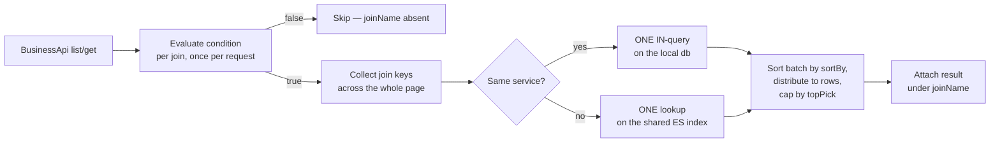

# Select-join

A `SelectJoin` is a read-time join declared on a BusinessApi's
select clause. It attaches fields from a related data object to each
returned row without an SQL join and without N+1 fetches: the service
collects the join keys across the whole result page, fetches the
related rows with **one batched query per join**, and distributes
them in memory. Because the join is application-level, the related
object may live in **another service** (read through the shared
Elasticsearch index) — something an SQL join can never do. Use it
when a list or read endpoint needs a handful of fields from a related
record per row.

The pattern class is `SelectJoin` (`subsection` level). It appears in
the `query.selectClause.selectJoins[]` slot on a BusinessApi (the
slot's type is `SelectClauseSettings`; the parent key on the
BusinessApi's `query` chapter is `selectClause`). The same
`selectClause` block also controls **projection** — which of the main
object's own fields are returned (see
[Select-clause projection](#select-clause-projection) below).

## When to use

Reach for `SelectJoin` when:

- The relation already exists on a property of the main data object,
  or on a property of the target pointing back at the main object.
- Both objects live in the same service (cross-service joins resolve
  against the BFF's Elasticsearch index, which is functionally
  equivalent — see "Cross-service" below).
- The join target is many-to-one, one-to-one, or one-to-many; for
  many-to-many, project a count or use a BFF DataView.

Avoid `SelectJoin` when:

- The same join is read by a large number of subscribers — denormalise
  with [`PropertyStaticJoin`](static-joins.md) instead so reads avoid
  the join cost entirely.
- The join needs cross-service composition across more than one
  relation — use a [DataView](../system-services/bff.md).

## Anatomy

| Property | Type | Req | Notes |
|---|---|---|---|
| `joinName` | String | ✓ | Code-safe identifier. Also the response key under which the joined object / array appears. |
| `joinedDataObject` | DataObjectName | ✓ | Name (and optional service prefix) of the target object. The target must be related to the main object — either via a relation declared on a main-object property, or via a relation declared on a property of the target pointing back at the main object. |
| `selector` | String |  | Disambiguates when more than one relation exists between the two objects. Syntax `mainObjectKey->joinedObjectKey`. Shorthands `->`, `->key`, `key->` are accepted. Use the full form for clarity. A full selector whose keys exist on both objects also resolves when NO relation is declared between them — the named key pair is joined directly. A full selector that matches nothing resolvable drops the join (it never silently falls back to an unrelated key). |
| `properties` | PropRefer[] | ✓ | Which fields to return from the joined object. Empty array returns all fields. |
| `condition` | MScript |  | Boolean expression evaluated per request. When `false`, the join is skipped (the response key is absent). Cannot reference the main object — gates on session, request parameters, or other context. |
| `sortBy` | SortByItem[] |  | Sort applied when the join result is an array (one-to-many). Each entry has `name`, `property`, `order` (`asc` / `desc`). |
| `topPick` | Integer |  | Caps the returned array; `1` collapses to a single object. |

## Evaluation order



Each join is independent and runs AFTER the main operation, never
inside it — there is no SQL join. `condition` runs once per request
(it cannot see main-row fields). The fetch is **batched**: the join
keys of the entire result page are collected first, the related rows
are fetched with a single `$in` query (local) or a single index
lookup (cross-service), and the results are matched back to their
rows in memory. The query count per join is constant — a page of 300
rows costs exactly the same one query as a page of 3.

### When nothing matches

What a row carries under `joinName` when the join finds nothing depends
on the API type:

| Case | `get` API | `list` API |
|---|---|---|
| `condition` is false | key absent | key absent on every row |
| The main row's foreign key is `null` or empty | key absent | key absent on that row |
| Single join (many-to-one / one-to-one), no related row | `null` | key absent on that row |
| One-to-many join, no related row | `[]` (`null` with `topPick: 1`) | key absent on that row |

So a list client must treat a missing key as "no match", while a get
client sees an explicit `null` or `[]` once the row has a key to join
on. A join with exactly one entry in `properties` attaches that field's
value rather than an object (an array of values on a one-to-many join).

## One-to-one / many-to-one

The relation lives on a property of the main object (a foreign-key
property). The service resolves the join as a single record:

```json
{
  "basics": { "apiOptions": { "name": "listOrders", "dataObjectName": "Order", "crudType": "list" } },
  "query": {
    "selectClause": {
      "selectJoins": [
        {
          "joinName":         "customer",
          "joinedDataObject": "User",
          "selector":         "userId->id",
          "properties":       ["id", "fullname", "email"]
        }
      ]
    }
  }
}
```

Response row:

```json
{
  "id":      "ord_123",
  "status":  "paid",
  "total":   99.00,
  "customer": { "id": "u_1", "fullname": "Alice", "email": "alice@example.com" }
}
```

One batched `$in` fetch; N rows still cost one query.

## One-to-many

The relation lives on a property of the *target* pointing back at the
main object. The join returns an array under `joinName`:

```json
{
  "basics": { "apiOptions": { "name": "getOrganisation", "dataObjectName": "Organisation", "crudType": "get" } },
  "query": {
    "selectClause": {
      "selectJoins": [
        {
          "joinName":         "members",
          "joinedDataObject": "User",
          "selector":         "id->organisationId",
          "properties":       ["id", "fullname", "joinedAt"],
          "sortBy":           [ { "name": "byJoinedAt", "property": "joinedAt", "order": "desc" } ],
          "topPick":          50
        }
      ]
    }
  }
}
```

`sortBy` and `topPick` shape the embedded array. Each `SortByItem`
needs `name` (code-safe identifier), `property` (the field to sort
by), and `order` (`asc` or `desc`). With `topPick: 1`, the service
collapses to a single object even though the relation is parental —
useful for "the most recent X" or "the highest-ranked Y".

## Conditional joins

`condition` gates the entire join. Use it for "include this when the
caller asks for it":

```json
{
  "joinName":         "preferences",
  "joinedDataObject": "UserPreference",
  "selector":         "id->userId",
  "properties":       ["theme", "language"],
  "condition":        { "js": "this.includePreferences === true" }
}
```

The expression cannot reference the main object's columns — it is
evaluated once per request, not per row.

## Disambiguating relations

When two objects have more than one relation (e.g. `User.managerId`
and `User.directReportId` both reference `User`), the `selector`
makes the choice explicit:

```json
[
  { "joinName": "manager",       "joinedDataObject": "User", "selector": "managerId->id",       "properties": ["id", "fullname"] },
  { "joinName": "directReports", "joinedDataObject": "User", "selector": "id->managerId",       "properties": ["id", "fullname"] }
]
```

Without `selector`, the service picks the first detected relation —
fine for unambiguous cases, fragile when the model grows.

## Cross-service

A `SelectJoin` whose `joinedDataObject` lives in another service is
resolved through the shared Elasticsearch index rather
than the local database — still one batched lookup per join. The wire
response is the same — the service hides the difference. Cost: the
joined object's data is read from the replicated ES index, so
up-to-the-second freshness depends on the indexer's catch-up latency
(typically < 100ms), and the joined object must be indexed (data
objects are indexed by their owning service's indexer by default).

For more elaborate cross-service composition (multiple joins, stats,
denormalisation), use a [BFF DataView](../system-services/bff.md)
instead.

### Joining a moderated object

When the joined object carries
[`objectModeration`](../capabilities/object-moderation.md) in `mode: onPlace`,
the join runs its read gate with the calling request's identity, local and
cross-service alike: a joined row the caller may not see (not `accepted`,
not their own) is dropped from the join, so a one-to-many array shrinks and
a single join stays unset. See
[the onPlace read gate](../capabilities/object-moderation.md#the-onplace-read-gate).

## Filtering and sorting on joined fields

A `SelectJoin` runs AFTER the main query, so the main query's
`whereClause` / list filters **cannot reference joined columns** —
they see only the main object's own columns. `sortBy` on the join
orders the joined array *within* each row; it does not order the main
result set.

When an endpoint must filter or sort the main rows BY a related
object's fields, that is a composition concern — use a
[BFF DataView](../system-services/bff.md) (which indexes the composed
shape) or denormalise the needed field onto the row with a
[`PropertyStaticJoin`](static-joins.md) and filter on the real column.

## Select-join vs static-join

| | Select-join | [Static-join](static-joins.md) |
|---|---|---|
| Join time | Read | Write |
| Storage cost | None — derived on read | One column per joined field on every row |
| Read cost | One batched query per join per request | Zero |
| Sync model | Always current | As-of-write copy; never re-resolved |
| Use when | Join target changes faster than the row | Row is read far more than the target changes |

Pick `SelectJoin` for owner-facing list pages and admin views; pick
`PropertyStaticJoin` for high-traffic public reads where the joined
field is essentially immutable per row (price-at-purchase, name-at-time-of-event).

## Select-clause projection

The `query.selectClause` block (type `SelectClauseSettings`) has two
parts: `selectJoins[]` (above) and `selectProperties[]` — the
**projection** of the main object's own fields. Projection limits the
columns returned for performance or visibility; it affects only `get`
and `list` APIs.

| Field | Type | Notes |
|---|---|---|
| `selectProperties` | PropRefer[] | Which of the main object's fields to return. **Empty / absent returns all fields.** |
| `selectJoins` | SelectJoin[] | Read-time joins (documented above). |

```json
{
  "basics": { "apiOptions": { "name": "listUsers", "crudType": "list", "dataObjectName": "User" } },
  "query": {
    "selectClause": {
      "selectProperties": ["id", "fullname", "avatarUrl", "lastSeenAt"],
      "selectJoins": [
        { "joinName": "team", "joinedDataObject": "Team", "selector": "teamId->id", "properties": ["id", "name"] }
      ]
    }
  }
}
```

This returns only four columns of `User` per row — never the heavy or
sensitive fields (`passwordHash`, `internalNotes`). Projection compiles
to a `SELECT col1, col2, ...` on SQL databases and to a
field-projection on MongoDB, applied at the query on both
`get` and `list`; see
[How `selectProperties` is applied](../business-apis/list-api.md#how-selectproperties-is-applied)
for the full rules.

> **Projection and joins compose by widening the read, not the
> response.** The join reads its foreign key off the main row,
> so an api that declares a materialized `selectJoin` next to a
> projection reads the declared columns plus that key; the response is
> still the declared columns + `id` + the join payload key. A declared
> select list is always the response boundary: the foreign key is not
> returned unless the list declares it.

> Projection is **not** access control — it shapes the response, not who
> may call the API. Use auth options / permission filters for
> authorization. Use projection to trim payloads and avoid leaking
> internal columns by default.

`selectProperties` lists the main object's own columns;
[`selectJoins`](#anatomy) bring in related-object fields under their
`joinName`. They are declared in one `selectClause`, but they do not
compose on one api — see the note above.

## See also

- [Static joins](static-joins.md) — write-time alternative.
- [Index patterns](index-patterns.md) — index advice for join hot paths.
- [BFF DataViews](../system-services/bff.md) — cross-service composition.
- [MScript query reference](../mscript/query-reference.md) — filter
  syntax including joined columns.
- Specification: [`SelectJoin`](../../spec/SelectJoin.md),
  [`SelectClauseSettings`](../../spec/SelectClauseSettings.md).
