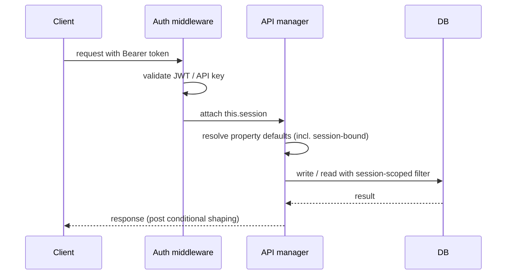

# Session-aware logic

Three patterns that keep "who is calling" out of every API and into
declarative configuration:

- **Property-level session binding** — populate properties from the
  active session at write time (`createdBy ← session.userId`,
  `workspaceId ← session.workspaceId`, i.e. the project's own
  `<tenantName>Id` on both sides — there is no generic `session.tenantId`).
- **Session-scoped reads** — filter list / get APIs by the session at
  request time without writing the predicate in every endpoint.
- **MScript reads of `this.session`** — in workflow actions,
  validations, and ABAC predicates.

Each pattern has a different home in the schema. They compose: a typical
multi-tenant data object uses all three.

## Property-level session binding

A property's value comes from the active session at create time
when its `sessionSettings` block is populated. Activation is
*block-presence* — leave `sessionSettings` null / absent for
properties supplied by the request body.

```json
{
  "objectSettings": {
    "basicSettings": { "name": "order" },
    "authorization": { "objectDataIsInTenantLevel": true }
  },
  "properties": [
    {
      "basicSettings": { "name": "createdBy", "type": "ID", "isRequired": true },
      "relationSettings": {
        "relationName":         "creator",
        "relationTargetObject": "auth:user",
        "relationTargetKey":    "id",
        "onDeleteAction":       "doNothing"
      },
      "sessionSettings": {
        "sessionParam":  "userId",
        "isOwnerField":  true
      }
    }
  ]
}
```

There is no tenant property to declare: on a multi-tenant project,
`objectDataIsInTenantLevel: true` makes the service add the
`<tenantName>Id` column (`workspaceId` for a tenant named `workspace`)
and write the caller's tenant into it on create — see
[Multi-tenancy](../data-modeling/multi-tenancy.md#marking-a-data-object-as-tenant-scoped).

| Setting | Notes |
|---|---|
| `sessionParam` | Name of the session field to read. Defaults to the property's name when omitted. The session carries `userId`, `roleId`, `email`, the tenant id as `<tenantName>Id` and the other fields listed under [The session field set](#the-session-field-set). |
| `isOwnerField` | When `true`, the property is the ownership key for the data object — used by ownership-based access control to scope reads to "rows created by the caller." Set on exactly one property per data object, and only when the property semantically identifies the row's owner (almost always `userId`). |

The service writes the value at every create operation and refuses
to accept it in the request body — the caller cannot override the
session-derived value.

### When the row has no session to be created from

Ownership is **session-fed, directly or carried by a trusted internal
event — never derived from row data.**

The second half of that rule exists for event-sourced objects. An order
row written by a kafka consumer acting on an order-intent event has no
session at its create edge at all, so `sessionParam` binds nothing: the
column stays null, ownership resolves to nothing, and every gate that
asks "who owns this row" — `ownershipCheck`, and the payment pattern's
injected lifecycle routes — silently has no answer.

Declare the provenance instead:

```json
"sessionSettings": { "isOwnerField": true, "ownerProvenance": "payload" }
```

with the `dataClauseItems` entry that writes the column from the event.
This says the owner id was stamped at the **original** session edge, by
the service that produced the event, and travelled here over an
M2M-verified pipe. The column then answers the ownership question
normally.

| | `ownerProvenance` |
|---|---|
| `session` (default) | The creating caller's own session stamps the column. Pair with `sessionParam`. |
| `payload` | A trusted internal event carries the owner id. No `sessionParam`; the create's `dataClauseItems` entry writes it. |

Two rules keep it honest:

- It is **refused on an object with any caller-facing create path** -
  REST, gRPC or SSE (`OWNER_PROVENANCE_PAYLOAD_WITH_REST_CREATE`). The
  column carries no `sessionParam`, so it is not
  excluded from the request contract, and a caller-supplied owner id would
  be written verbatim. kafka, cron and internal-call creates are the
  internal producers the declaration is for.
- Where **no** owner is bindable at all, the payment pattern's mutating
  routes refuse non-M2M callers (403 `OWNER_UNRESOLVED`) rather than
  falling through to the login gate. Silent-open is not a fallback.

### An object written only by internal or cron callers

A `checkout` or `subscription` object that no user ever creates through a
REST route - a renewal order a nightly job opens, a default workspace the
registration event provisions - needs an owner for the payment routes to
bind, and has no session to take it from. Two findings meet here:
`PAYMENT_LIFECYCLE_OWNERSHIP_UNBINDABLE` asks for an owner column, and
`INTERNAL_API_SESSION_DEPENDENT` refuses an internal-call create that
session-injects one. The blessed shape satisfies both:

1. The owner column declares `"sessionSettings": { "isOwnerField": true,
   "ownerProvenance": "payload" }` - no `sessionParam`.
2. The object is created by an **internal-call** create api (or a kafka
   create): `internalCallSettings.hasInternalCallController:
   true`, no caller-facing (REST, gRPC or SSE) create path. The owner is an ordinary request parameter,
   and a `dataClauseItems` entry writes it into the column.
3. A **cron** api has neither a session nor a payload, so it does not write
   the object itself. It composes: it finds the rows it works on and calls
   the internal create with the owner in the parameters,
   `API.<createApi>({ ownerUserId: ... })`.

Abridged (the checkout `configuration` needs its usual `orderName`,
`amountProperty`, status mapping and so on; `billingAccount` is an ordinary
object with `userId` and `monthlyCents`):

```json
{
  "dataObjects": [
    {
      "objectSettings": {
        "basicSettings": { "name": "renewalOrder" },
        "checkout": { "objectIsAnOrderObject": true, "configuration": { "providerName": "stripeMain" } }
      },
      "properties": [
        {
          "basicSettings": { "name": "ownerUserId", "type": "ID", "isRequired": true },
          "sessionSettings": { "isOwnerField": true, "ownerProvenance": "payload" }
        },
        { "basicSettings": { "name": "amountCents", "type": "Integer", "isRequired": true } }
      ]
    }
  ],
  "businessLogic": [
    {
      "basics": { "apiOptions": { "name": "createRenewalOrder", "crudType": "create", "dataObjectName": "renewalOrder" } },
      "controllers": {
        "restSettings": { "hasRestController": false },
        "internalCallSettings": { "hasInternalCallController": true }
      },
      "parameters": { "requestParameters": [
        { "name": "ownerUserId", "type": "ID", "required": true, "httpLocation": "body" },
        { "name": "amountCents", "type": "Integer", "required": true, "httpLocation": "body" }
      ] },
      "query": { "dataClauseItems": [
        { "name": "ownerUserId", "value": { "js": "this.ownerUserId" } },
        { "name": "amountCents", "value": { "js": "this.amountCents" } }
      ] }
    },
    {
      "basics": { "apiOptions": { "name": "renewDueAccounts", "crudType": "list", "dataObjectName": "billingAccount" } },
      "controllers": {
        "restSettings": { "hasRestController": false },
        "cronSettings": { "hasCronController": true, "cronExpression": "0 3 * * *" }
      },
      "actions": {
        "loopActions": [
          { "name": "renewEach", "loopFor": { "js": "this.billingAccounts" }, "loopItemName": "account", "actions": ["createOrderFor"] }
        ],
        "functionCallActions": [
          { "name": "createOrderFor",
            "callScript": { "js": "API.createRenewalOrder({ ownerUserId: account.userId, amountCents: account.monthlyCents })" } }
        ]
      },
      "workflow": { "list": { "afterMainListOperation": ["renewEach"] } }
    }
  ]
}
```

The owner id the cron passes is row data of the cron's own service (here
`billingAccount.userId`), which is exactly what a payload owner means: the
caller vouches for it, and only same-service code can make the call -
`API.<name>` is not reachable from outside the service.

The shapes around it that are **not** blessed, and the finding each one
draws:

| Shape | Finding |
|---|---|
| The owner column keeps `sessionParam` on an internal-call create | `INTERNAL_API_SESSION_DEPENDENT` (error): the internal call has no session, the column is written empty |
| The internal-call api declares `authOptions.ownershipCheck: true` | `INTERNAL_API_OWNERSHIP_UNENFORCEABLE` (error): `API.<name>(...)` runs as the system, the ownership gate is skipped, and the call reaches ANY row. A security finding: a build that skips validation is refused on it too. Drop `ownershipCheck` and select the row by an explicit parameter |
| No owner declaration at all | `PAYMENT_LIFECYCLE_OWNERSHIP_UNBINDABLE` (warning): the mutating payment routes fail closed for non-M2M callers |
| `ownerProvenance: "payload"` on an object that also has a REST, gRPC or SSE create | `OWNER_PROVENANCE_PAYLOAD_WITH_REST_CREATE` (error): a caller could post any owner id |
| `ownerProvenance: "payload"` together with `sessionParam` | `OWNER_PROVENANCE_PAYLOAD_WITH_SESSION_PARAM` (error): the session silently wins |
| A cron api that calls an api without an internal call controller, or a name that is not there | `INTERNAL_API_NO_CONTROLLER` / `INTERNAL_API_NOT_FOUND` (error) |
| An `addToContextActions` entry with `contextName: "session"` (or any other manager member) | `RESERVED_CONTEXT_NAME` (error): the write replaces the caller's session for the rest of the workflow |

**Don't write the session yourself.** An `addToContextActions` entry with
`contextName: "session"` (say `{ userId: this.registeredUserId }`, to fill
a session-fed owner on a kafka-fed create) is refused
(`RESERVED_CONTEXT_NAME`): it would replace the caller's session for the
rest of the workflow, and no design-time check could see what it bound.
What to do instead depends on the object:

- **A consumer of the auth register event** (an `organization` created
  for every new user, where `organization` also has the caller-facing
  `createOrganization`, so `ownerProvenance: "payload"` is refused there
  with `OWNER_PROVENANCE_PAYLOAD_WITH_REST_CREATE`). No extra action is
  needed. The route event of the auth
  service's `register` / `registerUser` names the **registrant** as its
  actor, with or without a caller session on the request (a browser
  still logged in to another account sends that account's token with
  the sign-up), and the kafka controller rebuilds the consumer's
  session from the event actor. The
  owner column keeps
  `sessionSettings: { "isOwnerField": true, "sessionParam": "userId" }` and
  fills by itself with the new user's id. The actor is identity only -
  `userId`, plus the new user's tenant on a multi-tenant project (the root
  tenant included) - with no `roleId`, `roles` or `sessionId`, so leave the
  consumer `loginRequired: false`: a role gate is not met by this event. A
  logged-in caller of `register` / `registerUser` is NOT the actor: the
  owner column would otherwise name the logged-in account instead of the
  new user. Creating somebody else's account is `createUser`, whose event
  keeps its caller, as every other api does. This is the one event whose
  actor is taken from the created row.
- **An object with no caller-facing create.** Use the declared shape above:
  no `sessionParam` on the owner column, `ownerProvenance: "payload"`, and
  `{ "name": "ownerId", "value": { "js": "this.registeredUserId" } }` in the
  create's `dataClauseItems`.

## Session-scoped reads

When a property is marked `isOwnerField: true`, list and get APIs on
that data object auto-filter by `<ownerField> === session.userId` for
non-privileged callers. Admins (per the project's `AccessControl`
roles) see all rows.

For tenant scoping, an object with
`authorization.objectDataIsInTenantLevel: true` carries the injected
`<tenantName>Id` column, and its reads and writes are pinned to the
session's `<tenantName>Id`; see [Multi-tenancy](../data-modeling/multi-tenancy.md)
for the full setup.

For arbitrary session-scoped predicates beyond owner / tenant, write
them directly in the BusinessApi's where clause using MScript:

```json
{
  "fullWhereClause": { "js": "({ $or: [ { createdBy: { $eq: this.session.userId } }, { $and: [ { workspaceId: { $eq: this.session.workspaceId } }, { visibility: { $eq: 'tenant' } } ] } ] })" }
}
```

See [MScript query reference](../mscript/query-reference.md) for the
filter syntax.

## Session in workflow MScript

Inside any action's MScript, `this.session` is the bound session
object. Common shapes:

```js
this.session.userId         // authenticated user id
this.session.workspaceId    // tenant id, under the PROJECT's own tenant name
this.session.tenantCodename // tenant codename - the one GENERIC tenant spelling
this.session.email          // user email
this.session.roleId         // role identity - string, or ARRAY under usersHaveMultipleRoles
```

**Author role checks against `roleId`.** The validated session field is
`roleId`: a string on a single-role project and an ARRAY when the project
sets `usersHaveMultipleRoles`. The service also stamps `roles`, the array
form of the same value (`[]` for an anonymous caller), but the validator
does not list it and reports `this.session.roles` as
`SESSION_FIELD_UNKNOWN` (a warning). The normalizing idiom covers string,
array and anonymous (no session) alike:

```js
[].concat(this.session?.roleId ?? []).includes('admin')
```

### The session field set

A login session is built from the caller's auth `user` row plus what the
login stamps on it:

| Group | Fields |
|---|---|
| Identity | `userId`, `sessionId`, `roleId`, `role` (an alias of `roleId`), `fullname` (built from `name` and `surname` when the row has none) |
| User row | every column of the caller's `user` row except `id`, `createdAt`, `updatedAt`, `isActive`, `_archivedAt` and `password`: `email`, `mobile`, `name`, `surname`, `avatar`, `emailVerified`, `mobileVerified`, `lastLoginAt`, …, every custom property declared under `authentication.userProperties`, and `<tenantName>Id` on a multi-tenant project |
| Tenant and app | `tenantCodename` (multi-tenant projects), `appCodename` |
| Times | `registeredAt` (the user row's `createdAt`), `loginAt`, `expiresAt` |
| Activity | `loginIp`, `lastActiveAt`, `lastActiveIp`, and `agent`: the parsed client, `{ deviceType, os, osVersion, browserName, browserVersion, architecture, model, vendor }` |
| Location | `country`, `countryCode`, `region`, `city`, `postalCode`, `timezone`, `latitude`, `longitude`, from a best-effort lookup of the login IP: absent when the lookup does not answer (a private address, no geo service) |
| Login kind | `accessToken`; `loginMethod` with `apiKeyId` and `apiKeyPrefix` on an API-key session; `isForwardedSession` and `forwardedFromProject` on a forwarded cross-project call |

The validator checks every `this.session.<field>` read against this set
and reports any other name as `SESSION_FIELD_UNKNOWN`: at runtime such a
read is `undefined`. A custom user property is a user-row column, so it
rides the session under its own name:

```js
this.session.plan                       // a `plan` user property
this.session.preferredLanguage ?? 'en'  // a `preferredLanguage` user property
```

### Validation predicates

The `validationActions[]` slot holds MScript-based business rules.
Each entry is a `ValidationAction` (no `actionType` discriminator —
the slot itself names the class):

```json
"actions": {
  "validationActions": [
    {
      "name":             "ownerOrAdmin",
      "validationScript": { "js": "this.instance.createdBy === this.session.userId || [].concat(this.session?.roleId ?? []).includes('admin')" },
      "checkType":        "liveCheck",
      "shouldBeTrue":     true,
      "errorMessage":     "You can only edit your own records (or be an admin).",
      "writeToResponse":  false
    }
  ]
}
```

### Authorization options

Session-aware role and ownership gates live under
`basics.authOptions` on the BusinessApi:

```json
{
  "basics": {
    "apiOptions":  { "name": "updateOrder", "crudType": "update", "dataObjectName": "order" },
    "authOptions": {
      "loginRequired":  true,
      "checkRoles":     ["editor", "admin"],
      "absoluteRoles":  ["superAdmin"],
      "ownershipCheck": true
    }
  }
}
```

| Field | Notes |
|---|---|
| `loginRequired` | When `false` the API does not require a session — see [Public APIs](#public-apis) below. |
| `checkRoles` | OR-set; any one of these roles passes the role gate. |
| `absoluteRoles` | Bypass all access checks (`checkRoles`, `ownershipCheck`, `membershipCheckActions`, every custom auth action). Business validation still applies. |
| `ownershipCheck` | Restricts reads / mutations to rows whose owner property (set via `sessionSettings.isOwnerField: true`) matches the caller. |
| `permissionCheck` | One permission name the caller must hold; decided by the native resolver (object/user override → object-role → membership → global role → ownership). |

> There is no `defaultPermissions` field. A blueprint that carries one has
> it dropped on validation, with a warning: it gates nothing, and it is not
> turned into `permissionCheck`, which takes ONE permission, not a set.

For composite predicates beyond roles and ownership — "subject +
resource + context" — wire a `PermissionCheckAction` or
`ObjectPermissionCheckAction` that evaluates a project-level
`AbacPermission`. There is no inline `abac.rule` field on the
BusinessApi; ABAC predicates live in the project's permission
catalogue and are referenced by name.

## Public APIs

When a BusinessApi sets `authOptions.loginRequired: false`, the auth
middleware does not require a session — the request reaches the
workflow without one. In that mode:

- `this.session` exists but its identity fields are undefined. `roles`
  is the exception: an anonymous caller gets `[]`, never `undefined`.
  This is the same shape the "Common pitfalls" section below describes;
  the session object itself is never absent inside a workflow.
- Properties whose `sessionSettings` block is populated either fall
  back to the property's `defaultValue` (when declared) or fail
  validation when `isRequired: true`.

Audit every session-derived MScript on a public API for null safety:

```js
this.session.userId ?? null
[].concat(this.session.roleId ?? []).includes('admin')
```

## Conditional defaults

A property's `defaultValue` is a literal only: an MScript object there is
refused (`INVALID_DEFAULT_VALUE`). A default that depends on the session
is a `dataClauseItems` entry of the create API, written over an optional
request parameter of the same name:

```json
{
  "parameters": {
    "requestParameters": [
      { "name": "language", "type": "String", "required": false, "httpLocation": "body" }
    ]
  },
  "query": {
    "dataClauseItems": [
      { "name": "language", "value": { "js": "this.language ?? this.session.preferredLanguage ?? 'en'" } }
    ]
  }
}
```

When the caller omits `language`, the session-derived value is written
(`preferredLanguage` being a custom user property). Unlike a
`sessionSettings`-bound property, this default *can* be overridden by an
explicit value in the request body.

## Conditional response shape

To redact fields for non-admin callers, declare a
`RemoveFromResponseAction` and gate it with a `condition`:

```json
"actions": {
  "removeFromResponseActions": [
    {
      "name":            "redactInternal",
      "condition":       { "js": "![].concat(this.session.roleId ?? []).includes('admin')" },
      "properties":      ["internalNotes", "marginAmount"],
      "writeToResponse": false
    }
  ]
}
```

The `condition` is the action's gate; when it evaluates falsy, the
action is skipped. The list of fields to drop lives at top level in
`properties` — there is no `parameters` wrapper.

## Flow



## Common pitfalls

- **Leaving `objectDataIsInTenantLevel` out.** On a multi-tenant
  project an object is tenant-scoped only when its stored
  `authorization` sets `objectDataIsInTenantLevel: true`. Without it the
  object gets no `<tenantName>Id` column, and every tenant reads and
  writes the same rows.
- **Spelling the tenant `tenantId`.** The tenant id rides the session
  under the name the project gave its tenant (`workspaceId`, `companyId`,
  `storeId` - whatever `tenantName` says), and only in a multi-tenant
  project. The generic `this.session.tenantId` is never stamped: it
  reads `undefined` on every request, and the validator reports it as
  `SESSION_FIELD_UNKNOWN` naming the field you meant. `this._tenantId` is
  an internal alias of the generated service, not a session field.
- **Spelling a `sessionSettings.sessionParam`.** The value is a SESSION field
  name and the generated data clause reads it verbatim, so a name the session
  does not carry writes `null` into the column on every request -- a 422
  `notNull Violation` when the column is required, and complete silence when
  it is not. On a multi-tenant project the tenant id is `<tenantName>Id`, not
  `tenantId`. The validator reports a name outside the session canon as
  `SESSION_PARAM_UNKNOWN`, naming the field that exists.
- **Reading the tenant codename under the project's name.** The codename is
  the one tenant name a session carries GENERICALLY:
  `this.session.tenantCodename`. In a workflow the project-named
  `this.<tenantName>Codename` is real and derives from it; on the session it
  is not.
- **Assuming session shape.** `roleId` is a string or an array depending
  on `usersHaveMultipleRoles` - the `[].concat(this.session?.roleId ?? [])`
  idiom absorbs both (plus the anonymous caller). Audit each project's
  `ProjectAuthentication` for the rest of the shape.
- **Public APIs reading `this.session.X`.** `this.session` is never
  undefined inside a workflow: the service installs
  `request.session ?? {}`, so an anonymous caller gets an object whose
  identity fields are undefined. What needs guarding is the FIELDS, not
  the session:
  `this.session.workspaceId?.trim()` is right, `this.session?.workspaceId`
  is guarding the wrong thing. (The request's session before the workflow
  starts is a different object and CAN be absent - that is the
  middleware's view, not the workflow's.)
- **Two owner fields.** Set `isOwnerField: true` on exactly one
  property per data object. The validator will warn if there are zero
  (and the service's ownership filter is silently disabled) or
  more than one.
- **Assuming a forwarded session is complete.** On a cross-project call
  that forwards the caller's identity (the sibling project forwards the
  caller's token and your service is configured to accept forwarded
  identity), the session
  your workflow sees is the local session with the forwarded identity
  merged over it — and when the claim MOVES the tenant, the members that
  were scoped to the OLD tenant are cleared rather than carried:
  `tenantCodename` and `userGroupIdList` both come back undefined. That
  is deliberate — a group id issued in one tenant grants nothing in
  another, and resolving the target tenant's membership is a lookup the
  auth path does not make — so MScript that branches on group membership
  must treat an empty list as "no group-scoped authority", not as an
  error: `[].concat(this.session.userGroupIdList ?? []).includes(id)`.
  `roleId` on the same call is separately capped by a configured
  forwarded-role ceiling and may be undefined too.

## See also

- [Authentication](../system-services/authentication/overview.md) — session
  shape, JWT claims, login flows.
- [Multi-tenancy](../data-modeling/multi-tenancy.md) — the
  tenant-scoping counterpart.
- [MScript query reference](../mscript/query-reference.md) —
  filtering on `this.session.X`.
- [Membership](membership.md) — when
  session-scoping is not the right axis.
- Specification:
  [`PropertySessionSettings`](../../spec/PropertySessionSettings.md),
  [`PropertyBasicSettings`](../../spec/PropertyBasicSettings.md),
  [`AccessControl`](../../spec/AccessControl.md).
