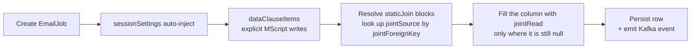

# Static joins

A `PropertyStaticJoin` is a *write-time* copy of a value from a related
data object onto the current row. The joined value is materialised
into a real column, so reads need no join. Use it when the join target
is read far more often than it changes, or when the value semantically
belongs to the row at the moment of writing (price-at-purchase,
tenant-at-creation).

Compare with [`SelectJoin`](select-join.md), which resolves the join at
read time and stores nothing.

## When to use

- The row is read far more often than the source target changes.
- The list is consumed by many subscribers — saved searches,
  notifications, analytics — and per-read joins are wasteful.
- The value is semantically *as-of-write* (audit / historical
  accuracy): an order's line price at the time of purchase, a
  message's author display name at the time of send.

Skip static-join when:

- Both the row and the target change frequently — the copy is taken
  once at create time and never refreshed, so it goes stale fast.
- The value is required to be live (current account balance, current
  inventory). Read-time joins or fresh fetches are correct.

## Declaring

A property becomes a static-join slot by populating its `staticJoin`
block. Activation is *block-presence* — leave `staticJoin` null /
absent for properties driven by the request, session, or customData.
Block presence is the only switch: there is no separate source flag on
`basicSettings` to set.

```json
{
  "objectSettings": { "basicSettings": { "name": "EmailJob" } },
  "properties": [
    {
      "basicSettings": { "name": "userId", "type": "ID", "hasRelation": true },
      "relationSettings": {
        "relationName":       "user",
        "relationTargetObject": "User",
        "relationTargetKey":  "id"
      }
    },
    {
      "basicSettings": { "name": "clientId", "type": "ID" },
      "staticJoin": {
        "jointSource":     "User",
        "jointRead":       "clientId",
        "jointSourceKey":  "id",
        "jointForeignKey": "userId"
      }
    }
  ]
}
```

| Property | Type | Req | Notes |
|---|---|---|---|
| `jointSource` | DataObjectName | ✓ | Source object. Optionally prefixed with a service name for cross-service joins (resolved through a search index the generated services maintain of the source's fields). |
| `jointRead` | PropRefer | ✓ | Property on the source whose value is copied. Defaults to the current property's name when omitted. |
| `jointSourceKey` | PropRefer | ✓ | Property on the source used to identify the matching record. Typically `id`. |
| `jointForeignKey` | PropRefer | ✓ | Property on the *current* object that references the source. The "join FK." |
| `defaultValue` | MScript |  | Fallback expression used when the source row cannot be found or the read value is null. |

The example above means: when an `EmailJob` is created with a
`userId`, look up `User.id = this.userId`, read `User.clientId`, copy
it into `EmailJob.clientId`. Subsequent list APIs filter by `clientId`
without ever joining back to `User`.

## Execution order

Static joins resolve **after** the per-API `dataClauseItems[]` writes.
A `dataClauseItems` expression
therefore cannot read the joined value off `this.<propertyName>` — at
the moment it runs, the join has not happened yet. A workflow ACTION
that runs after the row write can: the join assigns both
`this.dataClause.<propertyName>` and `this.<propertyName>`.



The static-join lookup runs after the data clause is built, and it
FILLS the column rather than overriding it: an explicit
`dataClauseItems` entry for the same property is written first and the
join only supplies a value when that entry resolved to null.
Authoring both is legal but ambiguous, so the validator warns
(`DATA_CLAUSE_ITEM_SHADOWED_BY_STATIC_JOIN`) and names the precedence.

## Which write paths resolve a static join

A static join is **create-only**, and only some write paths resolve
it:

| Write path | Resolves the join? |
|---|---|
| API-layer **create** | Yes — local and cross-service sources |
| **Seed data** (`SeedData` rows, applied on boot) | Yes for a source object of the SAME service; a cross-service source is refused at design time (`SEED_STATIC_JOIN_UNSUPPORTED_SOURCE`) because the seed runs before anything is indexed |
| A **create CRUD action** writing a `childObject` | Yes — local and cross-service sources |
| A **create-bulk CRUD action** (`CreateBulkCrudAction`) | No — map the joined column in its `objects` entry; an entry that leaves it unmapped is a design-time warning (`CREATE_BULK_STATIC_JOIN_UNMAPPED`) |
| API-layer **update** | No — see below |
| A direct data-layer write (migration, script, import) | No |

Every path that resolves the join also applies its `defaultValue` (see
[Defaults](#defaults)) when the join cannot supply a value, so a given
blueprint writes the same column value whichever path creates the row.

Seed data specifics:

- **Ordering.** The seed run is ordered so that every seeded row of a
  LOCAL joint source is written before the rows that join to it,
  whatever order the `seedData` entries are declared in. (A row that
  joins a row of its OWN object resolves against rows declared earlier
  in the run.)
- **Refresh.** A seeded row that already exists is refreshed on every
  boot from its declared values, and the join is re-resolved with it,
  so a seeded denormalised column follows its source row from boot to
  boot. This is the one place the generated service re-resolves a
  static join.
- **Frozen rows are never revisited.** A seed whose values are ALL
  `insertOnly` is left exactly as the database holds it once it exists
  (no write is issued at all). If its join could not resolve on the
  boot that inserted it, the column keeps whatever that boot wrote -
  the default, or NULL. Seed the value explicitly if the row must carry
  it.
- **Defaults.** A `defaultValue` that reads `this.` needs a request
  and is not applied by a seed; the validator says so
  (`SEED_STATIC_JOIN_DEFAULT_NEEDS_REQUEST`). A literal default is
  applied.

A join keyed on the property it writes (`jointForeignKey` naming that
same property) is refused: `STATIC_JOIN_SELF_FOREIGN_KEY`. Such a join
can never fire, because the column its own null-guard reads is the one
it would have written. Keep the foreign key a plain column and put the
`staticJoin` on the denormalised sibling that holds the copied value.

## Read behaviour

The joined column is a normal property on the row. List, get, search,
filter, and sort all use it like any other column. There is no
runtime join cost.

## Update behaviour

**The join does not re-resolve.** It is applied once, when the row is
created, and nothing in the generated service refreshes it afterwards
(the one exception is a SEEDED row, re-resolved by the seed refresh on
every boot - see the seed-data notes above):

- Changing the SOURCE row (renaming the store, editing the user's
  display name) leaves every already-written copy as it was. The
  generated service does not run a consumer that bulk-updates
  downstream rows.
- Changing the current row's `jointForeignKey` on an UPDATE does not
  re-run the join either — an API update skips static joins by
  design, so the row keeps the value its create resolved.

That is the price of a write-time copy, and it is usually the point:
the column is an as-of-write record (the price at purchase, the
author's name at the time of send). When you need the value to track
its source, either re-write the column explicitly with a
`dataClauseItems` entry on the update API, or use
[`SelectJoin`](select-join.md), which resolves at read time and cannot
go stale.

## Cross-service static joins

`jointSource` can include a service prefix (`AuthService:User`). When
the source lives in another service, the generated services index the
source's relevant fields into a search index; the join resolves
against that index at write time. It resolves on the
API create and on a child create-CRUD write; a SEEDED row cannot use a
cross-service source, because seeds run before the index is populated
(`SEED_STATIC_JOIN_UNSUPPORTED_SOURCE`). Like every static join, the
cross-service copy is never refreshed afterwards.

## Defaults

`defaultValue` is an MScript expression evaluated when the source row
cannot be found or the read value is null. Useful for:

- A guest-user case where `userId` is null and you want a sentinel
  `clientId`.
- A "fall back to the request session" pattern:
  `defaultValue: "this.session.workspaceId"` (the project's own
  `<tenantName>Id` — there is no generic `session.tenantId`).
  This form reads the request, so it applies on an API create and a
  create CRUD action but NOT on a seeded row (seeds run at boot).

The default is applied to the column once, at write time; it does not
re-evaluate when the source row appears later (a seeded row, refreshed
on every boot, is the exception).

## Things to get right

- **Composite-index the (source, target) pair** if you read the
  joined column with `WHERE clientId = ? AND ...`. The index pays for
  itself the first time a list query runs.
- **Pin audit columns.** For "the user's name at the time of order,"
  the static-join column IS the audit record, and since the join never
  re-resolves (see *Update behaviour*) that is what you get by default.
- **Decide what happens when the source changes.** Nothing in the
  generated service refreshes an already-written copy. For high-stakes
  data (financial, legal) where the copy must track its source, own the
  refresh explicitly: a `dataClauseItems` entry on the update API, a
  reconciliation cron of your own, or `SelectJoin` instead.
- **A seeded row needs a LOCAL joint source.** Seeds run at boot, so a
  cross-service join has nothing to read; the validator says so
  (`SEED_STATIC_JOIN_UNSUPPORTED_SOURCE`). Seed the value as a literal
  instead.

- **A moderated source.** When the `jointSource` carries
  [`objectModeration`](../capabilities/object-moderation.md) in
  `mode: onPlace`, the source row is read through its read gate with the
  CREATING caller's identity: a row they may not see joins as absent (the
  property stays unset, or takes `defaultValue`). A creator who may see a
  hidden source — its author, a reviewer, cron or an `API.*` call — still
  copies its unapproved content onto this row, and the validator warns
  (`OBJECT_MODERATION_UNGATED_READ_PATH`): enable `objectModeration` on
  this object too, or accept the copy knowingly.

## Static-join vs select-join

| | Static-join | [Select-join](select-join.md) |
|---|---|---|
| Join time | Write | Read |
| Storage cost | One column per joined field | None |
| Read cost | Zero | One JOIN per request |
| Sync model | As-of-write copy; never re-resolved | Always current |
| Use when | Row is read far more than the target changes | Join target changes faster than the row |

## See also

- [Select-join](select-join.md) — read-time alternative.
- [Index patterns](index-patterns.md) — composite indexes that
  benefit static-join columns.
- Specification:
  [`PropertyStaticJoin`](../../spec/PropertyStaticJoin.md),
  [`PropertyBasicSettings`](../../spec/PropertyBasicSettings.md).
