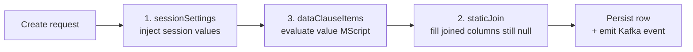

# Write-time data composition

When a `create` or `update` BusinessApi runs, the generated service composes
the row it writes from three sources. This is the same population model
described for [data properties](../data-modeling/property-types.md) —
this page is the **per-API view** of it: how each property on the data
object gets its value at write time, and where you declare it.

There is one consistent story; do not look for a competing mechanism.
For each property the service resolves, in this order:

1. **`sessionSettings` block** on the property → auto-inject from the
   session (`userId`, `tenantId`, audit columns). Activated by
   block-presence, not declared per API.
2. **`staticJoin` block** on the property → run the join, copy the
   value from a related object. The lookup runs *after* the per-API
   `dataClauseItems` writes, so a `dataClauseItems` expression cannot
   read the joined value. When a property carries both a `staticJoin`
   and a `dataClauseItems` entry, the entry is written and the join only
   fills the column if that value resolved to null; the
   validator warns about the pair
   (`DATA_CLAUSE_ITEM_SHADOWED_BY_STATIC_JOIN`).
3. **otherwise** → look up the matching
   `query.dataClauseItems[].name` entry on this BusinessApi and
   evaluate its `value` MScript.

A property with none of the three is **not written**, and the auditor
flags the missing entry. The two automatic hooks live on the property;
everything else is a per-API decision in `dataClauseItems`. The legacy
`customData` field is **deprecated** — use `dataClauseItems`.

**Scope of the two automatic hooks.** Step 2 (`staticJoin`) runs on
**create** only: for the API's MAIN data object, for a child object
written by a `CreateCrudAction`, and for a seeded row whose joint source
is a data object of the same service (see
[Which write paths resolve a static join](static-joins.md#which-write-paths-resolve-a-static-join)).
Step 1 (`sessionSettings`) runs on **every** create, main or nested:

- On **update** both are skipped, so a partial update never churns
  ownership or audit columns. To change a session-bound or joined column
  on update, map it in that API's `dataClauseItems`.
- A row created by a **`CreateCrudAction` / `CreateBulkCrudAction`**
  (a nested create of a child object) gets step 1 and the tenant column
  stamp. The child create fills every
  session-bound column the action's own `dataClause` / `objects` mapping
  does not name, from the caller's session; a mapping the action does
  author always wins, and a session with no value leaves the key absent
  so a required column refuses the row rather than being written null.
  Step 2 differs between the two: a `CreateCrudAction` child
  create resolves every joined column its `dataClause` does not name,
  from the foreign key that mapping supplies (an authored mapping for
  the joined column wins and emits no join), while a
  `CreateBulkCrudAction` row does NOT get step 2, so a **joined** column
  still has to be mapped in its `objects` entry, for example
  `this.data.lines.map(l => ({ orderId: this.order.id, regionCode: this.order.regionCode }))`.
  An entry the `objects` source shows (an array of object literals, or a
  `.map` callback returning one) that leaves a joined column out is a
  design-time warning (`CREATE_BULK_STATIC_JOIN_UNMAPPED`).
- A required child column of a `CreateCrudAction` with no source at all —
  no mapping, no `sessionSettings`, no `staticJoin`, no column default — is
  a design-time error (`CHILD_CREATE_MISSING_VALUE_SOURCE`), not a row the
  database refuses after the parent has already committed. A
  `CreateBulkCrudAction` builds its rows in MScript, so that check does not
  run on it: a bulk row missing a required column is refused by the
  database at run time.

## (1) Session binding — `sessionSettings`

Declared on the property (see
[Session-aware logic](session-aware-logic.md)). Block-presence
activates it:

```json
{
  "basicSettings":   { "name": "createdBy", "type": "ID" },
  "relationSettings": { "relationName": "creator", "relationTargetObject": "User", "relationTargetKey": "id" },
  "sessionSettings": { "sessionParam": "userId", "isOwnerField": true }
}
```

The service writes `createdBy = session.userId` on every create. It
is **not** declared in `dataClauseItems` and **not** accepted from the
request body — the session is the only source.

## (2) Static join — `staticJoin`

Declared on the property (see [Static joins](static-joins.md)).
Block-presence activates it:

```json
{
  "basicSettings": { "name": "clientId", "type": "ID" },
  "staticJoin": {
    "jointSource":     "User",
    "jointRead":       "clientId",
    "jointSourceKey":  "id",
    "jointForeignKey": "userId"
  }
}
```

At create time the service looks up `User` by the row's `userId`,
reads its `clientId`, and stores it. The join runs **after** the
`dataClauseItems` writes, so a `dataClauseItems` entry cannot read the
joined value via `this.clientId`; a workflow action that runs after the
row write can.

A `jointSource` moderated with
[`objectModeration`](../capabilities/object-moderation.md) in `mode: onPlace`
is read through its read gate with the creating caller's identity: a source
row they may not see joins as absent. See
[Static joins](static-joins.md#things-to-get-right) for the residue the
validator warns about.

## (3) Everything else — `dataClauseItems`

Everything not driven by session or static join is a per-API entry in
`BusinessApi.query.dataClauseItems[]` (array of `DataMapItem`: a `name`
= the property, and a `value` = MScript). This covers caller-supplied
values, forced literals, and computed values.

```json
{
  "basics": { "apiOptions": { "name": "createProject", "crudType": "create", "dataObjectName": "Project" } },
  "parameters": {
    "requestParameters": [
      { "name": "name", "type": "String", "required": true },
      { "name": "slug", "type": "String", "required": true }
    ]
  },
  "query": {
    "dataClauseItems": [
      { "name": "name",   "value": { "js": "this.name" } },
      { "name": "slug",   "value": { "js": "this.slug" } },
      { "name": "status", "value": { "js": "'draft'" } },
      { "name": "ownerId", "value": { "js": "this.session.userId" } }
    ]
  }
}
```

Common `value` shapes:

| Intent | `value` MScript |
|---|---|
| Caller-supplied | `this.<paramName>` |
| System-managed literal | `'<literal>'` (e.g. `'draft'`) |
| Caller-with-fallback | `this.<paramName> \|\| '<default>'` |
| Computed / derived | `LIB.calc(this.X)`, `new Date().toISOString()` |

> Properties populated by `sessionSettings` or `staticJoin` should
> **not** also appear in `dataClauseItems`. A session-bound column keeps
> the session value; on a joined column the entry wins and the join only
> fills a null, and the validator warns
> (`DATA_CLAUSE_ITEM_SHADOWED_BY_STATIC_JOIN`). List only the
> request/literal/computed properties here.

## Full composition order



The numbers are the precedence of the value sources, not the execution
order: the static-join lookup executes last, after the `dataClauseItems`
writes, so a `dataClauseItems` expression cannot read a joined value.

## A decided value — `decisionSource`

A property with a [`decisionSource`](../data-modeling/property-types.md#decided-properties-decisionsource)
takes none of the three sources above: its value is a judgement a
decision provider makes about the row. It is not a `dataClauseItems`
entry (writing it through an API is a manual override that pins it),
and it is not resolved in the API pipeline. The decision runs after a row
is created or updated, against the
committed row, so every create path of the object (a create API, a
`CreateCrudAction`, a library data-layer call) is decided the same way,
and the value is written back with its confidence, model and time. A
provider outage leaves the value null for a background backfill and
never fails the write. See
[The decision layer](../capabilities/decision-layer.md#decisionsource-write-time-columns).

## DB-level scalar default

A purely static scalar default belongs on the property
(`basicSettings.defaultValue`), not in `dataClauseItems`. Dynamic
defaults (`new Date()`, conditional fallbacks) are `dataClauseItems`
MScript.

## See also

- [Session-aware logic](session-aware-logic.md) — `sessionSettings`
  (step 1).
- [Static joins](static-joins.md) — `staticJoin` (step 2).
- [The decision layer](../capabilities/decision-layer.md) — `decisionSource`,
  the decided value.
- [Property value population](../data-modeling/property-types.md) — the
  property-side view of this same model.
- [MScript reference](../mscript/query-reference.md) — `value`
  expression syntax.
- Specification: [`DataMapItem`](../../spec/DataMapItem.md),
  [`PropertySessionSettings`](../../spec/PropertySessionSettings.md),
  [`PropertyStaticJoin`](../../spec/PropertyStaticJoin.md).
