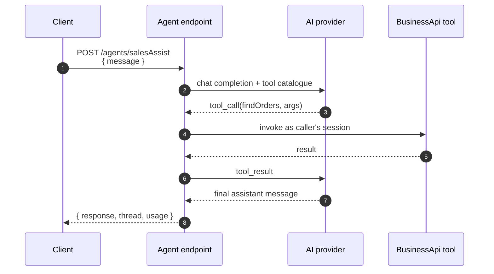

# Add an AI agent that can read your data

An `AIAgent` is a configured model + system prompt + tool surface that
the service exposes as a REST/SSE endpoint and as a callable tool
from other agents and BusinessApis. Tools come from your own
BusinessApis and DataObjects, so the agent's reach is whatever the
caller's session can already do: no new permission surface.

> **Audience.** AI agent or human author adding an LLM-powered API to
> an existing project. Assumes a configured AI provider account
> (OpenAI / Anthropic / Google / etc.).

## Flow



## Pattern

### 1. Configure the AI provider

```json
"projectSettings": {
  "aiProvidersSettings": {
    "aiProviders": [
      {
        "name":     "mainOpenai",
        "provider": "openai",
        "configuration": [
          { "name": "apiKey",       "value": "ENTER_CREDENTIAL", "secret": true },
          { "name": "defaultModel", "value": "gpt-4o-mini" }
        ]
      }
    ]
  }
}
```

The project owner enters the real key outside the blueprint; the blueprint
holds the placeholder only. To let each user (or tenant) run the agent on
their own key instead, add `credentialScopes` to the entry (which scope
levels are honoured depends on the compiler; a compiler refuses a construct
it does not implement; see [the AI provider page](../providers/ai.md)).

### 2. Declare the agent in the hub

```json
"agentHub": {
  "aiAgents": [
    {
      "agentBasics": {
        "name":          "salesAssist",
        "description":   "Helps reps look up customers and orders.",
        "executionMode": "chat",
        "modality":      "text"
      },
      "modelSettings": {
        "providerName": "mainOpenai",
        "model":        "gpt-4o-mini",
        "systemPrompt": "You assist sales reps. Use the tools to look up customer and order data. Never invent IDs or numbers."
      },
      "toolSettings": {
        "apiTools": "getUser,listOrders,getOrder"
      },
      "endpointSettings": { "hasRestEndpoint": true, "hasSseEndpoint": true, "authRequired": true },
      "guardrails": {
        "maxToolCalls":    8,
        "maxTokenBudget":  8000
      }
    }
  ]
}
```

`apiTools` is a comma-separated string of BusinessApi names (per the
[`AgentToolSettings`](../../spec/AgentToolSettings.md) reference).
A compiler resolves these references case-insensitively against local and
remote APIs and exposes each tool under the BusinessApi's canonical spelling.
For example, `ListOrders` binds the API named `listOrders`, and the callable
tool name is `listOrders`. The handler, remote binding, tool manifest and
recorded identity arm use that same name. Entries in `m2mTools` and matching
API entries in `approvalRequiredTools` resolve to it as well.
Each entry binds an existing BusinessApi as a callable tool; the
agent runs the tool under the caller's session, so it cannot do
anything the caller could not already do via REST. That includes an
api gated by `permissionCheck`: the tool call is decided by the caller's
own permission resolver, as the REST call would be. Only a run started
by the agent's own HTTP request carries that resolver's session manager.
Every other run kind cannot be decided that way, even when a real user is
behind it: a Kafka- or cron-triggered agent, a run resumed after an
approval pause or a restart, a Telegram or WhatsApp chat-surface message,
the hub's eval suite, and a programmatic in-process run (an
`AgentCallAction` that runs the agent in-process, the video live
pipeline). There such a tool call is refused with a 403; gate the apis
those agents call with `checkRoles`, `absoluteRoles` or `ownershipCheck`
instead (see
[Agent hub - tools](../system-services/agent-hub.md#tools-the-agent-can-call)).

For an agent whose job ends in a mandatory write, declare
`guardrails.requiredToolCalls` (comma-separated tool names, per the
[`AgentGuardrails`](../../spec/AgentGuardrails.md) reference): the
runtime checks its own tool-call journal at the finish path and a
run without a successful call to each listed tool ends `failed`
(`AGENT_REQUIRED_TOOL_NOT_CALLED`) instead of `success`: a
model that merely *claims* it wrote cannot end green.
The failed run's `sys_agentExecution` row records that code in
`errorCode` and the missing tool names in `errorDetail.missingToolCalls`,
and a Kafka-triggered run's dead letter carries the same `errorCode` and
`missingToolCalls`, so a sweeper selects these runs by code.

## Invocation

### Via the generated agent endpoint

```bash
curl -X POST "$AGENTHUB_URL/agents/salesAssist" \
     -H "Authorization: Bearer $JWT" \
     -d '{ "message": "What are the latest 3 orders for alice@example.com?" }'
```

The hub-generated controller handles the chat thread state and tool
dispatching (`$AGENTHUB_URL` stands for the base URL of the service that
hosts the hub). The companion SSE endpoint lives at
`/agents/salesAssist/stream` and streams tokens (text mode) or step
results (orchestrator mode) when `hasSseEndpoint: true`. Override
either path via `endpointSettings.basePath`. The stream sends a `: ping`
SSE comment every 15 seconds while the stream is open, so a proxy idle
timeout does not cut a long turn; a client that disconnects does not
cancel the run, and its answer is still stored.

### Via an `AgentCallAction` from another business API

Inside the calling API's typed action store:

```json
"actions": {
  "agentCallActions": [
    {
      "name":               "ask",
      "agentName":          "salesAssist",
      "inputData":          { "js": "({ message: this.question })" },
      "contextPropertyName": "agentReply",
      "writeToResponse":    true
    }
  ]
}
```

Both paths run the agent with the caller's session: tools can only do
what the caller could.

## Variations

- **RAG over a docs corpus**: add a data object for your corpus, set
  `toolSettings.enableCrudTools: true`, and list the relevant object
  names in `toolSettings.crudScopes` (comma-separated). The agent
  picks up the auto-generated list / search / get tools and can
  look up rows before answering.
- **Per-tenant tool surface**: enable runtime agent creation in
  `agentHub.hubSettings` so end users compose their own agent +
  tool set within the limits you define.
- **Direct model call (no thread, no tools)**: use `AiCallAction`
  pointing at a named `aiProviders` entry: skip the agent abstraction.
  When a later action branches on a field of its answer (a moderation
  verdict, a decision), declare `responseSchema` on the action exactly as
  you would on `modelSettings.responseSchema`: a reply that does not match
  fails the action instead of silently taking the default branch (see
  [AiCallAction - decision and moderation flows](../actions/ai-call-action.md#decision-and-moderation-flows)).
- **Judge risky tool calls before they run**: add
  `guardrails.decisionGate` with a decision provider and one or more
  `noul` statements about the call ("this call deletes data the user did
  not ask to delete"). A flagged or uncertain call is denied, held for
  human approval or only logged, per `onGateFail`; `exemptTools` lists
  the read-only tools (by the same names as `apiTools`) that need no
  judging. See
  [Agent hub - decision gate over tool calls](../system-services/agent-hub.md#decision-gate-over-tool-calls).
- **Bulk work over many records**: list api tools offer `page` /
  `pageSize` and a `fields` argument, so the agent walks a long list a
  page at a time and asks only for the columns it needs; set
  `toolSettings.enableBatchApiCall: true` to give it `batch_api_call`,
  which runs many api tool calls the user has confirmed in one step (tools
  that need approval are refused inside a batch). See
  [Agent hub - tools the agent can call](../system-services/agent-hub.md#tools-the-agent-can-call).
- **A cheap decision in front of the agent**: when a business API only
  needs a verdict (route, classify, approve) and the agent's prose only
  for the unclear cases, put a
  [`DecisionAction`](../actions/decision-action.md) first and name the
  `AgentCallAction` as its `escalateTo`; the agent then runs only for the
  minority the decision provider is not confident about.
- **Reasons for moderated content**: to moderate what users write to a
  data object, enable `objectModeration` on it rather than wiring a verdict
  by hand; an agent declared as above becomes its `escalateTo` and writes
  the reason for a held or rejected submission (see
  [Object content moderation](../capabilities/object-moderation.md#two-tier-reasons)).

## See also

- [AI agents](../system-services/agent-hub.md)
- [The decision layer](../capabilities/decision-layer.md): calibrated decisions, the agent decision gate and `escalateTo`
- [AI providers](../providers/ai.md)
- Reference: [`AgentCallAction`](../../spec/AgentCallAction.md), [`AIAgent`](../../spec/AIAgent.md)
