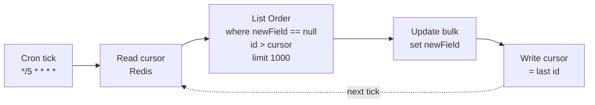

# Add a cron job

A cron job is a `BusinessApi` with the `cron` controller switched on.
The service runs it on a schedule instead of (or in addition to) an
HTTP route. Use for nightly archives, periodic reconciliation,
backfills, alert sweeps.

> **Two ways to schedule.** This recipe schedules a `BusinessApi` (a
> *cron controller*: every replica runs every tick). To run a plain
> library function on a schedule, once per tick across replicas, with a
> run history, a timeout and an optional run-once mode, declare a service
> cron job (`services.cronJobs[]`) instead. See
> [Scheduled business, cron jobs and cron controllers](../business-apis/scheduled-business.md).

> **Audience.** AI agent or human author scheduling background work
> inside an existing service.

## How scheduling is wired

Cron lives at `services.businessLogic.controllers.cronSettings`. Set
`hasCronController: true` and fill `cronExpression` with a standard
5-field cron string:

```json
{
  "basics": { "apiOptions": {
    "name":            "archiveExpiredOrders",
    "crudType":        "update",
    "dataObjectName":  "Order"
  }},
  "controllers": {
    "cronSettings": {
      "hasCronController": true,
      "cronExpression":    "0 3 * * *"
    },
    "restSettings": { "hasRestController": false }
  },
  "query": {
    "whereClause": {
      "expression": { "js": "status == 'expired' && archivedAt == null" }
    },
    "dataClauseItems": [
      { "name": "archivedAt", "value": { "js": "@now" } }
    ]
  }
}
```

`hasRestController: false` makes the API cron-only. Drop that line if
you want both a manually-triggerable HTTP route *and* the schedule.

## Pattern A: nightly archive (bulk update)

Use the `update`-crudType form above. The service runs the
`whereClause` against the data object, applies `dataClauseItems`,
emits the DB-level `updated` event, and finishes. One row in, one
write out: no action store needed.

When you want to publish a follow-up Kafka topic, add actions to the
business workflow:

```json
{
  "basics": { "apiOptions": { "name": "archiveExpiredOrders", "crudType": "update", "dataObjectName": "Order" }},
  "controllers": { "cronSettings": { "hasCronController": true, "cronExpression": "0 3 * * *" } },
  "actions": {
    "publishEventActions": [
      {
        "name":            "fireDone",
        "topic":           "orders.archive.completed",
        "message":         { "js": "({ at: new Date().toISOString() })" },
        "writeToResponse": false
      }
    ]
  },
  "workflow": {
    "update": {
      "afterMainUpdateOperation": ["fireDone"]
    }
  }
}
```

## Pattern B: periodic reconciliation (loop over a result set)

A `*/15 * * * *` schedule that pages through drifted rows and fixes
each one. Use a `list`-crudType BusinessApi and a `LoopAction` over
the result:

```json
{
  "basics": { "apiOptions": { "name": "reconcileBalances", "crudType": "list", "dataObjectName": "Account" }},
  "controllers": { "cronSettings": { "hasCronController": true, "cronExpression": "*/15 * * * *" } },
  "query": {
    "whereClause": { "fullWhereClause": { "js": "({ ledgerSyncedAt: { $lt: new Date(Date.now() - 15 * 60 * 1000) } })" } },
    "paginationOptions": { "defaultPageRowCount": 200 }
  },
  "actions": {
    "loopActions": [
      {
        "name":            "fixDrift",
        "loopFor":         { "js": "this.items" },
        "loopItemName":    "account",
        "actions":         ["syncOne", "publishFixed"],
        "writeToResponse": false
      }
    ],
    "interserviceCallActions": [
      {
        "name":            "syncOne",
        "targetService":   "ledger",
        "targetApi":       "syncAccount",
        "apiParameters":   [ { "name": "accountId", "value": { "js": "account.id" } } ],
        "writeToResponse": false
      }
    ],
    "publishEventActions": [
      {
        "name":            "publishFixed",
        "topic":           "accounting.account.synced",
        "message":         { "js": "({ id: account.id })" },
        "writeToResponse": false
      }
    ]
  },
  "workflow": {
    "list": {
      "afterMainListOperation": ["fixDrift"]
    }
  }
}
```

The loop binds the current row to `this.account` (the
`loopItemName`); the inner actions reference `account.id` directly
(loop-item variables are addressable both as `this.<loopItemName>`
and bare `<loopItemName>` inside MScript).

Two crons firing while the previous run still works the same backlog
is rarely a problem here because each page is bounded; if it matters,
stamp a `reconcileRunId` on each row as the loop fixes it and filter
on it in the next tick.

## Pattern C: large stateful backfill (Redis cursor)

For 100k+ row backfills, one tick can't do it all. Page with a Redis
cursor; advance it on each successful page. Crashes restart from the
last saved cursor.



```json
{
  "basics": { "apiOptions": { "name": "backfillNewField", "crudType": "list", "dataObjectName": "Order" }},
  "controllers": { "cronSettings": { "hasCronController": true, "cronExpression": "*/5 * * * *" } },
  "parameters": {
    "redisParameters": [
      {
        "name":         "cursor",
        "type":         "String",
        "required":     false,
        "redisKey":     { "js": "'backfill:newField:cursor'" },
        "defaultValue": { "js": "00000000-0000-0000-0000-000000000000" }
      }
    ]
  },
  "query": {
    "whereClause": { "fullWhereClause": { "js": "({ newField: { $eq: null }, id: { $gt: this.cursor } })" } },
    "listOptions": { "listSortBy": [ { "name": "byId", "property": "id", "order": "asc" } ] },
    "paginationOptions": { "defaultPageRowCount": 1000 }
  },
  "actions": {
    "loopActions": [
      {
        "name":            "patchEach",
        "loopFor":         { "js": "this.items" },
        "loopItemName":    "row",
        "actions":         ["patchRow"],
        "writeToResponse": false
      }
    ],
    "updateCrudActions": [
      {
        "name":            "patchRow",
        "childObject":     "Order",
        "whereClause":     { "js": "({ id: { $eq: row.id } })" },
        "dataClause":      [ { "name": "newField", "value": { "js": "LIB.common.computeNewField(row)" } } ],
        "writeToResponse": false
      }
    ],
    "writeToRedisActions": [
      {
        "name":            "advance",
        "condition":       { "js": "this.items.length > 0" },
        "redisKey":        { "js": "'backfill:newField:cursor'" },
        "message":         { "js": "this.items[this.items.length - 1].id" },
        "writeToResponse": false
      }
    ]
  },
  "workflow": {
    "list": {
      "afterMainListOperation": ["patchEach", "advance"]
    }
  }
}
```

The Redis cursor lands on the context as `this.cursor` from the
`redisParameters` block. The where-clause picks up the next slice,
the loop fans `updateCrudAction` onto each row, and
`WriteToRedisAction` advances the cursor only when at least one row
was processed: when the page comes back empty, the cursor stays
put, and the next tick finds nothing new until rows reappear.

## Verify

Watch the service log for the `cron.<apiName>.start` /
`cron.<apiName>.done` lines on the expected
cadence. The interval comes straight from `cronExpression`; UTC is
the only schedule timezone: adjust offsets in the expression itself.

## Pitfalls

- **No built-in overlap policy.** Two ticks of the same cron can be
  running at once if work stretches beyond the interval. Guard with a
  Redis lock in the action store when overlap is unsafe.
- **No retry / DLQ for cron.** Cron failures log and move on. If a
  step must retry, model it as a Kafka topic the cron publishes to,
  and put the retry policy on the Kafka controller.
- **REST-only fields are ignored.** Setting `restSettings.routePath`
  on a cron-only API doesn't enable HTTP: set
  `restSettings.hasRestController` to opt back in.

## See also

- [Cron controllers reference](../business-apis/cron-jobs.md)
- [Scheduled business, cron jobs and cron controllers](../business-apis/scheduled-business.md)
- Action reference: [`LoopAction`](../actions/loop-action.md),
  [`UpdateCrudAction`](../actions/update-crud-action.md),
  [`WriteToRedisAction`](../actions/write-to-redis-action.md),
  [`ReadFromRedisAction`](../actions/read-from-redis-action.md),
  [`PublishEventAction`](../actions/publish-event-action.md)
- Cron expression syntax: any standard 5-field cron reference.
