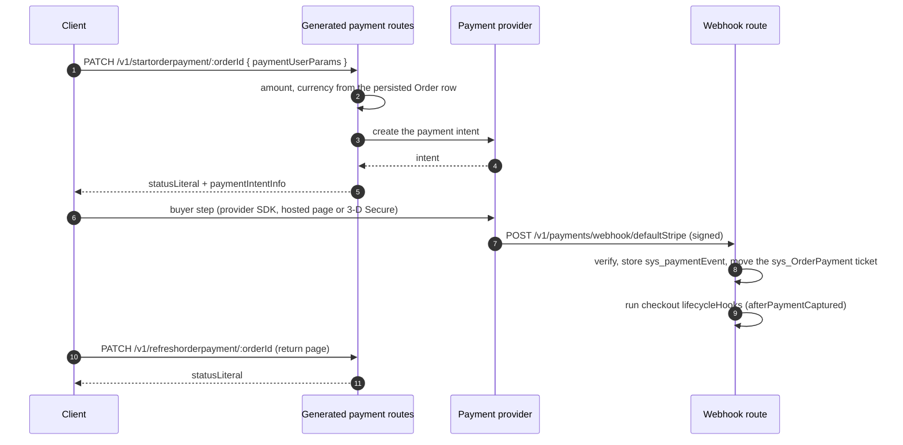

# Add a payment checkout to a service

End-to-end recipe wiring a one-time payment onto an `Order` row.

> **Audience.** AI agent or human author adding "user pays for X" to an
> existing project. Assumes familiarity with
> [data objects](../data-modeling/data-objects.md) and the
> [payment workflow](../capabilities/payment-workflow.md).

The checkout opt-in on the order object is the whole design. The service
then generates the payment routes: start, refresh, the webhook and, for the
providers that need them, the browser-return routes. You do not author a
"create checkout session", "complete payment" or webhook Business API.

## Flow



## Outcome

After this recipe:

- A named PaymentProvider entry at the project level.
- An `Order` DataObject with the `checkout` opt-in, so the service
  manages its payment ticket (`sys_OrderPayment`) and mounts the payment
  routes for it.
- A lifecycle hook that writes the order's own status when the payment is
  captured.

## Step 1: configure the provider once

```json
"projectSettings": {
  "paymentProvidersSettings": {
    "paymentProviders": [
      {
        "name":     "defaultStripe",
        "provider": "stripe",
        "configuration": [
          { "name": "secretKey",      "value": "..." },
          { "name": "publishableKey", "value": "..." },
          { "name": "webhookSecret",  "value": "..." }
        ]
      }
    ]
  }
}
```

Values are masked in API responses.

## Step 2: declare the Order DataObject with the checkout opt-in

```json
{
  "objectSettings": {
    "basicSettings": { "name": "Order" },
    "checkout": {
      "objectIsAnOrderObject": true,
      "configuration": {
        "providerName":         "defaultStripe",
        "orderName":            "Order",
        "orderIdProperty":      "id",
        "amountProperty":       "amount",
        "currencyProperty":     "currency",
        "orderStatusProperty":  "paymentStatus",
        "orderOwnerIdProperty": "userId",
        "lifecycleHooks": [
          {
            "name":    "markOrderPaidOnCapture",
            "trigger": "afterPaymentCaptured",
            "script":  { "js": "await API.markOrderPaid({ orderId: payment.orderId })" }
          }
        ]
      }
    }
  },
  "properties": [
    {
      "basicSettings":   { "name": "userId", "type": "ID", "isRequired": true },
      "sessionSettings": { "isOwnerField": true, "sessionParam": "userId" }
    },
    { "basicSettings": { "name": "amount",        "type": "Decimal", "decimalScale": 2, "isRequired": true } },
    { "basicSettings": { "name": "currency",      "type": "String", "defaultValue": "USD" } },
    { "basicSettings": { "name": "paymentStatus", "type": "Enum", "enumOptions": ["pending", "paid", "failed", "canceled"], "defaultValue": "pending" } },
    { "basicSettings": { "name": "paymentUpdatedAt", "type": "Date" } }
  ]
}
```

What the block does and does not do:

- `objectIsAnOrderObject: true` activates it; `configuration` carries the
  [`CheckoutConfig`](../../spec/CheckoutConfig.md). The start route reads
  the amount and currency from the persisted order row, never from the
  request. `amountProperty` must be a `Decimal` column in major units
  (`10.00`, not cents).
- The owner column (`sessionSettings.isOwnerField`) is what lets a buyer
  start, refresh and read the payment of their own order. Without it a buyer
  cannot start the payment at all.
- The service keeps the payment state on its own ticket,
  `sys_OrderPayment.statusLiteral` (`started`, `success`, `failed`,
  `canceled`, `amount_mismatch`, ...). It does **not** write the order's
  `orderStatusProperty`: that field, and `mapPaymentResultToOrderStatus`,
  are declarative only.
- The order status is written by your hook. In a hook script the payment
  ticket is `payment` (`payment.orderId` is the `Order` row id), the
  normalized provider resource is `resource`, and same-service Business APIs
  with `controllers.internalCallSettings.hasInternalCallController: true`
  are reached as `await API.<name>(...)`. Here `markOrderPaid` is such an
  internal-call `update` API on `Order` that sets `paymentStatus` to
  `'paid'` and `paymentUpdatedAt`. Add `afterPaymentFailed` /
  `afterPaymentCanceled` hooks the same way. A hook runs once per payment.
  Two more triggers complete the mirror:
  `afterPaymentStarted` (a start recorded a new intent; `pending` on the
  order) and `afterPaymentAmountMismatch` (the capture was refused for a
  wrong amount and is under review; `resource.metadata.amountMismatch` has
  both figures - show "under review, do not pay again", not paid or failed).
  A compiler refuses a construct it does not implement, so check that the
  compiler you target supports these two triggers.

## Step 3: start the payment from the frontend

The frontend calls the generated start route with the buyer's session:

```http
PATCH /v1/startorderpayment/:orderId
Content-Type: application/json
Authorization: Bearer <buyer token>

{
  "paymentUserParams": {
    "return_url": "https://app.example.com/orders/123/paid"
  }
}
```

The route segment is the object name in lower case
(`start<object>payment`). `paymentUserParams` carries the three values a
caller may contribute: `return_url`, `paymentMethodId` (a saved method) and
`providerOptions`. The answer carries `statusLiteral`, `paymentId` and
`paymentIntentInfo` (`requires_redirect`, `redirectToUrl`, `client_secret`,
`next_action`), which tell the frontend what the buyer has to do next.
What the frontend renders for each provider (the Stripe Payment Element, a
redirect to a hosted page, an iyzico 3-D Secure form, Adyen Web) is in
[3-D Secure and buyer redirects](../capabilities/payment-3ds-and-redirects.md).

A designer-authored start is optional: when the start has to sit inside
your own workflow, a Business API on the order object can run a
`PaymentAction` with stage `start`. It reads the same `CheckoutConfig`
bindings and writes the same ticket. Declare an Object request parameter
named `paymentUserParams` (`httpLocation: "body"`) on that API, or the
action receives no `return_url` / `paymentMethodId` / `providerOptions`:

```json
{
  "name":                "startPayment",
  "providerName":        "defaultStripe",
  "stage":               "start",
  "contextPropertyName": "payment",
  "writeToResponse":     true
}
```

### A card entered on your own frontend: payOrder with cardInfo and saveCard

On an iyzico entry with `directCardEntry: true`, a buyer-facing `payOrder`
API (a PATCH on the order that runs the `PaymentAction`) can take the card
typed on your own page. The API must DECLARE `cardInfo` (Object) and
`saveCard` (Boolean) as request parameters, beside `return_url`. The action
reads only the parameters the API declares: a card sent to an API that does
not declare it is silently dropped, no error is raised, and the buyer is sent
to the hosted form.

```json
{
  "parameters": {
    "requestParameters": [
      { "name": "orderId",    "type": "ID",      "httpLocation": "urlpath", "required": true },
      { "name": "return_url", "type": "String",  "httpLocation": "body" },
      { "name": "cardInfo",   "type": "Object",  "httpLocation": "body" },
      { "name": "saveCard",   "type": "Boolean", "httpLocation": "body" }
    ]
  },
  "actions": {
    "validationActions": [
      {
        "name": "returnUrlWhenCard",
        "description": "A call that carries a card must say where the 3-D Secure return redirects.",
        "validationScript": { "js": "!this.cardInfo || !!this.return_url" },
        "shouldBeTrue": true,
        "checkType": "liveCheck",
        "errorStatus": 400,
        "errorMessage": "return_url is required when cardInfo is sent"
      }
    ],
    "paymentActions": [
      {
        "name": "startCardPayment",
        "providerName": "iyzicoProd",
        "stage": "start",
        "contextPropertyName": "payment",
        "writeToResponse": true
      }
    ]
  }
}
```

The request body is then `{ "return_url": "...", "cardInfo": { "cardHolderName":
"...", "cardNumber": "...", "expireMonth": "12", "expireYear": "2030", "cvc":
"..." }, "saveCard": true }`, flat. (The alternative is one `paymentUserParams`
Object parameter holding the same keys; declare one shape, not both.) Keep the
`return_url` guard: the 3-D Secure return redirects there, and without it the
buyer ends on a JSON confirmation. The answer is the same as for the start
route: `started` with the 3-D Secure form to render, or `success` below the
entry's `newCardThreeDSThreshold`. The full contract (PCI scope, the closed
`cardInfo` schema, the refusal codes, saving the card) is in
[the payment provider behaviour page](../providers/payment.md).

## Step 4: the webhook is generated

There is nothing to author for the webhook. The service mounts
`POST /v1/payments/webhook/<providerName>` for every provider entry
(here `/v1/payments/webhook/defaultStripe`). It verifies the signature over
the raw body with the entry's secret, stores the normalized event in
`sys_paymentEvent`, moves the `sys_OrderPayment` ticket and runs your
`lifecycleHooks`. Do not add a Business API for it, and do not run a
`PaymentAction` with stage `complete` or `callback` from one: those stages
require the order owner's session, so an anonymous provider call is
refused.

What you do have to do is point the provider at the route:

- **Stripe:** run the operator action
  `POST /v1/payments/admin/webhooks/provision`. It creates the endpoint with
  the events the adapter maps and stores its signing secret
  (see [the payment provider page](../providers/payment.md)).
- **iyzico:** set the merchant panel's webhook URL to
  `<service url>/v1/payments/webhook/<providerName>`
  (see [the payment provider page](../providers/payment.md)).
- Other providers: see the provider's entry in
  [the payment provider page](../providers/payment.md).

## Step 5: the return page

When the buyer comes back to your `return_url`, refresh the ticket with
`PATCH /v1/refreshorderpayment/:orderId` and branch on its `statusLiteral`
(`success`, `started`, `failed`, ...), never on a query parameter of the
return URL. The refresh is also the backstop when the webhook is late.
Who completes the payment differs per provider (Stripe in the browser,
iyzico on a generated return route, Adyen through the generated complete
route); see
[3-D Secure and buyer redirects](../capabilities/payment-3ds-and-redirects.md).

## Variations

- **Refunds**: add a separate API with `RefundAction`:
  `paymentIntentIdProperty` points at the order's payment intent
  reference; omit `refundAmountProperty` for a full refund.
- **Subscriptions**: declare `SubscriptionConfig` on the DataObject
  instead of (or alongside) `CheckoutConfig`, use `SubscriptionAction`
  with `stage="subscribe"`.
- **Marketplace / payouts**: declare `MarketplaceConfig`, use
  `PayoutAction`.
- **Other providers**: change `provider` and the matching
  `configuration` keys. The order object and the start route stay the
  same; what the frontend renders and how the payment completes depend on
  the provider (see its page).

## See also

- [Payment workflow](../capabilities/payment-workflow.md)
- [3-D Secure and buyer redirects](../capabilities/payment-3ds-and-redirects.md)
- [Build a shopping cart](build-shopping-cart.md)
- [Payment providers](../providers/payment.md)
- Reference: [`PaymentAction`](../../spec/PaymentAction.md), [`CheckoutConfig`](../../spec/CheckoutConfig.md), [`LifecycleHook`](../../spec/LifecycleHook.md)
