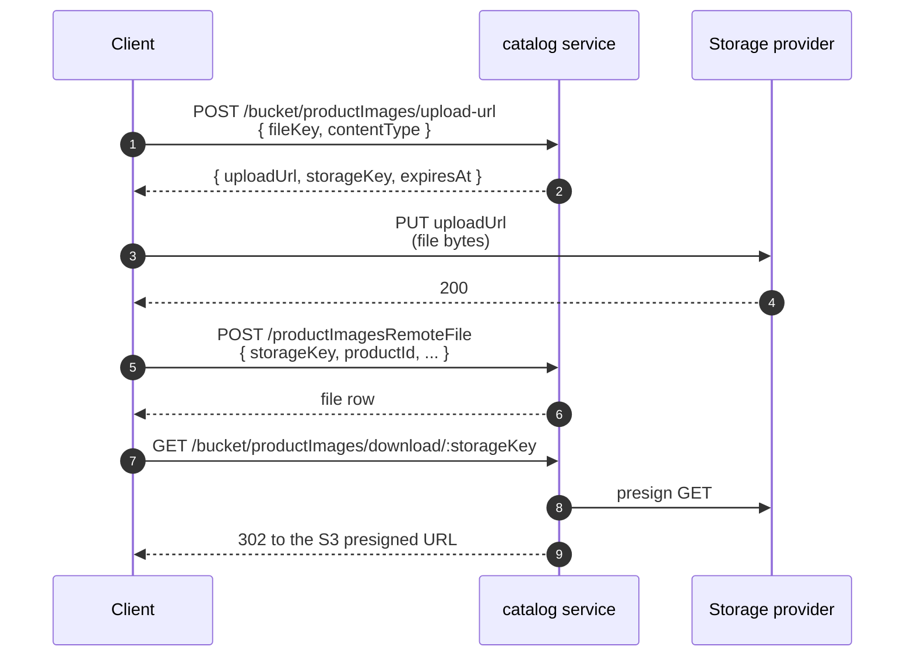

# Attach file uploads to a record

A blueprint has two file-storage patterns. Both auto-generate a file
data object, upload + download routes, and authorization gates on the
owning service. There is no separate "bucket service" to deploy: file
storage lives in the service that owns the data.

| Pattern | Where files live | Pick when |
|---|---|---|
| **`RemoteBucket`** | A cloud provider configured under `bucketProvidersSettings` (S3, R2, any S3-compatible endpoint, GCS, Azure) | Large files, public-CDN reach, presigned URLs |
| **`DbBucket`** | A `BYTEA` column on the row's own Postgres database | Small files (default 10 MB cap), strong transactional consistency with the parent row |

This recipe wires `Product` images two ways: one `RemoteBucket` for
high-res photos and one `DbBucket` for a low-res thumbnail kept inline
with the row.

> A thumbnail that is only a smaller copy of an uploaded photo does not need
> a bucket of its own: declare `bucketBasics.imageVariants` on the
> `RemoteBucket` and every image upload gets its resized copies, recorded on
> the file row and served by `?variant=<name>` on the download route. See
> [Image variants](../composition/remote-buckets.md#image-variants-thumbnails).
> The `DbBucket` below is for a small image you want stored inline and
> uploaded on its own.

## Prerequisites

- A service with the `Product` data object.
- For `RemoteBucket`: at least one entry under
  `projectSettings.bucketProvidersSettings.bucketProviders`. Credentials
  are supplied to the running service at runtime, outside the blueprint.
- Scanning uses the compiler's default virus-scan service, with no setup;
  set `clamAvSettings` for a self-hosted clamd or URL
  ([DbBucket](../composition/db-buckets.md#the-scanner-where-the-bytes-go)).

## Step 1: configure a cloud provider (RemoteBucket only)

```json
{
  "projectSettings": {
    "bucketProvidersSettings": {
      "bucketProviders": [
        {
          "name":     "mainStorage",
          "provider": "s3",
          "configuration": {
            "region":            "us-east-1",
            "defaultBucketName": "acme-products",
            "endpoint":          null,
            "forcePathStyle":    false
          }
        }
      ]
    }
  }
}
```

The provider's access credentials are not part of the blueprint: they are
filled from your secrets store when the service is deployed. The physical
bucket (`acme-products` here) must already exist; it is not auto-provisioned.

## Step 2: declare a `RemoteBucket` on the service

```json
{
  "services": [
    {
      "serviceSettings": { "serviceBasics": { "name": "catalog" } },
      "remoteBuckets": [
        {
          "bucketBasics": {
            "name":            "productImages",
            "description":    "Full-resolution product photos.",
            "maxFileSizeMb":  20,
            "allowedMimeTypes": "image/png,image/jpeg,image/webp",
            "virusScan":      true,
            "virusScanMode":  "block"
          },
          "bucketStorage": {
            "providerName":         "mainStorage",
            "keyPrefix":            "products/",
            "presignTTLSeconds":    3600,
            "serverSideEncryption": true
          },
          "bucketAuthorization": {
            "readAccess":      "authenticated",
            "writeAccess":     "authenticated",
            "writeCheckRoles": ["catalogManager"]
          },
          "ownerDataObject": {
            "hasOwnerDataObject": true,
            "configuration": {
              "dataObjectName":   "Product",
              "relationProperty": "productId"
            }
          }
        }
      ]
    }
  ]
}
```

The compiler produces:

- A `productImagesRemoteFile` data object with metadata columns
  (`fileName`, `mimeType`, `fileSize`, `storageKey`, `accessKey`,
  optional owner foreign key, `scanStatus`/`scanResult`/`scannedAt`
  when `virusScan: true`).
- Routes mounted on the `catalog` service:
  - `POST /bucket/productImages/upload`: through-server
    upload. The bytes flow through the service so it
    can magic-byte-sniff the MIME type and run a virus scan before
    writing to S3.
  - `POST /bucket/productImages/upload-url`: presigned PUT.
    The client uploads directly to the provider; no scan, no sniff.
  - `GET /bucket/productImages/download/:key`: issues a
    presigned GET (302 redirect); the client downloads directly
    from the provider.
  - `DELETE /bucket/productImages/object/:key`: removes the
    underlying provider object.
- CRUD APIs for `productImagesRemoteFile` (metadata).

`RemoteBucket` and `DbBucket` routes both live under
`/bucket/<name>/`: deliberately, so client code can move a bucket
from one kind to the other without changing a URL. Only `NativeBucket`
has its own prefix, `/nativebucket/<name>/`. A `/remotebucket/...` or
`/buckets/...` path is mounted nowhere and will 404.

## Step 3: declare a `DbBucket` on the same service

```json
{
  "dbBuckets": [
    {
      "bucketBasics": {
        "name":           "productThumbnails",
        "description":   "Low-resolution thumbnails stored inline.",
        "maxFileSizeMb": 2,
        "allowedMimeTypes": "image/png,image/jpeg,image/webp"
      },
      "bucketAuthorization": {
        "readAccess":  "public",
        "writeAccess": "authenticated"
      },
      "ownerDataObject": {
        "hasOwnerDataObject": true,
        "configuration": {
          "dataObjectName":   "Product",
          "relationProperty": "productId"
        }
      }
    }
  ]
}
```

This emits a `productThumbnailsFile` data object with a `BYTEA` column
and the matching routes under `/bucket/productThumbnails/...`. The
file lives in the same Postgres row, so deleting the file row is
transactional with the rest of the service's writes.

## Step 4: upload from a client



For a through-server upload (server-side virus scan + magic-byte
sniff), `multipart/form-data` POST to
`/bucket/productImages/upload` with a field named `file`. The
response carries the new `storageKey`, `scanStatus`, and
`scanResult`.

## Authorization

`bucketAuthorization.readAccess` accepts `public`, `private`,
`authenticated`, or role-gated via `readCheckRoles`. `writeAccess`
accepts `authenticated` or `adminOnly` (the validator promotes role
lists into the right mode). `readAbsoluteRoles` /
`writeAbsoluteRoles` always bypass the gate. `enableKeyAccess: true`
lets anyone holding the 12-character `accessKey` download the file:
the basis of shareable links.

## Lifecycle

When the parent record is deleted, the service cascades by default
through the FK relation declared in
`ownerDataObject.configuration`: the file row is removed and the
provider-side object is enqueued for deletion. The cascade behaviour
follows the property's `relationSettings.onDeleteAction`, which has
four values: `doDelete` cascades (the default), `setNull` keeps the
file row as a tombstone, `restrict` refuses the OWNER's delete with
HTTP 409 `RELATION_RESTRICTED` while any live file row still points
at it, and `doNothing` leaves the file row untouched. There is no
separate `cascadeOnDelete` flag on the bucket. See
[On-delete cascades](../data-modeling/relations.md#on-delete-cascades).

## Verify

```sh
# Presign + upload (RemoteBucket)
PRESIGN=$(curl -s -X POST $API/bucket/productImages/upload-url \
  -H "Authorization: Bearer $JWT" \
  -d '{"fileKey":"hero.png","contentType":"image/png"}')
UPLOAD_URL=$(echo "$PRESIGN" | jq -r .uploadUrl)
# The storage key is SERVER-derived: "hero.png" above is only a name hint
# (it supplies the extension and comes back as .originalName). Always read the
# key out of the response - it is what every download/delete route addresses.
STORAGE_KEY=$(echo "$PRESIGN" | jq -r .storageKey)

curl -X PUT "$UPLOAD_URL" --data-binary @hero.png -H "Content-Type: image/png"

# Register metadata + owner FK
curl -X POST $API/productImagesRemoteFile \
  -H "Authorization: Bearer $JWT" \
  -d "{\"storageKey\":\"$STORAGE_KEY\",\"productId\":\"<id>\",\"fileName\":\"hero.png\",\"mimeType\":\"image/png\",\"fileSize\":123456}"

# Download (302 to presigned GET)
curl -L $API/bucket/productImages/download/$STORAGE_KEY \
  -H "Authorization: Bearer $JWT" -o /tmp/hero.png
```

## Next steps

- [Bucket providers](../providers/bucket.md) for
  per-provider credential keys (S3 / R2 / s3Compatible / GCS / Azure).
- [Share a record by link](share-a-record-by-link.md): pair with
  `enableKeyAccess` to hand out per-file URLs.
- Reference: [`RemoteBucket`](../../spec/RemoteBucket.md),
  [`DbBucket`](../../spec/DbBucket.md),
  [`BucketProvidersSettings`](../../spec/BucketProvidersSettings.md).
