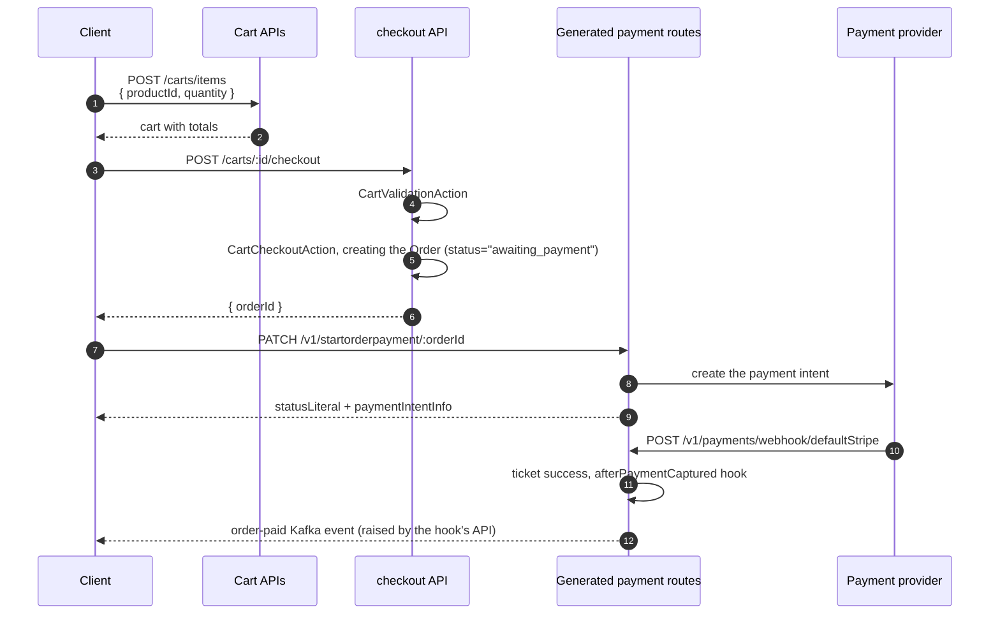

# Build a shopping cart checkout flow

The `ShoppingCartConfig` chapter on a service auto-generates a Cart,
CartItem, optional Campaign / Coupon data objects, the cart CRUD
APIs, and the cart-to-order checkout step. Put a `checkout` opt-in on
the order object and the service also generates the payment routes, so you
have an end-to-end "click, pay, ship" flow without authoring any payment
API.

> **Audience.** AI agent or human author adding a checkout to a
> service that already models products. Builds on
> [Add a payment checkout](add-payment-checkout.md): read that first.

## Flow



## Prerequisites

- A `commerce` (or similar) service with at least one `Product`-like
  catalog object.
- A payment provider configured per
  [Add a payment checkout](add-payment-checkout.md).

## Step 1: turn on the cart

```json
{
  "services": [
    {
      "serviceSettings": { "serviceBasics": { "name": "commerce" } },
      "shoppingCartConfig": {
        "basicSettings": {
          "useShoppingCartFeature": true,
          "cartObjectName":  "cart",
          "currency":        "USD",
          "supportGuestCart": true,
          "supportNotes":     true
        },
        "pricingSettings": {
          "defaultVatRate":    8.5,
          "roundingStrategy":  "perLine",
          "roundingPrecision": 2
        },
        "productCatalogSettings": {
          "useProductCatalog": true,
          "productDataObject": "Product",
          "lookupField":       "barcode"
        },
        "checkoutSettings": {
          "orderCreationMode":  "local",
          "orderDataObjectName": "Order",
          "autoMapProperties":   true,
          "publishCheckoutEvent": true,
          "checkoutEventTopic":   "commerce-cart-checkout-completed",
          "initialOrderStatus":   "awaiting_payment"
        }
      }
    }
  ]
}
```

The service now has `Cart`, `CartItem`, and the basic CRUD APIs
under `/carts`, `/carts/:id/items`, etc. Each cart carries the
configured pricing. Because the cart is catalogue-bound
(`useProductCatalog`), the **server prices every line** from the `Product`
row: a client-sent `unitPrice` is ignored, `unitPrice` need not be sent at
all, and adding a barcode the catalogue does not hold answers a typed
`404 CART_PRODUCT_NOT_FOUND`. Note that `defaultVatRate`
speaks **percent** (`8.5` = 8.5%), per the language-wide vat unit contract
(a bare `1` means one percent, sub-1% rates are written as
fractions like `0.005`). There is no automatic abandonment: `abandoned` is
written only by an explicit cart delete (the inactivity-period knobs were
retired; see [Shopping cart](../capabilities/shopping-cart.md)).

## Step 2: declare the Order data object

Order is yours to shape because every business has its own status
ladder. Pair it with the payment recipe's `CheckoutConfig`:

```json
{
  "dataObjects": [
    {
      "objectSettings": {
        "basicSettings": { "name": "Order" },
        "checkout": {
          "objectIsAnOrderObject": true,
          "configuration": {
            "providerName":              "defaultStripe",
            "orderName":                 "Order",
            "orderIdProperty":           "id",
            "amountProperty":            "total",
            "currencyProperty":          "currency",
            "orderStatusProperty":       "status",
            "orderStatusUpdateDateProperty": "statusUpdatedAt",
            "orderOwnerIdProperty":      "userId",
            "mapPaymentResultToOrderStatus": {
              "paymentResultStarted":  { "js": "'awaiting_payment'" },
              "paymentResultSuccess":  { "js": "'paid'" },
              "paymentResultFailed":   { "js": "'payment_failed'" },
              "paymentResultCanceled": { "js": "'canceled'" }
            },
            "lifecycleHooks": [
              {
                "name":    "markOrderPaidOnCapture",
                "trigger": "afterPaymentCaptured",
                "script":  { "js": "await API.markOrderPaid({ orderId: payment.orderId })" }
              }
            ]
          }
        }
      },
      "properties": [
        {
          "basicSettings":    { "name": "userId", "type": "ID", "hasRelation": true },
          "relationSettings": { "relationName": "buyer", "relationTargetObject": "User", "relationTargetKey": "id" },
          "sessionSettings":  { "isOwnerField": true, "sessionParam": "userId" }
        },
        { "basicSettings": { "name": "subtotal",      "type": "Decimal", "decimalScale": 2 } },
        { "basicSettings": { "name": "discountTotal", "type": "Decimal", "decimalScale": 2 } },
        { "basicSettings": { "name": "vatTotal",      "type": "Decimal", "decimalScale": 2 } },
        { "basicSettings": { "name": "grossTotal",    "type": "Decimal", "decimalScale": 2 } },
        { "basicSettings": { "name": "total",    "type": "Decimal", "decimalScale": 2, "isRequired": true } },
        { "basicSettings": { "name": "redeemedPoints",     "type": "Integer" } },
        { "basicSettings": { "name": "pointsValue",        "type": "Decimal", "decimalScale": 2 } },
        { "basicSettings": { "name": "appliedPointsValue", "type": "Decimal", "decimalScale": 2 } },
        { "basicSettings": { "name": "currency", "type": "String", "defaultValue": "USD" } },
        { "basicSettings": { "name": "status",   "type": "Enum", "enumOptions": ["awaiting_payment", "paid", "payment_failed", "canceled", "refunded"], "defaultValue": "awaiting_payment" } },
        { "basicSettings": { "name": "statusUpdatedAt", "type": "Date" } }
      ]
    }
  ]
}
```

Only the columns above the `status` ladder are money columns, and they are
there for a reason: `autoMapProperties` copies the canonical cart fields onto
the order payload, and **any of them the `Order` object does not declare is
dropped** (loudly, as a `CartOrderPropertiesDropped` warning, but dropped).
Declare `total` alone and the row records what was charged with nothing to
explain how that number was reached. `total` is net of any loyalty redemption,
so the reconstruction that holds in every state is
`total = grossTotal - appliedPointsValue`, where `grossTotal` is the basket
before points and `appliedPointsValue` is the part of the redemption the
basket could absorb. `redeemedPoints` / `pointsValue` are the shopper's
request and can be larger than `appliedPointsValue` when the goods shrank
after the redemption - keep them if you owe a loyalty balance an audit trail.
Drop the loyalty columns if the service has no loyalty program.

The `Order.status` enum is your state ladder. The generated payment layer
does **not** write it: it keeps the payment state on its own ticket
(`sys_OrderPayment.statusLiteral`), and `orderStatusProperty` and
`mapPaymentResultToOrderStatus` are declarative only. The status moves
through your own code: the `afterPaymentCaptured` hook above calls
`markOrderPaid`, an internal-call `update` API on `Order`
(`controllers.internalCallSettings.hasInternalCallController: true`) that
sets `status` to `paid` and can raise an order-paid event
(`basics.apiOptions.raiseApiEvent`, topic suffix `raisedEventTopic`). In a hook script `payment` is the
payment ticket and `payment.orderId` the `Order` row id. Other transitions
are explicit BusinessApis that move the status field with a `whereClause`
gating which from-states are valid. The owner column
(`sessionSettings.isOwnerField`) is what lets the buyer start and refresh
the payment of their own order.

## Step 3: the checkout BusinessApi

`CartValidationAction` enforces existence / stock / pricing
preconditions. `CartCheckoutAction` writes the Order and clears the
cart. The API is a `get` on the `Cart` row (`crudType` is one of
`create`, `update`, `get`, `list`, `delete`): it loads the cart by id and the
actions run after the main read. It answers the new `orderId`; the payment is started on it in
Step 4.

```json
{
  "basics": {
    "apiOptions":  { "name": "checkoutCart", "crudType": "get", "dataObjectName": "Cart" },
    "authOptions": { "loginRequired": true }
  },
  "parameters": {
    "requestParameters": [
      { "name": "cartId", "type": "ID", "required": true, "httpLocation": "urlpath" }
    ]
  },
  "controllers": {
    "restSettings": { "hasRestController": true, "routePath": "/carts/:cartId/checkout" }
  },
  "actions": {
    "cartValidationActions": [
      {
        "name":            "validate",
        "validations":     ["itemsExist", "stockAvailable", "pricesValid", "minimumOrderMet"],
        "failFast":        true,
        "writeToResponse": false
      }
    ],
    "cartCheckoutActions": [
      {
        "name":                   "doCheckout",
        "stage":                  "process",
        "clearCartAfterCheckout": true,
        "recordPromotionUsage":   true,
        "contextPropertyName":    "checkout",
        "writeToResponse":        false
      }
    ],
    "addToResponseActions": [
      {
        "name":            "respond",
        "context": [
          { "contextName": "orderId", "contextValue": { "js": "this.checkout.orderId" } }
        ],
        "writeToResponse": false
      }
    ]
  }
}
```

Custom-type APIs don't drive a default verb from the crudType; set
`controllers.restSettings.forcePOSTMethod: true` when the endpoint
mutates and you want POST instead of the default GET, or accept the
non-default verb that the route calculator picks from the API
name.

## Step 4: start the payment and let the generated routes finish it

With the `orderId` from the checkout answer, the frontend starts the
payment on the generated route, as in
[Add a payment checkout](add-payment-checkout.md):

```http
PATCH /v1/startorderpayment/:orderId
Content-Type: application/json

{ "paymentUserParams": { "return_url": "https://shop.example.com/orders/paid" } }
```

The answer carries `statusLiteral` and `paymentIntentInfo`
(`requires_redirect`, `redirectToUrl`, `client_secret`, `next_action`); what
the frontend renders from it is per provider, see
[3-D Secure and buyer redirects](../capabilities/payment-3ds-and-redirects.md).
The return page refreshes the ticket with
`PATCH /v1/refreshorderpayment/:orderId`.

There is nothing to author for the webhook. The generated
`POST /v1/payments/webhook/<providerName>` route verifies the provider's
signature, moves the `sys_OrderPayment` ticket and runs the
`lifecycleHooks` you attached on `CheckoutConfig`. Point the provider at
it as the payment recipe describes.

A designer-authored start is optional. To start the payment inside the
checkout API itself, add a `PaymentAction` with stage `start` after
`cartCheckoutActions` and declare an Object request parameter named
`paymentUserParams` (`httpLocation: "body"`) so the action receives the
caller's `return_url` and `paymentMethodId`.

## What you get

Auto-generated routes on the `commerce` service:

- `POST /carts`: create cart (session-bound or guest via session id)
- `GET /carts/:id`: fetch with computed totals
- `POST /carts/:id/items`: add line item (Product snapshot included)
- `PUT /carts/:id/items/:itemId`: update quantity
- `DELETE /carts/:id/items/:itemId`: remove line item
- `POST /carts/:id/checkout`: the API declared above

And, from the `checkout` opt-in on `Order`, the generated payment routes:

- `PATCH /v1/startorderpayment/:orderId`: start the payment
- `PATCH /v1/refreshorderpayment/:orderId`: refresh the ticket (return page, late webhook)
- `POST /v1/payments/webhook/<providerName>`: payment webhook

## Variations

- **Guest checkout.** `supportGuestCart: true` (set above) attaches the
  cart to a session id (`X-Session-Id`). Login is **rotation, not
  adoption**: the logged-in user gets a different owner slot
  and starts from an empty cart, while the guest basket stays intact under
  its session id until the cart TTL: nothing is merged. Re-send the same
  `X-Session-Id` without a token to find the guest basket again; a
  merge-on-login, if a project wants one, is app-level code.
- **Multi-currency.** Set `currency` per-cart from a session field
  (`basicSettings.currency` accepts an MScript). Items snapshot the
  cart currency at add time; mixing currencies in one cart is
  rejected.
- **Coupons / campaigns.** Add a `Campaign` or `Coupon` DataObject and
  configure `promotionSettings` on the cart config. Add
  `CouponValidationAction` to the checkout workflow before
  `cartCheckoutActions`. The runtime coupon routes answer typed verdicts:
  an unknown code is `404 COUPON_NOT_FOUND`, a
  matched-but-ineligible one (expired, minimum unmet) is
  `400 COUPON_NOT_ELIGIBLE`, never a silent zero-discount "success", and
  removing one coupon re-applies the remaining ones.
- **Scarce stock.** The cart does **not** reserve or verify availability:
  the catalogue binding is pricing-only, and the `stockAvailable`
  validation above is a point-in-time check, not a hold. Enforce capacity
  atomically in your purchase flow (a conditional update like
  `soldCount + qty <= capacity`), or model real reservations with the
  ledger pattern ([Ledger FEFO stock](ledger-fefo-stock.md)).
- **Remote order service.** Set
  `checkoutSettings.orderCreationMode: "remote"` and
  `publishCheckoutEvent: true`. Checkout publishes the configured
  topic; the order service consumes it and creates the Order on its
  own database. If no Business API of the project creates an order from
  that topic, every remote checkout is lost, and validation and build
  refuse the project with the ERROR `CART_CHECKOUT_TOPIC_NO_CONSUMER`.
  Add the order consumer (a kafka-triggered create Business API
  on the order object whose `requestTopicName` is the exact checkout
  topic; a receipt notification or an event subscription does not
  count), or, when the order service lives outside this project, set
  `checkoutSettings.externalCheckoutConsumer: true`, or switch to
  `local` / `none`.

## See also

- [Add a payment checkout](add-payment-checkout.md)
- [Shopping cart](../capabilities/shopping-cart.md)
- [Payment workflow](../capabilities/payment-workflow.md)
- [3-D Secure and buyer redirects](../capabilities/payment-3ds-and-redirects.md)
- Reference: [`ShoppingCartConfig`](../../spec/ShoppingCartConfig.md), [`CartCheckoutAction`](../../spec/CartCheckoutAction.md), [`CartValidationAction`](../../spec/CartValidationAction.md), [`PaymentAction`](../../spec/PaymentAction.md)
