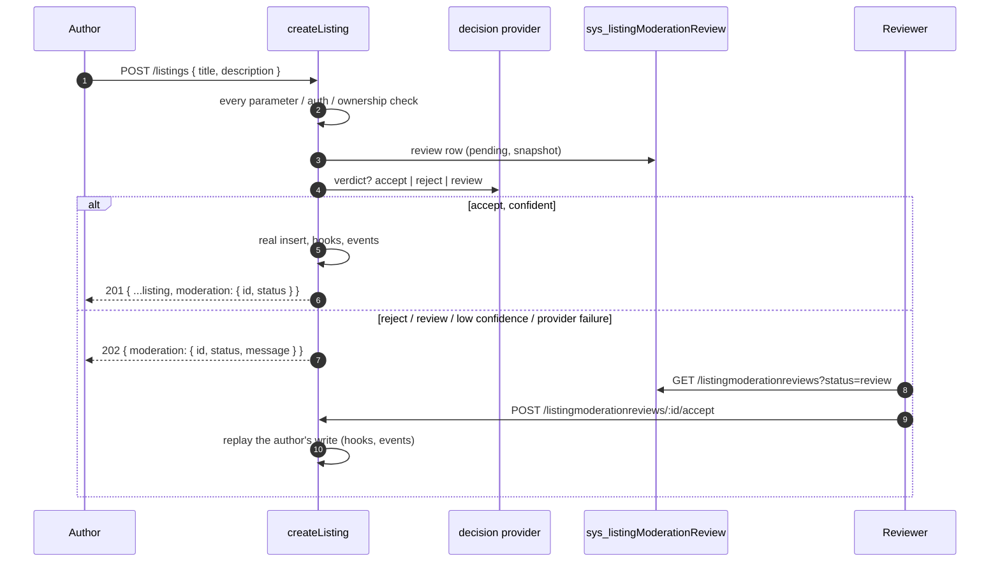

# Moderate user-submitted content

Users write listings, comments, profiles or events; nothing they write
should reach other users before it is judged. Enable `objectModeration` on
the object that carries the content: its create and update apis ask a
decision provider for a verdict, what is not clearly acceptable waits on a
generated review queue, and reviewer roles accept or reject it. Nothing in
your api definitions changes.

> **Audience.** AI agent or human author adding moderation to a project.
> This recipe is the end-to-end walk-through; every rule it relies on is
> specified in [Object content moderation](../capabilities/object-moderation.md).
> Do not build a separate moderation service, a moderation status column or
> an accept / reject api pair yourself: the pattern generates all of it.

## Flow



## Step 1: choose the mode

| | `staged` (default) | `onPlace` |
|---|---|---|
| Where a held write lands | only on the review row; the real row is written on accept | on the real row at once, with a compiler-managed `moderationStatus` |
| A held create answers | `202` `{ moderation }`, no record | `201` with the record and `moderation` beside it |
| Unapproved data on the real object | never | yes, hidden by a read gate from everyone but its author and the reviewers |
| Use when | always, unless the next case applies | a child object needs the parent's REAL id before the parent is accepted (an event whose wizard creates ticket types against it) |

Pick `staged` unless you can name the child that needs the real id.

## Step 2: declare the decision provider

One entry under `projectSettings.decisionProvidersSettings`, named by every
moderated object that uses it. `apiKey` is a secret: it is masked in api
responses.

```json
{
  "projectSettings": {
    "decisionProvidersSettings": {
      "decisionProviders": [
        {
          "name": "jevMain",
          "provider": "typesafe",
          "configuration": { "apiKey": "<TypeSafe API key>", "model": "jev-1.13.0" }
        }
      ]
    }
  }
}
```

`model` must be a pinned version (`DECISION_MODEL_NOT_PINNED` refuses a
floating tag). For local work without a key, declare the same entry with
`"provider": "mock"`: see [Test it with the mock brand](#test-it-with-the-mock-brand).

## Step 3: declare the reviewer role

`reviewerRoles` must name declared roles; left empty it means the platform
operator (`admin` / `superAdmin`, or `superAdmin` / `saasAdmin` in a
multi-tenant project).

```json
{
  "authentication": {
    "accessControl": {
      "roleSettings": {
        "rbacIsActive": true,
        "configuration": {
          "roleItems": [
            { "name": "moderator", "value": "moderator" }
          ]
        }
      }
    }
  }
}
```

## Step 4: enable `objectModeration` on the object

```json
{
  "serviceSettings": { "serviceBasics": { "name": "market" } },
  "dataObjects": [
    {
      "objectSettings": {
        "basicSettings": { "name": "listing" },
        "objectModeration": {
          "enabled": true,
          "mode": "staged",
          "providerName": "jevMain",
          "policy": "Listings must describe a real item for sale; no contact details, no offensive language.",
          "confidenceThreshold": 0.8,
          "moderatedProperties": ["title", "description"],
          "reviewerRoles": ["moderator"],
          "onProviderError": "failToReview"
        }
      },
      "properties": [
        { "basicSettings": { "name": "title", "type": "String", "isRequired": true } },
        { "basicSettings": { "name": "description", "type": "Text" } },
        { "basicSettings": { "name": "soldCount", "type": "Integer", "defaultValue": 0 } }
      ]
    }
  ],
  "businessLogic": [
    {
      "basics": { "apiOptions": { "name": "createListing", "crudType": "create", "dataObjectName": "listing" } },
      "controllers": { "restSettings": { "hasRestController": true } }
    },
    {
      "basics": { "apiOptions": { "name": "updateListing", "crudType": "update", "dataObjectName": "listing" } },
      "controllers": { "restSettings": { "hasRestController": true } }
    },
    {
      "basics": { "apiOptions": { "name": "listListings", "crudType": "list", "dataObjectName": "listing" } },
      "controllers": { "restSettings": { "hasRestController": true } }
    }
  ]
}
```

What each field does here:

- `policy` is the plain-language rule the verdict is judged against: write
  it as you would brief a human moderator, not as a prompt.
- `moderatedProperties` lists what is judged. `soldCount` is left out on
  purpose: an update that touches none of the listed properties writes
  straight through, so a sale bumping the counter never re-queues the
  listing. Unset, every user-writable property counts.
- `confidenceThreshold` `0.8` is the default; below it a verdict goes to a
  human. Keep it outside 0.3–0.7 for the typesafe brand (the drift band).
- `onProviderError: failToReview` (the default) holds the submission when
  the provider fails; `failToReject` refuses it. A failure never publishes.

Optional: `exemptRoles` for trusted authors whose writes land directly, and
`wantReason` + `escalateTo` (+ `userMessageMode: "llm"`) for an AI agent
that writes the reason for a held write: see
[two-tier reasons](../capabilities/object-moderation.md#two-tier-reasons).

The compiler adds `sys_listingModerationReview` and five apis to `market`; you
declare none of them.

## Step 5: what the author sees

An accepted create answers as an unmoderated one, plus the review row:

```text
POST /market-api/v1/listings  { "title": "Oak desk", "description": "Solid oak, 120 cm." }
→ 201 { "_type": "listing", "id": "…", "title": "Oak desk", …, "moderation": { "id": "8f0c…", "status": "accepted" } }
```

A held or rejected one answers `202` and writes nothing:

```text
→ 202 { "moderation": { "id": "8f0c…", "status": "review", "message": "Your submission is being reviewed." } }
```

The client must not treat a `202` as a created record or navigate to it.
The author follows their submissions through the injected list:

```text
GET /market-api/v1/mylistingmoderationsubmissions
→ { "data": [ { "id": "8f0c…", "kind": "insert", "status": "review", "userMessage": "…", … } ], "paging": … }
```

Over gRPC the same outcome is the `moderation` field (tag 1000) of the
response message; a hold answers `OK` with only that field set and the
`x-moderation-status` / `x-moderation-id` metadata. See
[what a gRPC caller sees](../capabilities/object-moderation.md#what-a-grpc-caller-sees).

## Step 6: the reviewer flow

A user holding `moderator` reads the queue, inspects one row (the submitted
`dataJson` and the decision record), then decides:

```sh
# The rows waiting for a human
curl -s "$API/listingmoderationreviews?status=review" -H "Authorization: Bearer $MOD_JWT"

# One row with its decision record
curl -s "$API/listingmoderationreviews/$REVIEW_ID" -H "Authorization: Bearer $MOD_JWT"

# Accept: replays the author's write through createListing, as the author
curl -s -X POST "$API/listingmoderationreviews/$REVIEW_ID/accept" -H "Authorization: Bearer $MOD_JWT"

# Or reject, with a reason for other reviewers and a message for the author
curl -s -X POST "$API/listingmoderationreviews/$REVIEW_ID/reject" \
  -H "Authorization: Bearer $MOD_JWT" -H "Content-Type: application/json" \
  -d '{ "reason": "Phone number in the description", "userMessage": "Please remove contact details." }'
```

- Accept answers `{ moderation, record }`; the replay runs every hook and
  event a direct write would. A replay that fails leaves the row
  `applyFailed`, which can be accepted again (`422` on that call).
- A reviewer can never decide their own submission (`403`
  `MODERATION_SELF_DECISION`), and a row someone else is deciding answers
  `409`.
- `?status=applyFailed` lists accepted rows whose write failed.

## Step 7: the `onPlace` variant: what reads hide

Switch `mode` to `onPlace` and the write lands at once; the verdict goes
into the injected, read-only `moderationStatus` column (`accepted`,
`rejected`, `review`) and the response is the normal `201` / `200` with
`moderation` beside the record. A moderated edit of an approved row is
decided again in the same request; unless it is accepted the row leaves
public view.

Every generated read the compiler controls then hides a row that is not
`accepted` from a caller who is neither its author nor privileged
(the reviewer roles, `superAdmin`, a tenant-pinned `tenantOwner`, cron and
internal calls): `listListings` and the object's get, update and delete,
select joins and joint / membership filters onto it, the `/geo` routes,
`FetchObjectAction`, `FetchStatsAction`, `FetchParentAction`,
`SearchObjectAction`, `FetchFromElasticAction`, static joins sourced from
it, and the embedded rows of a BFF DataView. The author still sees their
own rows. A reviewer's accept or reject flips the column, never replays.

What the gate does not cover is named by the validator
(`OBJECT_MODERATION_UNGATED_READ_PATH`): graph and enterprise projections,
an internal-call controller on the object's get / list, the static-join
residue, and a `global` aggregation in a `FetchFromElasticAction` body.
Kafka DB events carry every row with `moderationStatus` in it: a consumer
filters on that column. See
[the onPlace read gate](../capabilities/object-moderation.md#the-onplace-read-gate).

## Test it with the mock brand

Declare the provider with `"provider": "mock"` (or leave the typesafe key
unset: the provider registry then falls back to the mock). The mock is
deterministic and keyless, and on an explicitly non-production deployment
(the service's environment and its service configuration both declared,
both non-production, and agreeing) it decides, so a test can reach every
branch on purpose by writing a directive into a moderated text property:

```json
{ "title": "Oak desk", "description": "Solid oak. [[mock-decision verdict=reject@0.95]]" }
```

- `verdict=accept` (confidence defaults to 0.99) → `201`, row `accepted`;
- `verdict=reject@0.95` → `202`, row `rejected`;
- `verdict=accept@0.4` → below the threshold → `202`, row `review`;
- a value that is not `accept` / `reject` / `review` is refused
  (`MOCK_DECISION_DIRECTIVE_INVALID`).

On production a mock verdict: a declared `mock` entry or the fallback —
never decides: every submission is held for a human with
`transportFailure: "mockFallback"`. A production service with a missing key
therefore fills the review queue instead of publishing anything.

## Common validator findings

| Code | What it means | Fix |
|---|---|---|
| `OBJECT_MODERATION_PROVIDER_NOT_FOUND` | `providerName` is missing or names no `decisionProviders[]` entry | declare the entry (Step 2) or fix the name |
| `OBJECT_MODERATION_POLICY_MISSING` | no `policy` | write the rule in two sentences |
| `OBJECT_MODERATION_UNKNOWN_ROLE` | a `reviewerRoles` / `exemptRoles` entry is not a declared role | declare it (Step 3) |
| `OBJECT_MODERATION_PROPERTY_NOT_FOUND` | a `moderatedProperties` entry is not a property of the object | fix the name |
| `OBJECT_MODERATION_THRESHOLD_IN_DRIFT_BAND` (warning) | `confidenceThreshold` lies within the provider's drift band around 0.5 | move it out (0.8 is) |
| `OBJECT_MODERATION_NO_WRITE_API` (warning) | no create and no update api on the object, so nothing is moderated | declare the write apis |
| `OBJECT_MODERATION_UNSTAGED_WRITE_PATH` (warning) | a `createCrudAction` / `updateCrudAction` / bulk action writes the object past the seam | route the write through the object's own api, or accept the bypass |
| `OBJECT_MODERATION_REASON_WITHOUT_ESCALATION` / `OBJECT_MODERATION_LLM_MESSAGE_WITHOUT_REASON` | `wantReason` without `escalateTo`, or `userMessageMode: "llm"` without `wantReason` | add the agent, or drop the option |
| `OBJECT_MODERATION_STATUS_COLUMN_TAKEN` / `OBJECT_MODERATION_MANAGED_COLUMN_WRITTEN` | `onPlace`: you declared or write `moderationStatus` / `moderationAuthorId` yourself | remove it; the compiler owns both |
| `OBJECT_MODERATION_UNGATEABLE_VIEW_STAT` | `onPlace`: a BFF DataView `stat` counts the object | drop the stat; use a `FetchStatsAction` on the consuming api |
| `OBJECT_MODERATION_LANGUAGE_UNSUPPORTED` | the service targets a language for which the compiler has not implemented the engine (a compiler refuses a construct it does not implement) | generate the service in a language that implements it |

The full table is in
[Object content moderation: validation codes](../capabilities/object-moderation.md#validation-codes).

## See also

- [Object content moderation](../capabilities/object-moderation.md): the
  specification: both modes, the review row, the injected apis, the read
  gate, gRPC and every validation code.
- [Hub messages and outbound notifications](../capabilities/object-moderation.md#hub-messages-and-outbound-notifications)
 : the same moderation on chat messages and notification content
  (`contentModeration`).
- [The decision layer](../capabilities/decision-layer.md): decision providers,
  their credentials and the mock brand.
- [Add an AI agent](add-ai-agent.md): the agent `escalateTo` names when you
  want written reasons.
- [`ObjectModeration`](../../spec/ObjectModeration.md): every field and
  its default.
