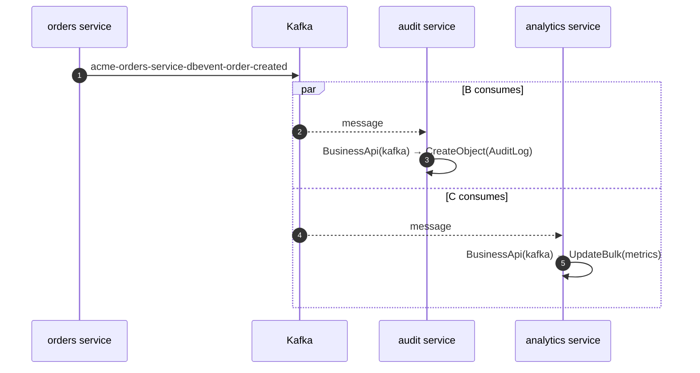

# React to an event from another service

When service A writes a row or finishes a custom API, the generated
service publishes a Kafka event. Service B consumes it by exposing a
`BusinessApi` with the Kafka controller switched on. Each consumer
runs in its own consumer group, so multiple services can react to the
same event independently.

> **Audience.** AI agent or human author wiring service-to-service
> reactions: audit logs, derived projections, saga steps, alerting.

## Flow



Two services on the same topic, two consumer groups, no contention.

## Producer side: what gets published

Every primary DataObject auto-publishes its DB-level events. The
emitter is the generated db layer itself: it raises a created,
updated or deleted event on every successful write, with topic:

```
<serviceCodename>-dbevent-<objectname>-<verb>
```

`serviceCodename` is the owning service's project-scoped codename:
`<projectCodename>-<serviceName>-service`, lowercase. `objectname` is
the lowercased DataObject name. `verb` is one of `created` /
`updated` / `deleted`. Examples:

- `acme-auth-service-dbevent-user-created`
- `acme-orders-service-dbevent-order-updated`
- `acme-billing-service-dbevent-invoice-deleted`

You will also see an `elastic-index-<project>_<objectname>-<verb>`
family on the broker. Those are the generated services' **internal**
Elasticsearch index-sync events (consumed by the services' own indexer
and the BFF DataView listeners). Subscribing to them is legitimate in one
narrow case: when your logic specifically needs **post-materialization
timing**: the event fires only AFTER the Elasticsearch write
succeeds, so the row is already queryable in the DataView. Know the
trade-off: the index attempt is awaited for at most a configured time
budget and never fails the write (an ES outage, a stall past the
budget or an unconfigured indexer drops the event silently, and only
indexed objects have this family at all). The reliable lifecycle
signal is the `-dbevent-` family above.

For custom API events, set
`basics.apiOptions.raiseApiEvent: true` on the producer API. The
compiler picks a derived topic name; consumers reference it
verbatim.

## Consumer side: declare a Kafka-triggered BusinessApi

In the consuming service, add a `BusinessApi` whose only controller is
Kafka. Use a `create`-crudType when the consumer should write a row
per event; use `custom` when the workflow is more involved.

```json
{
  "basics": { "apiOptions": { "name": "logUserCreated", "crudType": "create", "dataObjectName": "AuditLog" }},
  "controllers": {
    "kafkaSettings": {
      "hasKafkaController": true,
      "requestTopicName":   "acme-auth-service-dbevent-user-created"
    },
    "restSettings": { "hasRestController": false }
  },
  "parameters": {
    "requestParameters": [
      { "name": "subjectId", "type": "ID",     "httpLocation": "body",    "dataPath": "id",    "required": true },
      { "name": "email",     "type": "String", "httpLocation": "body",    "dataPath": "email" },
      { "name": "eventTime", "type": "String", "httpLocation": "request", "dataPath": "time"  }
    ]
  },
  "query": {
    "dataClauseItems": [
      { "name": "kind",      "value": { "js": "'user.signup'" } },
      { "name": "subjectId", "value": { "js": "this.subjectId" } },
      { "name": "email",     "value": { "js": "this.email" } },
      { "name": "at",        "value": { "js": "this.eventTime ?? new Date().toISOString()" } }
    ]
  }
}
```

**Declare a parameter, then read `this.<paramName>`: that is the whole
contract.** A Kafka-triggered API has no magic event binding: the
service builds a pseudo-request from the message and fills one
`this.<name>` per declared parameter. Nothing else is populated for
you.

Two read scopes, both shown above:

- `httpLocation: "body"` is **record** scope. (It is not a default:
  `httpLocation` is a required field. Where a location still has to be
  resolved for a parameter that never passed validation, the fallback is
  method-aware (see
  [`BusinessApiParameter`](../../spec/BusinessApiParameter.md)) and it
  applies here too: a Kafka-triggered API still carries an HTTP method derived
  from its `crudType`, even with no REST controller, so an undeclared location
  on a `get`/`list`/`delete` resolves to `query` rather than `body`. It makes
  no difference to what the Kafka reader emits: it distinguishes only
  `session` and `request`, and every other location reads the same
  unwrapped record. Declare the location anyway: it is required, and it is
  what the REST and SDK surfaces read.) The pseudo-request body is
  `payload.data ?? payload`, so the unified event envelope is already
  unwrapped and the `dataPath` is the **bare** record key:
  `"id"`, `"email"`, never `"data.id"`, which reads through a second,
  non-existent envelope and binds `undefined`.
- `httpLocation: "request"` is **envelope** scope: it resolves
  against the raw envelope the consumer carries on `_req.event`, which
  is how you reach `time`, `type`, `requestId`, and (on any `.updated`
  DB event) `old.<field>` for an act-only-if-it-actually-changed
  consumer.

The record is the row itself. On `user-created`, `data` **is** the user,
so the email is at `email`, not `user.email`.

There is no `this.event` on a Kafka consumer's context: the bound names
are session/params/data/instance/result and friends, and
`event` is not among them. Any expression rooted at `this.event`
therefore does not fail at design time; it dereferences `undefined` and
throws a `TypeError` on *every* message at runtime (surfaced as
`[MScript …] Cannot read properties of undefined`). The consumer's
error handler turns that into a single `ErrorInKafkaMessage` log line and the
message is not retried: so a whole topic goes unconsumed with nothing
but log noise to show for it.

If you must read the message without declaring a parameter, the escape
hatches are `this.request.body.<field>` (the unwrapped record) and
`this.request.event` (the raw envelope). Both are the same objects the
declared parameters bind against; prefer the declaration, which is
typed, validated, and documented in the API's own documentation.

The consumer group name is `<serviceCodename>-<requestTopicName>-<apiName>`,
where `serviceCodename` is the lowercased
`<projectCodename>-<serviceName>-service`. Each service and API gets its own
group, while replicas of the same API share the work.

## Fan-out: one topic, many consumers

To run a second reaction in a different service, declare another
Kafka-triggered BusinessApi pointing at the same `requestTopicName`.
Each service is its own consumer group; Kafka delivers the message to
each group independently. No coordination needed.

## Chained / saga pattern

A consumer can publish its own follow-up topic, which another
consumer reads. Use `publishEventActions` after the workflow's main
work:

```json
{
  "actions": {
    "addToContextActions": [
      {
        "name":            "buildPayload",
        "context": [
          { "contextName": "auditRow", "contextValue": { "js": "({ subjectId: this.subjectId, email: this.email })" } }
        ],
        "writeToResponse": false
      }
    ],
    "publishEventActions": [
      {
        "name":            "fireChain",
        "topic":           "audit.processed",
        "message":         { "js": "({ logId: this.instance.id })" },
        "writeToResponse": false
      }
    ]
  },
  "workflow": {
    "create": {
      "afterMainCreateOperation": ["fireChain"]
    }
  }
}
```

`this.instance` is the row written by the `create` crudType's main
operation; the audit log id is therefore available to the follow-up
event.

A saga is just a chain of these: each step listens on the previous
step's output topic and publishes its own. Compensating actions are
explicit BusinessApis that listen on `*.failed` topics.

## Idempotency

Kafka can redeliver. Two patterns:

- **Deterministic primary key.** Derive the new row's id from an
  immutable event field (typically `<eventName>:<sourceId>`) and use
  `onDuplicate: "stopOperation"` on the unique index. A redelivery
  becomes a no-op.
- **Conditional writes.** Use a `whereClause` on `update` /
  `delete` consumers that filters out already-applied state. A
  redelivered `order.paid` should match no rows when the order is
  already `paid`.

## Failure handling

Failures inside the consumer's workflow log and move on by default:
the message is **not** retried. Treat the topic as best-effort and
handle critical paths by either:

- Stamping a marker on the source row (`auditLoggedAt`) and running a
  reconciliation cron that picks up rows where the marker is null.
- Routing failures to your own dead-letter topic via
  `publishEventActions` in an `onError` branch, then subscribing a
  small alert consumer to it.

Kafka-triggered consumers do not run under the caller's HTTP session:
an event carries no session object and no credentials. What it does
carry is the envelope's minimal `actor`
(`userId` / `sessionId` / `tenantId` / `roleId`), which the consumer
assigns as the pseudo-request's session, the envelope's
transport-neutral `tenantId` mapped onto the project's own tenant field on
the way in. So `this.session.userId` and `this.session.<tenantName>Id` are
the originating identity on the consumer side, the same names an HTTP
session uses.

When a downstream action needs more than that, publish the extra fields
into the event's **record** at the producer and bind them like any other
input: a `requestParameter` with a bare `dataPath` read as
`this.<paramName>`.

## See also

- [Kafka topic naming](../best-practices/kafka-topic-naming.md): the
  literal naming conventions for emitted and authored topics.
- [Kafka controllers](../business-apis/kafka-controllers.md)
- Pattern reference: [`ApiKafkaSettings`](../../spec/ApiKafkaSettings.md), [`PublishEventAction`](../../spec/PublishEventAction.md)
- Cookbook: [Send a welcome email on signup](send-email-on-signup.md):
  same Kafka topic, different consumer.
