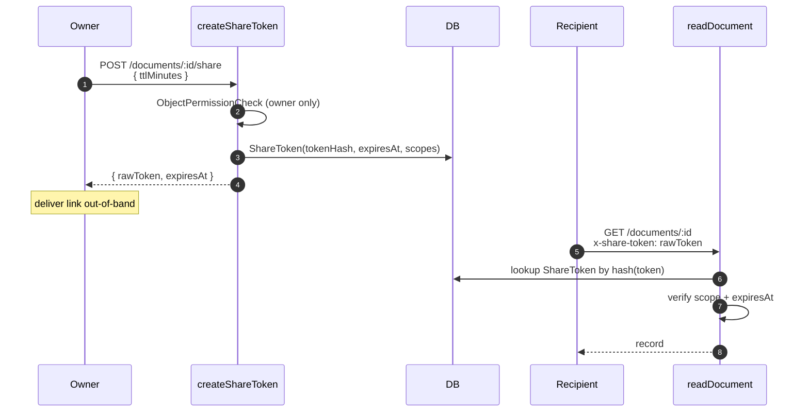

# Share a record by link

An authenticated owner mints a token that another visitor, possibly
unauthenticated, uses to read a single record for a limited time.
The token's hash lives in the database; the raw token is returned
exactly once and only the holder of the raw value can use it.

> **Audience.** AI agent or human author granting per-record access
> outside the regular role / ABAC gates. This is the **stateful**
> variant: the token is a random string stored as a `ShareToken` row,
> validated by fetching that row. It is simple, practical, and
> revocable (delete the row). For the **stateless** signed-payload
> variant (a token that carries a signed payload and is validated by
> signature with no DB row) see
> [Using share tokens to authorize access](../capabilities/share-tokens.md).
> Neither variant uses a membership check.

## Flow



## Step 1: the `ShareToken` data object

```json
{
  "objectSettings": {
    "basicSettings": { "name": "ShareToken" },
    "compositeIndexSettings": [
      { "indexName": "byTarget", "indexFields": ["targetObjectName", "targetObjectId"] }
    ]
  },
  "properties": [
    { "basicSettings": { "name": "targetObjectName", "type": "String", "isRequired": true } },
    { "basicSettings": { "name": "targetObjectId",   "type": "ID",     "isRequired": true } },
    { "basicSettings": { "name": "scopes",           "type": "String", "isRequired": true, "isArray": true } },
    {
      "basicSettings": { "name": "tokenHash", "type": "String", "isRequired": true },
      "indexSettings": { "unique": true, "isSecondaryKey": true, "cacheSelect": true }
    },
    { "basicSettings": { "name": "expiresAt",        "type": "Date",   "isRequired": true } },
    {
      "basicSettings":    { "name": "createdBy", "type": "ID", "isRequired": true },
      "relationSettings": { "relationName": "creator", "relationTargetObject": "User", "relationTargetKey": "id" },
      "sessionSettings":  { "sessionParam": "userId", "isOwnerField": false }
    }
  ]
}
```

The raw token is never stored, only `LIB.common.md5(rawToken)`.
Loss of the database is loss of audit, not loss of secrets. Use a
single composite index for target-side lookup (`(targetObjectName,
targetObjectId)`); the per-property `unique` on `tokenHash` gives
you the by-hash uniqueness constraint and the Redis lookup-key flag
for hot reads.

## Step 2: the mint BusinessApi

`ObjectPermissionCheckAction` enforces "only the document's owner can
mint". `AddToContextAction` produces a token + hash pair using the
library helper. The `create` crudType's main operation
persists the `ShareToken` row using `dataClauseItems[]`.
`AddToResponseAction` returns the raw token to the caller: that
single response is the only place it ever appears.

```json
{
  "basics": {
    "apiOptions":  { "name": "createShareToken", "crudType": "create", "dataObjectName": "ShareToken" },
    "authOptions": { "loginRequired": true }
  },
  "controllers": {
    "restSettings": { "hasRestController": true, "routePath": "/documents/:documentId/share" }
  },
  "parameters": {
    "requestParameters": [
      { "name": "documentId", "type": "ID",      "required": true, "httpLocation": "urlpath" },
      { "name": "ttlMinutes", "type": "Integer", "required": false, "defaultValue": 1440 },
      { "name": "scopes",     "type": "String",  "required": false, "isArray": true, "defaultValue": ["read"] }
    ]
  },
  "query": {
    "dataClauseItems": [
      { "name": "targetObjectName", "value": { "js": "'Document'" } },
      { "name": "targetObjectId",   "value": { "js": "this.documentId" } },
      { "name": "scopes",           "value": { "js": "this.scopes" } },
      { "name": "tokenHash",        "value": { "js": "this.hashToken" } },
      { "name": "expiresAt",        "value": { "js": "new Date(Date.now() + this.ttlMinutes * 60 * 1000).toISOString()" } }
    ]
  },
  "actions": {
    "objectPermissionCheckActions": [
      {
        "name":              "canShare",
        "permissionName":    ["docOwner"],
        "readObjectIdFrom":  { "js": "this.documentId" },
        "checkType":         "liveCheck",
        "writeToResponse":   false
      }
    ],
    "addToContextActions": [
      {
        "name":            "mintToken",
        "context": [
          { "contextName": "rawToken",  "contextValue": { "js": "LIB.common.md5(String(Date.now()) + ':' + String(Math.random()))" } },
          { "contextName": "hashToken", "contextValue": { "js": "LIB.common.md5(this.rawToken)" } }
        ],
        "writeToResponse": false
      }
    ],
    "addToResponseActions": [
      {
        "name": "respond",
        "context": [
          { "contextName": "token",     "contextValue": { "js": "this.rawToken" } },
          { "contextName": "expiresAt", "contextValue": { "js": "this.instance.expiresAt" } }
        ],
        "writeToResponse": false
      }
    ]
  },
  "workflow": {
    "create": {
      "afterCheckParameters":     ["canShare", "mintToken"],
      "afterMainCreateOperation": ["respond"]
    }
  }
}
```

`createdBy` is auto-injected from the caller's session because the
property carries a `sessionSettings` block: no entry in
`dataClauseItems[]` is needed. `LIB.common.md5` is part of the default
common library; for stronger entropy declare a project-level
library function that wraps a cryptographically secure random source
and call it from MScript by name.

## Step 3: validate the share token

A share token is **not** a membership: it is a row you look up and
check. So the read API does two things in order: **fetch** the
`ShareToken` row by the hash of the inbound raw token
(`FetchObjectAction`), then **validate** that row against the request
(`ValidationAction`): target match, required scope, and not expired.
No `MembershipCheckAction` is involved.

Add both actions to the existing `getDocument` BusinessApi:

```json
{
  "basics": {
    "apiOptions":  { "name": "getDocument", "crudType": "get", "dataObjectName": "Document" },
    "authOptions": { "loginRequired": false }
  },
  "parameters": {
    "requestParameters": [
      { "name": "documentId",    "type": "ID",     "required": true,  "httpLocation": "urlpath" },
      { "name": "rawShareToken", "type": "String", "required": false, "httpLocation": "header", "dataPath": "x-share-token" }
    ]
  },
  "actions": {
    "fetchObjectActions": [
      {
        "name":                "loadShareToken",
        "targetObject":        "ShareToken",
        "whereClause":         { "js": "({ tokenHash: LIB.common.md5(this.rawShareToken || '') })" },
        "isRequired":          true,
        "contextPropertyName": "shareToken",
        "writeToResponse":     false
      }
    ],
    "validationActions": [
      {
        "name":            "shareTokenValid",
        "description":     "The share token must target this document, carry the read scope, and not be expired.",
        "validationScript": { "js": "this.shareToken.targetObjectName === 'Document' && this.shareToken.targetObjectId === this.documentId && this.shareToken.scopes.includes('read') && new Date(this.shareToken.expiresAt) > new Date()" },
        "shouldBeTrue":    true,
        "checkType":       "liveCheck",
        "errorMessage":    "This document requires a valid, unexpired share link.",
        "errorStatus":     "403",
        "writeToResponse": false
      }
    ]
  },
  "workflow": {
    "get": {
      "afterCheckParameters": ["loadShareToken", "shareTokenValid"]
    }
  }
}
```

How it works:

- **`FetchObjectAction` (`loadShareToken`)** looks the row up by hash.
  The raw token never appears in a query: we hash it with
  `LIB.common.md5` inside the `whereClause` so the lookup matches the
  stored `tokenHash`. With `isRequired: true`, a missing or unknown
  token short-circuits with a not-found error before validation runs.
  The fetched row lands on the context as `this.shareToken`.
- **`ValidationAction` (`shareTokenValid`)** then asserts the row
  actually authorizes *this* request: the token's `targetObjectName` /
  `targetObjectId` match the requested document, the `read` scope is
  present, and `expiresAt` is still in the future. Any failure throws a
  `403` with the `errorMessage`. Expired tokens stop granting access
  automatically: no sweep job required.

Because the API is `loginRequired: false`, an unauthenticated visitor
holding the link passes both actions. To *also* let an authenticated
owner read without the header, relax the validation, e.g. add an
`||` branch on `this.session?.userId === this.shareToken?.createdBy`,
or layer an `ObjectPermissionCheckAction` with a `storedCheck` and OR
the two results in the validation script.

## Verify

```sh
# 1. Owner mints a token
RAW=$(curl -s -X POST $API/documents/$DOC_ID/share \
  -H "Authorization: Bearer $JWT" \
  -d '{"ttlMinutes":60,"scopes":["read"]}' | jq -r .token)

# 2. Unauthenticated read with the header
curl -s $API/documents/$DOC_ID -H "x-share-token: $RAW"

# 3. Same call without the header → 403
curl -s $API/documents/$DOC_ID
```

A request without a valid token gets the configured `errorMessage`
(missing/unknown tokens fail the `isRequired` fetch; wrong-target,
wrong-scope, or expired tokens fail the `ValidationAction`).

## See also

- [Using share tokens to authorize access](../capabilities/share-tokens.md):
  the **stateless** signed-payload variant (no DB row; validate by
  signature). Pick that one when you don't want a row per token; pick
  this stateful recipe when you want tokens to be revocable and
  auditable.
- [Permissions strategy](../best-practices/permissions-strategy.md)
- Action reference: [`FetchObjectAction`](../actions/fetch-object-action.md),
  [`ValidationAction`](../actions/validation-action.md),
  [`ObjectPermissionCheckAction`](../actions/object-permission-check-action.md),
  [`AddToContextAction`](../actions/add-to-context-action.md),
  [`AddToResponseAction`](../actions/add-to-response-action.md)
