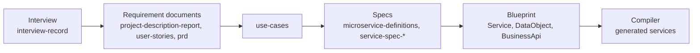
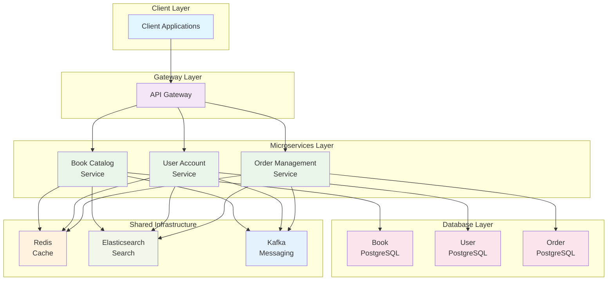

# Worked example: a book marketplace

This page shows what a design conversation produces, end to end, from the
requirement documents to the blueprint. The product is **BookMarket Pro**, a
multi-publisher book marketplace, described in the project chat as "a book
selling platform" and refined through the interview.

> **Audience.** AI agent or human author who wants to see how a
> conversation turns into design documents and then into blueprint
> patterns. The conversation itself (how an author interviews the product
> owner and gets the documents approved) is not part of this page; the
> design documents and the blueprint it produces are.

## Flow



## Requirements: project description and user stories

Once the interview is closed and approved, the author (here an AI agent) writes the requirement
documents. The two below are excerpts of `project-description-report` and
`user-stories`.

### Project description (`project-description-report`)

**Project**: BookMarket Pro

**Updated description**: A comprehensive multi-publisher book marketplace platform enabling publishers to list and sell both physical and digital books. The platform supports publisher registration and verification, comprehensive book catalog management with advanced search and categorization, secure payment processing with commission handling, and customer review systems. Publishers can manage their inventory, set pricing, and track sales analytics, while customers can browse, search, purchase, and review books from multiple publishers in a unified experience.

**Scope**: Initial release focuses on core marketplace functionality including publisher onboarding, book catalog management, customer browsing and purchasing, and basic analytics. Advanced features like affiliate programs, subscription models, and mobile apps are planned for future releases.

### User stories (`user-stories`)

**Publisher stories:**

- As a publisher, I want to register and verify my account so that I can start selling books on the platform
- As a publisher, I want to add book listings with detailed metadata so that customers can discover my books
- As a publisher, I want to set pricing and manage inventory so that I can control my sales strategy
- As a publisher, I want to view sales analytics so that I can understand my performance

**Customer stories:**

- As a customer, I want to browse and search books by various criteria so that I can find books I'm interested in
- As a customer, I want to purchase books securely so that I can own them
- As a customer, I want to leave reviews and ratings so that I can share my opinions with other readers

**Administrator stories:**

- As an admin, I want to moderate book listings so that I can ensure quality and compliance
- As an admin, I want to manage publisher accounts so that I can maintain platform integrity

## Use cases

After the project description, user stories and product requirements, the
author writes the structured use cases (`use-cases`) and maps them to the user
stories.

### Use case structure

Each use case includes:

- **Use case name**: Clear, action-oriented name
- **Primary actor**: The main user or system initiating the use case
- **Preconditions**: What must be true before the use case can execute
- **Main flow**: Step-by-step description of the normal scenario
- **Alternative flows**: Variations and exception handling
- **Postconditions**: System state after successful completion

### Example use cases

**UC-001: Publisher book registration**

- **Primary actor**: Publisher
- **Preconditions**: Publisher has verified account and is logged in

**Main flow**:

1. Publisher navigates to "Add New Book" section
2. Publisher enters book metadata (title, authors, ISBN, description)
3. Publisher uploads cover images
4. Publisher sets pricing and inventory information
5. Publisher selects book categories
6. Publisher submits book for review
7. System validates book information
8. System creates book listing in draft status
9. System sends confirmation to publisher

**Alternative flows**:

- 7a. If validation fails, system shows error messages and allows correction
- 8a. If duplicate ISBN detected, system prompts for verification

**Postconditions**: Book listing exists in draft status awaiting approval

**UC-002: Customer book search and discovery**

- **Primary actor**: Customer (anonymous or authenticated)
- **Preconditions**: Platform has published book listings available

**Main flow**:

1. Customer accesses book catalog
2. Customer enters search criteria (title, author, category, etc.)
3. System processes search and filters
4. System returns ranked search results
5. Customer browses results
6. Customer selects specific book for details
7. System displays detailed book information
8. Customer can proceed to purchase or continue browsing

**Alternative flows**:

- 4a. If no results found, system suggests alternative searches
- 6a. Customer can refine search criteria and repeat

**Postconditions**: Customer has viewed book information and can make purchase decision

### User story mapping

The use cases carry a mapping between user stories and use cases, ensuring complete coverage and traceability.

- **User story**: "As a publisher, I want to add book listings..."
  - **Maps to**: UC-001 (Publisher Book Registration), UC-003 (Book Metadata Management)
- **User story**: "As a customer, I want to browse and search books..."
  - **Maps to**: UC-002 (Customer Book Search), UC-004 (Book Catalog Browse)
- **User story**: "As an admin, I want to moderate book listings..."
  - **Maps to**: UC-005 (Book Content Moderation), UC-006 (Publisher Account Management)


## Service identification

From the requirements, user stories and use cases the author writes the spec
documents: `project-basic-setup`, `microservice-definitions`, `auth-spec`,
one `service-spec-<serviceKey>` per service, and the specs for the system
service modules the project enables. The first decision is the service boundaries.

### Service identification process

- **Domain analysis**: Groups related functionality into cohesive domains
- **Data ownership**: Identifies clear data ownership boundaries
- **Scalability considerations**: Separates services based on different scaling needs
- **Business logic grouping**: Ensures related business rules stay together

### Services in `microservice-definitions`

For the BookMarket Pro platform, the author identifies these core services in `microservice-definitions`:

#### bookCatalog service

**Purpose:** Manages book listings, metadata, and publisher associations

**Responsibilities:**

- Book CRUD operations
- Category management
- Search functionality
- Inventory tracking

#### orderManagement service

**Purpose:** Manages the purchasing process and order lifecycle

**Responsibilities:**

- Cart management
- Order processing
- Payment integration
- Order tracking
- Invoice generation

#### analytics service

**Purpose:** Provides reporting and analytics capabilities

**Responsibilities:**

- Sales tracking
- Performance metrics
- Business intelligence
- Revenue reporting

#### reviewRating service

**Purpose:** Manages customer feedback and book rating systems

**Responsibilities:**

- Review submission
- Rating aggregation
- Moderation
- Recommendation engine integration

#### inventory service

**Purpose:** Tracks book stock levels and availability across publishers

**Responsibilities:**

- Stock management
- Availability checking
- Low-stock alerts
- Publisher inventory sync

#### searchRecommendation service

**Purpose:** Provides advanced search and personalized book recommendations

**Responsibilities:**

- Full-text search
- Filtering
- Recommendation algorithms
- Trending books
- Personalized suggestions

#### contentModeration service

**Purpose:** Ensures platform content quality and compliance

**Responsibilities:**

- Automated content screening
- Manual review workflows
- Policy enforcement
- Audit trails


## The bookCatalog service in the blueprint

For each identified service, the author writes a comprehensive technical specification, the service's `service-spec-<serviceKey>` design document, and then writes it into the blueprint following the OpenAPPL pattern reference.

### Service architecture components

Each service architecture includes:

- **Service settings**: Basic configuration and communication protocols
- **Data model**: Database configuration and structure
- **Data objects**: Entity definitions with properties and relationships
- **Business APIs**: API endpoints for data operations (CRUD-shaped and custom)
- **Library functions**: Custom business logic and utilities

Let's examine the detailed architecture for the **bookCatalog** service. The JSON fragments below use the current blueprint shape; see [Service](../../spec/Service.md), [DataObject](../../spec/DataObject.md) and [BusinessApi](../../spec/BusinessApi.md) for the full reference.

### Service settings

The **bookCatalog** service is configured as a core domain service handling book-related operations:

```json
{
  "serviceSettings": {
    "serviceBasics": {
      "name": "bookCatalog",
      "description": "Handles book listings and metadata, supporting creation, editing, search, categorization, publisher association, and moderation audit trails for a multi-publisher book selling platform."
    },
    "serviceOptions": {
      "httpPort": 3002,
      "serviceAllowsUserToLogin": false,
      "dataModelName": "main",
      "dbType": "postgresql",
      "useSoftDelete": true
    }
  }
}
```

**Key design decisions:**

- **Public access**: Anonymous users can browse book catalogs. Login is decided per API through `authOptions.loginRequired`, so the public read APIs below set it to `false`.
- **Stateless design**: No user session management within this service (`serviceAllowsUserToLogin: false`).
- **Dedicated port**: Runs on port 3002 for clear service separation.

**Architectural benefits:**

- **PostgreSQL**: Provides ACID compliance for critical book data
- **Soft delete**: Maintains audit trails and enables data recovery
- **Single database**: Simplifies transactions and data consistency

### Data objects

The service defines three core entities with carefully designed relationships.

**1. book entity**

The central entity representing book listings with comprehensive metadata:

```json
{
  "objectSettings": {
    "basicSettings": {
      "name": "book",
      "description": "A physical book listing available for sale, including key metadata, publisher association, and publication status."
    },
    "compositeIndexSettings": [
      {
        "indexName": "isbnPublisherIndex",
        "indexFields": ["isbn", "publisherId"],
        "onDuplicate": "throwError"
      }
    ]
  },
  "properties": [
    {
      "basicSettings": { "name": "publisherId", "type": "ID", "isRequired": true, "allowUpdate": false },
      "indexSettings": { "indexedInDb": true, "indexedInElastic": true },
      "sessionSettings": { "sessionParam": "userId", "isOwnerField": true }
    },
    {
      "basicSettings": { "name": "title", "type": "String", "isRequired": true },
      "indexSettings": { "indexedInDb": true, "indexedInElastic": true, "fulltextSearch": true }
    },
    {
      "basicSettings": { "name": "isbn", "type": "String", "isRequired": true }
    },
    {
      "basicSettings": { "name": "authors", "type": "String", "isArray": true },
      "indexSettings": { "indexedInElastic": true }
    },
    {
      "basicSettings": { "name": "basePrice", "type": "Decimal", "decimalScale": 2, "isRequired": true }
    },
    {
      "basicSettings": {
        "name": "status",
        "type": "Enum",
        "enumOptions": ["draft", "published", "archived", "removal_pending", "moderation_review"],
        "defaultValue": "draft"
      }
    },
    {
      "basicSettings": { "name": "categories", "type": "ID", "isArray": true, "isRequired": false }
    }
  ]
}
```

**Design highlights:**

- **Publisher ownership**: `publisherId` is stamped from the caller's session (`sessionSettings`) and marked as the owner field; `allowUpdate: false` makes the assignment immutable, which ensures data integrity.
- **Search optimization**: Title and authors are indexed for fast search.
- **Flexible categorization**: Supports multiple categories per book (an ID array pointing at `bookCategory` records).
- **Status workflow**: Supports content moderation and publishing workflows.

**2. bookCategory entity**

Manages the organizational structure for book discovery:

```json
{
  "objectSettings": {
    "basicSettings": {
      "name": "bookCategory",
      "description": "Category or genre under which books are grouped. Used for filtering and organization."
    }
  },
  "properties": [
    {
      "basicSettings": { "name": "name", "type": "String", "isRequired": true, "defaultName": true },
      "indexSettings": { "unique": true, "indexedInDb": true }
    },
    {
      "basicSettings": { "name": "description", "type": "Text", "isRequired": false }
    }
  ]
}
```

**Design benefits:**

- **Simple structure**: Easy to manage and extend
- **Unique names**: Prevents confusion and duplication
- **Public access**: Available for browsing without authentication

**3. bookModerationLog entity**

Provides comprehensive audit trails for all book-related changes:

```json
{
  "objectSettings": {
    "basicSettings": {
      "name": "bookModerationLog",
      "description": "Log entry of moderation/content changes for a book, recording what changed and by whom."
    }
  },
  "properties": [
    {
      "basicSettings": { "name": "bookId", "type": "ID", "isRequired": true },
      "relationSettings": {
        "relationName": "book",
        "relationTargetObject": "book",
        "relationTargetKey": "id",
        "onDeleteAction": "doDelete",
        "relationIsRequired": true
      }
    },
    {
      "basicSettings": {
        "name": "actionType",
        "type": "Enum",
        "enumOptions": ["create", "update", "delete", "content_edit", "publish", "unpublish", "moderate"]
      }
    },
    {
      "basicSettings": { "name": "actorUserId", "type": "ID" },
      "sessionSettings": { "sessionParam": "userId", "isOwnerField": false }
    },
    { "basicSettings": { "name": "changedFields", "type": "String", "isArray": true, "isRequired": false } },
    { "basicSettings": { "name": "oldData", "type": "Object", "isRequired": false } },
    { "basicSettings": { "name": "newData", "type": "Object", "isRequired": false } },
    {
      "basicSettings": { "name": "timestamp", "type": "Date", "isRequired": true, "defaultFn": "now" },
      "indexSettings": { "indexedInDb": true }
    }
  ]
}
```

**Audit capabilities:**

- **Complete change tracking**: Records before/after states
- **Actor identification**: Tracks who made each change
- **Temporal queries**: Indexed timestamps for historical analysis
- **Compliance support**: Meets regulatory requirements for content platforms

### API design (Business APIs)

The service exposes a comprehensive REST API designed for both public consumption and publisher management. Every route exists because a [`BusinessApi`](../../spec/BusinessApi.md) entry under the service's `businessLogic[]` declares it; the REST path is derived from the API's crudType, name and data object unless `restSettings.routePath` overrides it.

**Public access routes**

- **`getBookById`** (get API, `GET /books/:bookId`): book detail retrieval. A trailing `ById` is dropped when the route is calculated, so `getBookById` gets the default route of a `get` on `book` without a `routePath`. The publisher's public name is attached with a [`FetchObjectAction`](../../spec/FetchObjectAction.md) against the auth service's `user` object.

  ```json
  {
    "basics": {
      "apiOptions": {
        "dataObjectName": "book",
        "crudType": "get",
        "name": "getBookById",
        "apiDescription": "Get book details by ID for detail page or admin/moderation view"
      },
      "authOptions": { "loginRequired": false }
    },
    "actions": {
      "fetchObjectActions": [
        {
          "name": "fetchPublisher",
          "targetObject": "auth:user",
          "matchValue": { "js": "this.book.publisherId" },
          "localKey": "id",
          "properties": ["id", "fullname"],
          "contextPropertyName": "publisher",
          "writeToResponse": true
        }
      ]
    },
    "workflow": {
      "get": { "afterMainGetOperation": ["fetchPublisher"] }
    }
  }
  ```

- **`listBooks`** (list API, `GET /books`): book catalog browsing

  ```json
  {
    "basics": {
      "apiOptions": {
        "dataObjectName": "book",
        "crudType": "list",
        "name": "listBooks",
        "apiDescription": "Browse or search all public book listings with filters for catalog/discovery"
      },
      "authOptions": { "loginRequired": false }
    },
    "query": {
      "listOptions": { "queryCache": true },
      "paginationOptions": { "defaultPageRowCount": 20 }
    }
  }
  ```

- **`listCategories`** (list API, `GET /bookcategories`): category listing (explicit `routePath`, since `listCategories` is not the default-shape name `listBookCategories`)

  ```json
  {
    "basics": {
      "apiOptions": {
        "dataObjectName": "bookCategory",
        "crudType": "list",
        "name": "listCategories",
        "apiDescription": "Lists all categories/genres available for grouping books"
      },
      "authOptions": { "loginRequired": false }
    },
    "controllers": {
      "restSettings": { "routePath": "/bookcategories" }
    },
    "query": {
      "paginationOptions": { "unpaged": true }
    }
  }
  ```

**Publisher management routes**

Each write API records an audit row with a [`CreateCrudAction`](../../spec/CreateCrudAction.md) placed after the main database operation, and raises an API event (`raiseApiEvent`) for downstream services. The `publisher` role these APIs check is declared in the project's `authentication` section, written from `auth-spec`; `admin` is one of the default roles.

- **`createBook`** (create API, `POST /books`): book creation. The caller's fields arrive as request parameters and reach the row through `dataClauseItems`; `publisherId` comes from the session and `status` from its default.

  ```json
  {
    "basics": {
      "apiOptions": {
        "dataObjectName": "book",
        "crudType": "create",
        "name": "createBook",
        "apiDescription": "Allows publishers to create a new book listing",
        "raiseApiEvent": true
      },
      "authOptions": { "loginRequired": true, "checkRoles": ["publisher"] }
    },
    "parameters": {
      "requestParameters": [
        { "name": "title", "type": "String", "required": true, "httpLocation": "body" },
        { "name": "isbn", "type": "String", "required": true, "httpLocation": "body" },
        { "name": "authors", "type": "String", "isArray": true, "required": false, "httpLocation": "body" },
        { "name": "basePrice", "type": "Decimal", "required": true, "httpLocation": "body" },
        { "name": "categories", "type": "ID", "isArray": true, "required": false, "httpLocation": "body" }
      ]
    },
    "query": {
      "dataClauseItems": [
        { "name": "title", "value": { "js": "this.title" } },
        { "name": "isbn", "value": { "js": "this.isbn" } },
        { "name": "authors", "value": { "js": "this.authors" } },
        { "name": "basePrice", "value": { "js": "this.basePrice" } },
        { "name": "categories", "value": { "js": "this.categories" } }
      ]
    },
    "actions": {
      "createCrudActions": [
        {
          "name": "logBookCreate",
          "childObject": "bookModerationLog",
          "dataClause": [
            { "dataProperty": "bookId", "dataValue": { "js": "this.book.id" } },
            { "dataProperty": "actionType", "dataValue": { "js": "'create'" } },
            { "dataProperty": "newData", "dataValue": { "js": "this.book" } }
          ]
        }
      ]
    },
    "workflow": {
      "create": { "afterMainCreateOperation": ["logBookCreate"] }
    }
  }
  ```

- **`updateBook`** (update API, `PATCH /books/:bookId`): book updates. Every field is optional; the data clause names the columns a caller may change.

  ```json
  {
    "basics": {
      "apiOptions": {
        "dataObjectName": "book",
        "crudType": "update",
        "name": "updateBook",
        "apiDescription": "Allows publishers to update an existing book they own",
        "raiseApiEvent": true
      },
      "authOptions": { "loginRequired": true, "checkRoles": ["publisher"], "ownershipCheck": true }
    },
    "parameters": {
      "requestParameters": [
        { "name": "title", "type": "String", "required": false, "httpLocation": "body" },
        { "name": "authors", "type": "String", "isArray": true, "required": false, "httpLocation": "body" },
        { "name": "basePrice", "type": "Decimal", "required": false, "httpLocation": "body" },
        { "name": "categories", "type": "ID", "isArray": true, "required": false, "httpLocation": "body" }
      ]
    },
    "query": {
      "dataClauseItems": [
        { "name": "title", "value": { "js": "this.title" } },
        { "name": "authors", "value": { "js": "this.authors" } },
        { "name": "basePrice", "value": { "js": "this.basePrice" } },
        { "name": "categories", "value": { "js": "this.categories" } }
      ]
    },
    "actions": {
      "createCrudActions": [
        {
          "name": "logBookUpdate",
          "childObject": "bookModerationLog",
          "dataClause": [
            { "dataProperty": "bookId", "dataValue": { "js": "this.book.id" } },
            { "dataProperty": "actionType", "dataValue": { "js": "'update'" } },
            { "dataProperty": "newData", "dataValue": { "js": "this.book" } }
          ]
        }
      ]
    },
    "workflow": {
      "update": { "afterMainUpdateOperation": ["logBookUpdate"] }
    }
  }
  ```

- **`deleteBook`** (delete API, `DELETE /books/:bookId`): book deletion (soft delete, because the service enables `useSoftDelete`)

  ```json
  {
    "basics": {
      "apiOptions": {
        "dataObjectName": "book",
        "crudType": "delete",
        "name": "deleteBook",
        "apiDescription": "Allows publisher to delete (soft) a book listing",
        "raiseApiEvent": true
      },
      "authOptions": { "loginRequired": true, "checkRoles": ["publisher"], "ownershipCheck": true }
    },
    "actions": {
      "createCrudActions": [
        {
          "name": "logBookDelete",
          "childObject": "bookModerationLog",
          "dataClause": [
            { "dataProperty": "bookId", "dataValue": { "js": "this.book.id" } },
            { "dataProperty": "actionType", "dataValue": { "js": "'delete'" } }
          ]
        }
      ]
    },
    "workflow": {
      "delete": { "afterMainDeleteOperation": ["logBookDelete"] }
    }
  }
  ```

**Administrative routes**

- **`listModerationLogs`** (list API, `GET /books/:bookId/moderationlogs`): audit trail access for a specific book (explicit `routePath`; the `:bookId` segment becomes the `selectBy` field)

  ```json
  {
    "basics": {
      "apiOptions": {
        "dataObjectName": "bookModerationLog",
        "crudType": "list",
        "name": "listModerationLogs",
        "apiDescription": "Lists moderation/content change logs for a specific book"
      },
      "authOptions": {
        "loginRequired": true,
        "absoluteRoles": ["admin"],
        "checkRoles": ["publisher"]
      }
    },
    "controllers": {
      "restSettings": { "routePath": "/books/:bookId/moderationlogs" }
    },
    "query": {
      "whereClause": { "selectBy": ["bookId"] },
      "paginationOptions": { "defaultPageRowCount": 50 }
    }
  }
  ```

> **Note:** Default-shape APIs (`getBookById`, `listBooks`, `createBook`, `updateBook`, `deleteBook`) get their route from the calculator described in [ApiRestSettings](../../spec/ApiRestSettings.md): the plural object name, plus `/:bookId` for single-record operations. Confirm the routes with the compiler's route listing before generation, or from the generated service's OpenAPI description after it.

### Library functions

The service includes custom business logic to handle specialized requirements. Library functions live in the service's `library.functions[]` as [`LibModule`](../../spec/LibModule.md) entries.

**Search normalization**

```javascript
// library.functions: searchBooksNormalize
module.exports = function searchBooksNormalize(query) {
  // Normalize search inputs for advanced search
  // - ISBN stripping (removes hyphens, spaces)
  // - Case normalization
  // - Whitespace handling
  // - Special character handling
  return normalizedQuery;
};
```

**Audit trail**

The audit row is written declaratively by the `CreateCrudAction` entries shown on the write APIs above, so no custom code is needed. When an audit entry needs logic that a data clause cannot express (for example, computing `changedFields` from before/after states), put that logic in a library function and call it from a [`FunctionCallAction`](../../spec/FunctionCallAction.md):

```javascript
// library.functions: extractChangedFields
module.exports = function extractChangedFields(oldData, newData) {
  // Returns the names of the fields whose values differ
  // between the before and after states of the record.
  return Object.keys(newData || {}).filter(
    (key) => JSON.stringify((oldData || {})[key]) !== JSON.stringify(newData[key])
  );
};
```

## Design choices in the example

### Domain-driven design

The author applies domain-driven design principles:

- **Bounded contexts**: Each service owns its domain data
- **Aggregates**: The BFF layer serves as the aggregate root
- **Value objects**: Categories and moderation logs support the book domain

### Security and access control

**Role-based security**:

- **Public access**: Anonymous users can browse catalogs
- **Publisher access**: Authenticated publishers manage their books
- **Admin access**: Administrators have oversight capabilities

**Data protection**:

- **Soft deletes**: Preserves data for regulatory compliance
- **Audit trails**: Complete change tracking for accountability
- **Ownership checks**: Publishers can only modify their own books

### Performance optimization

**Database optimization**:

- **Strategic indexing**: Search fields are properly indexed
- **Composite indexes**: Unique constraints with optimal performance
- **Query caching**: Frequently accessed data is cached

**API performance**:

- **Pagination**: Large datasets are properly paginated
- **Selective loading**: Foreign key data loaded on demand
- **Caching strategy**: Redis integration for hot data

### Event-driven architecture

**Domain events**:

- **Book created**: Triggers downstream processing
- **Book updated**: Enables real-time updates
- **Book deleted**: Handles cleanup and notifications

**Integration points**:

- Events enable loose coupling with other services
- Kafka integration for reliable event distribution
- Audit events for compliance and monitoring

See [Kafka topic naming](../best-practices/kafka-topic-naming.md) for how API event topics are named.

## Core services the design builds on

The design leverages the **built-in system services** of the language for common platform functionality, customizing them to match the specific application requirements. Rather than building these critical services from scratch, the author configures and extends the ready-made system services.

**Authentication service integration**

- **Base capability**: the language provides a comprehensive authentication and authorization system service
- **Customization**: the author configures user roles (publishers, customers, administrators), permission levels, and access controls specific to the marketplace requirements
- **Related capabilities**: social logins, session management, and multi-factor verification are configured on the same service

See [Authentication](../system-services/authentication/overview.md).

**Notification service integration**

- **Base capability**: the language includes a multi-channel notification system service supporting email, SMS, and push notifications
- **Customization**: the author defines notification templates, triggers, and delivery preferences tailored to the business workflows (order confirmations, publisher alerts, moderation notices)

See [Notification service](../system-services/notification.md).

**Payment integration**

- **Base capability**: the language provides secure payment processing through provider-neutral payment patterns, with Stripe among the supported payment providers
- **Customization**: the author configures commission structures, payout schedules, and payment flows specific to the marketplace model

See [Payment workflow](../capabilities/payment-workflow.md).

### Smart service adaptation

The author doesn't just use these services as-is, but adapts them:

- **Configuration over code**: Modifies service behavior through configuration rather than custom development
- **Business logic integration**: Connects core services with your domain-specific business rules
- **Workflow orchestration**: Coordinates interactions between core services and custom application services
- **Compliance alignment**: Ensures all configurations meet your industry and regulatory requirements

This approach significantly shortens development time: the system services are configured, not rewritten.

## Built-in infrastructure

A compiled service runs against a standard infrastructure stack of scalable microservice components, which the hosting platform provisions and configures. The blueprint author describes business logic, not the infrastructure of each component.

### Infrastructure components

**Database layer**

- **PostgreSQL**: Primary database with ACID compliance for each service
- **Connection pooling**: Optimized connection management and resource utilization

**Caching layer**

- **Redis**: Shared cache for the project's services
- **Query caching**: Caching of frequently accessed lists (`listOptions.queryCache`)
- **Entity caching**: Object-level caching with invalidation on writes ([RedisEntityCacheSettings](../../spec/RedisEntityCacheSettings.md))
- **Session storage**: Session management across services

**Search and aggregation layer**

- **Elasticsearch**: Full-text search with advanced querying capabilities
- **BFF integration**: Backend-for-Frontend data aggregation and optimization
- **Real-time indexing**: Automatic data synchronization from primary databases

**Messaging layer**

- **Apache Kafka**: Event streaming and service communication
- **Topic management**: Automatic topic creation
- **Dead letter queues**: Error handling and message retry mechanisms

### Architecture diagram



## See also

- [Data objects](../data-modeling/data-objects.md) and
  [Business APIs](../business-apis/overview.md): the patterns the
  bookCatalog blueprint is built from.
- Reference: [`Service`](../../spec/Service.md),
  [`DataObject`](../../spec/DataObject.md),
  [`BusinessApi`](../../spec/BusinessApi.md)
