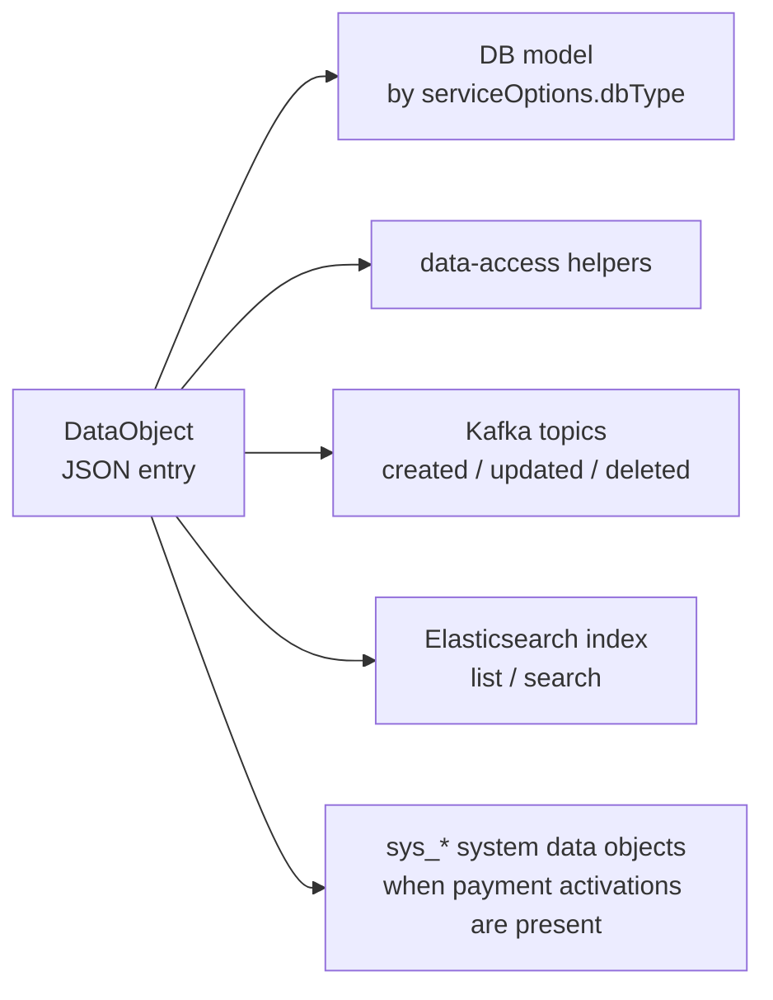

# Data objects

A [`DataObject`](../../spec/DataObject.md) is one persistent entity inside a service. It carries the schema (its properties) and the behaviour around it: object-level authorization, Redis entity cache, composite indexes, soft delete, membership rules, payment activations.

DataObjects live under `services[].dataObjects[]`.

## Shape

```json
{
  "objectSettings": {
    "basicSettings": {
      "name": "order",
      "description": "Customer order header.",
      "useSoftDelete": true
    },
    "authorization": {
      "dataObjectAccess": "accessPrivate",
      "objectDataIsInTenantLevel": false
    },
    "redisEntityCacheSettings": { "useEntityCaching": true },
    "compositeIndexSettings": [
      {
        "indexName": "userIdStatusIdx",
        "indexFields": ["userId", "status"],
        "onDuplicate": "throwError"
      }
    ]
  },
  "properties": [
    {
      "basicSettings": { "name": "userId", "type": "ID", "isRequired": true },
      "relationSettings": {
        "relationName": "owner",
        "relationTargetObject": "user",
        "relationTargetKey": "id",
        "onDeleteAction": "doDelete",
        "relationIsRequired": true
      }
    },
    {
      "basicSettings": {
        "name": "status",
        "type": "Enum",
        "enumOptions": ["pending", "paid", "cancelled"],
        "defaultValue": "pending"
      }
    },
    {
      "basicSettings": { "name": "total", "type": "Decimal", "decimalScale": 2, "isRequired": true }
    }
  ]
}
```

`objectSettings` and `properties` are the only required blocks. Everything under `objectSettings` other than `basicSettings` is optional. The blocks not shown above (`membershipSettings`, `checkout`, `subscription`, `marketplace`, `objectModeration`) are described below.

## Anatomy

- [`objectSettings.basicSettings`](../../spec/ObjectBasicSettings.md): name, description, soft-delete switch, the `publishDbEvents` switch and the `virtual` flag of a response-only object (see below).
- [`objectSettings.authorization`](../../spec/ObjectAuthorization.md): object-level access rules.
- [`objectSettings.redisEntityCacheSettings`](../../spec/RedisEntityCacheSettings.md): entity caching.
- [`objectSettings.compositeIndexSettings[]`](../../spec/CompositeIndex.md): multi-column DB indexes with `onDuplicate` resolution.
- [`objectSettings.membershipSettings`](../../spec/MembershipSettings.md): per-resource membership gating.
- `objectSettings.checkout` / `subscription` / `marketplace`: provider-neutral payment activations.
- [`objectSettings.objectModeration`](../../spec/ObjectModeration.md): hold this object's create and update writes behind a decision provider and a review queue; see [Object content moderation](../capabilities/object-moderation.md).
- `properties[]`: the field list; see [Property types](property-types.md).

## Naming and identity

- `basicSettings.name` is a single camelCase word. Singular noun (`order`, not `orders`). It is used in route paths, code symbols, Kafka topics, and Elasticsearch index names.
- The compiler adds an `id` property of type `ID`. It is a UUID v4 in both engines: stored as a `UUID` column in PostgreSQL and as a string field in MongoDB, so the id is identical across engines. You do not declare `id`.
- The names `id`, `isActive`, `createdAt`, `updatedAt`, `recordVersion` and `_type` (in any letter case, and in their snake_case spellings) are reserved for the fields the compiler adds to every stored data object. A blueprint that declares one as a property is refused with `RESERVED_PROPERTY_NAME`.
- The persistence target is derived from the data object name: a table in PostgreSQL, a collection in MongoDB. The route prefix is `/{serviceName}/{apiName}/...`.
- A few names are taken by the generated service itself, which emits one api-layer group per data object alongside groups it names on its own:
  - `integrations` is **refused** at validation time (`API_LAYER_FOLDER_NAME_COLLISION`): a project that declares integrations already has an api-layer group of that name. Rename the object.
  - `payment` is **allowed**. The api layer has no group of that name of its own, so an object named `payment` simply gets its own. Payment handling for an order object lives in the generated payment layer, not in the api layer.
  - `{serviceName}Service` is refused for a different reason: the generated per-object manager would take the name of the service-level base manager it extends (`SERVICE_MANAGER_NAME_COLLISION`).

## Properties

Each property is a [`DataProperty`](../../spec/DataProperty.md) with a required [`basicSettings`](../../spec/PropertyBasicSettings.md) block and optional blocks that activate by **block presence**: populate the block and the capability turns on.

- `basicSettings`: name, `type`, `isRequired`, `isArray`, `enumOptions`, `defaultValue`.
- `indexSettings`: DB index, unique constraint, Elasticsearch indexing, Redis cache hooks.
- `relationSettings`: foreign-key target; populating this block (with `relationTargetObject` set) *is* the relation.
- `sessionSettings`: auto-inject from the session context.
- `staticJoin`: copy a value from a related object at write time.
- `decisionSource`: a decision provider decides the value at write time, with confidence, model and time companion columns; see [Decided properties](property-types.md#decided-properties-decisionsource).

Standard fields `id`, `createdAt`, `updatedAt`, and (when `useSoftDelete: true`) `isActive` are added automatically. Do not declare them.

See [Property types](property-types.md) for the full catalogue.

## Soft delete

`basicSettings.useSoftDelete: true` makes `delete<X>` set `isActive: false` instead of removing the row. List APIs default to filtering out inactive records. The data-model settings can override the default per project; the object-level flag wins. See [Lifecycle and state](lifecycle-and-state.md#soft-delete).

## Object-level authorization

`objectSettings.authorization` is the place for rules that apply to *every* business API on this object. It is distinct from per-API `authOptions` and finer than project-level role config. Pair it with `membershipSettings` when access is gated via a separate paired object (for example `project`, `projectMember`, `user`).

## Composite indexes

```json
{
  "compositeIndexSettings": [
    {
      "indexName": "tenantStatusIdx",
      "indexFields": ["tenantId", "status"],
      "onDuplicate": "throwError"
    }
  ]
}
```

`onDuplicate` options are `doUpdate` (upsert), `throwError` (reject the conflict), `stopOperation` (silent skip), or `doInsert` (allow duplicates; the index is used for lookup only). For uniqueness on a single field, use the property's `indexSettings.unique` flag instead.

See [Indexes](indexes.md).

## Payment, subscription and marketplace activations

When the object represents an order, subscription, or marketplace transaction, add the matching block under `objectSettings`. Each is **provider-neutral**: it binds to a configured `PaymentProvider` via `configuration.providerName` and triggers generation of the matching `sys_<X>Payment`, `sys_<X>Subscription`, `sys_<X>Payout`, or `sys_<X>ConnectedAccount` system data objects and the corresponding business APIs. See [DataObject capabilities](object-capabilities.md#payments-checkout-subscription-marketplace) and [Payment workflow](../capabilities/payment-workflow.md).

## Virtual (response-only) data objects

Some APIs do not read or write rows of any entity: they compute an answer (a permission decision, a price quote, a report line) and return it. Declaring such an API against a real table only because the table happens to have compatible columns models it dishonestly, and a throwaway table just to hang the response type off is worse. A **virtual** data object is the honest shape:

```json
{
  "objectSettings": {
    "basicSettings": { "name": "accessDecision", "virtual": true },
    "authorization": { "dataObjectAccess": "accessProtected" }
  },
  "properties": [
    { "basicSettings": { "name": "allowed", "type": "Boolean" } },
    { "basicSettings": { "name": "reason", "type": "String" } }
  ]
}
```

- **Nothing is stored.** No table or collection, no model, no data-access module, no index, no Elasticsearch mapping, no seed, no schema-snapshot (migration history) entry, no db events. A service whose only objects are virtual has no data-access layer at all. No tenant id column is injected and `useSoftDelete` is ignored, so the response record is exactly the declared properties.
- **The response type is still generated.** The object keeps its api-layer manager, its OpenAPI record and its docs, so a client gets a typed response.
- **Only `get` and `list` apis** may be bound to it. The main operation reads nothing: a get starts from `{}` and takes no id route parameter (so next to a default-routed list it must author its own `restSettings.routePath`, otherwise both default to the bare resource path and validation reports `ROUTE_COLLISION`), a list starts from `[]`. The api's own actions build the answer: `addToResponseActions` (or a functionCall result) on a get, a [`ListMapAction`](../../spec/ListMapAction.md) with `replacesResult: true` in `afterMainListOperation` on a list (a virtual list without one is warned: `VIRTUAL_LIST_WITHOUT_ROWS`).
- **Validation refuses storage around it** (errors):
  - a create, update or delete api on it (`VIRTUAL_OBJECT_WRITE_API`);
  - ownership or parent-ownership checks, `dataViewName`, runtime filters and the list search filter on its apis (`VIRTUAL_OBJECT_API_STORAGE_OPTION`);
  - any relation, crud or fetch action, view, seed, membership, bucket or other data-object slot naming it (`VIRTUAL_OBJECT_REFERENCE`; schema-only slots such as `ComputeJobResult.summarySchema` stay legal);
  - checkout, subscription, marketplace, invoicing, fiscalization, ledger, membership, graph or enterprise projection and geo settings on it (`VIRTUAL_OBJECT_STORAGE_FEATURE`);
  - `virtual` on the auth user / session object or the tenant object (`VIRTUAL_OBJECT_RESERVED_ROLE`).

  Composite indexes, the entity cache, property index settings and relations declared on it are ignored with a warning (`VIRTUAL_OBJECT_SETTING_IGNORED`).

## What a compiler emits per data object



1. **Persistence model**: a table (PostgreSQL) or a collection (MongoDB), selected by `serviceOptions.dbType`. Columns and fields are inferred from the property list. See [Db layer](db-layer.md).
2. **Data-access helpers**: typed helpers (`createNote`, `getNoteById`, `updateNoteById`, `listNote`, and so on) that the API handlers and custom code call. Generated for both engines. See [Db layer](db-layer.md).
3. **Kafka topics**: lifecycle events on create, update and delete; the payload includes the row plus session metadata.
4. **Elasticsearch index**: maintained for list and search queries on every property that is `indexedInElastic`.
5. **System data objects**: `sys_<X>Payment`, `sys_<X>Subscription`, `sys_<X>Payout`, `sys_<X>ConnectedAccount` when payment activations are present, and `sys_<X>ModerationReview` (plus its reviewer and author apis) when `objectModeration` is enabled and a create or update api writes the object.

A virtual object (above) gets none of 1 to 5: only its api-layer manager and response record.

A DataObject does **not** auto-generate CRUD APIs. Every business API is declared explicitly in the service's `businessLogic[]`; the object's properties shape the request and response bodies of the APIs you author. See [Business APIs overview](../business-apis/overview.md). Every REST business API is also listed in the service's `GET /tools` registry, which [MCPBFF](../system-services/mcpbff.md) turns into MCP tools; `apiOptions.blockMcp: true` keeps an API out of it.

## Lifecycle features

- Soft delete and timestamps (`createdAt` / `updatedAt`) are managed by the service.
- Computed defaults are written via `dataClauseItems` MScript expressions on the relevant create or update API.
- State transitions are modelled with an `Enum` property plus business APIs that change it; see [Lifecycle and state](lifecycle-and-state.md).
- Lifecycle Kafka events fan out to any [event subscription](../capabilities/event-subscriptions.md), [Kafka controller](../business-apis/kafka-controllers.md), or [realtime hub](../capabilities/realtime.md) listening on the matching topic.

## What is NOT in ObjectSettings

Concepts you may have seen elsewhere that are *not* configured under `objectSettings`:

- **No `kind` enum.** Object behaviour is driven by its properties and activations, not a `primary | secondary | view | relation` tag.
- **No `bulkOps` flag.** Bulk writes are available regardless: `CreateBulkCrudAction`, `UpsertBulkCrudAction`, and an `UpdateCrudAction` / `DeleteCrudAction` whose `whereClause` matches many rows.
- **No inline `stateMachine`.** Lifecycle state is an `Enum` property plus business APIs (see above).

Tenancy has one switch per object, but it lives under `authorization`: once multi-tenancy is on for the project (at the [`LoginDefinition`](../../spec/LoginDefinition.md) level), `objectSettings.authorization.objectDataIsInTenantLevel: true` makes the object tenant-scoped. The service then adds a `<tenantName>Id` column (`organizationId` for a tenant named `organization`) and pins the object's reads and writes to the caller's tenant. The column is added only when the stored blueprint sets the flag to `true`, so set it explicitly on every tenant-owned object. See [Multi-tenancy](multi-tenancy.md#marking-a-data-object-as-tenant-scoped).

When in doubt, the [`ObjectSettings`](../../spec/ObjectSettings.md) specification page is authoritative.

## See also

- [Property types](property-types.md)
- [Relations](relations.md)
- [Indexes](indexes.md)
- [Multi-tenancy](multi-tenancy.md)
- [Lifecycle and state](lifecycle-and-state.md)
- [Remote buckets](../composition/remote-buckets.md), [DB buckets](../composition/db-buckets.md)
- [Business APIs overview](../business-apis/overview.md)
- Specification: [`DataObject`](../../spec/DataObject.md), [`ObjectSettings`](../../spec/ObjectSettings.md), [`ObjectBasicSettings`](../../spec/ObjectBasicSettings.md), [`CompositeIndex`](../../spec/CompositeIndex.md).
