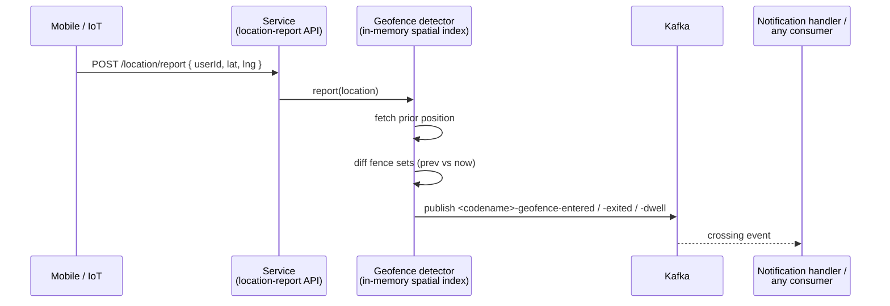

# Geography

OpenAPPL supports geo-typed properties and spatial queries. On PostgreSQL, storage is PostGIS-backed (`GEOGRAPHY` columns in SRID 4326) and filters compile to PostGIS predicates; on MongoDB the same fields become GeoJSON sub-documents with `2dsphere` indexes. A geofence runtime turns moving points into enter, exit and dwell Kafka events.

This page is the concise **type and storage reference**. For the full feature guide (GeoJSON wire format, making a list API geo-sensitive, the generated data-access helpers, MScript geo operators, geofence notifications, dual-engine storage details, and OpenAPI / MCP integration) see [Geography features](../capabilities/geography-features.md).

## Geo property types

Three geo entries in the `DataTypes` enum, all stored as `GEOGRAPHY` with EPSG:4326 (WGS-84, metres on the sphere). Coordinates are GeoJSON-style `[longitude, latitude]` order.

| Type | Stores | PostgreSQL column |
|------|--------|-------------------|
| `GeoPoint` | A single location (lon, lat) as GeoJSON `POINT`. | `GEOGRAPHY(POINT, 4326)` |
| `GeoRoute` | A path as GeoJSON `LINESTRING`: array of `[lon, lat]` pairs. | `GEOGRAPHY(LINESTRING, 4326)` |
| `GeoArea` | A polygon as GeoJSON `POLYGON`. The last and first vertex must be equal; the service closes the ring automatically if not. | `GEOGRAPHY(POLYGON, 4326)` |

A geo property declared with `isArray: true` holds a **list** of values of its type (a JSON array of single geometries on the wire) and is stored as one multi-geometry column: `GEOGRAPHY(MULTIPOINT | MULTILINESTRING | MULTIPOLYGON, 4326)`. See [Lists of geo values](../capabilities/geography-features.md#lists-of-geo-values-isarray).

Every write of a geo column, whatever filled it, is normalized to canonical GeoJSON (or refused with a 400) before it reaches the database; see [Input auto-coercion](../capabilities/geography-features.md#input-auto-coercion-on-every-write-path).

```json
{
  "objectSettings": { "basicSettings": { "name": "place" } },
  "properties": [
    { "basicSettings": { "name": "name", "type": "String", "isRequired": true } },
    { "basicSettings": { "name": "location", "type": "GeoPoint", "isRequired": true } },
    { "basicSettings": { "name": "area", "type": "GeoArea" } }
  ]
}
```

## Storage shape

A stored `GeoPoint` value:

```json
{ "type": "Point", "coordinates": [-122.4194, 37.7749] }
```

A `GeoArea` (polygon) value:

```json
{
  "type": "Polygon",
  "coordinates": [[
    [-122.42, 37.78], [-122.41, 37.78],
    [-122.41, 37.77], [-122.42, 37.77],
    [-122.42, 37.78]
  ]]
}
```

`GeoRoute` follows the GeoJSON `LineString` shape with a single coordinate array. All coordinates are `[longitude, latitude]`, the opposite of the "lat, lng" order used in spoken language.

Indexing is automatic: every geo column gets a spatial index (GiST on PostgreSQL, `2dsphere` on MongoDB). Do not declare anything in `compositeIndexSettings`.

## Spatial queries

Geo properties are queryable through MongoDB-style operators in a business API's `whereClause`. On PostgreSQL the query builder compiles them to PostGIS predicates.

| Operator | Meaning | PostGIS predicate |
|----------|---------|-------------------|
| `$geoNear` | Within `maxDistance` metres of a point (optional `minDistance` lower bound). | `ST_DWithin(field, point, maxDistance)` |
| `$geoWithin` | Inside a shape, or **overlapping** a bounding box: `bbox` is a viewport, not a containment test. | `ST_Covers(shape, field)` for `Polygon` / `MultiPolygon`; `ST_Within(field, shape)` otherwise; `ST_Intersects` with `ST_MakeEnvelope` when `bbox` is given. |
| `$geoContains` | Field contains the given shape (use on `GeoArea` columns). | `ST_Contains(field, shape)` |
| `$geoIntersects` | Field intersects the given shape. | `ST_Intersects(field, shape)` |

Example: a `whereClause` fragment finding every active place within 2 km of a customer:

```json
{
  "location": {
    "$geoNear": {
      "point": { "type": "Point", "coordinates": [-122.4194, 37.7749] },
      "maxDistance": 2000
    }
  }
}
```

Example: places inside a viewport (map bbox `[minLon, minLat, maxLon, maxLat]`):

```json
{ "location": { "$geoWithin": { "bbox": [-122.5, 37.7, -122.3, 37.8] } } }
```

See [Filters and lists](../business-apis/list-api.md) for the full where-clause grammar, and [Geography features](../capabilities/geography-features.md) for the `$bbox` / `$circle` / `$polygon` request-parameter filters.

## Geofences

A **geofence** is a stored `GeoArea` (polygon), circle (centre plus radius), or country / admin-area region. The notification service maintains a `GeoFence` data object that holds these rows; the **geofence detector** runtime keeps every active fence in an in-memory spatial index and turns location reports into crossing events.



### Detector pipeline

1. **Boot**: the notification service loads every active `GeoFence` row into the spatial index.
2. **Hot reload**: fence create, update and toggle calls upsert or remove the fence in the index; index updates cost O(grid-cells-touched).
3. **Report**: every location-report request flows through `report(location)`. The detector reads the prior position via an injected lookup callback, computes the set of fences containing the prior point and the set containing the new point, and diffs.
4. **Diff**: fences in `now \ prev` produce `enter` events; fences in `prev \ now` produce `exit` events; fences in both, after `dwellSeconds` continuous occupancy, produce a `dwell` event (deduplicated per `(user, device, fence, dwellStartedAt)`).
5. **Publish**: every crossing is published to one of three per-project Kafka topics, derived from the project root `codename` (the raw root codename, preserving its case and characters):
   - `<projectCodename>-geofence-entered`
   - `<projectCodename>-geofence-exited`
   - `<projectCodename>-geofence-dwell`

The crossing payload carries `userId`, `deviceId`, `fenceId`, `fenceName`, `action`, `lat`, `lng`, `occurredAt`, `fenceTags`, and `fenceMetadata`.

## Trigger configuration

To act on crossings, declare an `EventNotification` with `eventNotificationBasics.triggerSource: 'geofence'` and a [`GeofenceTrigger`](../../spec/GeofenceTrigger.md) block. The trigger filters at three layers: `action`, `fenceTags`, and two MScript expressions (`fenceFilter` against the fence row, `condition` against the full event payload). The example is a fragment of an `EventNotification` entry (the other required blocks are left out):

```json
{
  "eventNotificationBasics": {
    "name": "alertOnHighPriorityZone",
    "triggerSource": "geofence"
  },
  "geofenceTrigger": {
    "action": "enter",
    "fenceTags": ["restricted", "alert"],
    "fenceFilter": { "js": "fence.metadata.priority > 5" },
    "condition": { "js": "event.userId && session.role !== 'admin'" }
  }
}
```

All filters default to "match" when null. See [`GeofenceTrigger`](../../spec/GeofenceTrigger.md).

## Consuming geofence events

Three ways to react to a crossing:

- **Notification trigger**: declare an `EventNotification` as above; the notification service routes it through the configured providers.
- **Kafka controller**: bind a business API to `<projectCodename>-geofence-entered` (or `-exited` / `-dwell`) via [`ApiKafkaSettings`](../../spec/ApiKafkaSettings.md). See [Kafka controllers](../business-apis/kafka-controllers.md).
- **Event subscription**: surface crossings to a client via WebSocket or SSE. See [Event subscriptions](../capabilities/event-subscriptions.md).

## Indexing and performance

Geo columns are spatially indexed automatically. For data sets with millions of rows, prefer `bbox`-bounded `$geoWithin` over open-ended `$geoNear` in list filters; the planner uses the envelope to prune candidates before evaluating exact distances.

## See also

- [Geography features](../capabilities/geography-features.md): the comprehensive feature guide
- [Property types](property-types.md)
- [Filters and lists](../business-apis/list-api.md)
- [Kafka controllers](../business-apis/kafka-controllers.md), [Event subscriptions](../capabilities/event-subscriptions.md)
- Specification: [`GeofenceTrigger`](../../spec/GeofenceTrigger.md), [`EventNotification`](../../spec/EventNotification.md)
