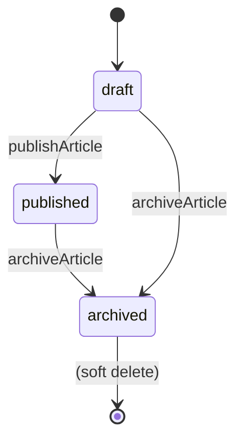
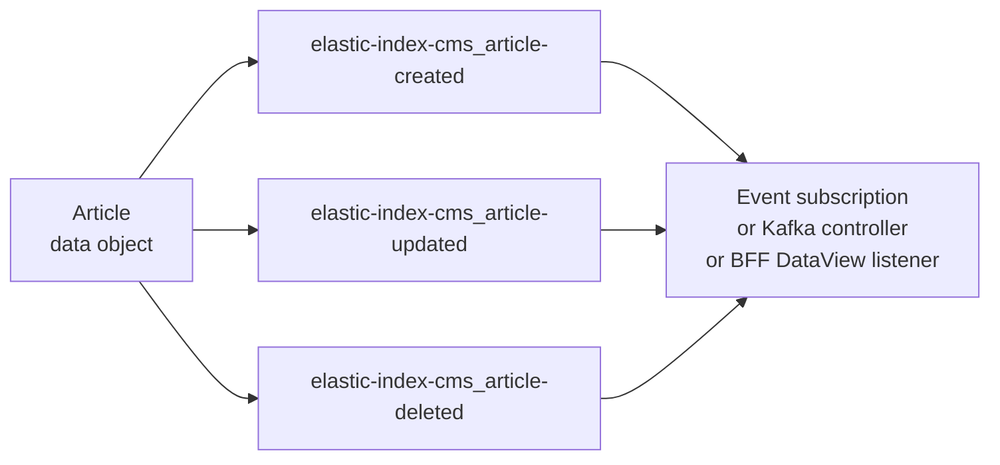

# Lifecycle and state

A data object passes through states over its lifetime: `draft`, `published`, `archived`; `pending`, `paid`, `cancelled`; or simply created, updated, deleted. OpenAPPL models these transitions with a small set of building blocks: enum properties for explicit domain state, soft delete and timestamps for the implicit ones, computed properties for derived fields, and Kafka events that fan out every lifecycle moment to downstream services.

There is no `objectSettings.stateMachine` block: state transitions are expressed as enum-property changes driven by business APIs. The page below walks through the pieces.

## State as an enum property

Declare the state as an `Enum` property with explicit values and a default:

```json
{
  "basicSettings": {
    "name": "status",
    "type": "Enum",
    "enumOptions": ["draft", "published", "archived"],
    "defaultValue": "draft",
    "isRequired": true
  }
}
```

The value is stored as a short string. Elasticsearch indexes it as a keyword (when `indexedInElastic: true`); a list API surfaces it as a filterable parameter (when `isFilterParameter: true`). The api that writes the property checks the value against the declared options; the storage itself carries no database-level constraint, so do not rely on the database to reject other strings written around the generated service. See [Property types: Enum](property-types.md#enum) for details.

A "pending review / approved / rejected" state on user-submitted content is not a designer enum: enable [`objectModeration`](../capabilities/object-moderation.md) on the object, which decides each write and keeps the review state itself (on a review queue in `staged` mode, on a managed `moderationStatus` column in `onPlace` mode).

## Modelling transitions

Two patterns cover almost every case.

### 1. Direct enum update

For low-stakes transitions where any authenticated caller may flip the state, accept `status` in an `update`-shaped business API you declare. The update workflow accepts the new value, validates the enum membership, writes, and publishes the `updated` event.

### 2. Dedicated transition API

For transitions that must enforce business rules (only `draft` to `published` is legal, the caller must have a role, a side effect must succeed first), author a custom business API per transition. The API:

- Locates the row.
- Validates the *from* state via a `ValidationAction`.
- Performs side effects (for example capture a payment) via additional actions.
- Forces the new state via a `dataClauseItems` entry.
- Publishes the `updated` event automatically.

```json
{
  "basics": {
    "apiOptions": {
      "name": "publishArticle",
      "crudType": "update",
      "dataObjectName": "article"
    },
    "authOptions": { "loginRequired": true, "checkRoles": ["editor", "admin"] }
  },
  "query": {
    "dataClauseItems": [
      { "name": "status", "value": { "js": "'published'" } },
      { "name": "publishedAt", "value": { "js": "new Date()" } }
    ]
  },
  "actions": {
    "validationActions": [
      {
        "name": "ensureCurrentlyDraft",
        "validationScript": { "js": "this.instance.status === 'draft'" },
        "shouldBeTrue": true,
        "errorStatus": "409",
        "errorMessage": "Article must be in draft to publish."
      }
    ]
  },
  "workflow": {
    "update": { "afterCheckInstance": ["ensureCurrentlyDraft"] }
  }
}
```



## Timestamps

`createdAt` and `updatedAt` are added automatically to every data object. You do not declare them. `createdAt` is set on insert; `updatedAt` is touched on every write that mutates the row.

When `useSoftDelete: true`, the service manages the `isActive` flag and records the deletion time in `_archivedAt` (see below).

## Soft delete

Set [`objectSettings.basicSettings.useSoftDelete: true`](../../spec/ObjectBasicSettings.md) to switch the default delete API from physical removal to a tombstone update. The `delete<X>` workflow:

- Sets `isActive: false` on the row.
- Records `_archivedAt` and leaves business fields intact.
- Publishes the `deleted` Kafka event with the row payload.

### Re-creating an archived row: a create never revives

A `create` never revives a soft-deleted row, on any soft-delete object. A create whose unique key matches an archived row inserts a NEW row with a NEW id; the archived row stays archived and untouched. This works because every generated unique index on a soft-delete object is partial on `isActive` (PostgreSQL `WHERE "isActive" = true`; MongoDB a partial filter on `isActive: true` plus a type condition per nullable unique field), so the fresh row does not collide with the archived one that carries the same key. The `created` outcome, the `created` db event and the after-create consumers fire only for a real insert.

- **The id is not stable across a delete/recreate cycle.** A foreign key, an Elasticsearch projection document or an external system holding the old id keeps pointing at the archived row, not at the new one.
- **A bulk create refuses an explicit `id` that names an archived row.** The call answers `409` (`Duplicate: id`, `errorCode: 'ARCHIVED_RECORD_ID'`) before any write; it does not bring the row back.
- **The automatic codename minter counts archived codenames as taken.** The next-codename helper sees archived rows too, so a deleted record's codename is never minted again for a new record: with `enes-guler` archived, the next minted codename is `enes-guler1`. Database uniqueness stays what you declare; an auto-minted codename retries a bounded number of times on a unique conflict, and a caller-chosen codename that collides with an ACTIVE row answers `409` and is never silently changed.
- **A codename is immutable when its property says so.** An update API on an object whose `codename` property is not updatable (`allowUpdate: false`) neither mints nor writes a codename, so renaming `shortname` or `name` keeps the stored one. An updatable codename keeps its caller-supplied value, validated and written, with no re-mint on update.

To bring a row back, restore it explicitly on its OLD id with an update API (see [Restore endpoint](#restore-endpoint)). For users, the authentication service's built-in `restoreUser` (`PATCH /users/:userId/restore`) does it, and answers `409` (`AnActiveUserHoldsThisIdentifier`) when an active user already holds the archived user's login identifier.

### Who sees archived rows

The `isActive: true` filter is applied to every read and scoped write (`get`, `list`, `update`, `delete`) of a soft-delete object. It is never applied to `create` (no where clause), never to an object with `useSoftDelete: false` (no `isActive` column), and never to a DataView read (a soft-deleted row is absent from every view index: its source document is kept archived, and the view's source search is active-only, so the archived row's view document is removed).

The Elasticsearch projection follows the same rule. A soft delete KEEPS the row's document, re-indexed with `isActive: false` and `_archivedAt` (a hard delete still removes it), and every Elasticsearch read (cross-service fetches, remote joins, search actions, list search filters, remote stats) answers active documents only, unless its query names `isActive` itself or the API passes the opt-out below (it then sends `includeArchived: true` on the read). A document without an `isActive` field reads as active. The `elastic-index-<object>-deleted` index-sync event is still published for a soft delete, carrying the archived document, so view listeners, the realtime hub and content-AI vector scrubbing treat it as the row leaving the live set.

Where it does apply it is a **default**, not an override. The by-query data-access helpers (get, list, stats, update and delete) share ONE rule on both engines: the gate applies unless the raw MScript query names `isActive` itself (anywhere in its `$and` / `$or` structure) or the helper's trailing `includeArchived` argument is `true`.

Two escape hatches, in increasing bluntness:

- **Per request**: add `isActive` to the API's `requestParameters` and read it from `whereClause.fullWhereClause` or an `additionalClauses` term (for example `{ isActive: this.isActive }`). `isActive` is a managed name, so it cannot be declared as a data property or a list filter; the API's own clause is where it belongs. An explicit `isActive` in that clause always wins; the default is only applied when the clause says nothing about `isActive`.
- **Per API**: set [`apiOptions.includeSoftDeleted: true`](../../spec/ApiOptions.md). No `isActive` term is injected into that API's where clause at all, and the generated fetch, get, list and update calls pass `includeArchived: true` down to the data-access layer. The same opt-out reaches the workflow's child actions whose target carries `isActive`: [`UpdateCrudAction`](../../spec/UpdateCrudAction.md), [`DeleteCrudAction`](../../spec/DeleteCrudAction.md) and [`FetchStatsAction`](../../spec/FetchStatsAction.md) each pass `includeArchived: true` to their helper, even when the API's own main object has no soft delete. This is what makes a **restore endpoint** expressible: an `update` API with `selectBy: ["id"]` that sets `isActive` back to `true` must be able to select a row that is currently archived. Use it for restore and undelete and for admin and audit reads, never for ordinary reads, which would leak archived rows. A `delete` API may not declare it (the validation error `INCLUDE_SOFT_DELETED_ON_DELETE`): its main delete selects live rows only, deleting an archived row would re-archive it rather than purge it, and there is no purge operation.

To genuinely remove rows on a soft-delete object, declare a delete-shaped API that performs a hard delete.

#### Restore endpoint

```json
{
  "basics": {
    "apiOptions": {
      "name": "restoreProject",
      "crudType": "update",
      "dataObjectName": "Project",
      "includeSoftDeleted": true
    },
    "authOptions": { "loginRequired": true, "checkRoles": ["superAdmin"] }
  },
  "query": {
    "whereClause": { "selectBy": ["id"] },
    "dataClauseItems": [
      { "name": "isActive", "value": { "js": "true" } },
      { "name": "_archivedAt", "value": { "js": "null" } }
    ]
  }
}
```

`dataClauseItems` entries are `DataMapItem`s (`name` / `value`), not action dataClause entries (`name` / `dataValue`). The two shapes look alike but an API's `query.dataClauseItems` only accepts the former; `dataValue` here is rejected with `UNKNOWN_PROPERTY`.

Restoring `isActive` alone is not enough: a soft-deleted row carries an `_archivedAt` timestamp, and `update` writes only the patch you declare, so a restore that does not also clear `_archivedAt` leaves the row `isActive: true` with a stale archive timestamp still set. Set both together, as above.

Without `includeSoftDeleted`, this API answers 404 on every soft-deleted target: the where clause, the fetch-instance read and the data-access update each AND `isActive: true`, so the instance check never finds the row it exists to reactivate. Restore is an admin operation on most objects: gate it with `authOptions.checkRoles` (or an equivalent ownership or role check) rather than leaving it open to any authenticated caller. The examples gate on `superAdmin`, the one operator role both tenancies have: a single-tenant project may add `admin`, a multi-tenant one `saasAdmin`. In a multi-tenant project a role named `admin` is a design-time ERROR (`MULTI_TENANT_ADMIN_ROLE_REFERENCE`; see [RBAC](../system-services/authentication/rbac.md)).

#### Restoring an archived auth user

The authentication service's `user` data object follows the same rule, with one twist: login filters `isActive: true` (a soft-deleted account answers the same 401 `errMsg_InvalidCredentials` as an unknown identifier), so an archived user cannot self-restore by logging back in. The authentication service already provides the admin-only `restoreUser` API at `PATCH /users/:userId/restore`; use that route for auth users, and find the archived user's id with the built-in directory reads: `GET /users?status=archived` (`listUsers`) or `GET /searchusers?keyword=<text>&status=archived` (`searchUsers`), both under the same admin gate. The example below illustrates the lifecycle patch for a custom update API. Do not register a second `restoreUser` API alongside the built-in one:

```json
{
  "basics": {
    "apiOptions": {
      "name": "restoreUser",
      "crudType": "update",
      "dataObjectName": "user",
      "includeSoftDeleted": true
    },
    "authOptions": { "loginRequired": true, "checkRoles": ["superAdmin"] }
  },
  "query": {
    "whereClause": { "selectBy": ["id"] },
    "dataClauseItems": [
      { "name": "isActive", "value": { "js": "true" } },
      { "name": "_archivedAt", "value": { "js": "null" } }
    ]
  }
}
```

See also: [Update API](../business-apis/update-api.md) and [Delete API](../business-apis/delete-api.md) for restore, unarchive and undelete.

## Computed properties

Properties whose value is derived from other properties on the same row are written via an MScript expression in `query.dataClauseItems` on the relevant create or update API:

```json
{
  "name": "displayName",
  "value": { "js": "`${this.firstName} ${this.lastName}`" }
}
```

`this` is the **BusinessApi runtime context**, not the data-object row. A property is on the context only if it was declared as a `requestParameters` entry or written by an earlier workflow action; it is not automatically present just because it belongs to the object. You can reference other fetched objects (for example `this.customer.id`) provided you arranged that object to be fetched earlier in the workflow (a [`FetchObjectAction`](../../spec/FetchObjectAction.md) with `contextPropertyName`) so it lands on the context before the dataClause runs. The value is computed at *write* time and persisted; reads return the stored value without re-running the script. For values that must reflect the freshest state of *other* records, prefer a [data view](../system-services/bff.md) over a computed property. See [Property types: Computed properties](property-types.md#computed-properties).

See [MScript syntax](../mscript/syntax.md).

## Lifecycle Kafka events

Every data object emits Kafka events on create, update, and delete. The topic naming convention is fixed:

```
elastic-index-<indexName>-<verb>
```

Where `<indexName>` is the Elasticsearch index name (typically `<projectCodename>_<objectName>`), and `<verb>` is one of `created`, `updated`, `deleted`.

Example: for an `article` object in a project codenamed `cms`, the lifecycle topics are:

```
elastic-index-cms_article-created
elastic-index-cms_article-updated
elastic-index-cms_article-deleted
```

The same writes also publish the row-level db events `<serviceCodename>-dbevent-<object>-{created|updated|deleted}`. The payload carries the affected row plus session metadata. Consumers see the full state after the operation; for `updated`, both the previous and the new state are included.



Consumers can be:

- **[Event subscriptions](../capabilities/event-subscriptions.md)**: surface events to clients via WebSocket or SSE.
- **[Kafka controllers](../business-apis/kafka-controllers.md)**: business APIs bound to a Kafka topic that run when a message arrives.
- **BFF data view listeners**: maintained read replicas in the BFF service.
- **Cross-service Elasticsearch listeners**: populate read-replica indices for `selectClause` joins in other services.

Lifecycle events fire after the main database operation of the matching CRUD workflow (the `afterMainCreateOperation`, `afterMainUpdateOperation` or `afterMainDeleteOperation` milestone); the api-level `apiOptions.raiseDbLevelEvents` is retired and has no effect. An object nothing consumes turns its db events (and their elastic-index copies) off with `objectSettings.basicSettings.publishDbEvents: false`. The Elasticsearch index of the object is still written, so search, dynamic data views and cross-service reads keep working; only the Kafka copies stop. Validation refuses `false` (`DB_EVENTS_SWITCH_CONSUMED`) on an object that a DataView, a subscription, a hub, a notification or another consumer reads. It is rarely useful otherwise, because these events back most cross-service integration.

## Lifecycle hooks for payments

The [`LifecycleHook`](../../spec/LifecycleHook.md) class is **specific to the payment dispatcher**, not a general data-object hook. Hooks are declared inside `objectSettings.checkout` / `subscription` / `marketplace` and fire when the payment state machine advances (`paymentAuthorized`, `paymentCaptured`, `subscriptionCancelled`, and so on). They run after the state transition completes; failures are recorded on `sys_paymentEvent.errorMessage` and retried via the outbox.

For non-payment lifecycle side effects, use a Kafka controller or an event subscription consuming the standard `created`, `updated` or `deleted` topic.

## See also

- [Property types](property-types.md), [Data objects](data-objects.md)
- [Business APIs overview](../business-apis/overview.md), [`ValidationAction`](../../spec/ValidationAction.md)
- [Event subscriptions](../capabilities/event-subscriptions.md), [Kafka controllers](../business-apis/kafka-controllers.md)
- [MScript syntax](../mscript/syntax.md)
- Specification: [`ObjectBasicSettings`](../../spec/ObjectBasicSettings.md), [`LifecycleHook`](../../spec/LifecycleHook.md)
