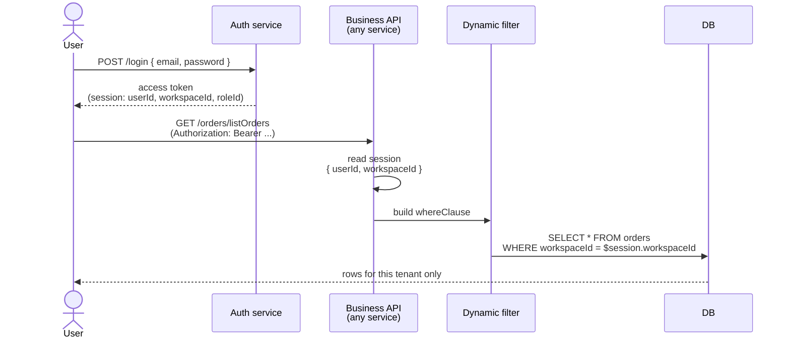

# Multi-tenancy

Multi-tenancy is enabled once, on the [`LoginDefinition`](../../spec/LoginDefinition.md), and each data object then opts in with `authorization.objectDataIsInTenantLevel`. The tenant identifier rides every authenticated request automatically; tenant-scoped data objects are filtered against the session's tenant id without any per-API plumbing.

This page is the **data-modeling slice**: how the tenant identifier reaches a data object and how you mark an object tenant-scoped. For the end-to-end guide (tenant registration, switching, SaaS-admin operations, and design patterns) see [Multi-tenancy (capabilities)](../capabilities/multi-tenancy.md).

You pick a tenant model at the login level, declare which objects are tenant-scoped, and let the service inject the tenant id.

## The tenancy model

A **tenant** is a top-level container that owns its own users, data, and configuration. Tenants are flat: there is no built-in nesting of tenants under organisations or accounts. If you need hierarchy, model it as data inside each tenant.

Multi-tenancy enforces strict isolation:

- Every user belongs to exactly one tenant.
- Every authenticated request carries the tenant id in the session.
- Every tenant-scoped read and write is auto-filtered by that tenant id.

## Enabling tenancy on a login

Set [`LoginDefTenantSettings`](../../spec/LoginDefTenantSettings.md) inside `authentication.loginDefinition`. The excerpt below is a fragment that leaves the other user settings out:

```json
{
  "authentication": {
    "loginDefinition": {
      "userSettings": { "primaryLoginIdentifier": "email" },
      "tenantSettings": {
        "useMultiTenantFeature": true,
        "configuration": {
          "tenantName": "organization",
          "tenantRegisterIsPublic": true,
          "tenantAutoAvatarScript": "`https://gravatar.com/avatar/${LIB.common.md5(this.fullname)}?s=200&d=identicon`"
        }
      }
    }
  }
}
```

[`LoginDefTenantSettingsConfig`](../../spec/LoginDefTenantSettingsConfig.md) fields:

| Field | Required | Notes |
|-------|----------|-------|
| `tenantName` | yes | The noun for the tenant object in your domain (`organization`, `workspace`, `client`). Drives code, table, and route names. |
| `tenantRegisterIsPublic` | | When `true`, any user can register a new tenant (typical SaaS sign-up). When `false`, only SaaS admins can. The creator is automatically assigned as the tenant owner. |
| `tenantAutoAvatarScript` | | MScript expression generating a default avatar URL for the tenant. |
| `uniqueTenantName` | | When `true`, two active tenants may not share the same `name`: the tenant object's `name` column carries a unique database index (partial on `isActive`, so a soft-deleted tenant releases its name) and the owner-provisioning APIs refuse a replay with `409`. Default `false`: one person owning several tenants, and two unrelated tenants both called `Acme`, are ordinary product shapes. Note that `codename` being unique is NOT this rule: the codename is server-minted with a counter suffix, so it can never collide. |
| `tenantNameHeaderName` | | Overrides the default `mbx-<tenantName>-codename` request header the runtime reads the tenant codename from (the runtime then reads ONLY this header). Everything the compiler generates that names the header follows it: the emitted SDKs, the API guides and the frontend prompt docs. A blank or whitespace-only value is treated as absent. |
| `compositeIndexSettings` | | Composite indexes for the tenant object, for a tenant identity that is a PAIR of columns (`name` plus a declared region, say) rather than a single name. MULTI-COLUMN ONLY: a composite index is named after its fields, so a single-field entry collides with the plain index that column already has and the constraint is never created; express single-column uniqueness through the property's `indexSettings.unique` instead. A composite covering `name` SUPERSEDES `uniqueTenantName`. |

When `useMultiTenantFeature: false` (the default), leave `configuration` null. The project is single-tenant; no tenant column or session claim is emitted.

## What gets emitted when tenancy is on

- A **tenant data object** (named per `tenantName`) with owner-user, name, and avatar properties.
- A `<tenantName>Id` foreign-key column on the auth `user` table (`organizationId` for the example above), plus composite uniqueness on `(email, <tenantName>Id)` and `(mobile, <tenantName>Id)` so identifiers are unique *within* a tenant rather than globally.
- The tenant on the session: the user row's `<tenantName>Id` is copied onto the session at login, next to `tenantCodename`; every authenticated request handler reads it. There is no generic `tenantId` session field.
- Tenant-aware CRUD APIs on the tenant object: register, list-for-current-user, switch active tenant.
- Automatic `<tenantName>Id` injection into the data clauses of every tenant-scoped business API.

## Tenant flow



## Marking a data object as tenant-scoped

Data objects opt into tenant scoping via [`ObjectAuthorization.objectDataIsInTenantLevel`](../../spec/ObjectAuthorization.md). When `true`, a `<tenantName>Id` property is added implicitly to the object's schema and every read and write is filtered by the session's tenant. The property is added only when the stored blueprint sets the flag to `true`: the compiler does not apply the pattern's documented default, so an object that leaves the flag out gets no tenant column and is project-global. Set it explicitly on every tenant-owned object (most domain objects in a multi-tenant project), and leave it `false` only for project-global tables (for example a `plan`, a `featureFlag`) that all tenants share.

```json
{
  "objectSettings": {
    "basicSettings": { "name": "order" },
    "authorization": { "objectDataIsInTenantLevel": true }
  }
}
```

The flag has no effect when `useMultiTenantFeature: false`: without tenancy, every object is implicitly project-global.

## Cross-tenant operations

There is no first-class "bypass" knob: every authenticated request runs in the context of one tenant. To perform cross-tenant work (a SaaS-operator dashboard, a tenant-merging utility), expose a separate service or business API guarded by SaaS-admin authorization, and call it from code that has SaaS-admin credentials (not per-tenant). The handler can then issue direct DB queries that ignore the tenant filter, because the session that drives the filter carries no `<tenantName>Id`: SaaS-level users belong to no tenant.

Per-tenant scaling concerns (sharding, per-tenant DB shards, dedicated Elasticsearch indices) are deployment decisions, not blueprint settings. A compiler does not generate per-tenant infrastructure from the blueprint.

## Tenant-scoped permissions

Tenant identity is one dimension; role-based and resource-based access are independent dimensions on top. Membership-style sharing inside a tenant (a `project` owned by a tenant but visible only to its `projectMember` set) uses [`MembershipSettings`](../../spec/MembershipSettings.md). See [Permissions strategy](../best-practices/permissions-strategy.md).

## See also

- [Multi-tenancy (capabilities)](../capabilities/multi-tenancy.md): the full tenancy guide.
- [Authentication](../system-services/authentication/overview.md)
- [Session-aware logic](../composition/session-aware-logic.md)
- [Permissions strategy](../best-practices/permissions-strategy.md)
- Specification: [`LoginDefinition`](../../spec/LoginDefinition.md), [`LoginDefTenantSettings`](../../spec/LoginDefTenantSettings.md), [`LoginDefTenantSettingsConfig`](../../spec/LoginDefTenantSettingsConfig.md), [`ObjectAuthorization`](../../spec/ObjectAuthorization.md).
