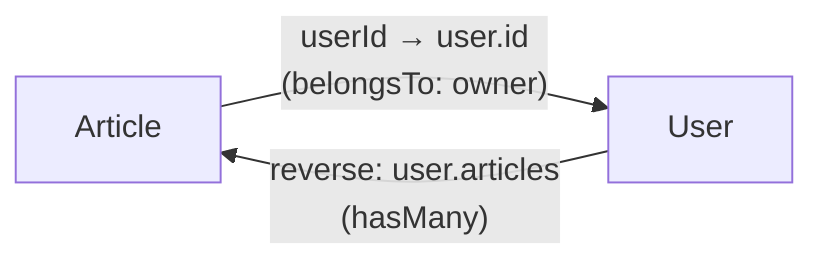

# Relations

A relation is a typed foreign-key reference from one data object to another. In OpenAPPL, relations live on a property: populate the [`PropertyRelation`](../../spec/PropertyRelation.md) block (`relationSettings`), with `relationTargetObject` set, on the property carrying the foreign-key value. **The relation activates by block presence**: a populated `relationSettings` *is* the relation. There is no separate activation flag.

## Declaring a relation

```json
{
  "basicSettings": {
    "name": "userId",
    "type": "ID",
    "isRequired": true
  },
  "relationSettings": {
    "relationName": "owner",
    "relationTargetObject": "user",
    "relationTargetKey": "id",
    "onDeleteAction": "doDelete",
    "relationIsRequired": true
  }
}
```

Effect, by engine:

- **PostgreSQL:** a `userId UUID NOT NULL` column (NOT NULL because `basicSettings.isRequired` is `true`, not because of `relationIsRequired`), a `belongsTo`-style association named `owner` (from `relationName`) with the matching reverse association on the parent, and an FK index. `onDeleteAction` is **not** handed to the database: no `ON DELETE` referential action is emitted, because rows are soft-deleted and no referential action fires on an UPDATE. The generated data-access layer enforces it instead; see [On-delete cascades](#on-delete-cascades).
- **MongoDB:** a `userId` field (a string holding the target id), no native FK constraint. Referential integrity is enforced at the application layer (the service rejects orphan creates, and cascade and null-set on delete run in code). The relation is resolved by reading the related document, not by a schema-level `populate` reference.
- **Both engines:** the list and get APIs can include the related row by referencing `owner` in their `selectClause` joins.

`relationName` is the join alias used inside generated code and `selectClause` entries. `relationTargetObject` is a [`DataObjectName`](../../spec/DataObjectName.md): **a string** holding either a simple object name within the same service (`"user"`) or a qualified `serviceName:objectName` for cross-service joins (`"auth:user"`, resolved via Elasticsearch; see below).

## Properties on `PropertyRelation`

| Field | Required | Notes |
|-------|----------|-------|
| `relationName` | yes | Single-word alias used in generated code and joins. |
| `relationTargetObject` | yes | Target data object: `<objectName>` or `<serviceName>:<objectName>`. |
| `relationTargetKey` | yes | Property on the target referenced by this FK; usually `id`. |
| `onDeleteAction` | yes | `doDelete` (cascade), `setNull`, `restrict` or `doNothing`; see [On-delete cascades](#on-delete-cascades). There is no schema default: state it explicitly. |
| `relationIsRequired` | yes | Semantic: when `true`, the relation is expected to RESOLVE to a live parent. It does **not** make the column NOT NULL (`basicSettings.isRequired` does that) and it emits no constraint of its own. |

`RelationOnDeleteAction` has four values. `setNull` writes NULL into the FK column, so it is illegal on a NOT NULL column: that is decided by `basicSettings.isRequired` on the property, and the combination is rejected at validation with `RELATION_SETNULL_ON_REQUIRED_FK`. The lawful answers for a NOT NULL FK are `doDelete`, `restrict` and `doNothing`. State `isRequired` explicitly on every foreign-key property; while the key is missing, validation reports `IS_REQUIRED_UNSPECIFIED`.

`relationIsRequired` is a different setting. It says the relation must resolve, not that the column is NOT NULL. `relationIsRequired: true` together with `setNull` on a nullable column is a warning, `RELATION_SETNULL_ON_REQUIRED_RELATION`, not an error: the cascade will null the FK and the required relation then stops resolving.

## Forward and reverse



The forward side (`Article` to `User`) is declared on the child via a populated `relationSettings`. The reverse side (`User.articles`) is built automatically from the same declaration: `User` does not need to know about `Article`. List APIs on the parent can use the reverse association in `selectClause` to include the children.

## Cardinality

OpenAPPL expresses cardinality through which side carries the FK column and whether the FK is unique:

- **Many-to-one**: the default. The child object carries the FK property. Multiple children may share one parent.
- **One-to-one**: same as many-to-one, but add `indexSettings.unique: true` on the FK property. The DB constraint guarantees at most one child per parent.
- **One-to-many**: declared on the parent side as a *reverse* relation; no column is emitted. You do not need to author this: the compiler builds it from the child's forward declaration.
- **Many-to-many**: model an explicit join object that has two relation properties (one populated `relationSettings` per side). Join tables are not generated automatically.

## Required relations and orphans

A NOT NULL foreign key comes from `basicSettings.isRequired: true` on the FK property: a create request without a value is rejected at write time. `relationIsRequired` is the separate, semantic flag described above and does not touch nullability.

Combined with `onDeleteAction: "doDelete"`, a NOT NULL FK leaves no orphans in the shapes the cascade covers: the child cannot exist without a parent, and is removed when the parent is removed, recursively, to any depth. Two shapes are **not** covered, and there a NOT NULL FK plus `doDelete` still leaves live rows pointing at an archived parent: a SELF-referencing relation, which emits no cascade at all, and a cross-service target. See the carve-outs under [On-delete cascades](#on-delete-cascades).

Where the FK column is nullable (`basicSettings.isRequired: false`), `onDeleteAction: "setNull"` is available: on parent delete the child stays but loses the reference.

## On-delete cascades

| Value | Effect |
|-------|--------|
| `doDelete` | Cascade: deleting the parent deletes every child holding this FK, and recursively every child of those (see the self-reference carve-out below). Use for compositional ownership (an order's line items, a thread's posts). |
| `setNull` | Nullify the FK on parent delete; the child survives. Use for soft associations (a comment whose author was removed). Illegal on a NOT NULL FK. |
| `restrict` | Refuse to delete the parent while any live child still holds this FK. The caller gets HTTP 409 with `errorCode: RELATION_RESTRICTED`, naming the blocking object and how many references hold it. |
| `doNothing` | Leave the child untouched: the parent goes, the child survives and keeps the FK value. For rows that must outlive the party they name: a sold ticket naming its buyer, an audit row naming an actor. |

The cascade is executed by the generated data-access layer, not by a DB-level `ON DELETE CASCADE`. That is deliberate: with soft delete on the parent (`useSoftDelete: true` on `basicSettings`), "delete" means flipping `isActive` to `false`, and no database referential action fires on an UPDATE. So the cascade runs on a soft delete exactly as it does on a hard one: the children disappear from list and get the same way the parent does, and each one emits its own `deleted` event.

All delete entry points behave identically: delete by id, delete by query, and the by-query delete a `DeleteCrudAction` uses each cascade `doDelete`, follow `setNull` and enforce `restrict`. Bulk deletes work in pages, and each page cascades before the next is read.

Two carve-outs. A relation whose target is in ANOTHER service (`"auth:user"`) gets no cascade, because the generated code only reaches objects of its own service. And a SELF-referencing relation (a tree via `parentId`) emits no cascade either, so deleting a node leaves its descendants live with a dangling FK and no `deleted` events; model a hierarchy you need cascaded through an explicit parent object rather than a self-reference.

`restrict` is decided UP FRONT. Before the first write, the delete walks the whole subtree it is about to remove (not just the direct children), collecting everything the operation removes on EVERY branch, and only then asks whether anything that will OUTLIVE the operation still points into it. A row the same operation is itself deleting is not a blocker, wherever in the graph it sits (including one that restricts the very row you asked to delete), so a legal delete is never refused because of the order the cascade happens to visit its branches in, and never because of WHICH entry point asked. Deleting by id and by query give the same answer for the same row. A refusal therefore leaves nothing half-deleted.

Three limits are worth knowing:

- There is no transaction around the cascade, so a blocker created by a CONCURRENT writer after that pre-flight is still refused, but by the hop that reaches it: after the shallower hops have committed, and a retry then reports 404 rather than resuming.
- The pre-flight walk exists only where a `restrict` edge is reachable; a `doDelete` graph with no `restrict` in it pays nothing for the guard, and if such a graph is deep enough to exceed the cascade depth cap it still fails from inside the cascade, with the shallower hops committed.
- Where the walk does run it follows the DATA, not the schema: because it writes nothing, a mutually referencing pair of objects is walked one ROW at a time, so a two-object graph with a long chain of rows can reach the depth cap and answer `CASCADE_DEPTH_EXCEEDED`, with nothing written and with a message that says the chain is in the data rather than in the model.

## Eager loading on list APIs

Relations participate in list and get APIs through the API's `query.selectClause`. Reference the `relationName` (alias) to include the joined row in the response. The list or get response carries the parent object plus the named joins, so no follow-up call is needed. See [Select join](../composition/select-join.md) for the full pattern.

## Self-reference

Point `relationTargetObject` at the object's own name:

```json
{
  "basicSettings": { "name": "parentCommentId", "type": "ID", "isRequired": false },
  "relationSettings": {
    "relationName": "parentComment",
    "relationTargetObject": "comment",
    "relationTargetKey": "id",
    "onDeleteAction": "doDelete",
    "relationIsRequired": false
  }
}
```

**The `doDelete` above emits no cascade.** A self-reference produces no cascade at all: deleting a comment leaves its replies live, holding a `parentCommentId` that points at an archived row, with no `deleted` event for any of them. The value is accepted and validated, and then does nothing. `setNull` and `restrict` on a self-reference are inert in the same way: no FK is nulled, no delete is refused.

If you need a hierarchy that really cascades, model the parent as a separate data object (`thread` then `comment`) and let the child point at it. If you need the tree shape, delete the descendants yourself, deepest first, before deleting the node.

## Cross-service relations

When `relationTargetObject` is qualified `serviceName:objectName` (for example `auth:user`), the reference field still holds the target id but there is no native FK constraint in *either* engine, because services do not share databases. Joins are resolved via Elasticsearch: the consuming service maintains a read-replica index of the target object via Kafka subscriptions, and `selectClause` joins are evaluated against that index.

The three common cross-service patterns:

- **`InterserviceCallAction`** in the action workflow: fetch the parent at request time.
- **BFF [data view](../system-services/bff.md)**: compose the response on the read side.
- **Elasticsearch read replica**: maintained via Kafka subscriptions (the default for cross-service joins in `selectClause`).

Pick by access pattern. See [Data modeling tips](../best-practices/data-modeling-tips.md).

**Soft-deleted targets in the shared index.** A soft delete does not remove the row's Elasticsearch document: the document stays, re-indexed with `isActive: false` (and `_archivedAt`). Every Elasticsearch read is active-only by default, exactly like the database readers, so an archived row disappears from cross-service reads (`fetchObjectAction` / `fetchParentAction` / `fetchStatsAction` on a remote target, `searchObjectAction`, `fetchFromElasticAction`, list search filters, remote `selectClause` joins) the moment it is archived. The exceptions mirror the local ones: a relation whose `onDeleteAction` is `doNothing` joins through to its archived target across services too, an API with [`apiOptions.includeSoftDeleted: true`](../../spec/ApiOptions.md) reads archived documents on its remote fetch, stats and search actions, and an authored Elasticsearch query that names `isActive` itself is taken at its word. A hard delete still removes the document. A document that carries no `isActive` at all (an object without soft delete) reads as active.

## Static joins vs. relations

A relation is a live foreign key: the joined row is fetched at read time. A [static join](../composition/static-joins.md) copies a value once at write time and stores it locally; the read does not join. Use a static join for fields that do not change over the child's lifetime (for example copy `user.clientId` into `EmailJob.clientId` on create). Use a relation when reads need the latest value of the parent.

Static joins are declared via [`PropertyStaticJoin`](../../spec/PropertyStaticJoin.md) (populate the `staticJoin` block with `jointSource`), independent of any relation. See [Static joins](../composition/static-joins.md).

## What a compiler emits

For every property with a populated `relationSettings`:

- **PostgreSQL:** an FK column, a `belongsTo`-style association named `relationName`, an auto-discoverable reverse association on the target model, and an FK index (PostgreSQL needs it for the constraint to be efficient).
- **MongoDB:** the reference field plus app-level integrity (orphan rejection on create, cascade and null-set on delete). The reverse direction is resolved by query against the reference field. No native FK constraint.
- **Both engines:** the relation feeds every relation consumer below.

## Relation consumers

A relation is not just an FK column: the same `relationSettings` declaration feeds many parts of the generated service. Knowing this is why a relation is worth declaring even when you "only" want a join in one API.

**Query and read shaping (BusinessApi):**

- **`SelectJoin`** (`query.selectClause.selectJoins[]`): join to the related object and project its properties under the join alias. See [Select join](../composition/select-join.md).
- **`ListJointFilter`** (`listOptions.jointFilters`): filter a list by a criterion evaluated in a related object (a left-join-like "joined criteria"). See [Joint filters](../composition/joint-filters.md).
- **`whereClause`** resolution against related fields. See [Where-clause composition](../composition/where-clause-composition.md).

**Actions:**

- **[`FetchParentAction`](../../spec/FetchParentAction.md)**: requires a relation to the parent in the current object's properties.
- **[`FetchObjectAction`](../../spec/FetchObjectAction.md)** and **[`FetchStatsAction`](../../spec/FetchStatsAction.md)**: match and enrich via related objects.
- **`staticJoin`**: derive a value from a related object at write time (see above).

**Auth and access control:**

- **`authOptions.parentOwnershipChecks`**: authorize against OWNERSHIP of a parent reached through a relation. Each entry names the parent object, the request field carrying its id, and the owner column on the parent; the generated manager fetches the parent row and returns 403 unless the caller owns it. This is the create-under-parent / own-the-parent case. Where a target language does not support it, validation refuses the list with `PARENT_OWNERSHIP_UNSUPPORTED_LANGUAGE`.
- **`authOptions.permissionCheck`**: authorize by ROLE or membership against a parent or scope object reached through a relation (`scopeFields` names the object's own scope-FK fields, for example `['organizationId']`). Use this for RBAC and membership; use `parentOwnershipChecks` for ownership.
- **OBAC / [`membershipSettings`](../../spec/MembershipSettings.md)**: object and membership access via a linking object that references the protected resource. See [Membership](../composition/membership.md).
- **Bucket owner resolution**: `DbBucketOwnerConfig` and `RemoteBucketOwnerConfig` resolve the file owner via a relation.

**Aggregation and data views:**

- **`ViewAggregate` / `ViewStat`** (BFF [data view](../system-services/bff.md)): aggregate across related objects.

**Cross-service:**

- **Qualified relations** (`relationTargetObject: "auth:user"`): resolved via Elasticsearch read-replica indexes maintained over Kafka (above).
- **[`InterserviceCallAction`](../../spec/InterserviceCallAction.md)**: parent and related fetches at request time.

**Model layer:**

- **Associations** (`belongsTo` / `hasMany`) and the **reference field** with app-level joins.
- **FK index** creation (PostgreSQL) and the dataClause write composition that resolves the FK on create and update.

## See also

- [Property types](property-types.md), [Db layer](db-layer.md)
- [Indexes](indexes.md)
- [Select join](../composition/select-join.md), [Joint filters](../composition/joint-filters.md), [Static joins](../composition/static-joins.md)
- [Data views](../system-services/bff.md) for cross-service read composition.
- Specification: [`PropertyRelation`](../../spec/PropertyRelation.md), [`PropertyStaticJoin`](../../spec/PropertyStaticJoin.md), [`DataObjectName`](../../spec/DataObjectName.md).
