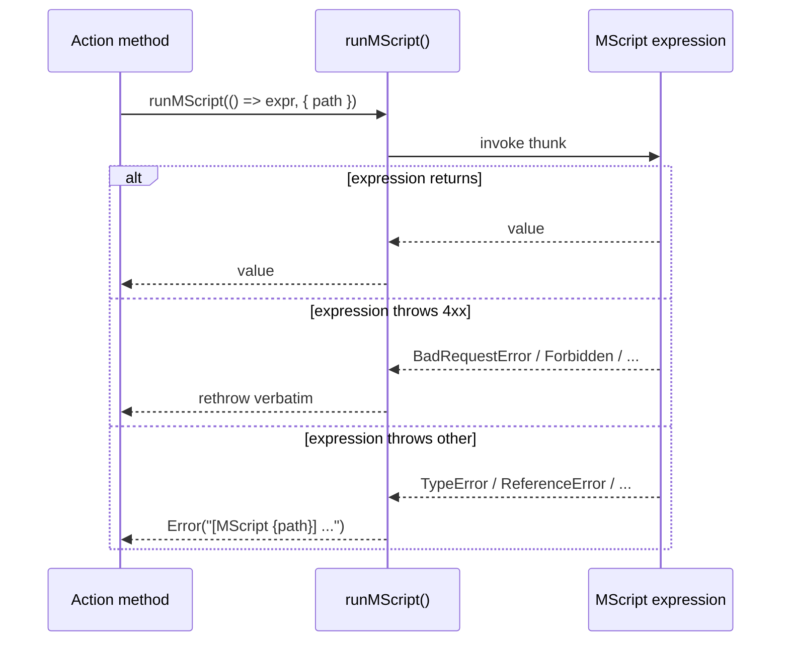

# MScript syntax

MScript is a **per-language source map** in the schema: an object keyed by target
language, whose values are expressions in that language:

```json
"validationScript": { "js": "this.user.age > 18" }
```

The language descriptor is not optional. The validator rejects a bare string
(`"validationScript": "this.user.age > 18"`) with `MSCRIPT_LEGACY_STRING_FORM`, and a
migration step rewrites a bare string in an older blueprint to `{ "js": <expr> }`. Keep
`js` as the portable default, including when converting an existing service. See
[Multi-language MScript](#multi-language-mscript).

Each source is parsed and validated at design time and is evaluated by the generated
service inside an envelope that labels errors with the blueprint path of the slot
(`runMScript(() => expr, { path })`). There is no narrowed expression grammar; design-time
rules also refuse unsupported or provably broken constructs. This page documents the shapes
authors actually write and the checks the validator applies before a compiler is invoked.
For what MScript is and how expressions relate to target languages, see the
[MScript overview](overview.md).

## Accepted forms

The validator parses each source as `const __mscript__ = <your source>`. The source must
fit on the right-hand side and pass the design-time rules. The examples below show the
*source*: the string on the right of the `"js"` key.

| Form | Example |
|------|---------|
| Literal | `5`, `0.4`, `"premium"`, `true`, `null` |
| Identifier (`true`, `false`, `null`, `undefined`, `NaN`, `Infinity`, `globalThis` only, see below) | `null` |
| `this` expression | `this` |
| Member access | `this.session.userId` |
| Binary / logical | `this.user.age > 18 && this.session.role === 'admin'` |
| Conditional | `this.user.isPremium ? 'premium' : 'free'` |
| Object literal | `{ id: this.fetchedOrder.id, total: this.fetchedOrder.amount }` |
| Array literal | `[this.session.userId, 'admin']` |
| Template literal | `` `Order ${this.fetchedOrder.id} succeeded` `` |
| Optional chaining / nullish coalescing | `this.session.user?.profile?.lang ?? 'en'` |
| Call | `this.getRole(this.session.userId)`, `LIB.dateUtils.daysBetween(a, b)` |
| Arrow function | `(o) => o.status === 'paid'` |
| Inline IIFE (multi-statement escape hatch) | `(() => { const t = this.cart.subtotal; if (t > 500) return 0.2; return 0; })()` |
| `module.exports = <expr>` | `module.exports = (this.user.age > 18)` |

> **The IIFE must be an ARROW.** `(function () { … this.x … })()` is a guaranteed runtime
> crash, not a style preference. A `function`-keyword IIFE gets its **own** `this`, and
> generated code runs in strict mode, so that `this` is `undefined` on every call: the
> first `this.<field>` read throws `Cannot read properties of undefined`, whatever the
> data is. An arrow has no `this` of its own and inherits the request context, which is
> what you want. The validator rejects the broken form at design time with
> `MSCRIPT_PLAIN_FUNCTION_IIFE_THIS`.
>
> ```js
> (() => { const t = this.cart.subtotal; return t > 500 ? 0.2 : 0; })()   // OK
> (function () { const t = this.cart.subtotal; return t > 500 ? 0.2 : 0; })()  // throws
> ```
>
> The `function` keyword is fine as long as you hand it a receiver explicitly:
> `(function () { … this.x … }).call(this)` works.

The `module.exports = …` form is the only top-level statement the validator accepts. Use
it when you want to spell out "this string holds one expression" for readability; it has
no runtime effect different from writing the expression directly.

## Conversions that differ between targets

A `js` source is translated by the compiler when a service targets another language
(see [Multi-language MScript](#multi-language-mscript)). Some coercion rules of JavaScript
are not shared by every target, so keep expressions defensive:

- A plain object converts to `"[object Object]"` in array `join`, string search and
  replacement arguments, and concatenation; nested arrays join recursively. Map and Set
  keys that are objects keep identity only on targets that support it; use scalar keys
  when distinct collection members must remain distinct.
- `Math.max` and `Math.min` return `NaN` when any operand converts to `NaN`; without
  operands they return `-Infinity` and `Infinity`. `isNaN` applies numeric coercion first
  (`isNaN([5])` is false, `isNaN([1, 2])` is true). `Math.round` rounds a half toward
  positive infinity (`Math.round(-2.5)` is `-2`).
- Numeric parsing is culture-invariant on every host.
- JavaScript converts `null` to `0` in arithmetic, so `Math.max(null, 5)` is `5`. A target
  that folds `null` and `undefined` into one null and converts it to `NaN` answers `NaN`
  there. Coalesce a nullable operand first, for example `Math.max(x ?? 0, 5)`.

## Accessor properties and expression boundaries

Object-literal getters and setters are refused in JS and TS code and MQuery slots with
`MSCRIPT_OBJECT_ACCESSOR`, including nested objects and typed source. For a constant or
eager getter value use a plain property; move stateful or lazy computation into a library
function or an action. Replacing a getter with a plain property makes evaluation eager and
can change side effects. Setters have no property-assignment lowering: move the write into
an action.

The validator checks the whole original source before it strips any TypeScript
annotations, so a source with trailing statements or malformed text cannot become a valid
expression by repair.

## The `this` binding

An MScript runs inside the per-request context of the generated service, so `this` refers
to that request context. The service populates it before any action runs. Common keys:

```js
this.session       // authenticated session (userId, tenantId, roles, ...)
this.<paramName>   // each entry from BusinessApi.requestParameters
this.<actionName>  // result of an action with that contextPropertyName
this.data          // the row, after a Create/Get/Update/Delete operation
this.dbResult      // raw DB result; same as this.data for single-record ops
this.result        // alias for this.dbResult
this.<objectName>  // for CRUD APIs, the fetched/created/updated record by
                   //   data-object name (lowercase first letter)
this.createOutcome // on a Create whose object declares an onDuplicate
                   //   'stopOperation'/'doUpdate' index: 'created',
                   //   'duplicateStopped' (nothing was written) or
                   //   'duplicateUpdated'
this.instance      // for Update/Delete, the pre-operation fetched row
```

`this.id` is bound only on a create (the new row's key). A get / update / delete api binds
its route id (`:id` or `:<dataName>Id`) as `this.<dataName>Id`. A list api has no single
route id; declare a request parameter for the value you need, or read ids from the listed
rows. On get / update / delete / list (an api with no `crudType` counts as a get), an
unbound `this.id` read is refused with `MSCRIPT_THIS_ID_UNBOUND`. Which services happen to
bind a caller-sent `id` onto `this` varies by target language, so write
`this.<dataName>Id` alone rather than relying on a fallback spelling.

> **Kafka-triggered APIs have no event binding.** `this.<objectName>` is a CRUD binding:
> the record this API's own operation fetched or wrote. It does not exist on a Kafka
> consumer before that operation runs. Neither does `this.event`: it is not one of the
> bound names. An inbound event's record reaches you only through declared
> `requestParameters` (bare `dataPath`, read as `this.<paramName>`), with
> `this.request.body` / `this.request.event` as the raw fallbacks. A path rooted at a name
> nothing populates dereferences `undefined` and throws on every message, which the
> consumer logs once as `ErrorInKafkaMessage` and drops.

For list APIs, `this.dbResult` is `{ rows: [...], count: N }` and
`this.<objectNamePlural>` is the array of rows. (A DataView-sourced list reads from
Elasticsearch instead: there `this.dbResult` is already the array, and
`this.<objectNamePlural>` is that same array.)

`this` is the binding in JavaScript-authored MScript. When the service is generated in
another language the compiler rewrites it (for example, Python uses `self`). Native
sources keep their authored spelling. See
[Writing MScript across languages](overview.md#writing-mscript-across-languages) for the
per-language binding table.

The validator's `MSCRIPT_UNDECLARED_REFERENCE` warning fires when you read `this.X` for a
name that is not:

- in `requestParameters` / `redisParameters`,
- a `:segment` on the route path (`this.id` is bound only on a create; a get / update /
  delete api binds its route id as `this.<dataName>Id`; an unbound `this.id` read on get /
  update / delete / list is refused with `MSCRIPT_THIS_ID_UNBOUND`, as above),
- the lowercased data-object name (or `<dataName>Id`) from `apiOptions.dataObjectName`,
- a `contextPropertyName` (or `<actionName>Error`) from any action in the same API,
- one of the framework-bound names listed above.

The check only runs on explicit-mode APIs (those that set `requestParameters` or
`apiOptions.autoParams: false`), so `autoParams` projects do not get false positives.

## Validator passes

The validator runs the passes below. Passes 1 and 2 are the schema's own required and type
handling, shared with every other field kind; the MScript validator itself owns pass 3 and
up. Passes 1 to 4 are blocking errors; passes 5 and up are warnings that surface in the
validation report. The syntax passes (3 to 5) run on **code** slots only: slots the schema
marks `prose` (an agent's `promptTemplate`, which the agent runtime evaluates and reads as
a template-literal body when it is not an expression) or `external` (a cleaning-pipeline
rule's Spark SQL) are exempt. An
[`AiCallAction`](../../spec/AiCallAction.md) `userPrompt` is a **code** slot: it is spliced
as an expression, so prompt text must be a template literal in backticks. Bare text, or a
template literal that is never closed, fails pass 3 with `INVALID_MSCRIPT_SYNTAX` and a
wrap-it-in-backticks hint (`details.suggestedSource` carries the fix).

1. **Required.** If the property is marked required and the value is empty, fail with
   `REQUIRED_FIELD_MISSING`, the schema's own required-field code, not an
   MScript-specific one. "Empty" is the whole list on
   [Empty vs authored](overview.md#empty-vs-authored): `null`, a blank string, `{}`, and
   the all-null envelope an editor writes for a field nobody has touched.
2. **Type.** Value must be a string, or an envelope object whose sources are all strings
   or `null`. An **empty object is not an authored multi-language value**: `{}` means
   "nothing authored". On an optional slot that is fine (it is as empty as `null`), but on
   a required one it is pass 1's `REQUIRED_FIELD_MISSING`, never a value that passes. A
   shape the slot cannot hold (a number, a boolean, an array, or an envelope carrying a
   non-string source) is an `INVALID_FIELD_TYPE`, which is a different failure from a
   missing value.
3. **Syntax (js).** The `js` source is parsed as ECMAScript 2022 through a probe chain:
   expression form, then object-literal body, then a TypeScript-annotated source through
   the TypeScript grammar. `INVALID_MSCRIPT_SYNTAX` fires when **every** probe fails. A
   source that parses only as a **statement list** (`const x = …; return x;`) is rejected
   with a targeted message: MScript is an expression language, so wrap multi-statement
   logic in the inline IIFE `(() => { … })()` shown above. ONE trailing `;` belongs to the
   expression and is stripped before the source is wrapped, also when whitespace or a
   trailing comment follows it (`await API.a({ … }); // note`, `(this.x as any).y;`); a
   second statement (`a; b`) or a second terminator (`x;;`) is a statement sequence and is
   rejected.
4. **Syntax (ts).** A `ts` source is parsed with the TypeScript grammar diagnostics, on the
   same expression body (one trailing `;` stripped); a parse error is
   `INVALID_MSCRIPT_SYNTAX` with the compiler message.
5. **Syntax (python / go / java / csharp / rust).** Native sources are checked by whatever
   front-end the validator has for that language. Where only the **heuristic** scan exists
   (bracket balance, string and comment termination, and high-precision statement-shape
   checks such as a missing Python `:`, a split `= =`, or a nameless `class {`), findings
   surface as the `MSCRIPT_SOURCE_SYNTAX_SUSPECT` **warning** and never fail validation: a
   real error in a native source still surfaces when the service is compiled. Alias source
   tags (`golang`, `py`, `cs`, `dotnet`, `rs`) are scanned with their canonical language's
   profile. Where a real parser is available for a language (C#, Java and Rust have one in
   some compilers), proven grammar defects are `INVALID_MSCRIPT_SYNTAX` **errors**, and a
   missing or failed parser falls back to the warning-only scan: infrastructure never fails
   validation. A native slot source must be exactly one expression of its language, because
   it is spliced into that language's evaluation envelope; write statements as a block or
   lambda expression where the language has one. Parsing never executes authored source.
   See [the compiler specification](../../compiler/index.md) for the envelope each target
   uses.
6. **Bare identifier.** If the whole expression is a single identifier (e.g. `premium`),
   the validator warns `MSCRIPT_BARE_IDENTIFIER`: almost always a missing pair of inner
   quotes around a string constant. The fix is `"'premium'"`. The JS globals (`true`,
   `false`, `null`, `undefined`, `NaN`, `Infinity`, `globalThis`) are exempt.
7. **Unknown `$`-operator tokens.** Any object-literal key that starts with `$` but is not
   in the canonical operator set warns `MSCRIPT_UNKNOWN_OPERATOR`; the operator catalogue
   is fixed (see [Query reference](query-reference.md) for the list).
8. **Null-operand stubs.** A call expression whose object-literal argument has all its
   values set to `null` / `undefined` warns `MSCRIPT_NULL_OPERAND_STUB`. Almost always an
   AI agent left a placeholder in.
9. **Undeclared `this.<X>`.** Described in the section above. The most common real-world
   catch: typos and accidentally reading a removed action.

Alongside the expression passes, the BusinessApi validator resolves every `this.<X>` read
against the workflow **schedule**, not merely against the declaration set:

10. **Read-before-produce.** `ACTION_CONTEXT_READ_BEFORE_PRODUCED` fires when an MScript
    reads a `contextPropertyName` (or an `AddToContextAction` `contextName`) whose
    producing action is scheduled LATER: in a later milestone, or later in the same
    milestone's array. **Error** tier for a `validationActions` script and for a
    `query.dataClauseItems[].value`; **warning** tier for every other slot. The message
    names both the reading action and the producing one, with each one's milestone and
    position.

    The same code covers the pipeline's own MID-pipeline bindings: `this.result`,
    `this.data`, `this.dbResult` and, on a `create`, `this.<objectName>` and
    `this.createOutcome` exist only from `afterMain<Crud>Operation` on, and `this.output`
    only from `afterBuildOutput` on. There the message names the producing STEP
    (`executeMainOperation()`, `mainOperation()`, `buildOutput()`) and the remedy is to
    move the reader later, because the step cannot move. `this.instance` has its own
    code, `INSTANCE_READ_BEFORE_FETCH`.

    The read evaluates to `undefined` at runtime (it does not throw), and in a
    `shouldBeTrue: false` validation action (`if (result) throw`) `undefined` is falsy, so
    the guard does not fire and the request is answered as though the check had passed.
    See [Ordering: what may read what](../workflow/overview.md#ordering-what-may-read-what)
    for the milestone table, the intra-milestone declaration-order rule, and the two
    clause slots evaluated before their own milestone.

Two more passes judge the ambient `API` registry: the same-service Business APIs that
declare `controllers.internalCallSettings.hasInternalCallController`, reached from a
lifecycle-hook script or a BusinessApi action slot as `await API.<apiName>(params)`.

On the Node.js and Rust targets the optional second argument carries a session explicitly:
`await API.<apiName>(params, { session: this.session })`. Use it in a BusinessApi action
(and, on Node.js, a hook) that has a caller session when the target must resolve that
caller's tenant. Ledger internal APIs on a tenant-scoped owner object need this argument
too. Omitting it leaves the target's session null (the system-call behaviour); neither
ambient async context nor the running API implicitly supplies a session. Passing the
session does not change the internal call's system authorization posture or depth limit:
role and ownership gates remain bypassed even with the explicit session, so the wrapper
must enforce access. A `session` property inside `params` is only input data. Other
language targets have the sessionless signature.

11. **`API.<name>` resolution.** A name that is not a registry member is
    `INTERNAL_API_NOT_FOUND`; a member without the internal call controller is
    `INTERNAL_API_NO_CONTROLLER`. The match is **case-SENSITIVE**: the registry keys each
    api by its declared name spelled exactly as authored, so `API.Known` against an api
    named `known` is `INTERNAL_API_NAME_CASE_MISMATCH`; it would otherwise throw
    `API.Known is not a function` on the first call. All three are errors, and all three
    stay errors through the cascade.
12. **Computed access is unsupported.** `API['known']` is judged exactly like the dot read
    (the key is statically known), but `API[expr]` cannot be checked against anything and
    warns `MSCRIPT_API_COMPUTED_ACCESS`. Write the member literally and branch between
    literal calls when the api depends on a condition.
13. **Internal calls are depth-1.** The called api's own pipeline runs, but an `API.*` call
    made anywhere inside it is refused at runtime with `INTERNAL_CALL_DEPTH_EXCEEDED`. So
    an api B whose own MScript calls `API.C` behaves differently BY CALLER: reached over
    REST, M2M, kafka or cron it runs at depth 0 and its `API.C` works; reached as `API.B`
    from another api's MScript it runs at depth 1 and the same call throws, failing the
    action that makes it. When api A calls `API.B` and B's MScript (or an arrow-function
    body) calls `API.*`, validation warns `INTERNAL_CALL_NESTED_API_CALL` at A's call
    site, naming A, B and every call of B's that will be refused. Fix it by calling the
    nested apis from A after `API.B` returns, or by doing the nested work in B's own
    workflow actions. The limit itself is deliberate. A lifecycle hook is a caller too: a
    checkout / subscription / marketplace / invoice / fiscal hook whose `script` or
    `condition` calls `API.B`, where B calls `API.*`, gets the same warning at the hook
    slot, naming the hook, its trigger, B and every refused call. Fix it by having the
    hook call the apis itself, in order (`await API.B(...)`, then `await API.C(...)`), or
    by letting B ensure its row through its own workflow actions or a dbLayer getter. The
    mirror case: a hook that is itself FIRED inside an internal-call chain (a credit note
    issued inside an api reached as `API.refundOrder`), so the hook's own `API.x` runs at
    depth 1 too. `INTERNAL_CALL_HOOK_FIRED_AT_DEPTH_1` warns for a hook with an `API.*`
    call registered on a trigger that an api action fires SYNCHRONOUSLY, before the action
    returns, when ANOTHER internal-call-reachable api of the service carries such an
    action, and names that api: invoicing `afterInvoiceFinalized` (an InvoiceAction
    `finalize`, or a PaymentAction under issuePolicy `onPaymentCaptured`),
    `afterInvoiceVoided` (`void`), `afterPaymentApplied` / `afterInvoicePaid` /
    `afterInvoicePartiallyPaid` (`applyPayment`, or a PaymentAction through the capture
    bridge); checkout `afterPaymentCaptured` / `afterPaymentFailed` (a PaymentAction),
    `afterPaymentStarted` (a PaymentAction start / simple), `afterPaymentAmountMismatch` (a
    PaymentAction whose capture the amount gate refuses) and `afterPaymentRefunded` /
    `afterRefundFailed` (a RefundAction); fiscal `afterFiscalSubmitted` /
    `afterFiscalAccepted` / `afterFiscalRejected` / `afterFiscalFailed` (a FiscalizeAction
    `submit`, `queryStatus` for the verdicts and a failed status, or an InvoiceAction
    `finalize` under submitPolicy `onInvoiceFinalized`) and `afterFiscalCanceled`
    (`cancel`). An api that carries none of the trigger's actions is never named, and with
    none the hook stays clean. Only the action's OWN event runs at that depth: a provider
    webhook row that happens to be pending when the action drains the event queue (a
    subscription renewal, a payout paid, another order's capture, another document's
    fiscal verdict) is dispatched outside the internal call, at depth 0, so its hooks'
    `API.*` calls are not refused. Invoicing's `afterCreditNoteIssued` has no authored
    action that issues a credit note, so there any other internal-call-reachable api is
    named, which is a coarse signal. The warning never names the hook's own target, and it
    does not prove that an `API.<that api>` caller exists. A trigger reachable only from a
    webhook / cron / kafka / REST-route path stays clean, since it never runs inside an
    internal-call chain: invoicing's `afterInvoiceUncollectible`, checkout's
    `afterPaymentCanceled` and dispute triggers, and every subscription and marketplace
    trigger. Fix it the same way: move the hook's `API.*` work into whichever api reaches
    the trigger (call it after the trigger's own return), or replace it with a direct
    dbLayer / library call.

`mquery`-marked slots (the `whereClause` family) get two more of their own: the
foreign-dialect guard (`MSCRIPT_MQUERY_FOREIGN_DIALECT` / `MSCRIPT_MQUERY_DYNAMIC_KEY`)
and the literal-null-in-a-value-list refusal (`MSCRIPT_MQUERY_NULL_IN_VALUE_LIST`, see
[Query reference](query-reference.md#null-inside-a-value-list-is-rejected)).

Every code and `mquery` slot also gets a **catastrophic-regex warning**,
`MSCRIPT_REGEX_CATASTROPHIC_SHAPE`, on its `js` and `ts` sources. It inspects regex
literals (`/(a+)+$/`) and a `RegExp(...)`, `new RegExp(...)` or `globalThis.RegExp(...)`
call whose whole first argument is a string literal (not `'...'.replace(...)` or
`'...' + x`; a method named `RegExp` on another object is not the constructor, and neither
is a `RegExp` or `globalThis` the source binds itself: a local `const RegExp`, a
parameter, a local `globalThis`). It reports two shapes that make a backtracking regex
engine take exponential time on a string that almost matches:

- a repeated group whose body is only another unbounded repeat plus optional parts:
  `(a+)+`, `(\w+\s?)*`, `((a+)b?)*`;
- a repeated group with two alternatives that match the same text: `(a|a)*`, `(\w|\d)+`,
  `(a|aa)*`.

A repeated group that needs a separator of its own (`(\d+,)*`) and alternatives that cannot
match the same character (`(a|b)*`, `(.|\n)*`) are not reported. A target may bound regex
evaluation time or fall back to a linear-time engine after excessive backtracking, but the
behaviour is target-specific, and patterns with backreferences (`\1`) or lookaround cannot
use a linear engine and remain unbounded; avoid those shapes in MScript.

The warning is a heuristic, so treat a clean result as "no known bad shape", not as proof
the pattern is safe. A pattern built at runtime (`new RegExp(this.pattern)`) is not
checked.

Reading `process.env.<X>` from MScript is a policy violation: configuration that varies
per environment belongs in service configuration, not in pattern fields. The MScript
validator does not block this at validation time; the `ServiceLibrary` validator enforces
the equivalent rule on library-function bodies. Treat `process.env` as off-limits in
MScript anyway.

The validator does not type-check the expression against the host language; the target
language's compiler catches type errors when the service is built.

### What a green run does not prove

Every check above resolves names **syntactically**. A name that is not literally in the
source is not seen, and an unseen name produces no diagnostic, so on the shapes below,
silence means *not checked*, not *checked and clean*:

- **Computed or template-literal keys**: `` { [`${prefix}Id`]: v } `` is skipped by the
  duplicate-key and value-list checks. (In `mquery` slots it is not silent: you get
  `MSCRIPT_MQUERY_DYNAMIC_KEY`.)
- **Spreads**: `{ ...payment }` is a whole-object use, so the field names inside it are
  never validated against the row's shape.
- **Computed member access on `LIB`**: `LIB[expr]` and `LIB.mod[expr]` are skipped
  silently. Only `API[expr]` is reported (item 12 above).
- **A value held in a local `const`**: `$in: ids` is not traced back to the array literal
  `ids` was bound to, so the empty-list and null-element refusals do not fire on it.
- **A TypeScript-annotated body**: the expression parser cannot parse it, and the
  validator then skips *every* pass above rather than degrading (the catastrophic-regex
  warning is the exception: it reads tokens, not a parse tree, so it still runs).
- **A regex built at runtime**: `new RegExp(this.pattern)` or a pattern assembled with `+`
  is never checked by `MSCRIPT_REGEX_CATASTROPHIC_SHAPE`; only a regex literal and a
  string-literal `RegExp(...)` argument are. A TypeScript-annotated source that cannot be
  parsed is read token by token, so a local binding that shadows `RegExp` is not seen
  there.

Write member reads and clause operands out literally if you want them verified.

## What is NOT allowed

- Top-level statements other than the single `ExpressionStatement` or
  `module.exports = …` assignment. No `if`, `for`, `while`, `let`, `const`, `var` at the
  top level: wrap in an IIFE if you need them.
- Reading `process.env`. Use service configuration.
- `import` / `require` calls.
- `await` at the top level. The envelope is synchronous; if the expression returns a
  promise, it is the caller's responsibility to `await` it.
- Field names starting with `$` inside object literals unless they are one of the known
  query operators (`$and`, `$or`, `$eq`, etc.).
- Computed access into the internal-call registry (`API[expr]`). The member cannot be
  checked at design time; spell it literally.
- A literal `null` element inside an MQuery value list in a `whereClause` family slot: it
  selects a different row set on every backend.

## JavaScript that a typed target rejects

MScript's `js` source is **JavaScript**. When the generated service is TypeScript, the
source is spliced *verbatim* into a file that compiles in strict mode. So a handful of
idioms that are perfectly good JavaScript are rejected by that compiler, and because the
MScript validator does not type-check against the host language, they pass validation and
only fail later, when the service is built. A conforming compiler repairs the common cases
automatically with type-only annotations that are erased at runtime (unannotated callback
parameters, an object literal indexed by a variable key, a bare `[]` that would infer as
`never[]`, an array literal later mutated with an element of another kind).

**These still fail the build.** Each has a one-line fix:

| Idiom | Why | Write instead |
| --- | --- | --- |
| `const o = { list: ['a'] }; o.list.push(1);` | `o.list` is inferred `string[]` | seed the array with both kinds, or build `list` after the object |
| `const r = ['a']; r.indexOf(1)` | comparing a number against `string[]` | compare like with like (this is usually a real bug) |
| `['a'].concat([1])` | no variable to widen | `[].concat(['a'], [1])` |
| `const o = { a: 1 }; o.b` | `b` was never declared on the literal | declare every key up front: `{ a: 1, b: null }` |
| `list.find(x => x.id === id).name` | `find` may return `undefined` | `list.find(x => x.id === id)?.name` |
| `items.filter(x => LIB.isOk(x) && x.on)` | a library module that is not provably synchronous is typed as a promise, and no `await` can be added inside a non-async callback | compute it first: `const ok = await LIB.isOk(id);`, or make the module's return provably synchronous |
| `const r = LIB.find(id); r.then(...); if (r) ...` | `r` is still a promise where it is tested or read | `const r = await LIB.find(id);` |
| `const p = this.instance; p.title` | `this.instance` is declared nullable on the request context | guard it (`if (!p) return null;`), read `p?.title`, or `const p = this.instance ?? {};` |

A `LIB.*` result tested or read directly, inside an IIFE, or through a `const` that is only
read as a value is awaited by the compiler automatically; the three rows involving library
calls and `this.instance` are the shapes it cannot repair, and validation warns about them
(`MSCRIPT_LIB_CALL_IN_SYNC_CALLBACK`, `MSCRIPT_LIB_RESULT_VAR_NOT_AWAITED`,
`MSCRIPT_NULLABLE_MEMBER_UNGUARDED`). A compile error in your MScript fails the build
before anything is deployed; the build errors name the service, the blueprint slot, the
compiler code and the message. A service whose generated code does not compile has no
runnable output, so the build refuses it instead of shipping it.

The rule of thumb: **give a value its full shape where you first create it.** A typed
target infers a type from that first expression and holds you to it; JavaScript does not.

If you hit a JS-valid idiom not listed here that fails the build, that is a compiler gap
worth reporting: a compiler is supposed to repair this class, not the author.

## Multi-language MScript

Every MScript is the same shape, an object of per-language sources. What varies is *which*
sources you fill in:

- **`js` only** is the portable default: at compile time the compiler translates it into
  the other service languages it supports (`java`, `python`, `csharp`, `go` and `rust`),
  and a Node.js service consumes it directly (see
  [Writing MScript across languages](overview.md#writing-mscript-across-languages)). Keep
  `js` on an existing-project conversion; supported forms translate without a
  target-native rewrite. Validate emitted behaviour on the target.
- **`ts` is not a translation target.** It is a legal source key and it is linted, but no
  compile target reads it: a Node.js service resolves `js` only. A `ts`-only MScript is
  dead weight, never emitted and never translated. Author `js` for Node.js services.
- **A native source per target** (`java`, `python`, `rust`, and so on) alongside (or
  instead of) `js`. This is optional, for a deliberate target-specific implementation or a
  supported-form gap. It is emitted verbatim and needs its own maintenance and
  compiler/behaviour evidence; language selection alone is not a request to replace
  portable logic.

Mind the **binding token** per language: JS, Java, C# and Go use `this`, Python uses
`self`, Rust indexes a JSON value. A value that carries two sources looks like this:

```json
{
  "validationScript": {
    "js":     "this.user.age > 18",
    "python": "self.user.age > 18"
  }
}
```

Each compile target reads the source that matches its language tag and **falls back to
translating the `js` form** when its own language is absent, so a JS-only value still
compiles everywhere. Recognised tags per target: `js`, `python` (also `py`), `java`,
`csharp` (also `cs` / `dotnet`), `go` (also `golang`), and `rust` (also `rs`). The
validator scans alias-tagged sources with their canonical language's profile; they are
known keys, not `MSCRIPT_UNKNOWN_SOURCE_KEY`. `php` is a recognised source tag for
archived projects, but PHP is not a service target. Note `ts` is **not** in that list: it
is a legal key that no compile target reads.

An MScript that offers the service's language **neither its own source nor a `js`
source** is **refused at design time** with `MSCRIPT_NO_SOURCE_FOR_TARGET_LANGUAGE` (error
tier). A target compiler would otherwise drop it silently, and the generated service would
substitute a constant-falsy value in the slot's place, so the build would be green with the
logic missing. Provide a `js` source (or a native source for the actual target).

When several aliases for one language are present (for the .NET target: `csharp`, `cs`,
`dotnet`), the compiler chooses the first non-nullish one in that order and emits it
verbatim if it is a nonempty string; otherwise it translates `js`. Aliases are
alternatives, not multiple executions. An empty `csharp` shadows later `cs` / `dotnet`
keys and falls back to JS:

```json
{ "js": "40 + 2", "csharp": "6 * 7", "cs": "0" }
```

The .NET target selects `6 * 7`; a Node.js service selects the portable JS. With no native
key, .NET translates `40 + 2`. Remove unused empty aliases rather than expecting the
compiler to try the next one.

A native source bypasses translation and is inserted into the target's evaluation
envelope, so what it can name is whatever that splice site has in scope: the request
context root, member access, optional chaining and `await` are all language-specific. See
[the compiler specification](../../compiler/index.md) for the per-target contract. The
validator reads the slot's binding contract (the roots a slot makes available) and checks
native sources against it; Python and Go sources are checked by the heuristic scanner
only (warning tier).

A valid blueprint can still be refused at generation when a translator cannot express a
construct in a given slot. The build error carries the slot path; report the unsupported
form rather than rewriting the entire blueprint in a native language to hide it, and do
not suppress the gate. Nonfatal design warnings do not imply that translator warnings are
nonfatal.

## Runtime envelope and error surface

Every call site is evaluated as `runMScript(() => <expr>, { path })`. The envelope's only
job is error labelling:

- **Typed 4xx errors** (`BadRequestError`, `NotAuthenticatedError`, `ForbiddenError`,
  `NotFoundError`, `ConflictError`, `UnprocessableEntityError`) thrown by the expression,
  usually from an author-written `throw new BadRequestError(...)`, propagate verbatim.
  Their `status` and `message` reach the HTTP response.
- **Anything else** (`TypeError`, `ReferenceError`, author-thrown 5xx) is rewrapped as a
  plain error whose message is `[MScript <path>] <original message>`. The blueprint path
  identifies the call site for log triage.

Each language target provides the equivalent envelope, so a compiled MScript expression
runs natively on whichever target the service uses.



## Stylistic guidance

- Keep MScript to one expression. If logic spans multiple statements, use the inline IIFE
  form or, better, declare an [`ArrowFunctionAction`](../../spec/ArrowFunctionAction.md)
  with a `functionBody` block and reference its `contextPropertyName` downstream.
- Reach for `??` over `||` when you mean "use this when null or undefined": `||` swallows
  `0`, `false`, and `""`.
- Give complex sub-expressions a name via
  [`AddToContextAction`](../../spec/AddToContextAction.md). Referencing `this.<name>` from
  later MScript is more reviewable than nesting.
- Validate inputs with `ValidationAction` rather than embedding the check inside another
  expression. The validator's `MSCRIPT_UNDECLARED_REFERENCE` warning is hard to triage when
  the reference is buried in a ternary.

## See also

- [MScript overview](overview.md): what MScript is and why, plus the per-language
  context-binding table.
- [Query reference](query-reference.md): the `$`-operator filter sub-language.
- [Step context](step-context.md): how `this` shifts inside loops.
- [Array mutation](array-mutation.md): the write-time array operator set.
- [Numeric mutation](numeric-mutation.md): the write-time numeric operator set (`$inc` /
  `$dec` / `$incIf`).
- Specification: [`MScript`](../../spec/MScript.md),
  [`ArrowFunctionAction`](../../spec/ArrowFunctionAction.md),
  [`AddToContextAction`](../../spec/AddToContextAction.md).
